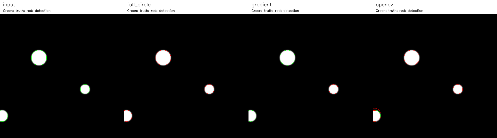

# S1-12 — Ví dụ tính tay và đối chiếu Hough thư viện

Phụ trách theo bảng phân công: Nguyễn Mạnh Tiến; phối hợp: Đinh Quang Hưng.
Căn cứ: `Giao_viec!A19:N19` trong
`Nhom_2_NASA24_Phan_cong_3_tuan.xlsx`. Tài liệu này thực hiện ví dụ 5×5,
mã kiểm chứng NumPy và đối chiếu thư viện; phần lý thuyết được tiếp tục ở
[S1-15](S1-15_LY_THUYET_HOUGH.md).

## 1. Chạy lại và đọc bằng chứng

Từ thư mục gốc, cần NumPy; phần đối chiếu và vẽ ảnh cần OpenCV đã có trong
`requirements.txt`:

```powershell
python -B scripts/verify_hough_examples.py --tiny-only
python -B scripts/verify_hough_examples.py
python -B -m unittest discover -s tests -p test_hough.py -v
```

Mã ở [verify_hough_examples.py](../scripts/verify_hough_examples.py).
Lệnh đầu in toàn bộ điểm biên, offset, tâm bỏ phiếu, chỉ số phẳng và ma trận
cộng dồn; tự kiểm chứng bằng `np.testing.assert_array_equal`, không ghi file.
Lệnh thứ hai lưu vào thư mục mới `outputs/s112_<UTC>/`:

| File | Nội dung |
|---|---|
| `report.json` | Vết tính 5×5, cấu hình đầy đủ, tất cả phát hiện, chênh lệch, phiên bản thư viện, commit và SHA-256 mã nguồn |
| `inputs.npz` | Ảnh gốc, ảnh xám uint8 chung, biên, theta, gx, gy |
| `comparison.csv` | Từng phát hiện và chênh lệch với tâm thật gần nhất |
| `comparison.png` | Ảnh chung và kết quả của ba cách phát hiện |

Bản chạy bàn giao: [JSON đầy đủ](evidence/S1-12_KET_QUA.json),
[CSV chênh lệch](evidence/S1-12_DOI_CHIEU.csv) và ảnh bên dưới.
Đây là dữ liệu giả lập có tâm/bán kính do script đặt, không phải nhãn NASA.

## 2. Quy ước và giới hạn ví dụ nhỏ

Mảng truy cập `edges[y,x]`, `accumulator[b,a]`; tọa độ ghi trong bảng là
`(x,y)` hoặc tâm `(a,b)`. Gốc ở góc trên trái, x sang phải, y xuống dưới.

API `detect_circles()` chỉ nhận `bool (512,512)`, bán kính nguyên 5–128 px.
Ví dụ 5×5 dưới đây dùng trực tiếp `_circle_offsets`, `_accumulate`,
`_local_peaks` và `_accumulate_gradient` từ **chính `src/hough.py`**.
Bán kính 1 và ngưỡng 3 chỉ dành cho minh họa các hàm nội bộ; không đưa chúng
vào API và không thay đổi hợp đồng của dự án.

Chọn bốn điểm biên P1=(2,1), P2=(1,2), P3=(3,2), P4=(2,3):

```text
E =                 x=0 1 2 3 4
y=0                   0 0 0 0 0
y=1                   0 0 1 0 0
y=2                   0 1 0 1 0
y=3                   0 0 1 0 0
y=4                   0 0 0 0 0
```

Cả bốn điểm cách tâm C=(2,2) đúng 1 px. Ví dụ P1:
`(2-2)²+(1-2)²=0+1=1=r²`.
`np.nonzero(E)` trả `ys=[1,2,2,3]`, `xs=[2,1,3,2]`;
code ép chúng thành `int32`.

## 3. Tính tay full-circle theo đúng các bước code

### Bước 1 — Tạo góc, làm tròn và loại trùng

Với r=1, bước góc mặc định 1°:
`angles=deg2rad(arange(0,360,1))`, có 360 góc và không có 360°.

Mỗi góc tạo `dx=rint(r*cos(phi))`, `dy=rint(r*sin(phi))`.
Ví dụ:

| phi | r cos(phi), r sin(phi) | Sau rint: (dx,dy) |
|---|---|---|
| 0° | (1,0) | (1,0) |
| 1° | (0,999848; 0,017452) | (1,0), trùng 0° |
| 45° | (0,707107; 0,707107) | (1,1) |
| 90° | (0,1) | (0,1) |
| 180° | (-1,0) | (-1,0) |
| 270° | (0,-1) | (0,-1) |

`np.unique(offsets,axis=0)` trong `_circle_offsets()` giữ đúng 8 offset,
theo thứ tự sắp xếp của NumPy:

```text
(-1,-1), (-1,0), (-1,1), (0,-1),
(0,1), (1,-1), (1,0), (1,1)
```

Mẫu số hỗ trợ là **8**, không phải 360. Offset đường chéo có độ dài √2
sau lượng tử hóa; đây là phép xấp xỉ lên lưới pixel của code, không phải
khẳng định điểm chéo nằm trên đường tròn liên tục r=1.
`np.rint` làm tròn tới số nguyên gần nhất, hòa nửa về số chẵn; tính lượng giác
dấu phẩy động cũng cần được giữ như trong code. Xem
[tài liệu NumPy rint](https://numpy.org/doc/stable/reference/generated/numpy.rint.html).

### Bước 2 — Tính tất cả tâm được bỏ phiếu

Với mỗi P=(x,y), code tính **a=x-dx; b=y-dy**.
Bảng dưới là toàn bộ 4×8=32 phép bỏ phiếu, mỗi ô nhận +1:

| Offset (dx,dy) | P1=(2,1) → (a,b) | P2=(1,2) → (a,b) | P3=(3,2) → (a,b) | P4=(2,3) → (a,b) |
|---|---|---|---|---|
| (-1,-1) | (3,2) | (2,3) | (4,3) | (3,4) |
| (-1,0) | (3,1) | (2,2) | (4,2) | (3,3) |
| (-1,1) | (3,0) | (2,1) | (4,1) | (3,2) |
| (0,-1) | (2,2) | (1,3) | (3,3) | (2,4) |
| (0,1) | (2,0) | (1,1) | (3,1) | (2,2) |
| (1,-1) | (1,2) | (0,3) | (2,3) | (1,4) |
| (1,0) | (1,1) | (0,2) | (2,2) | (1,3) |
| (1,1) | (1,0) | (0,1) | (2,1) | (1,2) |

Ví dụ ô P1 với offset (0,-1):
`a=2-0=2; b=1-(-1)=2` → `A[2,2]+=1`.
P2 với (-1,0): `a=1-(-1)=2; b=2-0=2` → cùng ô nhận phiếu thứ hai.
P3 với (1,0) và P4 với (0,1) đưa tổng phiếu của tâm lên 4.

### Bước 3 — Kiểm tra trong ảnh, trải phẳng và cộng phiếu

`inside=(0<=a<5)&(0<=b<5)`. Trong bảng trên, cả 32 tâm đều hợp lệ.
Nếu P=(0,0), offset=(1,0) thì a=-1, b=0: bỏ phiếu này bị loại,
không dùng chỉ số âm để vòng sang cột cuối.

`_accumulate()` khởi tạo 25 ô `int32` bằng 0; dùng chỉ số
`index=b*width+a=b*5+a`.
Tâm (2,2) có index=2×5+2=12. Bốn lần xuất hiện index 12 phải được cộng đủ.
`np.bincount(indices,minlength=25)` đếm số lần từng chỉ số xuất hiện,
sau đó `reshape((5,5))` đưa về ma trận. Xem
[tài liệu bincount](https://numpy.org/doc/stable/reference/generated/numpy.bincount.html).

Code bỏ phiếu theo lô `edge_batch_size`; lô chỉ giảm kích thước mảng tạm.
Script thử lô 1, 2 và 256, đều phải bằng ma trận tính tay.

### Bước 4 — Ma trận cộng dồn sau từng điểm

Khởi đầu A0 toàn 0. Cộng từng cột P1→P4 của bảng bỏ phiếu:

```text
A1 sau P1:       A2 sau P1+P2:
0 1 1 1 0       0 1 1 1 0
0 1 0 1 0       1 2 1 1 0
0 1 1 1 0       1 1 2 1 0
0 0 0 0 0       1 1 1 0 0
0 0 0 0 0       0 0 0 0 0

A3 sau P1+P2+P3: A4 sau cả 4 điểm:
0 1 1 1 0       0 1 1 1 0
1 2 2 2 1       1 2 2 2 1
1 1 3 1 1       1 2 4 2 1
1 1 2 1 1       1 2 2 2 1
0 0 0 0 0       0 1 1 1 0
```

Tổng A4 là 32 = 4 điểm × 8 offset; A4[2,2]=4.

### Bước 5 — Tính ngưỡng và lấy đỉnh 3×3

Cho ví dụ nhỏ `min_votes=3`, `min_vote_ratio=0.35`:
`threshold=max(3,ceil(0.35*8))=max(3,ceil(2.8))=3`.

Chỉ A[2,2]=4 vượt ngưỡng; tám ô kề đều bằng 2.
`_local_peaks(A,3)` trả **[[2,2]] theo (y,x)**.
Score=4/8=0,5. Đổi về tọa độ hình học: tâm (x,y)=(2,2), bán kính đã thử r=1.

Trong `_local_peaks`, tâm phải **lớn hơn** hàng xóm phía trên
(dy<0, gồm cả hai đường chéo) và bên trái cùng hàng; với phía dưới và bên phải
dùng **lớn hơn hoặc bằng**. Quy tắc này ưu tiên vị trí trên/trái khi hòa cục bộ.
Không gọi nó là chọn một đại diện cho mọi vùng plateau có hình dạng bất kỳ.

Nếu giữ **min_votes mặc định 12**, threshold=12 và **không có đỉnh**:
ma trận nhỏ không thể đạt 12 phiếu. Script cũng kiểm chứng tình huống này.

### Bước 6 — Xếp ứng viên và NMS

Ví dụ nhỏ chỉ có một ứng viên nên NMS giữ tâm (2,2), r=1.
Đây là suy diễn cho ví dụ nội bộ, không phải đầu ra API `detect_circles`.

Trong API, tuple ứng viên là `(score,votes,y,x,r)`; thứ tự ưu tiên:
score giảm → votes giảm → y tăng → x tăng → r tăng.
Một ứng viên bị loại khi **đồng thời**:
`(x-x_old)²+(y-y_old)² <= nms_center_px²` và
`abs(r-r_old) <= nms_radius_px`.

Ví dụ với mặc định 4 px và 2 px, đã giữ (350,310,20):
ứng viên (352,311,21) có d²=2²+1²=5≤16 và Δr=1≤2 nên bị loại.
(350,310,24) có d²=0 nhưng Δr=4>2 nên không bị loại bởi ứng viên đó.
NMS hiện tại cho phép vòng đồng tâm nếu bán kính khác đủ xa.

## 4. Tính tay nhánh gradient trên cùng ma trận

Giả định gradient lý tưởng hướng từ tâm ra ngoài:
`theta=atan2(y-2,x-2)`. Code chưa biết chiều sáng/tối nên xét cả hai dấu.

| Điểm | theta | (dx,dy)=rint(r cos theta, r sin theta) | (x-dx,y-dy) | (x+dx,y+dy) |
|---|---|---|---|---|
| (2,1) | -π/2 | (0,-1) | (2,2) | (2,0) |
| (1,2) | π | (-1,0) | (2,2) | (0,2) |
| (3,2) | 0 | (1,0) | (2,2) | (4,2) |
| (2,3) | π/2 | (0,1) | (2,2) | (2,4) |

Tổng 8 phiếu; ma trận của `_accumulate_gradient()` là:

```text
0 0 1 0 0
0 0 0 0 0
1 0 4 0 1
0 0 0 0 0
0 0 1 0 0
```

`support_size=ceil(2*pi*1)=7`, ngưỡng minh họa
`max(3,ceil(0.35*7))=3`, score tại tâm=4/7≈0,571429.
Đây là mẫu số ước lượng chu vi, không phải số hướng bỏ phiếu (2),
không phải 8 offset của full-circle và không phải xác suất đúng.

## 5. Đối chiếu thư viện trên cùng ảnh 512×512



Dùng ba đĩa sáng trong `scripts/demo_hough.py`: T1=(160,180,32),
T2=(350,310,20), T3=(8,420,24), vòng T3 cắt mép trái.
Làm trơn chung bằng Gaussian NumPy σ=1,5, kernel 11×11, reflect_101;
lượng tử `rint(255*smooth)` thành **một ảnh gray_u8 chung**.

Để đối chiếu gần cùng điều kiện đầu vào, script dựng lại Sobel 3×3
CV_16S, BORDER_REPLICATE và Canny low=50, high=100, L2gradient=False
theo [mã OpenCV 4.14.0](https://github.com/opencv/opencv/blob/4.14.0/modules/imgproc/src/hough.cpp).
NumPy nhận biên bool dựng lại (489 pixel) và theta từ chính gx/gy đó;
OpenCV nhận gray_u8 và chạy phần trích biên bên trong.
**Không đưa ảnh biên 0/255 vào HoughCircles rồi coi đó là cùng biên.**
Sự tương ứng này được đối chiếu với mã 4.14.0; nếu đổi phiên bản thư viện
cần kiểm tra lại, API không trả ra biên nội bộ để chứng minh đẳng thức trực tiếp.

Cả ba tìm r=18…36 px. NumPy dùng toàn bộ mặc định, chỉ đổi
`voting_method`; OpenCV dùng HOUGH_GRADIENT, dp=1, minDist=4,
param1=100, param2=12, minRadius=18, maxRadius=36.
param2 và min_votes cùng là 12 về số học nhưng **khác ý nghĩa thuật toán**:
không khẳng định ngưỡng tương đương hoặc cấu hình đã tối ưu độ chính xác.
Đây là cấu hình minh họa cố định sau thử chạy, chưa phải cấu hình đánh giá.

Kết quả trên Python 3.12.10, NumPy 2.5.3, OpenCV 4.14.0:

| Cách | Kết quả (x,y,r); phiếu nếu có |
|---|---|
| NumPy full_circle | (350,310,20): 136; (160,180,32): 188; (8,420,24): 83 |
| NumPy gradient | (350,310,20): 48 |
| OpenCV | (160,5;180,5;31,7), (350,5;310,5;19,6), (8,5;420,5;23,4), (6,5;415,5;28,5) |

Bộ ba trong hàng OpenCV dùng dấu chấm phẩy phân cách tọa độ để tránh nhầm
dấu phẩy thập phân. CSV/JSON giữ số dấu phẩy động gốc; không làm tròn chúng
trước khi tính chênh lệch.

| Phát hiện OpenCV | Tâm thật gần nhất | Δx | Δy | d tâm=√(Δx²+Δy²) | d sau khi trừ 0,5 | Δr |
|---|---|---:|---:|---:|---:|---:|
| (160.5,180.5,31.7) | T1 | +0.5 | +0.5 | 0.707107 | 0 | khoảng -0.3 |
| (350.5,310.5,19.6) | T2 | +0.5 | +0.5 | 0.707107 | 0 | khoảng -0.4 |
| (8.5,420.5,23.4) | T3 | +0.5 | +0.5 | 0.707107 | 0 | khoảng -0.6 |
| (6.5,415.5,28.5) | T3 | -1.5 | -4.5 | 4.743416 | 5.385165 | +4.5 |

**Với dp=1, Δx = Δy = +0,5 là độ lệch lượng tử hóa có hệ thống, không phải lỗi phát hiện.**
HOUGH_GRADIENT trả tâm của ô accumulator, tức `(chỉ số ô + 0,5) × dp`; tâm thật ở đây là
số nguyên nên với dp=1 mọi tâm lệch đúng +0,5. Kiểm tra độc lập (hình tròn đặc, 8 vị trí
và bán kính, `param1=100`, `param2=10`, `minDist=50`, r=10…40, OpenCV 5.0.0): dp=1 luôn
cho Δ=(+0,5; +0,5). Vì vậy cột "d sau khi trừ 0,5" mới là độ lệch tâm thật: ba phát hiện
đầu trùng tâm thật, còn phát hiện thứ tư lệch T3 khoảng 5,39 px. Hai phát hiện gần T3 cách
nhau √(2²+5²)≈5,39 px > minDist=4 nên OpenCV giữ cả hai.

Chỉ bù được khi dp=1: trừ 0,5 trước khi so với tâm nguyên của NumPy. Với dp>1, tâm bị
lượng tử theo ô dp×dp pixel nên **không có số bù cố định**: cùng thí nghiệm với dp=2 cho Δ
từ −3 đến +2 px (ví dụ tâm (100, 100) r=20 ra (99; 99)). CSV/JSON vẫn lưu giá trị gốc
OpenCV trả về.

Ví dụ hàng đầu: Δx=160,5−160=0,5; Δy=180,5−180=0,5;
d=√(0,25+0,25)=√0,5≈0,707107; Δr≈31,7−32=−0,3.
Ba phát hiện full-circle trùng các bộ tham số thật, nên các độ lệch bằng 0;
gradient chỉ trả vòng T2 trong cấu hình này.


Đối chiếu ngưỡng tại tâm thật của nhánh gradient cho thấy cụ thể vì sao chỉ
T2 được giữ (các số phiếu đọc từ accumulator trên cùng biên đã lưu):

| r | support=ceil(2πr) | Ngưỡng=max(12,ceil(0,35×support)) | Phiếu tại tâm thật | So sánh |
|---|---:|---:|---:|---|
| 20 | 126 | 45 | 48 | 48≥45, qua ngưỡng và là đỉnh |
| 32 | 202 | 71 | 40 | 40<71, không qua ngưỡng |
| 24 | 151 | 53 | 27 | 27<53, không qua ngưỡng |

Full-circle có support lần lượt 144,224,168 ở r=20,32,24; ngưỡng 51,79,59.
Các score là 136/144≈0,944444; 188/224≈0,839286; 83/168≈0,494048.
Vì vậy M1 là vòng r=20 dù vòng r=32 có nhiều phiếu tuyệt đối hơn:
code xếp **tỷ lệ phiếu trước**, không xếp chỉ theo tổng phiếu.

Việc gắn tâm thật **gần nhất** chỉ để mô tả độ lệch từng phát hiện;
nhiều dòng có thể cùng chỉ tới T3. Không ghép một-một, không đặt ngưỡng
TP/FP, không tính Precision/Recall và không coi vòng thiếu là đã tìm thấy.
Ảnh trống kiểm soát cho kết quả rỗng ở cả ba cách.

Lý do có thể khác: full-circle gom phiếu mọi hướng; gradient NumPy yêu cầu
phiếu hội tụ tại từng bán kính và phụ thuộc hướng Sobel; OpenCV tìm tâm rồi
ước lượng bán kính, có lượng tử hóa và loại gần tâm khác (độ lệch tâm 0,5 px
ở bảng trên là quy ước tâm ô, không thuộc nhóm lý do này).
Tâm bị cắt mép cũng mất hỗ trợ, trong khi mẫu số NumPy vẫn tính cả vòng.
Kết quả này không chứng minh cách nào tốt hơn trên ảnh NASA.
Thời gian từng lần chạy được lưu nhưng NumPy đo riêng Hough còn OpenCV gồm
Sobel/Canny nội bộ; không dùng các số này để xếp hạng tốc độ.

## 6. Checklist bàn giao S1-12

- Có ma trận 5×5, đủ 32 phép bỏ phiếu, bốn ma trận cộng dồn và công thức ngưỡng/đỉnh.
- Mã NumPy kiểm chứng cả ma trận, batching và nhánh gradient của hough.py.
- Đối chiếu trên ảnh chung và khoảng bán kính chung; ghi rõ điều kiện không tương đương.
- Lưu toàn bộ tham số, phiên bản, kết quả và chênh lệch, không áp ngưỡng độ chính xác.
- Phần lý thuyết/trích dẫn tiếp nối ở S1-15; nghiệm thu của nhóm là bước riêng.
