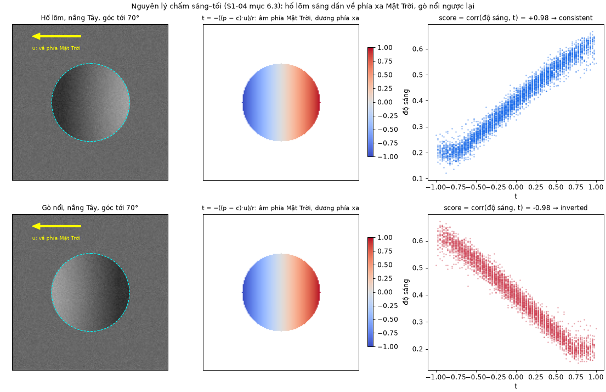
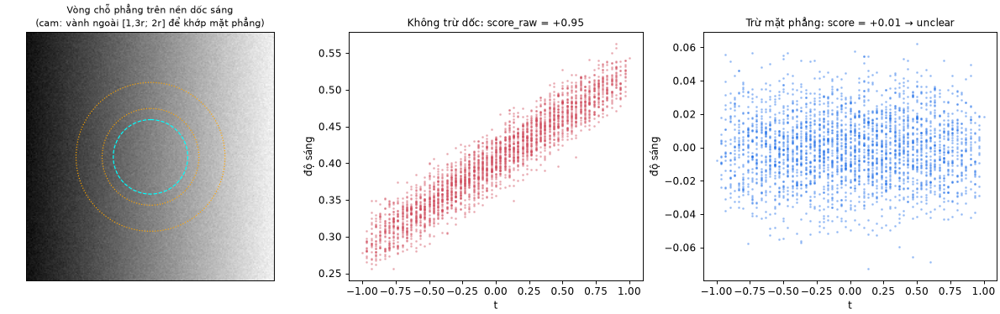
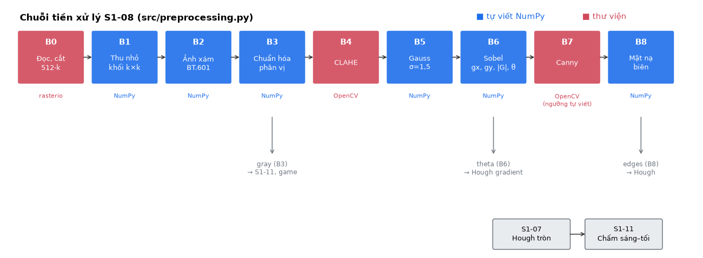
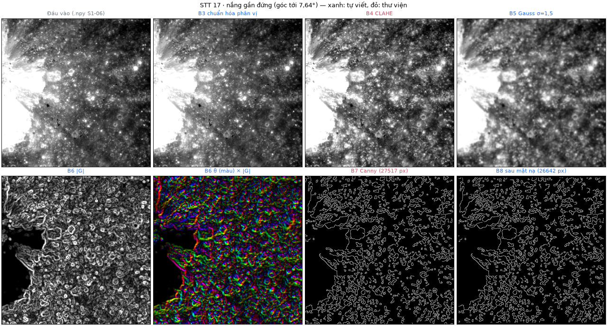
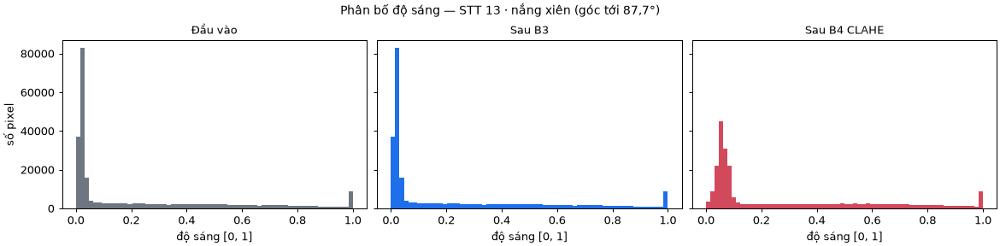
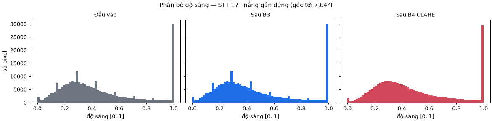

# S1-14 — Nháp Chương 2/3: Tiền xử lý ảnh và kiểm tra sáng–tối

> **Bản nháp S1-14** (Đinh Quang Hưng, 18/10/2026), chưa qua nhóm duyệt. Phụ thuộc S1-08 và S1-11.
> Nhánh `s1-14-chuong-2-3` tạo từ `main` (commit `029c76f`).
> - **Tiền xử lý** (mục 2.1, 3.2): mô tả đúng [src/preprocessing.py](../src/preprocessing.py) phiên bản `s108-2` trên `main`.
> - **Kiểm tra sáng–tối** (mục 2.3, 3.4): mô tả mã S1-11 phiên bản `s111-2` ở nhánh `s1-11-shading` (commit `6f1b5f0`), **chưa có trên `main`**, đang chờ gộp qua PR #12. Các đường dẫn tới `src/postprocessing.py` (bản đầy đủ), `docs/S1-11_SANG_TOI.md`, `data/s111_sun_checks.json` và `docs/evidence/s1-11/` chỉ hoạt động sau khi PR #12 được gộp. Nếu mã S1-11 thay đổi khi duyệt, cần đối chiếu lại mục 2.3 và 3.4.
>
> **Đánh số đề xuất** theo luồng xử lý: Chương 2 gồm **2.1 Tiền xử lý và trích biên** (S1-14), **2.2 Biến đổi Hough tròn** (S1-15; file S1-15 giữ nguyên số 2.1–2.9, khi ghép báo cáo các mục đó tương ứng 2.2.1–2.2.9), **2.3 Kiểm tra sáng–tối** (S1-14). Chương 3 gồm 3.1 Hợp đồng dữ liệu, **3.2 Cài đặt tiền xử lý** (S1-14), 3.3 Cài đặt Hough, **3.4 Cài đặt kiểm tra sáng–tối** (S1-14), 3.5 Giao diện và trò chơi. Nhóm chốt khi ghép báo cáo.
>
> Hình được tạo lại bằng `python scripts/s114_figures.py`; tham số thực tế của từng ảnh ở [docs/evidence/s1-14/](evidence/s1-14/).

---

# Chương 2. Cơ sở lý thuyết (phần S1-14)

## 2.1. Tiền xử lý ảnh và trích biên

### 2.1.1. Mục tiêu

Biến đổi Hough tròn (mục 2.2, S1-15) không làm việc trực tiếp trên ảnh xám mà trên **ảnh biên nhị phân**: mỗi pixel cho biết có thuộc đường biên hay không. Chất lượng ảnh biên quyết định chất lượng Hough. Nếu thiếu điểm biên trên vành hố, vòng tròn nhận ít phiếu. Nếu thừa điểm biên rác, Hough chạy chậm hơn và sinh nhiều ứng viên sai.

Bộ ảnh của đề tài có ba khó khăn chính [1][2]:
- Định dạng khác nhau (TIF 8 bit, PDS 16 bit, số thực).
- Góc tới của Mặt Trời trải từ 7,64° đến 87,78°: có ảnh gần như phẳng màu, có ảnh nửa sáng nửa tối.
- Nhiễu cảm biến và kết cấu hạt của lớp bụi regolith.

Chuỗi tiền xử lý đưa mọi ảnh về cùng một thang, tăng tương phản cục bộ, giảm nhiễu, rồi trích biên. Mỗi bước dưới đây nêu công thức và lý do chọn. Phần cài đặt và tham số nằm ở mục 3.2.

Quy ước dùng chung: ảnh xử lý có kích thước 512 × 512 px; x là cột (tăng sang phải), y là hàng (tăng xuống dưới), gốc ở góc trên trái; giá trị pixel là số thực trong [0, 1]. Pixel không có dữ liệu được đánh dấu bằng mặt nạ hợp lệ V (V = 1 là hợp lệ), không dùng NaN [2].

### 2.1.2. Thu nhỏ bằng trung bình khối

Ô cắt từ ảnh nguồn có cạnh 512·k px, với k nguyên ≥ 1. Ảnh 512 × 512 thu được bằng cách lấy trung bình mỗi khối k × k:

$$I'(x, y) = \frac{1}{k^2}\sum_{i=0}^{k-1}\sum_{j=0}^{k-1} I(kx + i,\; ky + j)$$

Khối chứa bất kỳ pixel không hợp lệ nào thì pixel kết quả cũng không hợp lệ: $V'(x, y) = \bigwedge_{i,j} V(kx+i, ky+j)$.

Dùng k nguyên nên phép thu nhỏ chỉ là phép lấy trung bình, không cần nội suy. Tỷ lệ ảnh sau thu nhỏ là $s = s_{\text{nguồn}} \cdot k$ (m/px). Đổi tọa độ về ảnh nguồn: $x_{\text{nguồn}} = x_0 + kx + (k-1)/2$ [2].

### 2.1.3. Ảnh xám

Cả 20 nguồn ảnh đều là ảnh toàn sắc một kênh, nên bước này thường chỉ kiểm tra số kênh. Ảnh ba kênh (ví dụ ảnh xem trước PNG) được đổi sang độ sáng theo chuẩn ITU-R BT.601 [3]:

$$Y = 0{,}299\,R + 0{,}587\,G + 0{,}114\,B$$

### 2.1.4. Chuẩn hóa theo phân vị

Gọi $P_{lo}$, $P_{hi}$ là phân vị 0,5 % và 99,5 % của độ sáng trên các pixel hợp lệ. Ảnh chuẩn hóa là:

$$I_N = \operatorname{clip}\!\left(\frac{I - P_{lo}}{P_{hi} - P_{lo}},\; 0,\; 1\right)$$

Dùng phân vị thay cho min/max để vài pixel bão hòa (đỉnh núi chói nắng) hoặc pixel chết không quyết định cả thang. Sau bước này, các ngưỡng phía sau (clipLimit, ngưỡng Canny) có cùng ý nghĩa trên mọi ảnh, dù ảnh gốc là 8 bit, 16 bit hay số thực.

Trường hợp đặc biệt: nếu $P_{hi} = P_{lo}$ nhưng ảnh vẫn có biến thiên (vật thể nhỏ trên nền phẳng chiếm hơn 99 % pixel), dùng min/max của pixel hợp lệ để không xóa mất vật thể. Ảnh thật sự phẳng trả về ảnh 0.

### 2.1.5. Tăng tương phản cục bộ CLAHE

**Vì sao cần.** Cân bằng histogram toàn cục sẽ làm vùng bóng bão hòa đen và khuếch đại nhiễu ở vùng biển (mare) phẳng. CLAHE (Contrast Limited Adaptive Histogram Equalization) [4][11] khắc phục bằng bốn ý:

1. **Chia ảnh thành lưới ô** (8 × 8 ô, mỗi ô 64 × 64 px) và tính histogram riêng cho từng ô.
2. **Cắt ngọn histogram** ở ngưỡng β. Một bin cao nghĩa là vùng phẳng màu; nếu không cắt, phép cân bằng sẽ kéo giãn vùng đó và khuếch đại nhiễu.
3. **Phân bổ lại** phần bị cắt đều cho mọi bin, rồi lấy hàm phân bố tích lũy làm hàm ánh xạ độ sáng của ô.
4. **Nội suy song tuyến** giữa ánh xạ của bốn ô lân cận để không lộ ranh giới ô.

**Ngưỡng cắt.** Trong cài đặt OpenCV dùng ở đây [5], ngưỡng cắt mỗi bin là:

$$\beta = \max\!\left(1,\; \frac{\text{clipLimit} \times N_{\text{ô}}}{N_{\text{bin}}}\right)$$

với $N_{\text{ô}}$ là số pixel một ô và $N_{\text{bin}}$ là số mức xám. Với ảnh 8 bit ($N_{\text{bin}} = 256$), ô 64 × 64 và clipLimit = 2 thì β = 32: clipLimit có tác dụng đúng như mong muốn. Với ảnh 16 bit ($N_{\text{bin}} = 65536$) thì $2 \times 4096 / 65536 < 1$, nên β luôn bằng 1 bất kể clipLimit. Vì lý do này nhóm chạy CLAHE trên ảnh 8 bit, khác với đặc tả ban đầu S1-04 (ghi 16 bit); chi tiết và số đo ở mục 3.2.6.

**Thứ tự CLAHE trước Gauss.** CLAHE khuếch đại cả nhiễu, nên đặt làm trơn Gauss ngay sau để dập phần nhiễu vừa bị khuếch đại trước khi tính gradient [1].

### 2.1.6. Làm trơn Gauss

Kernel Gauss một chiều với bán kính $R = \lceil 3\sigma \rceil$:

$$g(i) = \frac{\exp\!\left(-\dfrac{i^2}{2\sigma^2}\right)}{\displaystyle\sum_{j=-R}^{R}\exp\!\left(-\dfrac{j^2}{2\sigma^2}\right)}, \qquad i = -R, \dots, R$$

Kernel hai chiều tách được thành tích hai kernel một chiều: $G(i, j) = g(i)\,g(j)$. Vì vậy chỉ cần lọc theo hàng rồi theo cột:

$$I_S = (I * g_x) * g_y$$

Chi phí giảm từ $(2R+1)^2$ xuống $2(2R+1)$ phép nhân mỗi pixel. Với σ = 1,5 (R = 5, kernel 11) là 121 so với 22. Ở biên ảnh dùng phản chiếu không lặp pixel mép (kiểu `BORDER_REFLECT_101` của OpenCV), để đối chiếu được với thư viện.

**Chọn σ = 1,5.** Đủ để xóa vân hạt regolith và nhiễu cảm biến, nhưng vẫn giữ $\sigma \le r_{\min}/3 = 5/3 \approx 1{,}67$ để vành của hố nhỏ nhất (r = 5 px) không bị mờ mất [1]. Không dùng lọc trung vị vì đó là phép phi tuyến, chạy chậm khi viết bằng NumPy, và lý thuyết Canny giả định làm trơn bằng Gauss [6].

### 2.1.7. Gradient Sobel

$$K_x = \begin{bmatrix}-1 & 0 & 1\\-2 & 0 & 2\\-1 & 0 & 1\end{bmatrix} = \begin{bmatrix}1\\2\\1\end{bmatrix}\!\begin{bmatrix}-1 & 0 & 1\end{bmatrix}, \qquad K_y = K_x^{\mathsf T}$$

$$g_x = I_S \star K_x,\quad g_y = I_S \star K_y,\quad |G| = \sqrt{g_x^2 + g_y^2},\quad \theta = \operatorname{atan2}(g_y, g_x)$$

($\star$ là phép tương quan.) Với quy ước trục ảnh, $g_x > 0$ khi ảnh sáng dần sang phải, $g_y > 0$ khi sáng dần xuống dưới. Kernel cũng tách được thành hai lượt một chiều như Gauss.

Kernel **không chia cho 8**, để $|G| \cdot 255$ cùng thang với gradient mà OpenCV tính bên trong Canny trên ảnh 8 bit. Nhờ vậy ngưỡng tự động ở mục 2.1.8 tính từ $|G|$ dùng được trực tiếp cho Canny. Hướng θ được Hough dùng khi bỏ phiếu theo hướng gradient (mục 2.2, S1-15: phần "Dẫn xuất nhánh gradient").

### 2.1.8. Biên Canny

Canny [6] cho ảnh biên tốt hơn việc chỉ đặt ngưỡng $|G|$ nhờ hai bước:
- **Triệt tiêu điểm không cực đại (NMS):** chỉ giữ pixel có $|G|$ lớn nhất theo hướng θ so với hai pixel lân cận cùng hướng, nên biên mảnh còn 1 px.
- **Ngưỡng kép có nối biên (hysteresis):** pixel có $|G| \ge T_{high}$ là biên chắc chắn; pixel có $T_{low} \le |G| < T_{high}$ chỉ được giữ nếu nối liền với biên chắc chắn. Vành hố nhờ vậy liền mạch hơn mà ít điểm rác.

**Ngưỡng tự động.** Độ tương phản giữa các ảnh chênh nhau nhiều theo góc tới, nên ngưỡng cố định sẽ hỏng ở một số ảnh. Ngưỡng được co giãn theo từng ảnh:

$$T_{high} = P_{90}\!\left(|G| \cdot 255\right)\ \text{trên vùng hợp lệ đã co lề}, \qquad T_{low} = 0{,}4\, T_{high}$$

Nếu nền phẳng chiếm hơn 90 % ảnh (khi đó $P_{90} = 0$), phân vị được tính trên các pixel có gradient dương. Hai hệ số 90 và 0,4 là tham số sẽ chỉnh ở S2-15.

### 2.1.9. Mặt nạ biên

Đường ghép mosaic, khoảng trống và hiệu ứng ở mép ảnh của Gauss/CLAHE đều tạo biên thẳng giả. Biên thẳng dài vẫn góp phiếu cho nhiều vòng tròn. Vì vậy bỏ mọi điểm biên nằm trong lề m px tính từ mép ảnh và từ vùng không hợp lệ. Đây là phép co (erosion) mặt nạ hợp lệ bằng phần tử cấu trúc vuông cạnh $2m + 1$:

$$E_{\text{cuối}}(x, y) = E(x, y) \wedge \bigwedge_{|i| \le m,\ |j| \le m} V(x+i, y+j)$$

Ngoài ảnh coi là không hợp lệ. Lề $m = \max(6,\ R + 1)$: Gauss làm một pixel nodata ảnh hưởng tới R px xung quanh, Sobel thêm 1 px. Với σ = 1,5 thì m = 6.

---

## 2.2. Biến đổi Hough tròn

*Phần của S1-15 (Nguyễn Mạnh Tiến), xem [S1-15_LY_THUYET_HOUGH.md](S1-15_LY_THUYET_HOUGH.md). Trong file đó các mục đang đánh số 2.1–2.9; khi ghép báo cáo, mục 2.k của S1-15 trở thành 2.2.k ở đây (ví dụ "2.3. Dẫn xuất nhánh gradient" thành 2.2.3). Nháp này tham chiếu phần Hough theo tên mục, không theo số, nên không phụ thuộc việc đánh số lại.*

---

## 2.3. Kiểm tra sáng–tối theo hướng nắng

### 2.3.1. Cơ sở vật lý

Hough chỉ dựa vào hình dạng biên, nên không phân biệt được hố lõm với gò nổi, tảng đá hay một vòng tròn tình cờ khớp các biên rời rạc. Ánh sáng cho thêm một căn cứ độc lập. Hố là chỗ lõm, nên khi nắng chiếu xiên [1]:
- thành hố **phía gần Mặt Trời** quay lưng với nắng và bị chính mép hố che, nên **tối**;
- thành hố **phía xa Mặt Trời** hướng về nắng, nên **sáng**.

Gò nổi cho quy luật ngược lại. Một vòng đặt vào chỗ không có hố thì không có quy luật nào.



*Hình 2.3.1. Cảnh giả lập có đáp án: hố lõm và gò nổi cùng bán kính, nắng từ phía Tây, góc tới 70°. Cột giữa là bản đồ t, cột phải là độ sáng theo t.*

### 2.3.2. Hướng nắng trong hệ tọa độ ảnh

Metadata ghi phương vị Mặt Trời A, đo theo chiều kim đồng hồ từ hướng Bắc, và góc của hướng Bắc trong ảnh `north_angle_deg` [2]. Góc của hướng nắng trong ảnh, đo theo chiều kim đồng hồ từ hướng "lên", là φ = A + `north_angle_deg`. Vector đơn vị chỉ về phía Mặt Trời trong hệ tọa độ ảnh (x sang phải, y xuống dưới):

$$\mathbf{u} = (\sin\varphi,\; -\cos\varphi)$$

Kiểm tra: φ = 0° cho (0, −1), tức hướng lên; φ = 270° (nắng từ phía Tây, ảnh Bắc lên trên) cho (−1, 0), tức sang trái.

### 2.3.3. Điểm sáng–tối

Với ứng viên tâm $\mathbf{c} = (x_c, y_c)$, bán kính r, xét các pixel hợp lệ $\mathbf{p}$ trong đĩa $\|\mathbf{p} - \mathbf{c}\| \le r$. Vị trí chuẩn hóa của mỗi pixel dọc hướng **ra xa** Mặt Trời là:

$$t(\mathbf{p}) = -\frac{(\mathbf{p} - \mathbf{c}) \cdot \mathbf{u}}{r} \in [-1, 1]$$

t âm ở nửa phía Mặt Trời, t dương ở nửa phía xa. **Điểm sáng–tối** là hệ số tương quan Pearson giữa độ sáng I và t:

$$S = \frac{\sum (I_k - \bar I)(t_k - \bar t)}{\sqrt{\sum (I_k - \bar I)^2}\,\sqrt{\sum (t_k - \bar t)^2}} \in [-1, 1]$$

- S > 0: sáng dần về phía xa Mặt Trời, khớp với hố lõm.
- S < 0: ngược lại, khớp với gò nổi hoặc vòng sai.
- S ≈ 0: không có quy luật.

Chọn hệ số tương quan vì nó **không phụ thuộc độ sáng và độ tương phản chung** của ảnh: nhân hoặc cộng I với một hằng số không làm đổi S. Nhờ đó cùng một ngưỡng dùng được cho ảnh nắng đứng tương phản thấp lẫn ảnh nắng xiên tương phản cao.

### 2.3.4. Trừ độ dốc địa hình

Nếu ứng viên nằm trên một sườn dốc mà độ sáng tăng đều theo một hướng, S sẽ khác 0 dù không có hố. Trên cảnh giả lập, chỉ cần độ dốc sáng 0,001/px là một vòng chỗ phẳng đã bị chấm S = +0,48 hoặc −0,50.

Để loại ảnh hưởng này, khớp một **mặt phẳng độ sáng** bằng bình phương tối thiểu trên vành khuyên ngoài $1{,}3r < \|\mathbf{p} - \mathbf{c}\| \le 2r$. Vành bắt đầu từ 1,3r để bỏ qua phần vành nổi của hố:

$$\min_{a,b,c}\ \sum_{\mathbf{p} \in \text{vành}} \left[ I(\mathbf{p}) - \left(a + b\,\frac{x - x_c}{r} + c\,\frac{y - y_c}{r}\right) \right]^2$$

Sau đó trừ mặt phẳng khỏi pixel trong đĩa rồi mới tính S như mục 2.3.3.



*Hình 2.3.2. Vòng chỗ phẳng trên nền dốc sáng: không trừ dốc thì S = +0,95 ("hợp", sai); trừ mặt phẳng thì S = +0,01.*

**Quy tắc hai cách phải cùng nhãn.** Mặt phẳng không mô tả được mép bóng sắc (một bậc độ sáng). Khi mép bóng lớn nằm sát vòng, vành ngoài cắt qua mép bóng, mặt phẳng khớp ra một "độ dốc" lớn không có thật, và việc trừ đi lại **tạo ra** quy luật giả bên trong đĩa: trên cảnh giả lập, S sau trừ dốc là +0,90 trong khi S trên ảnh gốc là −0,01. Vì vậy điểm được tính cả hai cách ($S$ sau trừ dốc và $S_{raw}$ trên ảnh gốc), và chỉ kết luận khi hai cách cho cùng nhãn.

### 2.3.5. Phân loại

Với ngưỡng τ:

| Điều kiện | Nhãn | Ý nghĩa |
|---|---|---|
| S ≥ τ và $S_{raw}$ ≥ τ | `consistent` (hợp) | Sáng–tối khớp với hố lõm |
| S ≤ −τ và $S_{raw}$ ≤ −τ | `inverted` (ngược) | Sáng–tối ngược: gò nổi, mép bóng trong vòng, hoặc vòng sai |
| Còn lại | `unclear` (không rõ) | Không có quy luật, hoặc kết quả do địa hình quyết định |

τ = 0,15 khi phương vị đo bằng số (`measured`), τ = 0,25 khi chỉ biết Đông/Tây (`side_only`).

Lý do nới ngưỡng cho `side_only`: nếu phương vị thật lệch Δ so với giá trị quy ước (90° hoặc 270°), phần tương phản đo được dọc **u** giảm khoảng cos Δ, nhưng dấu của S vẫn đúng chừng nào Δ < 90°. Nghĩa là `side_only` vẫn đủ để phân biệt hợp/ngược, nhưng độ lớn S kém tin cậy hơn.

### 2.3.6. Khi nào hướng nắng đủ căn cứ

Ghi nhầm hướng nắng sẽ **đảo ngược mọi kết luận**: trên cảnh giả lập, chỉ cần đổi Tây thành Đông là cả ba hố thật bị chấm "ngược". Vì vậy một ảnh chỉ được chấm khi đạt đủ ba điều kiện:

1. **Hướng nắng có nguồn:** metadata ghi `measured` hoặc `side_only` kèm phương vị lấy từ trang sản phẩm, hoặc phía nắng ứng viên đã được xác nhận bằng mắt.
2. **Góc tới ≥ 30°:** nắng gần đứng thì bóng quá ngắn, mép sáng–tối của hố yếu [1]. Ngưỡng 30° là đề xuất ban đầu.
3. **Đã kiểm tra bằng mắt trên hố tham chiếu** [1]: chọn hố rõ, vẽ vector **u** lên ảnh, nhìn xem phía tối có nằm về phía **u** không. Bước này đồng thời kiểm tra `north_up`: ảnh bị lật cũng làm mọi kết luận đảo ngược. Hố tham chiếu không được dùng làm ví dụ đánh giá, để tránh lập luận vòng tròn.

Ảnh không đạt thì mọi ứng viên được ghi `not_checked` kèm lý do. Ứng viên vẫn được giữ, không bị coi là sai.

---

# Chương 3. Thiết kế và cài đặt (phần S1-14)

## 3.2. Cài đặt chuỗi tiền xử lý

### 3.2.1. Sơ đồ các bước



*Hình 3.2.1. Chuỗi B0–B8 trong `src/preprocessing.py`. Xanh: tự viết bằng NumPy; đỏ: dùng thư viện.*

```text
Ảnh nguồn LROC ──B0 đọc, cắt 512·k──► B1 thu nhỏ k×k ──► B2 ảnh xám ──► B3 chuẩn hóa phân vị ──► gray
     ──► B4 CLAHE ──► B5 Gauss ──► B6 Sobel (gx, gy, |G|, θ) ──► B7 Canny ──► B8 mặt nạ biên ──► edges
                                                   │ θ                                            │
                                                   ▼                                              ▼
                                           Hough (bỏ phiếu theo gradient)                Hough (S1-07)
gray ──► S1-11 kiểm tra sáng–tối; giao diện trò chơi
```

Hàm `preprocess(image, metadata, params, valid_mask)` chạy nối tiếp B1→B8 và trả một dict gồm `gray` (B3), `enhanced` (B4), `smooth` (B5), `gx`, `gy`, `mag`, `theta` (B6), `edges_canny` (B7), `edges` (B8), `valid_mask` và `params` (toàn bộ tham số đã dùng cùng các giá trị tính ra). Ảnh trung gian là float32 512 × 512; `edges` và `valid_mask` là bool [2].

### 3.2.2. Phần tự viết và phần dùng thư viện

| Bước | Thao tác | Cài đặt | Hàm |
|---|---|---|---|
| B0 | Đọc file, cắt cửa sổ 512·k, đọc mặt nạ nodata | **Thư viện** rasterio (GDAL) | `read_window` |
| B1 | Thu nhỏ trung bình khối k × k | **Tự viết** NumPy | `block_mean` |
| B2 | Ảnh xám BT.601 | **Tự viết** NumPy | `to_gray` |
| B3 | Chuẩn hóa phân vị; min/max khi hai phân vị bằng nhau | **Tự viết** NumPy | `normalize_percentile`, `normalization_bounds` |
| B4 | CLAHE | **Thư viện** OpenCV `createCLAHE` | `clahe` |
| B5 | Gauss tách hai chiều | **Tự viết** NumPy | `gaussian_kernel`, `gaussian_blur`, `correlate_1d` |
| B6 | Sobel 3 × 3, \|G\|, θ | **Tự viết** NumPy | `sobel` |
| B7 | Canny (NMS + ngưỡng kép) | **Thư viện** OpenCV `Canny`; **ngưỡng tự động tự viết** | `canny`, `canny_thresholds` |
| B8 | Co mặt nạ hợp lệ, bỏ biên trong lề | **Tự viết** NumPy | `erode`, `mask_edges` |

"Tự viết" nghĩa là chỉ dùng phép toán mảng của NumPy (cộng, nhân, cắt lát, `np.pad`, `np.percentile`), không gọi hàm lọc ảnh dựng sẵn. Phép nhân chập của B5 và B6 dùng chung hàm `correlate_1d`: đệm ảnh bằng `np.pad(mode="reflect")` (tương đương `BORDER_REFLECT_101`), rồi cộng dồn các lát cắt dịch chuyển nhân trọng số, tính trong float64 để sai số làm tròn nhỏ. OpenCV chỉ được gọi trong B4, B7 và trong bộ kiểm thử để đối chiếu.

Hai bước dùng thư viện vì phần cài đặt dài và không phải trọng tâm đề tài (CLAHE cần nội suy song tuyến giữa các ô; Canny cần NMS theo hướng và nối biên), nhưng báo cáo vẫn giải thích nguyên lý ở mục 2.1.5 và 2.1.8.

### 3.2.3. Tham số

Tham số mặc định nằm trong [configs/default.json](../configs/default.json) và `DEFAULT_PARAMS` của `src/preprocessing.py`. Đây là **giá trị ban đầu**; tham số cuối cùng chọn trên tập điều chỉnh và khóa ở S2-15.

| Tham số | Giá trị | Bước | Lý do |
|---|---|---|---|
| `p_lo`, `p_hi` | 0,5 ; 99,5 (%) | B3 | Bỏ 0,5 % pixel tối nhất và sáng nhất khi đặt thang |
| `clahe_clip` | 2,0 | B4 | Giá trị thường dùng làm điểm xuất phát |
| `clahe_grid` | 8 | B4 | Lưới 8 × 8, mỗi ô 64 × 64 px, đủ lớn để histogram cục bộ có ý nghĩa |
| `clahe_bits` | 8 | B4 | Để clipLimit có tác dụng (mục 2.1.5); khác S1-04 |
| `gauss_sigma` | 1,5 | B5 | σ ≤ r_min/3 |
| `gauss_kernel_size` | 11 | B5 | 2⌈3σ⌉ + 1 |
| `border_mode` | `reflect_101` | B5, B6 | Khớp mặc định OpenCV để đối chiếu |
| `canny_high_pct` | 90 | B7 | $T_{high}$ = P90 của \|G\|·255 |
| `canny_low_ratio` | 0,4 | B7 | $T_{low}$ = 0,4 · $T_{high}$ |
| Khẩu độ Sobel trong Canny, `L2gradient` | 3 ; True | B7 | Cùng thang với \|G\| tự tính ở B6 |
| `edge_margin_px` | 6 | B8 | max(6, R + 1); tự tăng nếu tăng kernel Gauss |

Mỗi lần chạy, `params` ghi lại cả tham số đặt vào lẫn giá trị tính ra: $P_{lo}$, $P_{hi}$, chiến lược chuẩn hóa, $T_{low}$, $T_{high}$, chiến lược ngưỡng, lề thực tế, tỷ lệ pixel hợp lệ, số pixel biên trước và sau mặt nạ.

### 3.2.4. Ảnh trước/sau

Hai ảnh thật đại diện hai điều kiện chiếu sáng cực đoan theo S1-04 mục 9: nắng rất xiên và nắng gần đứng.


*Hình 3.2.2. STT 13 (`moon_ap16_m132732855l_c01`), nắng Tây, góc tới 87,7°: bóng đổ dài, một nửa ảnh chìm trong bóng.*



*Hình 3.2.3. STT 17 (`moon_ap16_m109134835l_c01`), góc tới 7,64°: nắng gần đứng, hố có tương phản yếu.*




*Hình 3.2.4. Phân bố độ sáng trước và sau B3, B4. CLAHE làm phân bố trơn hơn và trải rộng hơn. Cột cao ở mức 1,0 là pixel đã bão hòa sẵn trong ảnh nguồn (mục 3.2.7).*

Giá trị tính ra trên hai ảnh (file đầy đủ: [docs/evidence/s1-14/](evidence/s1-14/)):

| Đại lượng | STT 13 (87,7°) | STT 17 (7,64°) |
|---|---|---|
| $P_{lo}$ ; $P_{hi}$ sau B3 | 0,0 ; 1,0 | 0,0 ; 1,0 |
| $T_{low}$ ; $T_{high}$ của Canny | 63,6 ; 159,0 | 46,3 ; 115,8 |
| Lề biên thực tế | 6 px | 6 px |
| Tỷ lệ pixel hợp lệ | 100 % | 100 % |
| Pixel biên sau B7 → sau B8 | 25 203 → 24 291 | 27 517 → 26 642 |

Ngưỡng Canny của ảnh nắng đứng thấp hơn khoảng 27 % so với ảnh nắng xiên: ngưỡng tự động đã co theo độ tương phản của từng ảnh như thiết kế. Số pixel biên vẫn ở mức khoảng 9–10 % diện tích ảnh, phần lớn là biên kết cấu chứ không phải vành hố (mục 3.2.7).

### 3.2.5. Kiểm chứng phần tự viết

So sánh với hàm OpenCV tương ứng (S1-04 mục 9), đo trên ảnh thật STT 13 và trong bộ kiểm thử `tests/test_preprocessing.py`:

| Phần tự viết | Đối chiếu với | Sai khác tuyệt đối lớn nhất trên STT 13 | Tiêu chí |
|---|---|---|---|
| Thu nhỏ khối, k = 2 | `cv2.resize(INTER_AREA)` | 6,0·10⁻⁸ | < 10⁻⁵ |
| Gauss σ = 1,5, kernel 11 | `cv2.GaussianBlur(BORDER_REFLECT_101)` | 1,8·10⁻⁷ | < 10⁻⁵ |
| Sobel gx ; gy | `cv2.Sobel(ksize=3, CV_32F)` | 1,2·10⁻⁷ ; 3,6·10⁻⁷ | < 10⁻⁵ |

Bộ kiểm thử còn kiểm tra chuẩn hóa phân vị trên ma trận tính tay, hệ số ảnh xám, dấu gradient, lề mặt nạ quanh mép và quanh nodata, cùng các trường hợp biên (ảnh phẳng, ảnh toàn nodata, tham số sai). `tests/test_preprocessing.py` có 33 bài; toàn bộ 158 bài kiểm thử của repo trên `main` (commit `029c76f`) đều đạt. Nhánh S1-11 có 181 bài, cũng đều đạt.

### 3.2.6. Điểm khác đặc tả S1-04

**CLAHE chạy trên ảnh 8 bit thay vì 16 bit.** Đo trên vùng phẳng có nhiễu (độ lệch chuẩn ban đầu 0,020):

| clipLimit | Độ lệch chuẩn sau CLAHE, 16 bit | 8 bit |
|---|---|---|
| 1 | 0,188 | 0,038 |
| 2 | 0,188 | 0,056 |
| 4 | 0,188 | 0,090 |

Với 16 bit, clipLimit không có tác dụng và nhiễu bị khuếch đại khoảng 9 lần. Việc lượng tử về 8 bit ảnh hưởng không đáng kể tới các bước sau: hướng gradient ở các điểm biên mạnh lệch trung vị 0,05–0,08°, biên Canny trùng 93–96 %. Phương án 16 bit vẫn chạy được (`clahe_bits = 16`) để so sánh.

### 3.2.7. Hạn chế ban đầu

- **Biên kết cấu nhiều.** Ngưỡng P90 giả định khoảng 10 % pixel là biên mạnh. Trên vùng gồ ghề của STT 13 và STT 17, Canny giữ nhiều biên kết cấu ngoài vành hố (Hình 3.2.2, 3.2.3), nên Hough nhận nhiều phiếu rác. Cả 26 ảnh đều chạm trần 100 ứng viên [7]. Cần chỉnh `canny_high_pct` và `gauss_sigma` ở S2-15.
- **B3 gần như không có tác dụng trên ảnh S1-06.** Ảnh `.npy` do S1-06 bàn giao đã được chuẩn hóa phân vị cùng công thức, nên B3 cho $P_{lo}$ = 0, $P_{hi}$ = 1. Kết quả không sai, nhưng bước này bị làm hai lần; khi dùng ảnh nguồn TIF trực tiếp thì B3 mới thật sự tác động.
- **Pixel bão hòa trong ảnh nguồn.** 11,1 % pixel của STT 17 và 3,2 % của STT 13 đã ở mức 255 trong ảnh browse 8 bit. Vùng sáng chói này không còn thông tin chi tiết, và không bước tiền xử lý nào khôi phục được. Ảnh browse LROC chỉ dùng để minh họa xử lý ảnh, không dùng để đo quang học [8].
- **Bóng đổ dài ở ảnh nắng rất xiên.** Mép bóng có gradient rất mạnh, trong khi vành phía sáng mờ hơn. Hough có thể bám vào mép bóng thay vì vành hố. Tiền xử lý không phân biệt được hai loại biên này; mục 3.4 dùng kiểm tra sáng–tối để đánh dấu các trường hợp này.
- **Nắng gần đứng.** Vành hố ở STT 17 có tương phản yếu. CLAHE tăng được một phần nhưng cũng làm nổi nhiễu.
- **B8 không phát hiện đường ghép mosaic** nằm giữa vùng hợp lệ; S1-06 phải tránh khi cắt ảnh.

### 3.2.8. Cách chạy

```bash
python scripts/run_preprocessing.py --input data/processed/<image_id>.npy --metadata data/processed/<image_id>.json
python scripts/run_preprocessing.py --input <ảnh> --metadata <json> --set gauss_sigma=2.0 canny_high_pct=95
python scripts/s114_figures.py        # tạo lại hình của tài liệu này
```

Mỗi lần chạy lưu thư mục riêng `outputs/<run_id>/` gồm ảnh từng bước, `params.json`, `metadata.json` và `run.json` (mã commit, SHA-256 file đầu vào). Hướng dẫn chi tiết ở [TIEN_XU_LY.md](TIEN_XU_LY.md).

---

## 3.4. Cài đặt kiểm tra sáng–tối

### 3.4.1. Luồng xử lý

```text
ứng viên Hough (x, y, r, votes) + gray (B3) + valid_mask + metadata
        │
        ▼
resolve_sun(metadata, phiếu kiểm tra)  ── không đạt 3 điều kiện mục 2.3.6 ──► mọi vòng: not_checked + lý do, ghi log
        │ đạt: phương vị A, mức tin cậy (measured / side_only)
        ▼
u = sun_vector(A, north_angle_deg)
        │
        ▼  với từng vòng
score_one: S_raw trên ảnh gốc; S sau trừ mặt phẳng vành [1,3r; 2r]; phân loại; khác nhãn → unclear
        │
        ▼
vòng giữ nguyên các trường + shading = {status, score, score_raw, reason}
```

Mã nằm trong [src/postprocessing.py](../src/postprocessing.py), toàn bộ tự viết bằng NumPy. Mặt phẳng được khớp bằng `np.linalg.lstsq`. `pipeline.py` (S1-13) gọi bước này qua `filter_candidates()`. **S1-11 chỉ chấm, không xóa vòng nào**: số vòng vào bằng số vòng ra. Ngưỡng loại bỏ để S2-02 quyết định khi có số liệu.

### 3.4.2. Tham số

| Tham số | Giá trị | Ý nghĩa |
|---|---|---|
| `min_incidence_deg` | 30 | Góc tới tối thiểu (mục 2.3.6) |
| `require_visual_check` | True | Bắt buộc có kết quả kiểm tra bằng mắt |
| `score_threshold` ; `score_threshold_side_only` | 0,15 ; 0,25 | τ khi phương vị đo bằng số ; khi chỉ biết Đông/Tây |
| `annulus_inner` ; `annulus_outer` | 1,3 ; 2,0 | Vành ngoài để khớp mặt phẳng, tính theo r |
| `min_pixels` ; `min_valid_fraction` | 30 ; 0,8 | Đĩa phải đủ pixel và có ít nhất 80 % nằm trong ảnh và hợp lệ |
| `min_annulus_pixels` ; `min_annulus_fraction` | 30 ; 0,5 | Vành ngoài phải còn ít nhất nửa trong ảnh và hợp lệ |

### 3.4.3. Kiểm tra hướng nắng bằng mắt

`scripts/s111_sun_check_sheet.py` tạo phiếu kiểm tra cho mỗi ảnh có hướng nắng và góc tới ≥ 30°. Phiếu gồm ảnh toàn cảnh có mũi tên chỉ về phía Mặt Trời và các hố tham chiếu phóng to. Ban đầu hố tham chiếu là các ứng viên Hough nhiều phiếu nhất; số phiếu không dùng độ sáng hai nửa hố nên không gây lập luận vòng tròn. Khi các ứng viên này không rõ, người kiểm tra tự chọn hố (`manual_craters`). Kết quả lưu ở [data/s111_sun_checks.json](../data/s111_sun_checks.json), ảnh phiếu ở [docs/evidence/s1-11/](evidence/s1-11/).

Ngày 18/10/2026, 8/8 ảnh Apollo 16 được kiểm tra đều cho kết quả `consistent`. Riêng ba ảnh nắng Đông (STT 11, 15, 16), trước đây phía Đông chỉ suy từ dấu góc tới [9], nay được xác nhận qua bước này.

### 3.4.4. Kết quả trên bộ 26 ảnh

| Nhóm ảnh | Số ảnh | Kết quả |
|---|---|---|
| STT 8, 9, 13, 14, 18 (nắng Tây, góc tới 80–88°) | 5 | Được chấm (`side_only` 270°) |
| STT 11, 15, 16 (nắng Đông, góc tới 42–65°) | 3 | Được chấm (`side_only` 90°, phía Đông xác nhận bằng mắt) |
| STT 10 (28,38°), STT 17 (7,64°, 2 ảnh) | 3 | Không chấm: góc tới < 30° |
| Mosaic STT 1–6 | 15 | Không chấm: trang nguồn không ghi hướng nắng |

Số vòng theo nhãn trên 8 ảnh được chấm, mỗi ảnh 100 ứng viên Hough:

| Ảnh | Hợp | Ngược | Không rõ |
|---|---|---|---|
| STT 8 | 26 | 26 | 48 |
| STT 9 | 27 | 24 | 49 |
| STT 11 | 31 | 25 | 44 |
| STT 13 | 28 | 25 | 47 |
| STT 14 | 28 | 24 | 48 |
| STT 15 | 28 | 18 | 54 |
| STT 16 | 17 | 27 | 56 |
| STT 18 | 24 | 22 | 54 |

Bảng đầy đủ kèm lý do từng ảnh: [docs/evidence/s1-11/s111_tong_hop.csv](evidence/s1-11/s111_tong_hop.csv).

### 3.4.5. Ví dụ hố đúng và ứng viên sai

Trên STT 13, sau khi loại 9 vòng trùng hố tham chiếu, 4 vòng điểm cao nhất và 4 vòng điểm thấp nhất được đối chiếu bằng mắt ([examples.png](evidence/s1-11/vi_du_stt13/examples.png)):

| Vòng | Máy chấm | Nhìn bằng mắt |
|---|---|---|
| M9 | hợp (+0,75) | Hố thật: tối phía Tây, vành sáng hình lưỡi liềm phía Đông |
| M11, M3, M66 | hợp (+0,69 đến +0,74) | Không phải hố, chỉ là địa hình gồ ghề |
| M51, M92, M71, M60 | ngược (−0,72 đến −0,79) | Không phải hố: mép bóng, ranh giới bóng, địa hình nhiễu |

Kiểm thử trên cảnh giả lập có đáp án (`tests/test_postprocessing.py`, 23 bài):

| Trường hợp | S_raw | S sau trừ dốc | Nhãn |
|---|---|---|---|
| 3 hố lõm, góc tới 40° / 70° / 87° | +0,89 đến +0,98 | +0,89 đến +0,98 | hợp |
| Gò nổi, góc tới 40° / 70° / 87° | −0,89 đến −0,98 | −0,89 đến −0,98 | ngược |
| Vòng chỗ phẳng | −0,01 | −0,03 | không rõ |
| Vòng chỗ phẳng trên dốc ±0,001/px | ±0,5 | −0,03 | không rõ |
| Mép bóng sát mép vòng | −0,01 | +0,90 | không rõ (hai cách khác nhãn) |

### 3.4.6. Hạn chế ban đầu

- **Nhãn "hợp" không khẳng định là hố.** 3/4 vòng điểm cao nhất của STT 13 không phải hố. Thả 500 vòng ngẫu nhiên lên STT 8, 13, 18 thì 11–16 % được chấm "hợp" (vòng Hough: 24–28 %). Địa hình gồ ghề đôi khi tình cờ có quy luật sáng–tối giống hố. Nhãn "ngược" đáng tin hơn: cả 4 vòng điểm thấp nhất đều không phải hố. Vì vậy S1-11 phù hợp để **loại bớt ứng viên sai**, không phù hợp làm đáp án chấm người chơi.
- **Chỉ 8/26 ảnh có hướng nắng đủ tin cậy.** 15 mosaic không có hướng nắng; nếu cần, có thể tính phương vị từ tọa độ điểm dưới Mặt Trời trong nhãn PDS của ảnh thành phần.
- **STT 16 cần xem lại.** Đây là ảnh duy nhất có số vòng ngược (27) nhiều hơn hợp (17), và cũng là ảnh có căn cứ kiểm tra bằng mắt yếu nhất (một hố lớn và một hố nhỏ). Chưa đủ để kết luận phía Đông sai.
- **Mép bóng cắt qua bên trong vòng** vẫn bị chấm "ngược". Nhãn này đúng về hướng, nhưng không phân biệt được với gò nổi.
- **Vành ngoài chứa hố lân cận** có thể kéo lệch mặt phẳng trừ dốc.
- **Kiểm tra bằng mắt mang tính chủ quan** và gắn với ô cắt hiện tại; nếu S1-06 cắt lại ảnh mà giữ nguyên `image_id` thì phải kiểm tra lại.
- Các ngưỡng 0,15, 0,25, 30° và vành [1,3r; 2r] là giá trị ban đầu, cần chỉnh trên tập điều chỉnh (S2-02).

---

## Tài liệu tham khảo của phần này

[1] Nhóm 2, *S1-04 — Đặc tả tiền xử lý và dữ liệu đầu vào*, `docs/S1-04_Dac_ta_tien_xu_ly.docx` (mục 4, 6, 8, 9, 10).
[2] Nhóm 2, *Định dạng dữ liệu*, `docs/DINH_DANG_DU_LIEU.md`; *Bàn giao bộ ảnh S1-06*, `docs/S1-06_HUONG_DAN_DU_LIEU.md`.
[3] ITU-R Recommendation BT.601, *Studio encoding parameters of digital television for standard 4:3 and wide-screen 16:9 aspect ratios*.
[4] Zuiderveld, K. (1994). Contrast Limited Adaptive Histogram Equalization. Trong P. S. Heckbert (Ed.), *Graphics Gems IV* (tr. 474–485). Academic Press. ISBN 0-12-336155-9. *(Thông tin trích dẫn khớp ở hai nguồn độc lập; nội dung bốn ý ở mục 2.1.5 mới đối chiếu qua tài liệu thứ cấp [11], chưa đọc bản gốc.)*
[5] OpenCV, *Histograms – 2: Histogram Equalization* (CLAHE), https://docs.opencv.org/4.x/d5/daf/tutorial_py_histogram_equalization.html; mã nguồn `createCLAHE` của OpenCV.
[6] Canny, J. (1986). A Computational Approach to Edge Detection. *IEEE Transactions on Pattern Analysis and Machine Intelligence*, PAMI-8(6), 679–698. DOI 10.1109/TPAMI.1986.4767851.
[7] Nhóm 2, *Chạy từ đầu đến cuối S1-13*, `docs/S1-13_CHAY_TU_DAU_DEN_CUOI.md`, `docs/evidence/s1-13/e2e_26_anh.csv`.
[8] LROC, *RDR Software Interface Specification*, mục 3.2, https://pds.lroc.im-ldi.com/data/LRO-L-LROC-5-RDR-V1.0/LROLRC_2001/DOCUMENT/RDRSIS.PDF.
[9] Nhóm 2, *S1-02 — Bảng 20 ảnh nguồn*, `docs/S1-02_Bang_20_anh_nguon (1).docx` (mục 5).
[10] Nhóm 2, *Tiền xử lý S1-08*, `docs/TIEN_XU_LY.md`; *Kiểm tra sáng–tối S1-11*, `docs/S1-11_SANG_TOI.md`.
[11] MathWorks, *adapthisteq — Contrast-limited adaptive histogram equalization (CLAHE)*, https://www.mathworks.com/help/images/ref/adapthisteq.html (mô tả chia ô, giới hạn tương phản và nội suy song tuyến giữa các ô; trích dẫn Zuiderveld 1994).

> Trước khi nộp cần: đọc bản gốc [4] (sách *Graphics Gems IV*, thư viện) để xác nhận bốn ý ở mục 2.1.5 và nhà xuất bản trên trang bìa; đổi số mục theo cấu trúc nhóm chốt; cập nhật số liệu nếu S2-15 thay tham số.
