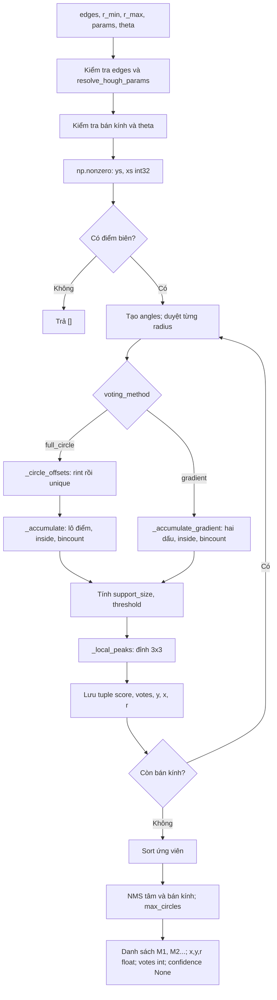

# S1-15 — Nháp Chương 2: Hough tròn và ví dụ minh họa

Phụ trách theo phân công: Nguyễn Mạnh Tiến; phối hợp: Đinh Quang Hưng.
Căn cứ: `Giao_viec!A22:N22` trong bảng XLSX; phụ thuộc S1-03 và S1-12.
Bản nháp ngày 14/10/2026, đối chiếu với [hough.py](../src/hough.py).
Kết quả thực nghiệm nhỏ được thực hiện trước tại
[S1-12](S1-12_VI_DU_VA_DOI_CHIEU_HOUGH.md); danh mục nguồn và mức đã đọc nằm ở
[TAI_LIEU_THAM_KHAO_HOUGH.md](TAI_LIEU_THAM_KHAO_HOUGH.md).

## 2.1. Bài toán và ý tưởng không gian tham số

Đầu vào là ảnh biên E: mỗi pixel cho biết có thuộc đường biên hay không.
Ta cần đề xuất những bộ (a,b,r) mô tả vành tròn; a là cột tâm,
b là hàng tâm, r là bán kính, tất cả theo pixel ảnh đã xử lý.
Một pixel riêng lẻ không xác định được một đường tròn. Nhiều pixel
thuộc cùng vành có thể cùng ủng hộ một bộ tham số; đỉnh của bảng tích lũy
là cách tìm sự hội tụ đó.

Đây là ứng dụng của ý tưởng chuyển phát hiện đường cong sang tìm đỉnh
trong không gian tham số, tham khảo Duda–Hart
([bản ghi NASA NTRS](https://ntrs.nasa.gov/citations/19720033498)).
Các biến thể tìm đường tròn đã được Yuen và cộng sự so sánh trên những bộ
ảnh riêng của họ; không lấy kết quả đó làm kết quả dự án
([bài báo, thông tin và abstract](https://www.sciencedirect.com/science/article/pii/026288569090059E)).

Hough trả **ứng viên hình học**. Một vành gần tròn có thể là hố hoặc cấu trúc
khác. Trong dự án, tiền xử lý nằm ở S1-08; kiểm tra sáng–tối/lọc ứng viên và
đánh giá trên nhãn thật là các bước riêng.

## 2.2. Dẫn xuất công thức full-circle

### Từ phương trình hình học đến tâm khả dĩ

Đường tròn tâm C=(a,b), bán kính r>0 thỏa:

$$
(x-a)^2+(y-b)^2=r^2.
$$

Chia hai vế cho r², đặt u=(x-a)/r và v=(y-b)/r,
ta có u²+v²=1. Do đó có thể tham số hóa u=cos φ, v=sin φ:

$$
x-a=r\cos\varphi,\qquad y-b=r\sin\varphi.
$$

Chuyển vế để tìm tâm:

$$
a=x-r\cos\varphi,\qquad b=y-r\sin\varphi,
\quad 0\leq\varphi<2\pi.
$$

Với một điểm biên P và r cố định, tập các tâm khả dĩ cũng là một
đường tròn bán kính r quanh P. Điểm biên trên cùng một vành thật có một tâm
khả dĩ chung. Duyệt nhiều r tạo không gian tham số (a,b,r).
Ký hiệu toán học A(a,b,r), nhưng mảng trong code dùng **A_r[b,a]**.

### Rời rạc hóa đúng như hough.py

Code tạo các góc φk từ `np.arange(0,360,angle_step_deg)`, đổi sang radian.
Với từng r, tạo tập offset duy nhất:

$$
\mathcal{D}_r=\operatorname{unique}\left\{
(\operatorname{rint}(r\cos\varphi_k),
 \operatorname{rint}(r\sin\varphi_k))\right\}.
$$

Cho mỗi điểm E[y,x]=True và mỗi (dx,dy)∈D_r,
bỏ phiếu tại a=x−dx, b=y−dy nếu tâm còn nằm trong ảnh:

$$
A_r[b,a]=\sum_{(x,y)\in E}\sum_{(d_x,d_y)\in\mathcal{D}_r}
\mathbf{1}[a=x-d_x\ \land\ b=y-d_y].
$$

Chỉ cộng các a,b hợp lệ. Hàm `_circle_offsets` làm tròn **offset trước**
rồi `_accumulate` trừ offset nguyên khỏi tọa độ nguyên.
Không đổi thành một công thức làm tròn cuối tùy ý: quy tắc hòa nửa
về số chẵn của rint có thể làm cách tính khác nhau ở giá trị đúng nửa.
Tham khảo [NumPy rint](https://numpy.org/doc/stable/reference/generated/numpy.rint.html).

Loại trùng offset tránh một điểm biên bỏ nhiều phiếu vào cùng tâm chỉ vì
nhiều góc rơi vào một pixel. Số hướng mẫu T và số offset S_r=|D_r| khác nhau.
Bước góc thưa có thể bỏ qua offset hữu ích; bước quá nhỏ làm tăng chi phí,
nhưng không tăng phiếu tại offset đã được khử trùng.

## 2.3. Dẫn xuất nhánh gradient

Đặt F(x,y)=(x−a)²+(y−b)²−r².
Gradient hình học ∇F=(2(x−a),2(y−b)) vuông góc tiếp tuyến của đường tròn.
Nếu gradient mức xám cũng gần pháp tuyến vành, hướng đơn vị
n=(cos θ,sin θ), θ=atan2(gy,gx), cho hai giả thuyết tâm:

$$
(a,b)=(x,y)-r\mathbf{n}
\quad\text{hoặc}\quad
(a,b)=(x,y)+r\mathbf{n}.
$$

Cần hai dấu vì chưa biết chiều chuyển sáng–tối. θ là **hướng gradient
tại điểm biên**; φ ở full-circle là **góc đang quét để thử tâm**.
Không đồng nhất hai đại lượng trong phần cài đặt.

`_accumulate_gradient` lấy theta tại (ys,xs), làm tròn dx,dy,
ghép cả `xs-dx, xs+dx` và `ys-dy, ys+dy`, lọc tâm ngoài ảnh,
rồi dùng bincount. Mỗi điểm biên sinh tối đa hai phiếu hợp lệ cho mỗi r.
Nhánh này không quét các góc φ và không dùng edge_batch_size.

Gradient thật trên hố có thể hướng theo mép bóng, kết cấu hoặc địa hình,
không hướng qua tâm. Ví dụ S1-12 ghi nhận nhánh gradient bỏ hai vòng với
cấu hình mặc định dù full-circle vẫn giữ chúng.
Đó là quan sát của bộ ảnh giả lập này, không phải kết luận tổng quát.

Tiền xử lý dự án tính gx/gy bằng Sobel và trích biên Canny; nền tảng biên
được tham khảo từ Canny (1986), thông tin thư mục có ở
[trang tác giả](https://people.eecs.berkeley.edu/~jfc/papers/papers.html).
Bản nháp chưa tái hiện dẫn xuất bộ lọc tối ưu trong bài báo đó.
Chi tiết B0–B8 xem [TIEN_XU_LY.md](TIEN_XU_LY.md).

## 2.4. Ngưỡng, score, đỉnh cục bộ và khử trùng

Mỗi bán kính có số hỗ trợ:

$$
S_r=
\begin{cases}
|\mathcal{D}_r|,&\text{full-circle},\\
\lceil 2\pi r\rceil,&\text{gradient}.
\end{cases}
$$

Ngưỡng τ_r=max(min_votes,ceil(min_vote_ratio×S_r)).
Ô có phiếu ≥τ_r mới được xét cực đại 3×3.
Score dùng để xếp hạng là A_r[b,a]/S_r.

Với full-circle, trên vành số hóa đúng theo bộ offset, một tâm có thể nhận
S_r phiếu. Với gradient, S_r chỉ ước lượng chu vi: score không được bảo đảm
≤1 trên mọi kiểu biên số hóa/dày. Code không kẹp score về [0,1].
Trong cả hai cách, đây **không phải xác suất**; đầu ra đặt confidence=None.

Cực đại 3×3 của `_local_peaks` so sánh > với hàng xóm phía trên và
bên trái cùng hàng, ≥ với phía dưới và bên phải. Mảng được đệm −1 nên
ô mép vẫn được xét. Đây là chọn đỉnh trong một mặt phẳng bán kính;
chưa phải cực đại 3 chiều qua r.

Sau khi thu đỉnh của mọi r, code xếp tuple (score,votes,y,x,r)
theo score giảm, votes giảm, rồi y,x,r tăng.
NMS giữ ứng viên theo thứ tự này; loại ứng viên gần một vòng đã giữ khi:

$$
(a-a_j)^2+(b-b_j)^2\leq d_{\rm NMS}^2
\quad\land\quad |r-r_j|\leq\delta r_{\rm NMS}.
$$

Phải thỏa **cả hai** điều kiện. Dừng khi giữ max_circles ứng viên.
Khoảng tâm trước khi bình phương được chặn ở H+W nhằm tránh tràn với
tham số hữu hạn rất lớn; mọi khoảng cách tâm trong ảnh đều nhỏ hơn H+W
nên quyết định NMS vẫn được giữ nguyên.

## 2.5. Ví dụ phiếu bầu và dẫn về mã kiểm chứng

S1-12 dùng E 5×5 có bốn điểm (2,1),(1,2),(3,2),(2,3), r=1.
Theo đúng góc 1° và khử trùng trong code, D_1 có 8 offset.
Ví dụ P1=(2,1), offset=(0,−1):

1. a=2−0=2, b=1−(−1)=2.
2. Tâm trong ảnh: 0≤2<5 ở cả hai chiều.
3. Chỉ số phẳng i=b×5+a=2×5+2=12.
4. Bincount cộng một phiếu vào i=12, tương ứng A[2,2].

P2 với offset (−1,0), P3 với (1,0), P4 với (0,1)
cùng đưa phiếu về (2,2): tổng 4 phiếu.
Tất cả 32 phép bỏ phiếu được liệt kê và cộng dồn ở
[S1-12 mục 3](S1-12_VI_DU_VA_DOI_CHIEU_HOUGH.md#3-tính-tay-full-circle-theo-đúng-các-bước-code).
Ma trận cuối:

```text
0 1 1 1 0
1 2 2 2 1
1 2 4 2 1
1 2 2 2 1
0 1 1 1 0
```

Cho ngưỡng minh họa min_votes=3 và ratio=0,35:
τ=max(3,ceil(0,35×8))=3; tâm có 4 phiếu, láng giềng có 2;
score=4/8=0,5; tâm=(2,2), r=1.
Nếu giữ min_votes=12 mặc định thì không có đỉnh.

Ví dụ gradient cũng được tính đủ hai dấu cho từng điểm ở S1-12 mục 4:
tâm nhận 4 phiếu, bốn ô ngoài nhận mỗi ô 1 phiếu;
support=ceil(2π)=7, score=4/7.
Các kết quả này được kiểm chứng bởi
[`tiny_example()`](../scripts/verify_hough_examples.py).
Ví dụ dùng hàm nội bộ, không gọi API 512×512 với bán kính 1.

## 2.6. Các bước hoạt động của hough.py

Sơ đồ thể hiện các lời gọi thật, không thêm tiền xử lý vào detect_circles:



| Thứ tự | Hàm/đoạn mã | Điều code thực hiện |
|---|---|---|
| 1 | `detect_circles`: đầu hàm | Chuyển edges bằng asarray; yêu cầu đúng shape (512,512), dtype bool |
| 2 | `resolve_hough_params` | Nhận dict Hough hoặc config có khóa hough; ghép DEFAULT_PARAMS; từ chối khóa lạ/sai kiểu/phạm vi |
| 3 | Kiểm tra r_min/r_max | Số nguyên, không nhận bool; giới hạn cấu hình nằm trong 5–128 và r_min≤r_max |
| 4 | Kiểm tra theta | Nếu có: cùng shape, dtype số thực/nguyên, hữu hạn tại điểm biên; gradient thiếu theta báo lỗi kể cả biên rỗng |
| 5 | `np.nonzero` | Trả ys,xs theo hàng; ép int32; không có biên thì trả [] sau kiểm tra đầu vào |
| 6 | `angles`, vòng `range` | Góc [0,360); r chạy từ min tới max với radius_step_px; max chỉ được thử nếu nằm trên bước đó |
| 7 | `_circle_offsets` / `_accumulate` | Full-circle: làm tròn, khử trùng; bỏ phiếu theo lô; index=y×W+x |
| 8 | `_accumulate_gradient` | Nhánh thay thế: lấy theta tại biên, bỏ phiếu hai đầu pháp tuyến |
| 9 | `threshold`, `_local_peaks` | Ngưỡng phụ thuộc support của phương pháp; chọn cực đại từng mặt phẳng r |
| 10 | `candidates.sort` | Xếp theo score/votes, tie y/x/r; không chỉ chọn votes lớn nhất |
| 11 | Vòng `selected` | NMS với cả khoảng tâm và khoảng r; giới hạn số kết quả |
| 12 | `return` | Mã M1… theo thứ tự sau NMS; x,y,r float, votes int, confidence None |

Vì r chạy bằng range(min,max+1,step), ví dụ min=18,max=23,step=2
chỉ thử 18,20,22. Nếu có theta trong full-circle, code vẫn kiểm tra
định dạng nhưng không dùng nó để bỏ phiếu. Giá trị theta ngoài biên có thể
NaN; code chỉ yêu cầu hữu hạn tại pixel biên.

### Tham số mặc định đang có trong mã

| Tham số | Giá trị | Vai trò |
|---|---:|---|
| voting_method | full_circle | Cách bỏ phiếu; gradient cần theta |
| radius_step_px | 1 | Bước bán kính nguyên |
| r_min_limit_px / r_max_limit_px | 5 / 128 | Giới hạn bán kính API |
| angle_step_deg | 1,0 | Bước góc full-circle, cho phép 0,1–10° |
| min_votes | 12 | Ngưỡng phiếu tối thiểu |
| min_vote_ratio | 0,35 | Phần hỗ trợ dùng tính ngưỡng |
| nms_center_px | 4,0 | Khoảng cách tâm NMS |
| nms_radius_px | 2 | Khoảng bán kính NMS, cho phép 0 |
| max_circles | 100 | Số vòng giữ tối đa |
| edge_batch_size | 256 | Số điểm mỗi lô full-circle |

### Giả mã bám cài đặt

```text
validate edges, resolve params, validate radii and theta
ys, xs <- nonzero(edges); if empty return []
angles <- degrees 0 .. <360 converted to radians
candidates <- []
for r in range(r_min, r_max+1, radius_step):
    if full_circle:
        offsets <- unique(rint(r*cos(angles)), rint(r*sin(angles)))
        S <- number of offsets
        A <- accumulate batched centers from edges and offsets
    else:
        S <- ceil(2*pi*r)
        A <- accumulate two gradient-normal centers per edge
    threshold <- max(min_votes, ceil(ratio*S))
    for (y,x) in local_peaks_3x3(A, threshold):
        append (A[y,x]/S, A[y,x], y, x, r)
sort candidates by (-score, -votes, y, x, r)
selected <- []
for candidate in candidates:
    if no selected circle satisfies BOTH center/radius proximity:
        append candidate
        if count(selected) >= max_circles: break
return selected as circle dictionaries
```

## 2.7. Đối chiếu thư viện và cách đọc kết quả

OpenCV HoughCircles dùng ảnh xám; biến thể HOUGH_GRADIENT tìm tâm và ước lượng
bán kính theo quy trình riêng. Xem
[tài liệu OpenCV](https://docs.opencv.org/4.x/d4/d70/tutorial_hough_circle.html).
Không thể đồng nhất mọi tham số của OpenCV với bộ ngưỡng của NumPy.

Tham số của `cv2.HoughCircles(..., cv2.HOUGH_GRADIENT, dp, minDist, param1, param2, minRadius, maxRadius)`:

| Tham số | Ý nghĩa |
|---|---|
| `dp` | Tỉ lệ nghịch độ phân giải accumulator so với ảnh. dp=1: cùng độ phân giải; dp=2: accumulator bằng nửa ảnh. |
| `minDist` | Khoảng cách tối thiểu (px) giữa hai tâm được trả về; tâm gần hơn bị loại. |
| `param1` | Ngưỡng cao của Canny bên trong; ngưỡng thấp bằng `param1/2`. |
| `param2` | Ngưỡng tích lũy tại tâm: càng nhỏ càng nhiều vòng (kể cả vòng giả). |
| `minRadius`, `maxRadius` | Khoảng bán kính tìm kiếm (px). |

Tâm trả về là tâm ô accumulator: `(chỉ số ô + 0,5) × dp`. Với dp=1, một hố tâm
nguyên (x, y) được trả về (x+0,5, y+0,5); trừ 0,5 trước khi so với tâm nguyên của
NumPy. Với dp>1, sai số lượng tử theo ô dp×dp nên không bù bằng một hằng số
(thử với dp=2: lệch từ −3 đến +2 px, xem S1-12).

S1-12 đã lưu ảnh chung, gx/gy, biên dựng lại theo mã OpenCV 4.14.0,
cấu hình, thời gian, phiên bản và mọi phát hiện.
Với r=18…36: full-circle trả 3 vòng, gradient NumPy 1 vòng, OpenCV 4 vòng.
Sau khi trừ quy ước tâm ô 0,5 px, ba vòng OpenCV trùng tâm thật; bán kính
lệch dưới 1 px, và có thêm một vòng gần T3 (lệch 5,39 px, lớn hơn minDist=4 nên
không bị loại). Không xóa vòng này để làm bảng kết quả đẹp hơn.
Các độ lệch và cách tính nằm ở
[S1-12 mục 5](S1-12_VI_DU_VA_DOI_CHIEU_HOUGH.md#5-đối-chiếu-thư-viện-trên-cùng-ảnh-512512).

Scikit-image cung cấp API Hough nhận ảnh biên và tập bán kính, phù hợp cho
một thí nghiệm bổ sung về accumulator; phần này **chỉ tham khảo tài liệu,
chưa chạy**, không ghi là kết quả đối chiếu đã có.
Xem [API hough_circle](https://scikit-image.org/docs/stable/api/skimage.transform.html#skimage.transform.hough_circle).
Thí nghiệm đã bàn giao sử dụng OpenCV có sẵn trong dự án.

## 2.8. Chi phí của cài đặt hiện tại

Đặt N=H×W; E là số điểm biên; R số bán kính thực sự thử;
T số mẫu góc; S=max S_r của full-circle; B=edge_batch_size;
C tổng ứng viên trước NMS; K≤max_circles số ứng viên được giữ.

Phần bỏ phiếu hình học trực tiếp full-circle tốn O(R×E×S),
thường được mô tả thô là O(R×E×T).
Tuy nhiên, code thật gọi bincount với minlength=N **trong từng lô**.
Mỗi lô phải tạo/cộng một mảng dài N; vì thế ước lượng đầy đủ hơn là:

$$
O\left(R[T\log T+ES+\lceil E/B\rceil N+N]+C\log C+CK\right).
$$

T log T mô tả khử trùng offset bằng sắp xếp; N gồm dò đỉnh.
Gradient dùng một bincount cho mỗi r, nên phần chính là
O(R(E+N)+C log C+CK); vẫn có chi phí quét ảnh/lấy biên và tạo angles ban đầu.
NMS so với vòng đã giữ, tối đa K phép so sánh mỗi ứng viên.
Đây là phân tích từ mã, chưa phải phép đo tỷ lệ thời gian trên dữ liệu NASA.

Code không giữ khối accumulator N×R. Bộ nhớ full-circle gồm
mảng A, vùng đệm tìm đỉnh/bincount O(N), tọa độ biên O(E),
mảng tạm lô O(min(E,B)×S), offsets/góc và danh sách ứng viên O(C).
Tổng cỡ O(N+E+min(E,B)S+T+C); gradient cỡ O(N+E+T+C).
**Không nói toàn bộ bộ nhớ luôn chỉ O(N)**: danh sách C vẫn gom qua mọi r.
Riêng A int32 cho 512×512 là 512×512×4=1.048.576 byte = 1 MiB.
Nếu giữ đủ 124 mặt phẳng r=5…128, riêng khối A sẽ là 124 MiB.

## 2.9. Hạn chế và phạm vi bản nháp

Vành bị đứt/mất ở mép nhận ít phiếu nhưng vẫn chia cho hỗ trợ cả vòng.
Ảnh biên dày/nhiễu tạo đỉnh giả; bóng và địa hình có thể lệch hướng gradient.
Bước r/góc và lượng tử hóa ảnh hưởng tâm/r ước lượng.
NMS hiện tại không loại mọi vòng đồng tâm; score chưa hiệu chuẩn.
Cần thử tham số trên tập điều chỉnh riêng trước đánh giá trên nhãn thật.

Bản nháp có dẫn xuất, ví dụ tính tay, mô tả mã, giả mã và phân tích chi phí.
Bảng nguồn theo dõi **12 nguồn, trong đó 3 bài DOI**, phân biệt thuật toán,
dữ liệu và kiến thức khoa học. Với bài chỉ đọc metadata/abstract, trạng thái
vẫn ghi đúng mức đó; cần bổ sung đọc toàn văn khi hoàn thiện báo cáo.
Kết quả ở đây đáp ứng phạm vi nháp S1-15, chưa thay cho nghiệm thu của nhóm.
