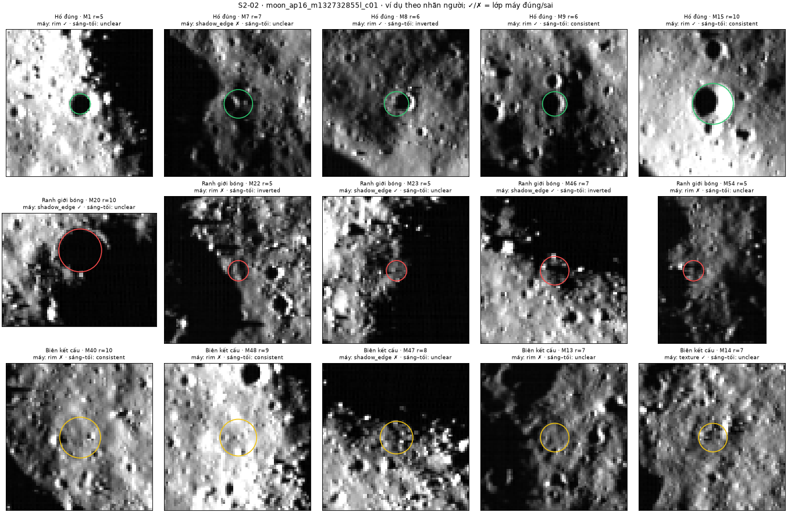

# S2-02 — Rà tiền xử lý/biên và kiểm tra ứng viên theo sáng–tối

Phụ trách: Đinh Quang Hưng · Phụ thuộc: S1-11 (đã gộp, PR #12) · Kiểm chéo nhãn: Hoàng Quốc Anh (23/10/2026)
Mã: [src/postprocessing.py](../src/postprocessing.py) phần S2-02 (phiên bản `s202-1`), [scripts/s202_review.py](../scripts/s202_review.py), [scripts/s202_experiments.py](../scripts/s202_experiments.py). Minh chứng: [docs/evidence/s2-02/](evidence/s2-02/).

**Tóm tắt.** Trên ảnh lỗi STT 13, có 100 ứng viên Hough nhưng chỉ 8 là hố thật (theo nhãn đã kiểm chéo). Bộ rà mới xếp mỗi ứng viên vào một trong ba lớp: vành hố, ranh giới bóng đổ, biên kết cấu. **Lọc bỏ lớp "biên kết cấu" loại được 48 ứng viên sai mà không mất hố thật nào**; tỉ lệ hố thật trong danh sách tăng từ 8,5 % lên 17,4 %. **Lọc theo sáng–tối "ngược" có hại**: loại nhầm 2/8 hố thật mà không làm tăng tỉ lệ hố thật. Thử có kiểm soát cho thấy đổi tham số làm trơn theo cả hai chiều đều làm mất hố thật trên STT 13, và không cấu hình tiền xử lý nào đưa được hố lớn (r > 16 px) vào danh sách Hough. Kết quả mới đo trên **một ảnh** với 8 hố thật; chưa đủ để chốt tham số chung.

## 1. Bài toán

S1-11 chấm sáng–tối cho từng ứng viên nhưng không loại vòng nào, và kết luận rằng điểm sáng–tối một mình chưa tách được hố thật với ứng viên sai. Khi rà lại, thấy nguồn ứng viên sai chủ yếu đến từ **ảnh biên**:

- **Ranh giới bóng đổ:** mép các vùng bóng lớn của địa hình có gradient rất mạnh. Hough có thể đặt vòng tròn bám theo mép này.
- **Biên kết cấu:** bề mặt gồ ghề tạo rất nhiều mảnh biên nhỏ. Hough ghép chúng thành các vòng nhỏ.
- **Vòng nhỏ chiếm hết danh sách:** trên cả 4 ảnh đã đo, Hough trả đúng 100 ứng viên (`max_circles`), 80–94 vòng có r = 5–6 px (bán kính nhỏ nhất cho phép), và không vòng nào có r > 12 px, dù dải tìm lên tới 100–125 px.

## 2. Phân biệt vành hố, ranh giới bóng và biên kết cấu

### 2.1. Ở mức điểm biên: ranh giới bóng

Vùng bóng lớn là vùng liền khối có độ sáng B3 < 0,06 và diện tích ≥ 1500 px. Bóng trong lòng hố nhỏ có diện tích nhỏ hơn nên không bị tính. Điểm biên B8 nằm cách vùng bóng lớn ≤ 2 px được coi là **điểm biên ranh giới bóng**.

| Ảnh | Vùng bóng lớn | Điểm biên là ranh giới bóng |
|---|---|---|
| STT 13 (nắng xiên 87,7°) | 49,7 % diện tích | 18,2 % |
| Mosaic Mare Frigoris | 28,6 % | 14,2 % |
| STT 17 (nắng gần đứng 7,64°) | 0,9 % | 0,7 % |

Kết quả đúng với vật lý: nắng càng xiên thì bóng càng dài, và càng nhiều biên là mép bóng.

Biên kết cấu **không** tách được ở mức điểm biên bằng độ dài mảnh biên: các mảnh kết cấu nối thành đường dài ngoằn ngoèo, lẫn với vành hố. Vì vậy biên kết cấu được tách ở mức ứng viên.

### 2.2. Ở mức ứng viên

Với ứng viên tâm c, bán kính r, xét các điểm biên trong dải |d − r| ≤ 1,5 px (d là khoảng cách tới tâm):

| Đặc trưng | Công thức | Ý nghĩa |
|---|---|---|
| Độ phủ xuyên tâm | Tỉ lệ trong 36 cung 10° có ít nhất một điểm biên với hướng gradient lệch hướng xuyên tâm ≤ 30° | Vành tròn thật cho gradient hướng ra/vào tâm và phủ nhiều cung; biên kết cấu cắt vòng theo hướng ngẫu nhiên |
| Độ nổi của vành | Trung bình \|G\| của các điểm biên xuyên tâm / trung vị \|G\| trên vành ngoài [1,3r; 2r] | Vành hố nổi hơn nền; kết cấu thì không |
| Tỉ lệ biên bóng | Tỉ lệ điểm biên trên vòng là ranh giới bóng (mục 2.1) | Vòng bám mép bóng |

Luật phân lớp, xét theo thứ tự:
1. Tỉ lệ biên bóng ≥ 0,5 → `shadow_edge`.
2. Độ phủ xuyên tâm < 0,5, hoặc độ nổi < 1,5 → `texture`.
3. Còn lại → `rim`.

Không có điểm biên nào trên vòng thì ghi `unclear`. Luật **không dùng điểm sáng–tối**, để hai bằng chứng độc lập với nhau. Hàm `review_candidates()` chỉ gắn nhãn kèm lý do, không loại vòng nào.

Tìm vùng liền khối dùng thư viện OpenCV (`connectedComponentsWithStats`). Phần còn lại tự viết bằng NumPy; phép giãn vùng dùng `erode` của S1-08.

## 3. Lọc có đối chiếu

### 3.1. Nhãn đối chiếu

Nhãn người cho 100 ứng viên của STT 13 nằm ở [data/s202_labels/moon_ap16_m132732855l_c01.json](../data/s202_labels/moon_ap16_m132732855l_c01.json). Gán nhãn trên phiếu **mù** (không hiện kết quả máy), [phieu_nhan.png](evidence/s2-02/moon_ap16_m132732855l_c01/phieu_nhan.png). Người gán: Đinh Quang Hưng; kiểm chéo: Hoàng Quốc Anh.

Kết quả: 8 `rim`, 7 `shadow_edge`, 79 `texture`, 6 `unclear`. Các phép đo dưới đây dùng 94 vòng có nhãn khác `unclear`.

### 3.2. Lớp máy so với nhãn người (STT 13)

| Lớp máy \ Nhãn người | rim | shadow_edge | texture |
|---|---|---|---|
| rim (33) | **7** | 2 | 24 |
| shadow_edge (13) | 1 | **4** | 8 |
| texture (48) | 0 | 1 | **47** |

- Lớp `texture` của máy gần như chắc chắn đúng: 47/48 là kết cấu, không có hố thật nào.
- Lớp `rim` của máy còn lẫn nhiều: 24/33 thực ra là kết cấu.
- Hố thật bị xếp nhầm: 1 vòng (M7, nằm sát vùng bóng lớn, mục 5).

### 3.3. Thử các cách lọc

`apply_filter()` **loại thật** các vòng theo lớp được chọn, và mỗi vòng bị loại ghi `filter_reason`.

| Cách lọc | Loại | Loại nhầm hố thật | Còn lại | Hố thật còn lại | Tỉ lệ hố thật trong phần còn lại |
|---|---|---|---|---|---|
| Không lọc | 0 | 0 | 94 | 8 | 8,5 % |
| Bỏ `shadow_edge` | 13 | 1 | 81 | 7 | 8,6 % |
| **Bỏ `texture`** | **48** | **0** | 46 | 8 | **17,4 %** |
| Bỏ `shadow_edge` + `texture` | 61 | 1 | 33 | 7 | 21,2 % |
| Bỏ sáng–tối `inverted` | 23 | **2** | 71 | 6 | 8,5 % |
| Bỏ `shadow_edge` + `texture` + `inverted` | 66 | 3 | 28 | 5 | 17,9 % |


*Hình 1. STT 13, trước và sau khi bỏ `shadow_edge` + `texture`. Màu là nhãn người: xanh lá = hố thật. Mũi tên chỉ hố thật duy nhất bị loại nhầm (M7).*

**Đề xuất:**
- **Bỏ `texture`** là cách lọc an toàn: không mất hố thật, tỉ lệ hố thật tăng gấp đôi.
- Bỏ thêm `shadow_edge` tăng tỉ lệ hố thật lên 21,2 % nhưng mất 1/8 hố.
- **Không lọc theo sáng–tối "ngược".**

`pipeline.py` **chưa bật lọc**. Việc bật mặc định cần nhóm quyết định sau khi đo trên ít nhất một ảnh nữa.

### 3.4. Vì sao lọc theo sáng–tối "ngược" có hại

Hai hố thật bị chấm "ngược" là M8 và M19. Hough tìm mỗi hố này **hai lần**: một vòng đúng cỡ (M32 r = 9, M15 r = 10) và một vòng nhỏ hơn lệch về phía Tây (M8 r = 6, M19 r = 6). Vòng nhỏ chỉ bao lòng hố tối và vách hố sáng, không chứa đủ hai nửa của vành, nên điểm sáng–tối bị đảo dấu. Đây là lỗi trùng vòng của Hough (S1-07). Khi Hough còn trả vòng lệch cỡ, nhãn "ngược" không đủ tin để loại.

## 4. Thử có kiểm soát: làm trơn, Canny, tương phản

Mỗi cấu hình chỉ đổi **một** tham số so với mặc định (σ = 1,5; Canny P90; CLAHE clip 2). Hough và luật rà giữ nguyên. Các ảnh thử:
- **Ảnh lỗi:** STT 13, nắng xiên 87,7°.
- **Ảnh khác:** STT 17, nắng gần đứng 7,64°; và mosaic Mare Frigoris 20 m/px.

Bảng đầy đủ, gồm tham số, thời gian, ngưỡng Canny, số biên và lý do xấu đi: [thu_nghiem.csv](evidence/s2-02/thu_nghiem.csv) và [thu_nghiem.json](evidence/s2-02/thu_nghiem.json).

### 4.1. Ảnh lỗi STT 13 (có nhãn)

| Cấu hình | Biên (px) | Tỉ lệ biên bóng | rim / shadow_edge / texture (máy) | r lớn nhất | Hố thật tìm lại | Hough (s) | Xấu đi |
|---|---|---|---|---|---|---|---|
| Mặc định | 24 291 | 18,2 % | 35 / 13 / 52 | 10 | 8/8 | 38,5 | — |
| Gauss σ 1,0 | 29 938 | 17,2 % | 26 / 8 / 66 | 11 | **4/8** | 33,7 | Mất 4 hố |
| Gauss σ 2,0 | 19 265 | 20,5 % | 40 / 13 / 47 | 10 | **5/8** | 23,9 | Mất 3 hố; biên bóng tăng |
| Gauss σ 2,5 | 16 081 | 22,0 % | 25 / 17 / 58 | 13 | **6/8** | 20,9 | Mất 2 hố; bám bóng 13→17 |
| Canny P85 | 26 799 | 18,8 % | 38 / 13 / 49 | 11 | 8/8 | 29,7 | — |
| Canny P95 | 19 207 | 19,5 % | 36 / 10 / 54 | 13 | 7/8 | 19,6 | Mất 1 hố |
| CLAHE clip 1 | 23 837 | 17,1 % | 43 / 9 / 48 | 10 | 7/8 | 23,5 | Mất 1 hố |
| CLAHE clip 4 | 24 814 | 20,2 % | 33 / 10 / 57 | 10 | 7/8 | 29,0 | Mất 1 hố; biên bóng tăng |

### 4.2. Ảnh khác (chưa có nhãn)

| Cấu hình | STT 17: biên / rim máy / bám bóng | Mosaic: biên / rim máy / bám bóng | Xấu đi |
|---|---|---|---|
| Mặc định | 26 642 / 61 / 0 | 26 046 / 27 / 4 | — |
| Gauss σ 1,0 | 34 268 / 59 / 1 | 42 783 / 38 / 7 | Mosaic: bám bóng tăng, Hough chậm 1,6× |
| Gauss σ 2,0 | 20 672 / 75 / 0 | 15 771 / 31 / 5 | Mosaic: biên bóng tăng |
| Gauss σ 2,5 | 15 786 / 64 / 1 | 10 264 / 20 / 12 | **Mosaic: rim 27→20, bám bóng 4→12** |
| Canny P85 | 31 655 / 60 / 0 | 33 425 / 33 / 4 | — |
| Canny P95 | 18 934 / 53 / 0 | 15 034 / 27 / 4 | Mosaic: biên bóng tăng |
| CLAHE clip 1 | 23 487 / 56 / 0 | 22 168 / 37 / 8 | Mosaic: bám bóng 4→8 |
| CLAHE clip 4 | 30 784 / 65 / 1 | 27 900 / 34 / 5 | Bám bóng tăng nhẹ |

### 4.3. Nhận xét

- **Làm trơn mạnh (σ = 2,5) xấu đi trên cả hai ảnh có bóng.** Biên kết cấu mất đi, nên mép bóng chiếm phần lớn số biên còn lại (STT 13: 22 %, mosaic: 22 %), và số ứng viên bám bóng tăng. Đây là trường hợp ranh giới bóng lấn át vành hố.
- **Trên STT 13, đổi σ theo cả hai chiều đều mất hố thật** (còn 4–6/8). Canny P85 là cấu hình duy nhất không mất hố, nhưng biên tăng 10 %.
- **Không cấu hình tiền xử lý nào đưa được hố lớn vào danh sách:** bán kính lớn nhất chỉ 8–16 px trên mọi cấu hình. Nút thắt nằm ở cách Hough chọn 100 đỉnh (S1-07, S2-15), không ở tiền xử lý.
- **Trên STT 17**, σ = 2,0 làm số vòng `rim` của máy tăng 61→75 và kết cấu giảm 39→25. Nhưng ảnh này chưa có nhãn, nên chưa biết đó là hố thật hay chỉ là kết cấu bị xếp nhầm.
- **Thời gian:**
  - Tiền xử lý mất 0,1–0,3 s mỗi ảnh; Hough mất 8–40 s, tỉ lệ gần với số điểm biên.
  - Thời gian đo **một lần** nên dao động: cùng cấu hình mặc định trên STT 13 đo được 19–38 s ở các lần chạy khác nhau. Cảnh báo "chậm hơn" cần đo lặp lại.

### 4.4. Giới hạn của phép so sánh

Nhãn được gán **trên ứng viên của cấu hình mặc định**, nên mặc định đương nhiên tìm lại đủ 8/8. Cột "hố thật tìm lại" chỉ cho biết cấu hình khác **mất** hố nào mà mặc định có; nó **không** phát hiện được hố mới mà cấu hình khác tìm ra. Để so sánh công bằng cần nhãn độc lập với ứng viên, tức là gán nhãn hố trực tiếp trên ảnh (công cụ S1-10 `label_craters.py`).

## 5. Ví dụ hố đúng và ứng viên sai



*Hình 2. STT 13, ví dụ theo nhãn người; ✓/✗ cho biết lớp máy đúng hay sai.*

| Vòng | Nhãn người | Lớp máy | Sáng–tối | Ghi chú |
|---|---|---|---|---|
| M15 (r = 10) | hố thật | rim ✓ | hợp | Hố rõ nhất: lòng tối, vành sáng phía Đông |
| M9 | hố thật | rim ✓ | hợp | Trùng ví dụ S1-11 |
| M8 (r = 6) | hố thật | rim ✓ | **ngược** | Vòng nhỏ lệch trong hố M32 → sáng–tối đảo (mục 3.4) |
| M7 | hố thật | **shadow_edge ✗** | không rõ | Hố nằm sát vùng bóng lớn; 67 % điểm biên trên vòng là mép bóng |
| M20 (r = 10) | ranh giới bóng | shadow_edge ✓ | không rõ | Vòng nằm trọn trong mép vùng bóng |
| M22, M54 | ranh giới bóng | **rim ✗** | ngược / không rõ | Vòng nhỏ ở mép bóng, phần lớn điểm biên không thuộc vùng bóng lớn |
| M14 | kết cấu | texture ✓ | không rõ | |
| M40, M48 | kết cấu | **rim ✗** | **hợp** | Kết cấu tình cờ tạo vòng và quy luật sáng–tối giống hố |

## 6. Hướng nắng

- STT 13 dùng hướng nắng `side_only` 270°, đã kiểm tra bằng mắt ở S1-11 (`data/s111_sun_checks.json`).
- STT 17 **bỏ qua** sáng–tối: góc tới 7,64° < 30°.
- Mosaic **bỏ qua** sáng–tối: metadata không có hướng nắng.
- Lý do bỏ qua được ghi trong `report.json` của từng ảnh.
- Phân lớp hình học (mục 2) không cần hướng nắng, nên vẫn chạy trên mọi ảnh.

## 7. Cấu trúc đầu ra và cách chạy

```powershell
python scripts/s202_review.py <image_id>        # ảnh từng bước, ứng viên, phiếu nhãn mù, đối chiếu nếu có nhãn
python scripts/s202_experiments.py               # 8 cấu hình × 3 ảnh; --images để chạy một phần (giữ dòng ảnh khác)
```

Mỗi ảnh có một thư mục `docs/evidence/s2-02/<image_id>/` gồm:

| File | Nội dung |
|---|---|
| `buoc_bien.png` | Ảnh gốc → B3 → B4 → B5 → \|G\| → B7 → B8 → loại biên (đỏ: ranh giới bóng) |
| `ung_vien.png` | Ứng viên Hough: màu = lớp máy, nét = sáng–tối, mũi tên = hướng nắng |
| `phieu_nhan.png` | Phiếu gán nhãn mù |
| `loc_truoc_sau.png`, `vi_du.png` | Chỉ có khi đã có nhãn |
| `candidates.csv` | Từng vòng: đặc trưng, lớp máy, sáng–tối, nhãn người |
| `report.json` | Tham số, thời gian, số đếm, đối chiếu |

Đã chạy cho STT 13, STT 17 và mosaic `moon_marefrig_loc_c01`; chỉ STT 13 có nhãn.

## 8. Hạn chế và việc tiếp theo

- **Mới một ảnh có nhãn, 8 hố thật.** Mọi tỉ lệ ở mục 3 có sai số lớn. Cần gán nhãn thêm ít nhất STT 17 hoặc mosaic (phiếu và mẫu nhãn đã có sẵn) trước khi bật lọc mặc định.
- **Hố sát vùng bóng lớn bị xếp nhầm `shadow_edge`** (M7). Hướng sửa: chỉ đếm điểm biên bóng nằm ở phía *về Mặt Trời* của vòng, vì vành hố thật có bóng ở phía đó.
- **Lớp `rim` của máy còn lẫn 24 vòng kết cấu.** Ngưỡng độ phủ xuyên tâm 0,5 và độ nổi 1,5 là giá trị ban đầu, chưa chỉnh trên tập điều chỉnh.
- **Lỗi của Hough cần báo Tiến (S1-07/S2-15):**
  - Danh sách luôn chạm trần 100 vòng nhỏ (r ≤ 16), nên hố lớn không vào được danh sách.
  - Mỗi hố bị tìm hai lần (vòng đúng cỡ và vòng nhỏ lệch tâm).
- **So sánh cấu hình thiên vị cấu hình mặc định** (mục 4.4).
- Ngưỡng vùng bóng (B3 < 0,06, diện tích ≥ 1500 px) đặt theo ảnh 2 m/px; với ảnh 20 m/px cần xem lại.
