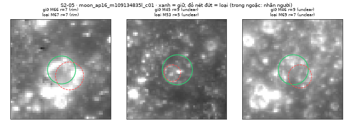

# S2-05 — Lọc vòng tròn trùng và kiểm tra hố gần nhau/chồng nhau

Phụ trách: Đinh Quang Hưng · Phụ thuộc: S2-02 (đã gộp, PR #19), S2-01 (PR #21, chưa gộp; theo review, kết quả phát hiện không đổi so với `main`)
Mã: [src/postprocessing.py](../src/postprocessing.py), phần S2-05 (`dedupe_circles`, `duplicate_pair`, `vote_ratio`). Bộ ví dụ: [data/examples/s205_dedupe_cases.json](../data/examples/s205_dedupe_cases.json). Kiểm thử: [tests/test_dedupe.py](../tests/test_dedupe.py). Chạy trên ảnh thật: [scripts/s205_dedupe.py](../scripts/s205_dedupe.py). Minh chứng: [docs/evidence/s2-05/](evidence/s2-05/).

**Tóm tắt.** Hough có thể tìm cùng một hố hai lần mà NMS của S1-07 không gộp được. Module lọc trùng gộp các cặp này theo một quy tắc hình học, và **giữ vòng ngoài**. Trên hai ảnh có nhãn, module gộp đúng cả **3/3 cặp trùng thật** và **không làm mất hố thật nào**. Bộ ví dụ có 10 trường hợp, trong đó 4 trường hợp **không được xóa**: hố chạm mép, hố chồng mép, hố nhỏ nằm trong hố lớn, cụm hố gần nhau. Cả 10 trường hợp đều cho kết quả đúng.

## 1. Vì sao cần lọc trùng

NMS trong `src/hough.py` chỉ gộp hai đỉnh khi tâm lệch ≤ 4 px **và** bán kính lệch ≤ 2 px. Trên ảnh thật đã thấy hai dạng trùng lọt qua điều kiện này:

| Dạng | Ví dụ | Nguyên nhân |
|---|---|---|
| Vòng nhỏ lồng trong vành thật | STT 13: M8 (r = 6) trong M32 (r = 9); M19 (r = 6) trong M15 (r = 10) | Mép bóng trong lòng hố cũng là một đường cong gần tròn, nhỏ hơn vành |
| Hai vòng cùng cỡ, tâm lệch | STT 17: M66 và M67 (cùng r = 7, tâm cách 5 px) | Vành sáng rộng vài px, Hough cho hai đỉnh gần nhau |

Vòng trùng gây hại ở hai chỗ:
- **Đếm hố và mật độ:** một hố bị đếm hai lần.
- **Kiểm tra sáng–tối:** vòng nhỏ lồng trong hố bị chấm "ngược", từng làm lọc sáng–tối loại nhầm hố thật ở S2-02, mục 3.4.

## 2. Quy tắc và tham số

### 2.1. Khi nào hai vòng là một hố

Với cặp vòng A, B, gọi R là bán kính vòng lớn, r là bán kính vòng nhỏ, d là khoảng cách tâm:

$$\text{trùng} \iff \frac{d}{R} \le 0{,}75 \;\;\text{và}\;\; \frac{r}{R} \ge 0{,}5$$

| Tham số | Giá trị | Lý do |
|---|---|---|
| `max_center_frac` | 0,75 | Ba cặp trùng thật có d/R = 0,33; 0,45; 0,71. Với ngưỡng 0,5, cặp M66/M67 bị bỏ sót. Hai hố khác nhau cạnh nhau có d ≥ khoảng R + r, tức ≥ 1,5R khi r ≥ 0,5R, nên vẫn cách xa ngưỡng |
| `min_radius_ratio` | 0,5 | Hố nhỏ nằm trên sàn hay vành hố lớn thường nhỏ hơn nhiều (r/R < 0,5), nên được giữ riêng |
| `min_outer_vote_ratio` | 0,35 | Ngưỡng để vòng được coi là "đủ tin", cùng ý nghĩa `min_vote_ratio` của Hough |
| `unreliable_classes` | (`texture`) | Vòng bị S2-02 xếp `texture` không được ưu tiên giữ lại |
| `angle_step_deg` | 1,0 | Khớp Hough, để đếm đúng số điểm trên chu vi |

Tỉ lệ phiếu = số phiếu / số điểm pixel khác nhau trên chu vi bán kính r, đúng mẫu số mà Hough dùng (r = 6: 48 điểm; r = 10: 80 điểm).

### 2.2. Giữ vòng nào

Các vòng được xếp theo thứ tự ưu tiên rồi duyệt tham lam: vòng nào trùng với một vòng đã giữ thì bị loại, ghi `duplicate_of` và `dedupe_reason`.

1. Vòng **đủ tin** trước: tỉ lệ phiếu ≥ 0,35 và không thuộc lớp `texture`.
2. Vòng **lớn hơn** trước, vì vòng trong thường là mép bóng lòng hố.
3. Tỉ lệ phiếu cao hơn; sau đó số phiếu; sau đó `crater_id`, để kết quả không phụ thuộc thứ tự đầu vào.

**Vì sao không chọn theo tỉ lệ phiếu.** Đây là lựa chọn ban đầu, nhưng đã đo trước khi chốt:

| Cặp | Vòng đúng (nhãn) | Tỉ lệ phiếu | Độ phủ xuyên tâm (S2-02) | Giữ vòng lớn |
|---|---|---|---|---|
| M32 (r = 9) / M8 (r = 6) | M32 | 0,542 / **0,583** → giữ nhầm M8 | 0,556 / **0,667** → nhầm | M32 ✓ |
| M15 (r = 10) / M19 (r = 6) | M15 | 0,562 / 0,562 → hòa | 0,75 / **0,861** → nhầm | M15 ✓ |

Vòng nhỏ có ít điểm trên chu vi hơn, nên dễ đạt tỉ lệ cao. Vì vậy quy tắc ưu tiên vòng ngoài, kèm điều kiện vòng ngoài phải đủ tin. Nếu vòng ngoài là `texture` hoặc có ít phiếu, vòng trong được giữ (ví dụ 5 và 6 ở mục 3).

### 2.3. Phạm vi

- `dedupe_circles(circles, params)` trả (giữ lại, bị loại, báo cáo). Vòng giữ lại không bị đổi trường nào, danh sách vẫn hợp lệ theo hợp đồng S1-05.
- Toàn bộ là mã tự viết bằng Python/NumPy; dùng lại `_circle_offsets` của Hough để đếm điểm chu vi.
- **`pipeline.py` chưa gọi lọc trùng.** Việc bật mặc định cần nhóm quyết định, cùng với lọc `texture` của S2-02.

## 3. Bộ ví dụ kiểm tra

File [data/examples/s205_dedupe_cases.json](../data/examples/s205_dedupe_cases.json). Ba ca đầu lấy đúng tọa độ, bán kính, số phiếu và lớp S2-02 từ ảnh LROC; các ca còn lại dựng tay.

| # | Trường hợp | Kết quả mong đợi | Đạt |
|---|---|---|---|
| 1 | STT 13: M8 (r = 6) lồng trong M32 (r = 9) | Giữ M32 | ✓ |
| 2 | STT 13: M19 (r = 6) lồng trong M15 (r = 10) | Giữ M15 | ✓ |
| 3 | STT 17: M66/M67 cùng r = 7, tâm cách 5 px | Giữ 1 vòng | ✓ |
| 4 | Chuỗi ba vòng cùng một hố (r = 12, 9, 7) | Giữ vòng r = 12 | ✓ |
| 5 | Vòng ngoài là `texture`, vòng trong là `rim` | Giữ vòng trong | ✓ |
| 6 | Vòng ngoài ít phiếu (tỉ lệ 0,25) | Giữ vòng trong | ✓ |
| 7 | **Hai hố chạm mép** (d = R + r) | **Giữ cả hai** | ✓ |
| 8 | **Hai hố chồng mép** (d = 14, R = 10, r = 8) | **Giữ cả hai** | ✓ |
| 9 | **Hố nhỏ trong hố lớn** (r/R = 0,3) | **Giữ cả hai** | ✓ |
| 10 | **Cụm 4 hố gần nhau** | **Giữ cả bốn** | ✓ |

Kiểm thử ([tests/test_dedupe.py](../tests/test_dedupe.py), 8 bài) chạy toàn bộ bộ ví dụ và kiểm thêm:
- các ca "không trùng" không mất vòng nào;
- đảo thứ tự đầu vào không đổi kết quả;
- ngưỡng biên d/R = 0,75 và r/R = 0,5;
- vòng giữ lại không bị sửa và vẫn hợp lệ theo hợp đồng dữ liệu;
- tham số sai bị báo lỗi.

## 4. Kết quả trên ảnh thật

Chạy `python scripts/s205_dedupe.py` trên 100 ứng viên Hough mặc định của mỗi ảnh. Đối chiếu bằng nhãn S2-02:
- **Gộp đúng:** cặp mà cả hai vòng đều được người gán là cùng một hố thật.
- **Mất hố thật:** vòng bị loại là hố thật nhưng vòng được giữ không phải hố đó.

| Ảnh | Nhãn | Vào → ra | Loại | Gộp đúng | Mất hố thật |
|---|---|---|---|---|---|
| STT 13 (`moon_ap16_m132732855l_c01`) | Đã kiểm chéo | 100 → 96 | 4 | **2/2** (M8→M32, M19→M15) | **0** |
| STT 17 (`moon_ap16_m109134835l_c01`) | Đã kiểm chéo | 100 → 97 | 3 | **1/1** (M67→M66) | **0** |
| Mosaic `moon_marefrig_loc_c01` | Chưa có | 100 → 100 | 0 | — | — |

Bốn vòng bị loại còn lại đều là cặp `texture` hoặc `unclear` theo nhãn người:
- STT 13: M98→M66, M65→M40.
- STT 17: M53→M45, M69→M46.

Chi tiết từng cặp, gồm tỉ lệ phiếu, d/R, r/R và lý do, nằm trong `docs/evidence/s2-05/<image_id>.csv`.


*Hình 1. STT 13: xanh = vòng giữ, đỏ nét đứt = vòng bị loại; trong ngoặc là nhãn người. Hai cặp đầu là vòng nhỏ (mép bóng lòng hố) lồng trong vành thật.*



*Hình 2. STT 17: cặp đầu là M66/M67, cùng một hố vành sáng.*

## 5. Hạn chế

- **Số cặp trùng thật còn ít:** 3 cặp trên 2 ảnh, trên hai ảnh Apollo 16 cùng tỷ lệ 2 m/px. Ngưỡng 0,75 chọn theo 3 cặp này, chưa chỉnh trên tập điều chỉnh đầy đủ.
- **Lọc trùng không giải quyết được giới hạn 100 vòng của Hough:** loại vòng trùng chỉ giảm danh sách (100 → 96), không đưa thêm hố mới vào. Hố lớn vẫn vắng mặt cho tới khi S2-01 xử lý việc chọn đỉnh.
- **Hai hố thật chồng nhau gần hết** (d < 0,75R và r ≥ 0,5R) sẽ bị gộp thành một. Trường hợp này hiếm, nhưng quy tắc hình học không phân biệt được.
- **Ưu tiên vòng ngoài có thể sai** khi vòng ngoài là một vòng giả "đủ tin" bao quanh một hố nhỏ. Điều kiện đủ tin (lớp khác `texture`, tỉ lệ phiếu ≥ 0,35) chỉ giảm chứ không loại hết rủi ro này.
- Mosaic 20 m/px không có cặp trùng nào nên chưa kiểm được ở tỉ lệ này.

## 6. Cách chạy

```powershell
$env:PYTHONUTF8 = "1"
.venv\Scripts\python -m unittest tests.test_dedupe -v     # bộ ví dụ kiểm tra
python scripts/s205_dedupe.py                              # 3 ảnh thật, ghi docs/evidence/s2-05/
```

```python
from src.postprocessing import dedupe_circles
kept, removed, report = dedupe_circles(circles)                     # tham số mặc định
kept, removed, report = dedupe_circles(circles, {"max_center_frac": 0.5})
```
