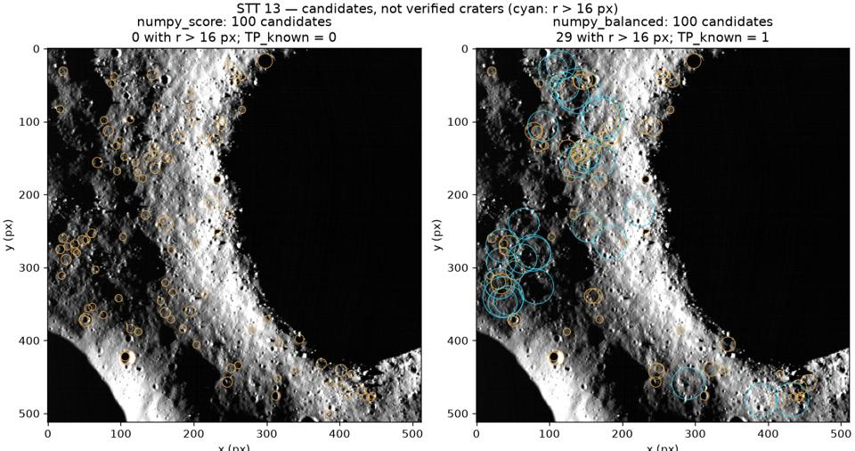

# S2-06 / S3-02 — Kiểm chứng Hough và đánh giá phát hiện

Ngày nghiệm thu: 27/10/2026. Căn cứ các dòng S2-01, S2-06, S2-11, S3-02, S3-06
trong `Nhom_2_NASA24_Phan_cong_3_tuan.xlsx`.

## Kết quả và phạm vi hoàn thành

| Task | Kết quả |
|---|---|
| Kiểm nhãn / #20 | 26/26 file khớp JSON/manifest/index/overlay; Tiến xác nhận đã kiểm bằng mắt; [đã xác nhận trên PR #20](https://github.com/Duckcy-Bui/nasa24-crater-stem/pull/20#issuecomment-6462992167) |
| S2-01 | Thêm chế độ thử nghiệm sửa việc các vòng nhỏ chiếm hết 100 kết quả bằng chọn luân phiên nhóm r; không giải quyết hố ngoài dải 5–128 px |
| S2-06 | Có test scalar, ví dụ có đáp án/ảnh trống/hố trùng/chồng nhau, đối chiếu OpenCV trên giả lập và 11 ảnh thật |
| S2-11 | Hoàn thiện dẫn xuất, ví dụ nhỏ, giả mã, tham số, chi phí thời gian/bộ nhớ |
| S3-02 | Cài evaluation.py; có TP_known/FN_known/Recall và thời gian từng ảnh trên đủ 8 holdout. FP/P/F1 toàn ảnh chưa thể có vì nhãn thưa |
| S3-06 | Phần Hough Chương 2/3 và danh mục 12 nguồn; xác minh thư mục của 3 DOI qua Crossref |

[Lý thuyết/cài đặt](S2-11_S3-06_HOUGH_HOAN_THIEN.md) ·
[Nguồn](TAI_LIEU_THAM_KHAO_HOUGH.md) ·
[Hồ sơ nghiệm thu](evidence/s2-06-s3-02/README.md).

## Quy trình và điều kiện chạy

Game giữ mặc định `candidate_selection=score`; `configs/default.json` không đổi.
`radius_balanced` chỉ bật tường minh trong cấu hình thử nghiệm. Cập nhật 29/10/2026: [S2-15](S2-15_CHOT_THAM_SO.md) đã chốt giữ `score` cho game/tuần 3; số liệu dưới đây vẫn là phép đo lịch sử ngày 27/10.
Nếu S2-15 đổi cấu hình game, phải báo trước người viết báo cáo để sửa Bảng 1.1, mục 3.7, 5.4
và chụp lại Hình 5.2. Số liệu 0/28→2/28 và 4/66→5/66 chưa đủ để đổi mặc định.

Cố định `configs/s201_large_craters.json` trước đánh giá: full_circle, r=5–128 kẹp theo metadata,
bước r=1, góc=1°, min_votes=12, min_vote_ratio=0,35, NMS tâm=4 px/r=2 px, tối đa 100 vòng.
Cùng tiền xử lý B0–B8, cùng ảnh xám làm trơn cho OpenCV và dải r; OpenCV HOUGH_GRADIENT dùng
`dp=1, minDist=4, param1=100, param2=12`. Giữ tâm trong [0,511] theo hợp đồng của repo.
NumPy nhận biên B8, OpenCV tự trích biên; khác ngưỡng/NMS và xử lý mask, nên không coi là hai
cài đặt tương đương. NumPy tối đa 100 vòng, OpenCV không cắt 100: đọc cả số ứng viên khi so Recall.
Mỗi phương pháp có 1 warm-up và 3 lần đo; JSON lưu từng mẫu, median/min/max, điều kiện máy,
SHA-256 cấu hình/mã/ảnh/metadata/nhãn. Hash mask được bổ sung trong `input_hashes.json`.
Thời gian NumPy chỉ gồm Hough; OpenCV gồm trích biên nội bộ. Không dùng bảng này xếp hạng tốc độ toàn pipeline.

Ba ảnh tuning gồm STT 13, STT 17 và Apollo 15 high-sun. Sau đó chạy đúng 8 ảnh holdout theo manifest,
cùng hash cấu hình và mã; không quét/chỉnh tham số theo holdout. Hai chế độ score/balanced được xác định
trước khi đọc kết quả holdout. S2-05 được đo riêng trước/sau; không bật lọc trùng trong game.

## Kết quả trên nhãn thưa

TP_known: số cặp ghép một–một; FN_known: hố chắc chắn chưa ghép.
Điều kiện d_tâm≤0,5 r_ref; tối đa số cặp rồi tối thiểu tổng khoảng cách chuẩn hóa.
Ưu tiên nhãn chắc chắn trước, dự đoán còn lại trúng vùng uncertain được bỏ qua.
Recall_known=TP_known/(TP_known+FN_known). Không dùng sai số bán kính làm ngưỡng ghép;
JSON vẫn lưu radius_error_px. Vòng ngoài nhãn không được tính là FP.

| Tập | Phương pháp | TP_known | FN_known | Recall_known micro | Macro mean ± SD |
|---|---|---:|---:|---:|---:|
| Tuning (3 ảnh) | numpy_score | 0 | 28 | 0.00% | 0.00 ± 0.00% |
| Tuning (3 ảnh) | numpy_balanced | 2 | 26 | 7.14% | 7.41 ± 6.42% |
| Tuning (3 ảnh) | opencv | 27 | 1 | 96.43% | 96.67 ± 5.77% |
| Holdout (8 ảnh) | numpy_score | 4 | 62 | 6.06% | 5.95 ± 8.77% |
| Holdout (8 ảnh) | numpy_balanced | 5 | 61 | 7.58% | 7.64 ± 8.88% |
| Holdout (8 ảnh) | opencv | 65 | 1 | 98.48% | 98.21 ± 5.05% |

SD là độ lệch chuẩn mẫu theo ảnh (ddof=1), không phải khoảng tin cậy; micro gộp số hố.
**Recall NumPy vẫn rất thấp.** Chọn balanced chỉ giảm một nguyên nhân bỏ sót, chưa đạt chất lượng
phát hiện tốt. Có suy giảm cục bộ: `moon_marefrig_loc_c02` từ 1/7 xuống 0/7;
không chỉnh lại cấu hình sau khi thấy holdout. OpenCV tạo hàng nghìn vòng mỗi ảnh;
Recall cao không chứng minh Precision cao. Nhãn hiện tại không đủ kết luận phương pháp nào chính xác hơn.

## Từng ảnh / thời gian

Các dòng dưới dùng đầu ra Hough thô. P/F1/FP để trống trong CSV vì chưa xác định.
Thời gian là median của 3 lần chạy, đơn vị giây.

| Tập / ảnh | Phương pháp | Số vòng | TP / FN | Recall_known | Hough (s) | TP sau lọc trùng |
|---|---|---:|---:|---:|---:|---:|
| tuning / moon_ap16_m132732855l_c01 | numpy_score | 100 | 0 / 9 | 0.00% | 29.095 | 0 |
| tuning / moon_ap16_m132732855l_c01 | numpy_balanced | 100 | 1 / 8 | 11.11% | 22.539 | 0 |
| tuning / moon_ap16_m132732855l_c01 | opencv | 7112 | 9 / 0 | 100.00% | 4.595 | 3 |
| tuning / moon_ap16_m109134835l_c01 | numpy_score | 100 | 0 / 10 | 0.00% | 9.000 | 0 |
| tuning / moon_ap16_m109134835l_c01 | numpy_balanced | 100 | 0 / 10 | 0.00% | 9.070 | 0 |
| tuning / moon_ap16_m109134835l_c01 | opencv | 8984 | 9 / 1 | 90.00% | 5.906 | 4 |
| tuning / moon_ap15_hia_c01 | numpy_score | 100 | 0 / 9 | 0.00% | 7.306 | 0 |
| tuning / moon_ap15_hia_c01 | numpy_balanced | 100 | 1 / 8 | 11.11% | 7.455 | 1 |
| tuning / moon_ap15_hia_c01 | opencv | 8030 | 9 / 0 | 100.00% | 2.920 | 3 |
| holdout / moon_ap15_loc_c01 | numpy_score | 100 | 0 / 8 | 0.00% | 20.403 | 0 |
| holdout / moon_ap15_loc_c01 | numpy_balanced | 100 | 0 / 8 | 0.00% | 21.024 | 0 |
| holdout / moon_ap15_loc_c01 | opencv | 8195 | 8 / 0 | 100.00% | 6.218 | 5 |
| holdout / moon_ap15_loc_c02 | numpy_score | 100 | 0 / 9 | 0.00% | 7.747 | 0 |
| holdout / moon_ap15_loc_c02 | numpy_balanced | 100 | 0 / 9 | 0.00% | 7.667 | 0 |
| holdout / moon_ap15_loc_c02 | opencv | 8323 | 9 / 0 | 100.00% | 3.153 | 3 |
| holdout / moon_ap15_loc_c03 | numpy_score | 100 | 0 / 9 | 0.00% | 8.453 | 0 |
| holdout / moon_ap15_loc_c03 | numpy_balanced | 100 | 0 / 9 | 0.00% | 8.419 | 0 |
| holdout / moon_ap15_loc_c03 | opencv | 8438 | 9 / 0 | 100.00% | 3.443 | 4 |
| holdout / moon_lunokhod2_loc_c01 | numpy_score | 100 | 1 / 8 | 11.11% | 6.561 | 1 |
| holdout / moon_lunokhod2_loc_c01 | numpy_balanced | 100 | 1 / 8 | 11.11% | 6.332 | 1 |
| holdout / moon_lunokhod2_loc_c01 | opencv | 9040 | 9 / 0 | 100.00% | 4.077 | 5 |
| holdout / moon_lunokhod2_loc_c02 | numpy_score | 100 | 0 / 9 | 0.00% | 6.260 | 0 |
| holdout / moon_lunokhod2_loc_c02 | numpy_balanced | 100 | 1 / 8 | 11.11% | 6.366 | 1 |
| holdout / moon_lunokhod2_loc_c02 | opencv | 9086 | 9 / 0 | 100.00% | 4.178 | 4 |
| holdout / moon_marefrig_loc_c01 | numpy_score | 100 | 0 / 6 | 0.00% | 6.056 | 0 |
| holdout / moon_marefrig_loc_c01 | numpy_balanced | 100 | 1 / 5 | 16.67% | 19.365 | 1 |
| holdout / moon_marefrig_loc_c01 | opencv | 8259 | 6 / 0 | 100.00% | 6.300 | 4 |
| holdout / moon_marefrig_loc_c02 | numpy_score | 100 | 1 / 6 | 14.29% | 22.250 | 1 |
| holdout / moon_marefrig_loc_c02 | numpy_balanced | 100 | 0 / 7 | 0.00% | 24.683 | 0 |
| holdout / moon_marefrig_loc_c02 | opencv | 8521 | 6 / 1 | 85.71% | 6.970 | 1 |
| holdout / moon_marefrig_loc_c03 | numpy_score | 100 | 2 / 7 | 22.22% | 20.322 | 2 |
| holdout / moon_marefrig_loc_c03 | numpy_balanced | 100 | 2 / 7 | 22.22% | 25.497 | 1 |
| holdout / moon_marefrig_loc_c03 | opencv | 8866 | 9 / 0 | 100.00% | 3.772 | 3 |

Lọc trùng làm mất một cặp ghép đúng của balanced trên STT 13 (1→0).
Không lấy số ứng viên giảm để khẳng định chất lượng tăng. Tham số lọc có thể cần điều chỉnh
trên tuning ở đầu việc khác; giữ nguyên trong đợt đánh giá này.

## Hố lớn và test có đáp án

STT 13: score giữ 100 vòng r≤10 px; balanced giữ 100 vòng có 29 vòng r>16 px, r tối đa 31 px.
Cả hai cùng ngưỡng/phiếu, chỉ khác thứ tự chọn trước NMS/giới hạn đầu ra.
Các vành hố vượt 128 px, vành đứt/không tròn hoặc đỉnh chưa đủ ngưỡng vẫn có thể bị bỏ sót.



Test hồi quy dựng nhiều vòng nhỏ và một vành r=80 bị khuyết: score bị che mất hố lớn,
balanced tìm lại hố trong sai số 1 px và vẫn tuân thủ max_circles.
Lần chạy gốc có 277 test Python đạt (exit 0), 8 test mới có log riêng trong kho chi tiết.
Sau review ngày 28/10/2026: 282 test Python, kiểm tra hợp đồng và 6 bộ canvas đạt;
log nằm tại `outputs/pr26-review/`.
Bộ cũ bao gồm các ca hố trống, hố cạnh/chồng nhau, hố lồng nhỏ và ví dụ tính tay 5×5.
Bản tóm tắt kiểm thử toàn bộ được ghi rõ là tóm tắt; không giả làm log đầy đủ đã bị cắt trên console.

Đối chiếu giả lập với ba hố biết trước và kiểm tra ảnh trống cho cả NumPy/OpenCV:

| Phương pháp | TP | FP | FN | Precision | Recall |
|---|---:|---:|---:|---:|---:|
| full_circle | 3 | 0 | 0 | 1.0000 | 1.0000 |
| gradient | 1 | 0 | 2 | 1.0000 | 0.3333 |
| opencv | 3 | 1 | 0 | 0.7500 | 1.0000 |

P/R ở bảng này chỉ có nghĩa cho cảnh giả lập đầy đủ, không đại diện dữ liệu NASA.
Bộ chuyển benchmark lịch sử đã kiểm tra trên biên giả lập r=8, 3 lần sau warm-up:
chế độ score giữ nguyên danh sách/phiếu so với commit baseline; xem `previous_validation.historical_adapter` trong [summary.json](evidence/s2-06-s3-02/summary.json).
Số đo tăng tốc thực trên ba ảnh của lần 24/10 vẫn ở hồ sơ S2-01; không thay nó bằng thời gian giả lập.

## Xác nhận trên PR #20

Nguyễn Mạnh Tiến xác nhận trực tiếp ngày 27/10/2026: đã kiểm bằng mắt đủ 26 overlay.
Hồ sơ [review_confirmation.json](../data/reference_labels/review_confirmation.json) ghi đúng nguồn xác nhận của người dùng; kiểm tra file tự động
không thay thế việc kiểm bằng mắt. Các file vẫn là nhãn thưa, không đổi thành đầy đủ.
Ngày 28/10/2026, tài khoản `NguyenManhTien1505` đã [xác nhận trên PR #20](https://github.com/Duckcy-Bui/nasa24-crater-stem/pull/20#issuecomment-6462992167):

> Đã kiểm đủ 26 overlay; nhãn thưa dùng được cho Recall_known.

## Tái tạo

Từ gốc repo, môi trường theo requirements-test.txt (Python 3.12); dữ liệu giải nén bằng
`scripts/install_s106_dataset.py`. Đầu ra phải là thư mục mới:

```powershell
$env:PYTHONUTF8 = "1"
.\.venv\Scripts\python.exe -X utf8 -B -m unittest discover -s tests -v
.\.venv\Scripts\python.exe -X utf8 -B scripts/evaluate_hough.py --config configs/s201_large_craters.json --images moon_ap16_m132732855l_c01 moon_ap16_m109134835l_c01 moon_ap15_hia_c01 --output outputs/evaluation_tuning --repeats 3
.\.venv\Scripts\python.exe -X utf8 -B scripts/evaluate_hough.py --config configs/s201_large_craters.json --holdout --output outputs/evaluation_holdout --repeats 3
```

API: `evaluate(machine, catalogue, {"metadata": metadata})` mặc định nhãn thưa.
Chỉ cho nhãn đầy đủ khi chính catalogue có `catalogue_coverage="complete"`;
không ép một bộ nhãn thưa thành đầy đủ bằng tham số đánh giá.
Trên Linux/CI hoặc sau khi kích hoạt môi trường Python:

```bash
python scripts/evaluate_hough.py --config configs/s201_large_craters.json --images moon_ap16_m132732855l_c01 moon_ap16_m109134835l_c01 moon_ap15_hia_c01 --output outputs/evaluation_tuning --repeats 3
python scripts/evaluate_hough.py --config configs/s201_large_craters.json --holdout --output outputs/evaluation_holdout --repeats 3
```

Các lượt tái tạo sinh `report.json`, `results.csv`, `summary.json` và JSON chi tiết trong `outputs/`.
Trong Git chỉ giữ [results.csv](evidence/s2-06-s3-02/results.csv),
[summary.json](evidence/s2-06-s3-02/summary.json), [input_hashes.json](evidence/s2-06-s3-02/input_hashes.json),
[archive_manifest.json](evidence/s2-06-s3-02/archive_manifest.json) cùng README.
Summary giữ tham số, hash gốc, môi trường, median thời gian và TP/FN/Recall từng ảnh;
không thay hash gốc bằng hash mã sau review. Một số tệp lúc đo dùng CRLF, Git lưu LF;
`measured_text_newlines` ghi cách phục hồi byte để đối chiếu hash cũ. Bản mã/config lúc đo
được giữ ngoài Git trong `outputs/s2-06-s3-02/measured_source/`. CSV gộp hai tập với cột `split`.
Chi tiết cũ nằm tại `outputs/s2-06-s3-02/`, không được Git theo dõi; manifest ghi SHA-256/size
các file và từng entry trong ZIP. Chưa có bản chia sẻ Drive (`shared_url=null`).
Lượt lỗi `tuning/report.json` đã bỏ khỏi Git và không được đưa vào summary/kết luận.
