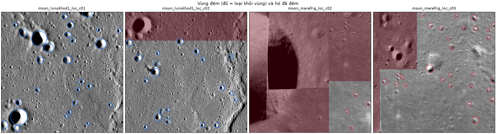
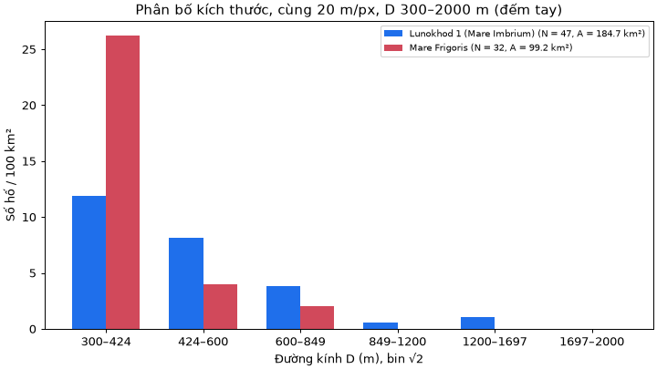
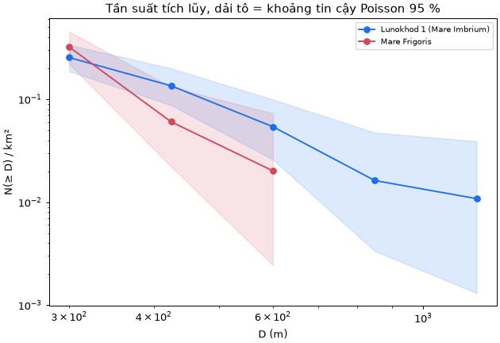

# S2-09 — Đếm hố và so mật độ hai vùng

Phụ trách: Đinh Quang Hưng · Phụ thuộc: S2-05 (lọc trùng), S2-03 (tập dữ liệu và nhãn)
Mã: [src/statistics.py](../src/statistics.py), [scripts/s209_density.py](../scripts/s209_density.py). Số liệu: [data/s209_counts/](../data/s209_counts/). Minh chứng: [docs/evidence/s2-09/](evidence/s2-09/).

**Tóm tắt.** Đếm đủ mọi hố có đường kính 300–2000 m trong vùng mặt biển của hai vùng cùng tỷ lệ 20 m/px.

| Vùng | Diện tích | Số hố | Mật độ (hố/km²) | Khoảng tin cậy 95 % |
|---|---|---|---|---|
| Lunokhod 1 (Mare Imbrium) | 184,7 km² | 47 | 0,254 | 0,187–0,338 |
| Mare Frigoris | 99,2 km² | 32 | 0,322 | 0,221–0,455 |

**Không có khác biệt có ý nghĩa thống kê** về tổng mật độ (tỉ số 0,79; p = 0,35). Với hố từ 424 m trở lên, Lunokhod 1 nhiều hơn khoảng 2,2 lần, nhưng vẫn chưa đủ ý nghĩa (p = 0,09). Vì vậy **chỉ gợi ý rất yếu** rằng bề mặt Lunokhod 1 có thể cổ hơn. Không kết luận được về tuổi.

## 1. Chọn hai vùng

S1-06 chốt cặp so mật độ là Van de Graaff (cao nguyên) và Mare Frigoris (mare). Khi xem ảnh trước khi đếm, cặp này **không so được**:

| | Van de Graaff | Mare Frigoris |
|---|---|---|
| Góc tới Mặt Trời | 27–45° (nắng gần đứng) | 61–84° (nắng xiên) |
| Hố hiện ra | Đốm sáng, gần như không có bóng, hố nhỏ hầu như không thấy | Rõ nhờ bóng đổ |

Số đếm phụ thuộc mạnh vào góc nắng, nên chênh lệch đo được sẽ chủ yếu do ánh sáng chứ không do tuổi.

S2-09 dùng cặp **Lunokhod 1 và Mare Frigoris** (đã thống nhất với Hưng), lý do:
- Cùng tỷ lệ 20 m/px.
- Cùng loại bề mặt (biển bazan).
- Cùng nắng xiên (60–79° và 61–84°).

Như vậy so sánh có kiểm soát được ánh sáng ở mức thô. Lunokhod 2 bị loại vì mosaic có nhiều dải ghép, vùng bóng lớn và địa hình núi.

> Cần nhóm xác nhận việc đổi cặp so với S1-06, và cập nhật Chương 4 (S1-16) nếu đồng ý.

## 2. Phương pháp

### 2.1. Cùng thang đo và cùng dải bán kính vật lý

- Cả bốn ô cắt đều có `scale_m_per_px = 20,0` và `downsample_k = 1`. `region_count()` và `compare_regions()` **từ chối** khi hai vùng khác tỷ lệ hoặc khác dải D (có test).
- Dải đường kính chung: **D = 300–2000 m**, tức r = 7,5–50 px. Đường kính tính `D = 2·r·s`. Một hố được đếm khi 300 ≤ D < 2000.
- Bỏ hố dưới 300 m vì vòng r < 7,5 px khó nhận chắc chắn. Ở các hố nhỏ, độ đầy đủ phụ thuộc mạnh vào ánh sáng và độ phân giải.
- Trên 2 km, hố quá hiếm trong khoảng 100–200 km² nên không có số liệu.

### 2.2. Vùng đếm và diện tích

Vùng đếm của từng ô là các hình chữ nhật ghi trong [regions.json](../data/s209_counts/regions.json):
- **Lunokhod 1:** toàn bộ ô `c01`, và ô `c02` bỏ 122 hàng đầu (phần trùng `c01` trên ảnh nguồn).
- **Mare Frigoris:** chỉ phần mặt biển.
  - Ô `c03` bỏ góc trên trái, chỗ có cụm hố lớn và dải ghép sáng khác.
  - Ô `c02` chỉ lấy phần dưới phải, không trùng `c03` và không có hố lớn 6–8 km, vùng bóng hay dải ghép.
  - Ô `c01` bỏ hẳn: gần như toàn ô là hố lớn và vùng bóng.

Diện tích tính trên **hợp** các vùng đếm theo tọa độ ảnh nguồn:

$$A = N_{\text{px}} \cdot s^2 / 10^6 \ (\text{km}^2)$$

Vì các vùng đếm đã chọn không chồng nhau, mỗi hố chỉ đếm một lần. Code vẫn có gộp hố trùng giữa các ô chồng nhau (tâm lệch ≤ 0,5R và r/R ≥ 0,7), có test.



*Hình 1. Vùng đếm (phần tô đỏ bị loại) và các hố đã đếm.*

### 2.3. Nguồn đếm: đếm tay đầy đủ

Mật độ chỉ có nghĩa khi đếm **đủ mọi hố** trong dải D trên toàn diện tích. Vì vậy:
- **Không dùng nhãn S2-03**, vì đó là nhãn **thưa** (6–9 hố mỗi ảnh).
- **Không dùng kết quả máy** (mục 4).

Các hố được đếm tay trên từng ô cắt, có lưới tọa độ và vòng mẫu 300 m. File [data/s209_counts/*_count.json](../data/s209_counts/) theo định dạng S1-05 (`source = "catalogue"`).

> Người đếm: Đinh Quang Hưng (bản đầu do Claude đề xuất, Hưng duyệt); kiểm chéo: Hoàng Quốc Anh (28/10/2026).

### 2.4. Thống kê

Tự viết bằng Python, không dùng scipy:

- **Mật độ:** ρ = N / A. Khoảng tin cậy 95 % là khoảng Poisson chính xác (Garwood), tìm nghiệm bằng chia đôi. Đã đối chiếu bảng: n = 0 cho [0; 3,689], n = 10 cho [4,795; 18,39].
- **Phân bố kích thước:** histogram theo bin √2 bắt đầu tại 300 m (cách chia bin kiểu CATWG 1979). Kèm tần suất tích lũy N(≥ D)/km².
- **So hai vùng:** kiểm định nhị thức có điều kiện. Nếu hai vùng cùng mật độ, thì với tổng N₁ + N₂ cố định, N₁ tuân theo phân phối nhị thức với tham số (N₁ + N₂, A₁/(A₁ + A₂)). p-value tính hai phía chính xác.

## 3. Kết quả

### 3.1. Bảng đếm

| Vùng | Ô cắt | Diện tích (km²) | 300–424 | 424–600 | 600–849 | 849–1200 | 1200–1697 | 1697–2000 | Tổng |
|---|---|---|---|---|---|---|---|---|---|
| Lunokhod 1 | c01 + c02 (phần không trùng) | 184,7 | 22 | 15 | 7 | 1 | 2 | 0 | **47** |
| Mare Frigoris | c02 (một phần) + c03 (mặt biển) | 99,2 | 26 | 4 | 2 | 0 | 0 | 0 | **32** |

Bảng máy đọc: [bang_dem.csv](evidence/s2-09/bang_dem.csv). Toàn bộ số liệu: [so_sanh.json](evidence/s2-09/so_sanh.json).



*Hình 2. Số hố trên 100 km² theo bin √2.*

### 3.2. So mật độ

| Từ D trở lên | Lunokhod 1: N (hố/km²) | Mare Frigoris: N (hố/km²) | Tỉ số | p (hai phía) |
|---|---|---|---|---|
| 300 m | 47 (0,254) | 32 (0,322) | 0,79 | 0,35 |
| 424 m | 25 (0,135) | 6 (0,060) | 2,24 | 0,09 |
| 600 m | 10 (0,054) | 2 (0,020) | 2,69 | 0,24 |
| 849 m | 3 | 0 | — | 0,56 |



*Hình 3. Tần suất tích lũy N(≥ D)/km²; dải tô là khoảng tin cậy 95 %.*

Đọc kết quả:
- **Tổng mật độ không khác nhau có ý nghĩa.** Hai khoảng tin cậy chồng nhau rộng.
- **Hai đường cong tích lũy cắt nhau:**
  - Mare Frigoris có nhiều hố 300–424 m hơn (26 hố trên 99 km², so với 22 trên 185 km²).
  - Lunokhod 1 có nhiều hố ≥ 424 m hơn.
  - Hai vùng khác nhau ở **hình dạng** phân bố, không chỉ ở mức. Nhưng với 6 và 2 hố ở các bin lớn, khác biệt này chưa có ý nghĩa thống kê.

### 3.3. Giải thích tuổi bề mặt (tương đối)

Nguyên lý: trong cùng điều kiện quan sát và cùng dải kích thước, bề mặt tích lũy nhiều hố va chạm hơn trên mỗi km² thường đã tồn tại lâu hơn. Đây chỉ là **tuổi tương đối**.

Với số liệu này:
- **Không thể nói vùng nào cổ hơn** nếu dựa trên tổng mật độ 300–2000 m.
- Hố lớn (≥ 424 m) nhiều hơn ở Lunokhod 1 **gợi ý yếu** rằng bề mặt Lunokhod 1 có thể cổ hơn. Hố lớn ít bị ảnh hưởng bởi bão hòa và ánh sáng hơn hố nhỏ.
- Gợi ý này chưa đạt ngưỡng p < 0,05, và còn bị chi phối bởi các giới hạn ở mục 5. Nhóm **không nên** trình bày nó như một kết luận.

## 4. Kết quả máy (để đối chiếu)

Máy được chạy trên cùng vùng đếm và cùng dải D: Hough mặc định, lọc `texture` (S2-02), rồi lọc trùng (S2-05).

| Vùng | Đếm tay | Máy: ứng viên thô | Máy: sau lọc | Máy: trong dải 300–2000 m | Bán kính lớn nhất máy tìm |
|---|---|---|---|---|---|
| Lunokhod 1 | 47 | 200 | 117 | **11** | 13 px (260 m) |
| Mare Frigoris | 32 | 200 | 91 | **0** | 13 px (260 m) |

**Không dùng được máy để tính mật độ trong dải này.** Hough mặc định trên `main` trả đúng 100 vòng nhỏ mỗi ô (r ≤ 13 px, tức D ≤ 520 m). Phần lớn có D < 300 m nên rơi ra ngoài dải. Đây là giới hạn đã nêu ở S2-01, S2-02 và S2-05. Khi bản cải thiện hố lớn của Tiến (PR #26) được gộp, cần chạy lại `scripts/s209_density.py` để so sánh máy và tay. File: [may_so_voi_tay.csv](evidence/s2-09/may_so_voi_tay.csv).

## 5. Giới hạn suy luận

1. **Số lượng nhỏ.** Khoảng tin cậy rộng (±30–40 %). Ở các bin lớn chỉ có 0–7 hố.
2. **Diện tích nhỏ và không ngẫu nhiên.** Khoảng 100–185 km² là một mảnh rất nhỏ của mỗi biển. Vùng đếm Mare Frigoris còn được chọn để **tránh** hố lớn và vùng bóng, nên không phải mẫu đại diện.
3. **Ánh sáng chỉ được kiểm soát thô.** Hai vùng cùng nắng xiên nhưng phương vị Mặt Trời không có trong metadata (`sun.quality = none`). Hướng bóng nhìn thấy khác nhau giữa hai vùng. Ảnh browse 8 bit, mỗi mosaic ghép từ nhiều ảnh thành phần. Độ đầy đủ ở D = 300–424 m có thể khác nhau giữa hai vùng **chỉ vì cách hiện hố**. Đây là lý do khả dĩ khiến Mare Frigoris có nhiều hố nhỏ hơn.
4. **Hố thứ cấp và chuỗi hố.** Lunokhod 1 có cụm hố lớn liền nhau (góc trên trái `c01`), có thể là hố thứ cấp hoặc chuỗi hố, không phải hố va chạm sơ cấp độc lập. Tính chúng vào sẽ làm mật độ hố lớn tăng mà không phản ánh tuổi.
5. **Đếm tay mang tính chủ quan.** Vị trí và bán kính ước lượng bằng mắt, sai khoảng ±2 px (±40 m). Hố gần ngưỡng r = 7,5 px dễ bị tính hay bỏ khác nhau giữa người đếm; đã có một người kiểm chéo nhưng chưa đo độ lệch giữa hai người đếm độc lập.
6. **Không quy đổi ra tuổi tuyệt đối.** Muốn suy ra tuổi (triệu năm) cần hàm sản xuất và hàm thời gian (chronology) được hiệu chuẩn bằng mẫu Apollo/Luna, cùng diện tích lớn hơn nhiều và dữ liệu đã hiệu chuẩn bức xạ. Ngoài phạm vi đề tài.
7. **Đổi cặp vùng so với S1-06** (mục 1). Cần nhóm xác nhận.

## 6. Cách chạy

```powershell
python scripts/s209_density.py              # bảng đếm, so sánh, hình và đối chiếu máy (khoảng 1 phút)
python scripts/s209_density.py --no-machine # chỉ phần đếm tay
python -m unittest tests.test_statistics -v
```

Muốn đổi dải D hoặc vùng đếm, sửa [regions.json](../data/s209_counts/regions.json) rồi chạy lại. Nếu đổi dải D, cần xem lại bản đếm: hố sát ngưỡng mới có thể chưa được đếm.

## 7. Thống kê trong giao diện trò chơi

`statistics.summarize(crater_set, metadata, valid_pixel_count)` trả đúng hợp đồng S2-13 (`docs/S2-13_TICH_HOP.md` mục 1):
- `count`, `valid_area_km2`, `density_per_km2`;
- `histogram`: bin √2 bắt đầu tại `radius.d_min_m` của ảnh;
- `limitations`;
- thêm khoảng tin cậy 95 %.

App gọi hàm này cho **ứng viên máy trên một ô**, nên số hiện ra là số ứng viên chưa kiểm chứng, không phải mật độ hố. Phần `limitations` nói rõ điều này.

Hai bài test trong `tests/test_integration.py` (S2-13, Đức) trước đây khẳng định thống kê "chưa cài". Giờ chúng được sửa để:
- kiểm tra `summarize` thật qua đúng hợp đồng;
- vẫn giữ một test cho trường hợp "chưa cài" bằng cách giả lập `NotImplementedError`.

## Tài liệu tham khảo

- Crater Analysis Techniques Working Group (1979). Standard techniques for presentation and analysis of crater size-frequency data. *Icarus*, 37(2), 467–474. DOI 10.1016/0019-1035(79)90009-5.
- Garwood, F. (1936). Fiducial limits for the Poisson distribution. *Biometrika*, 28(3/4), 437–442. DOI 10.1093/biomet/28.3-4.437.
- Przyborowski, J., & Wilenski, H. (1940). Homogeneity of results in testing samples from Poisson series. *Biometrika*, 31(3/4), 313–323. DOI 10.2307/2332612.
- Nhóm 2, *S1-06 Hướng dẫn dữ liệu*, `docs/S1-06_HUONG_DAN_DU_LIEU.md`; *S2-03 Tập điều chỉnh*, `docs/S2-03_TAP_DIEU_CHINH.md`.
