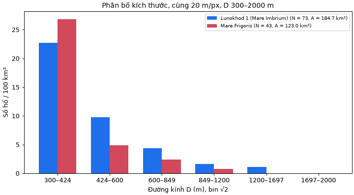
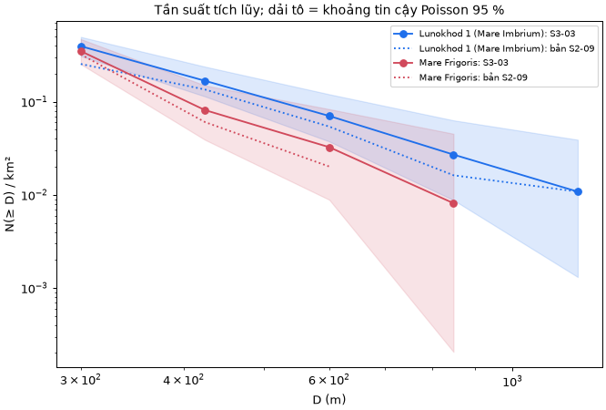

# S3-03 — Kiểm tra đếm, kích thước và mật độ hai vùng

Phụ trách: Đinh Quang Hưng · Phụ thuộc: S2-09, S2-03, S2-15
Mã: [scripts/s303_kiem_tra.py](../scripts/s303_kiem_tra.py), [tests/test_s303.py](../tests/test_s303.py). Bản đếm: [data/s303_counts/](../data/s303_counts/). Minh chứng: [docs/evidence/s3-03/](evidence/s3-03/).

> **Trạng thái: chờ kiểm chéo.** Bản đếm S3-03 do Claude lập, Đinh Quang Hưng duyệt ngày 03/11/2026; chờ Hoàng Quốc Anh kiểm chéo trên các phiếu `docs/evidence/s3-03/phieu_kiem_cheo_*.png`. App, Chương 1, 3, 4, 5 và bằng chứng S3-10 vẫn dùng số S2-09 cho tới khi kiểm chéo xong.

**Tóm tắt.** Kiểm tra phát hiện bản đếm S2-09 không đầy đủ và quy tắc loại vùng không công bằng, nên đã đếm lại theo một quy tắc chung. Mật độ trong dải 300–2.000 m: Lunokhod 1 0,395 hố/km² và Mare Frigoris 0,350 hố/km². **Hai vùng không khác nhau có ý nghĩa** (tỉ số 1,13; p = 0,57). Ở D ≥ 424 m, Lunokhod 1 nhiều hơn khoảng 2 lần (p = 0,054), nhưng đây là ngưỡng thăm dò: sau hiệu chỉnh 4 ngưỡng p = 0,22. Vì vậy **không kết luận được vùng nào già hơn**.

## 1. Kiểm tra thang đo, dải bán kính, diện tích và đơn vị

Cả 13 phép kiểm tra đều đạt (`checks` trong [kiem_tra.json](evidence/s3-03/kiem_tra.json)).

| Nội dung | Kết quả |
|---|---|
| Tỷ lệ ảnh | Cả bốn ô đều 20,0 m/px |
| Dải đường kính | Hai vùng cùng 300–2.000 m, tức r = 7,5–50 px |
| Đơn vị | 1 px = 400 m² = 4·10⁻⁴ km² |
| Diện tích Lunokhod 1 | 461.824 px = 184,7 km², tính lại độc lập từ mặt nạ |
| Diện tích Mare Frigoris | 307.432 px = 123,0 km², tính lại độc lập từ mặt nạ |
| Phần chồng giữa hai ô cùng vùng | 0 px ở cả hai vùng |
| Tổng các bin | Bằng N ở cả hai vùng |

## 2. Quy tắc loại vùng chung

Bản S2-09 bỏ góc có cụm hố lớn ở Mare Frigoris c03, trong khi cụm tương tự ở Lunokhod 1 c01 vẫn được đếm. Việc này làm giảm đúng nhóm hố lớn của một vùng.

**Quy tắc mới, áp dụng cho cả hai vùng.** Chỉ loại:
1. phần trùng nhau trên ảnh nguồn;
2. dải ghép và vùng bóng lớn;
3. phần trong vành và sườn ngoài của hố có D > 2 km.

Không loại một vùng chỉ vì có cụm hố nhỏ hơn 2 km. Áp dụng quy tắc này, Mare Frigoris c03 chỉ còn bỏ dải ghép nhiễu, và c02 được mở thêm mặt biển ở phía dưới. Diện tích tăng từ 99,2 lên 123,0 km².

## 3. Đối chiếu số đếm

### 3.1. Vì sao phải đếm lại

Quét riêng r = 7–50 px bằng Hough cho thấy bản S2-09 sót nhiều hố rõ, chủ yếu ở Lunokhod 1. Khi rà từng phần ảnh, còn thấy vòng đặt lệch khỏi hố, hai vòng ghi cho cùng một hố, và hố rõ mà Hough không đề xuất. Lỗi này nằm ở bản đếm S2-09, do Claude lập.

| Dải D (m) | Lunokhod 1: S2-09 → S3-03 | Mare Frigoris: S2-09 → S3-03 |
|---|---:|---:|
| 300–424 | 22 → 42 | 26 → 33 |
| 424–600 | 15 → 18 | 4 → 6 |
| 600–849 | 7 → 8 | 2 → 3 |
| 849–1.200 | 1 → 3 | 0 → 1 |
| 1.200–1.697 | 2 → 2 | 0 → 0 |
| Tổng | **47 → 73** | **32 → 43** |

Số sửa chủ yếu ở bin nhỏ nhất, gần ngưỡng r = 7,5 px, nên các số này còn phụ thuộc người đếm.

### 3.2. Đối chiếu với nhãn S2-03

Trong vùng đếm và dải D có 30 nhãn; **chỉ 4/30 khớp một hố đã đếm** (tâm lệch ≤ 0,5 r, ghép một–một), tức cũng chỉ 4/116 hố đã đếm có nhãn. Xem [doi_chieu_nhan.csv](evidence/s3-03/doi_chieu_nhan.csv).

Tỉ lệ thấp không chứng minh bản đếm đúng. Khi phóng to các nhãn không khớp ở bản đếm trước, phần lớn nằm trên nền phẳng hoặc lệch khỏi hố, chỉ khoảng 3–5 nhãn có dấu vết hố thật. Nhận định này mới do Claude nhìn trên 4 ô, cần Tiến và Quốc Anh xem lại. Nếu đúng, Recall_known ở các ô này có thể bị ảnh hưởng. Nhãn S2-03 không dùng được làm mốc kiểm bản đếm, và tài liệu này không sửa nhãn.

## 4. Mật độ và so sánh hai vùng

| Vùng | Diện tích | N | ρ (hố/km²) | Khoảng tin cậy 95 % |
|---|---:|---:|---:|---|
| Lunokhod 1 | 184,7 km² | 73 | 0,395 | 0,310–0,497 |
| Mare Frigoris | 123,0 km² | 43 | 0,350 | 0,253–0,471 |



*Hình 1. Số hố trên 100 km² theo bin √2.*



*Hình 2. Tần suất tích lũy; nét chấm là bản S2-09.*

**Ngưỡng 424 m là phân tích thăm dò.** Bốn ngưỡng đã được thử sau khi xem dữ liệu, nên p được nhân với 4 (Bonferroni):

| Từ D trở lên | Lunokhod 1 | Mare Frigoris | Tỉ số | p | p hiệu chỉnh |
|---:|---:|---:|---:|---:|---:|
| 300 m | 73 | 43 | 1,13 | 0,57 | 1,00 |
| 424 m | 31 | 10 | 2,06 | 0,054 | 0,22 |
| 600 m | 13 | 4 | 2,16 | 0,22 | 0,87 |
| 849 m | 5 | 1 | 3,33 | 0,41 | 1,00 |

Dải chính 300–2.000 m là phép so duy nhất được định trước.

### 4.1. Độ nhạy

| Kịch bản | Tỉ số tổng | p | Tỉ số D ≥ 424 m | p |
|---|---:|---:|---:|---:|
| Bản S3-03 | 1,13 | 0,57 | 2,06 | 0,054 |
| Bản S2-09 cũ | 0,79 | 0,35 | 2,24 | 0,089 |
| Cùng bỏ góc [0, 0, 184, 244) ở c01 và c03 | 1,28 | 0,26 | 2,61 | 0,023 |
| Chỉ Lunokhod c01 | 1,25 | 0,29 | 2,23 | 0,040 |
| Chỉ Mare Frigoris c03 | 1,05 | 0,84 | 1,83 | 0,13 |
| Mọi bán kính +1 px | 1,13 | 0,57 | 1,83 | 0,035 |
| Mọi bán kính −1 px | 1,36 | 0,22 | 1,81 | 0,23 |

Dải chính không đạt p < 0,05 ở kịch bản nào. Ở D ≥ 424 m, chiều của chênh lệch giữ nguyên (tỉ số 1,8–2,6) nhưng p dao động 0,02–0,23. Kịch bản "cùng bỏ góc" cho p thấp nhất, nhưng nó bỏ cụm hố lớn của Mare Frigoris, tức đúng điều quy tắc chung tránh, nên không dùng làm kết luận. Các p trong bảng này chưa hiệu chỉnh.

Dự đoán trước khi đếm lại rằng tỉ số D ≥ 424 m sẽ giảm còn 1,37–1,81 là **sai**: bản đếm thật cho 2,06.

## 5. Tác động của hố bỏ sót và phát hiện sai

### 5.1. Trên bản đếm tay

Với mỗi vùng, nếu chỉ đếm được tỉ lệ c hố thật thì tỉ số đo được bị nhân với $c_M / c_L$.

| Độ đầy đủ L / M | Tỉ số tổng | Tỉ số D ≥ 424 m |
|---|---:|---:|
| 100 % / 100 % | 1,13 | 2,06 |
| 70 % / 100 % | 1,61 | 2,95 |
| 100 % / 70 % | 0,79 | 1,44 |

Chỉ cần độ đầy đủ lệch 30 % là tỉ số tổng đổi chiều, nên chiều của tỉ số 1,13 không có ý nghĩa. Ở dải chính cần thêm 21 hố vào Lunokhod 1 hoặc 25 hố vào Mare Frigoris mới đạt p < 0,05, nên kết luận "không khác biệt" khá bền. Ở D ≥ 424 m, chỉ thêm **1 hố** vào Lunokhod 1 là đạt p < 0,05 chưa hiệu chỉnh, nên con số p = 0,054 rất mong manh.

### 5.2. Trên ứng viên máy

Máy chạy Hough, bỏ lớp `texture`, rồi lọc trùng; so với bản đếm bằng ghép một–một (tâm lệch ≤ 0,5 r). Bản đếm có thể còn sót, nên "phát hiện sai" là giới hạn trên.

| Cấu hình | Vùng | Hố đã đếm | Máy trong dải | Đúng | Bỏ sót | Phát hiện sai | ρ máy (hố/km²) |
|---|---|---:|---:|---:|---:|---:|---:|
| S2-15 (`score`) | Lunokhod 1 | 73 | 11 | 9 | 64 | 2 | 0,060 |
| S2-15 (`score`) | Mare Frigoris | 43 | 1 | 0 | 43 | 1 | 0,008 |
| `radius_balanced` | Lunokhod 1 | 73 | 46 | 17 | 56 | 29 | 0,249 |
| `radius_balanced` | Mare Frigoris | 43 | 27 | 0 | 43 | 27 | 0,220 |

- **Bỏ sót:** cấu hình S2-15 chỉ tìm lại 12 % và 0 % số hố, nên tỉ số mật độ của máy lên tới 7,3, hoàn toàn do bỏ sót.
- **Phát hiện sai:** `radius_balanced` cho tỉ số 1,13, trùng với đếm tay, nhưng ở Mare Frigoris không có vòng nào đúng. **Sự trùng khớp này là ngẫu nhiên**: hố bỏ sót và phát hiện sai bù trừ nhau. Vì vậy không được coi tỉ số gần đúng là bằng chứng máy đếm đúng.

Mật độ từ ứng viên máy chưa dùng được để so hai vùng.

## 6. Diễn giải

- **Kết luận chính:** trong dải 300–2.000 m, chưa có căn cứ nói hai bề mặt có mật độ hố khác nhau, nên chưa so được tuổi tương đối.
- **Gợi ý cần kiểm chứng:** Lunokhod 1 có nhiều hố ≥ 424 m hơn, còn số hố nhỏ tương đương. Mẫu này chưa đủ vững để diễn giải, và không nên trình bày là "Lunokhod 1 cổ hơn".
- **Câu trong S2-09 cần sửa:** "Mare Frigoris có nhiều hố nhỏ hơn" và "hai đường tích lũy cắt nhau" không còn giữ được: trên bản mới, Lunokhod 1 cao hơn ở mọi ngưỡng.

Giới hạn khác: 116 hố trên hai vùng nhỏ; ảnh browse 8 bit; không có phương vị Mặt Trời; hố thứ cấp chưa tách; và không quy đổi được ra tuổi tuyệt đối.

**Hạn chế của chính bản đếm:** vẫn do Claude nhìn ảnh, sai số bán kính khoảng ±2 px. Hough không độc lập hoàn toàn và chỉ tìm lại được một phần số hố đã đếm, nên chưa ước lượng được độ đầy đủ. Muốn đo thì cần một người đếm độc lập, không xem bản này, trên ít nhất một ô.

## 7. Việc cần làm sau khi bản đếm được duyệt

1. Điền `reviewed_by` (đã điền `counted_by`). Quốc Anh tự xác nhận trên PR, như review PR #30 yêu cầu; bản S2-09 chưa có xác nhận này trên PR #30.
2. Chuyển `data/s303_counts/` thành số chính thức và chạy lại `scripts/s209_density.py`. `so_sanh.json` được app và test dùng.
3. Cập nhật Bảng 1.1, mục 3.6, 4.1, 5.7 và chạy lại phần S2-09 của S3-10.

## 8. Cách chạy

```powershell
python scripts/s303_kiem_tra.py
python -m unittest tests.test_s303 -v
```
