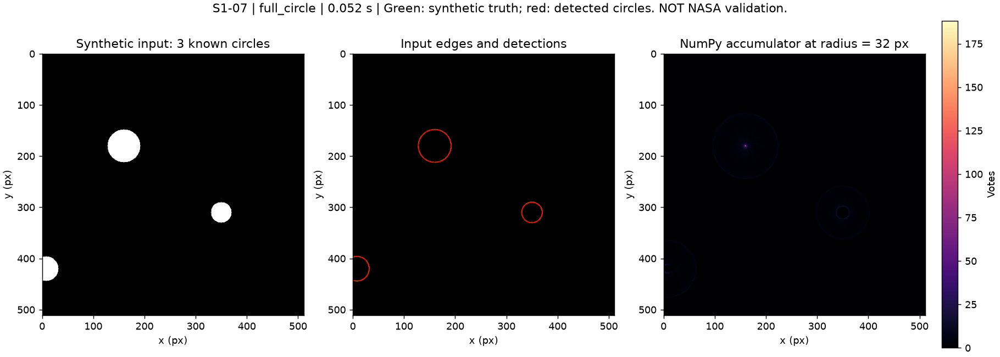

<!--
CHƯƠNG 2 – BẢN GHÉP ĐẦU TIÊN (S3-12).
Người chốt: Tiến (S3-06) cho mục 2.2 Hough; Hưng (S3-07) cho mục 2.1 tiền xử lý và 2.3 sáng–tối.
Mục 2.4 lấy từ mã đối sánh/chấm điểm của Đức (S2-04) và mục 5 của S2-11/S3-06; nên nhờ Đức và Tiến (S3-02) đọc lại.
Mục 2.5 lấy từ mô tả thống kê của Hưng (S2-09); Hưng đọc lại cùng mục 4.5.

MỤC 2.2 BÁM THEO PR #26 (CHƯA GỘP): nguồn chính là docs/S2-11_S3-06_HOUGH_HOAN_THIEN.md và src/hough.py trên ref pr26.
Sau khi PR #26 gộp phải đối chiếu lại 2.2 (dẫn xuất, ví dụ, giả mã, độ phức tạp (2.15)–(2.16), dải bán kính (2.14)),
câu nhắc chế độ chọn cân bằng theo bán kính ở 2.2.3 và dòng "chế độ cân bằng" của giả mã, và câu về nhãn không chắc chắn ở 2.4.2.

Nguồn đã dùng:
  pr26: docs/S2-11_S3-06_HOUGH_HOAN_THIEN.md, docs/TAI_LIEU_THAM_KHAO_HOUGH.md (mục 5), src/hough.py;
  docs/S1-15_LY_THUYET_HOUGH.md; docs/S1-12_VI_DU_VA_DOI_CHIEU_HOUGH.md; docs/HOUGH.md; docs/S2-01_HOUGH_CAI_THIEN.md;
  docs/S1-14_NHAP_CHUONG_2_3.md (Chương 2, mục 2.1.x và 2.3.x); docs/TIEN_XU_LY.md;
  docs/S1-11_SANG_TOI.md; docs/S2-02_RA_SOAT_SANG_TOI.md; docs/S2-05_LOC_TRUNG.md;
  docs/S2-04_CHAM_DIEM.md; docs/S2-03_TAP_DIEU_CHINH.md (mục 3.3); docs/S2-07_THI_NGHIEM_VA_THU_GAME.md;
  docs/S1-16_HO_SO_DU_LIEU.md, docs/DINH_DANG_DU_LIEU.md (quy ước tọa độ);
  docs/S1-06_HUONG_DAN_DU_LIEU.md, docs/S1-16_KHAO_SAT.md, docs/S1-16_CHUONG_4_NHAP.md, docs/CHUONG_1_NHAP.md (mật độ, tuổi tương đối);
  src/preprocessing.py, src/hough.py, src/postprocessing.py, src/matching.py, src/scoring.py, src/statistics.py, configs/default.json.

Việc người chốt cần kiểm tra:
 1. CLAHE (2.1.3): bốn ý chia ô / cắt ngọn / phân bổ lại / nội suy song tuyến mới đối chiếu qua nguồn thứ cấp MathWorks;
    cần đọc bản gốc Zuiderveld 1994 (Graphics Gems IV) và xác nhận nhà xuất bản trên trang bìa.
 2. Công thức ngưỡng cắt (2.3): người ghép đã đối chiếu clahe.cpp tag 4.14.0 dòng 397–402 (clip = max(1, int(clipLimit·N_ô/256)))
    và thêm mục bib opencv_clahe_source (27/10/2026).
 3. Cơ sở vật lý sáng–tối (2.3.1) viết thành lập luận hình học, minh họa bằng Hình 2.3 (cảnh giả lập); nếu muốn trích nguồn
    khoa học, thêm mục bib và trích ở câu này.
 4. Ba DOI (Duda–Hart 1972, Yuen 1990, Canny 1986) đã đối chiếu Crossref ngày 27/10/2026 ở mức thư mục (PR #26),
    nhưng chưa đọc toàn văn. Không mở rộng nội dung trích dẫn vượt mức đã đọc.
 5. Quy ước tâm ô +0,5 px của OpenCV (2.2.5) đã kiểm bằng thực nghiệm (OpenCV 4.14.0 và 5.0.0, S1-12);
    nên chỉ ra dòng tương ứng trong hough.cpp tag 4.14.0. Mã tag 4.14.0 không chứng minh nội bộ bản 5.0.0.
 6. Độ phức tạp (2.15)–(2.16) theo ký hiệu của S2-11 mục 4 (I, K, L). Mục 2.8 của S1-15 (hạng ⌈E/B⌉·N cho mỗi lô) đã cũ
    sau S2-01; nay chỉ còn là cận trên của I.
 7. Các số S_r = 40 (r = 5), S_r = 360 từ r = 62, tổng 36.445 độ lệch trên r = 5…128 và 8,9·10^8 phiếu được tính lại
    bằng đúng quy tắc _circle_offsets (bước góc 1°) khi ghép chương; 48, 80, 144, 168, 224 có sẵn trong S1-12/S2-05.
    Chưa có script lưu trong repo cho các số mới: chạy lại hoặc bỏ.
 8. Câu "vòng dự đoán rơi vào hố không chắc chắn được bỏ qua" (2.4.2) theo S2-11 mục 5; trong nhánh này
    src/evaluation.py chưa cài, src/scoring.py chỉ loại hố uncertain khỏi tập nhãn. Kiểm tra lại với mã đánh giá của PR #26.
 9. Các ngưỡng 30°, τ = 0,15/0,25, vành [1,3r; 2r], Canny P90 và 0,4, σ = 1,5 là giá trị ban đầu; sửa nếu bản chạy cuối đổi.
10. Công thức mật độ (2.24) theo docstring src/statistics.py; hàm summarize chưa cài. Đối chiếu khi S2-09 xong.
11. Hình 2.1 có tiêu đề tiếng Anh, mã "S1-07" và thời gian chạy; Hình 2.3 có "(S1-04 mục 6.3)" trong tiêu đề.
    Cân nhắc vẽ lại không có mã nội bộ (scripts/demo_hough.py, scripts/s114_figures.py). Hình 2.2 chạy bằng mã trước PR #26.
12. Chương 3 không lặp lại: bảng tham số, số đo CLAHE 8/16 bit, ảnh trước/sau, histogram STT 13/17, sơ đồ B0–B8.
    Công thức đổi tọa độ ảnh cắt về ảnh nguồn của S1-14 mục 2.1.2 không đưa vào đây vì Chương 4 đã có (4.1).
13. Để giữ khoảng 9–10 trang, đã bỏ bảng so sánh hai cách bỏ phiếu và hình trừ độ dốc (docs/images/s114/tru_doc_dia_hinh.png);
    nếu còn chỗ có thể đưa lại hình này vào 2.3.3.
-->

# Chương 2. Cơ sở lý thuyết

Chương này trình bày cơ sở toán học của từng bước: tiền xử lý và trích biên, Hough tròn tự cài đặt bằng NumPy, kiểm tra sáng–tối, đối sánh và độ đo, mật độ hố. Tham số và số đo nằm ở Chương 3 và Chương 4.

## 2.1. Tiền xử lý ảnh và trích biên

### 2.1.1. Mục tiêu và quy ước

Hough tròn làm việc trên ảnh biên nhị phân: thiếu điểm biên trên vành thì vòng nhận ít phiếu, thừa điểm biên rác thì Hough chậm và sinh nhiều ứng viên sai. Ảnh đầu vào có thể khác nhau về định dạng (TIF 8 bit, PDS 16 bit, số thực), có góc tới của Mặt Trời từ 7,64° đến 87,78°, và có nhiễu cùng kết cấu hạt regolith. Vì vậy ảnh được đưa về cùng thang, tăng tương phản cục bộ, giảm nhiễu rồi mới trích biên. Quy ước chung: ảnh xử lý cỡ 512 × 512 px; x là cột, tăng sang phải; y là hàng, tăng xuống dưới; gốc ở góc trên trái. Tâm pixel có tọa độ nguyên, còn tâm hố có thể là số thực. Giá trị pixel nằm trong [0, 1]. Pixel không có dữ liệu được đánh dấu bằng mặt nạ hợp lệ V (V = 1 là hợp lệ).

### 2.1.2. Thu nhỏ, ảnh xám và chuẩn hóa

Ô cắt có cạnh 512·k px, k nguyên ≥ 1, được thu về 512 × 512 bằng trung bình khối k × k; khối chứa pixel không hợp lệ cho pixel không hợp lệ:

$$ I'(x,y) = \frac{1}{k^2}\sum_{i=0}^{k-1}\sum_{j=0}^{k-1} I(kx+i,\; ky+j), \qquad V'(x,y) = \bigwedge_{i,j} V(kx+i,\; ky+j) \qquad (2.1) $$

Vì k nguyên nên không cần nội suy, và tỷ lệ ảnh mới là $s = k \cdot s_{\mathrm{nguồn}}$ (m/px). Cả 16 ảnh nguồn đều là ảnh một kênh; ảnh ba kênh, nếu có, được đổi sang độ sáng $Y = 0{,}299R + 0{,}587G + 0{,}114B$ theo ITU-R BT.601 [@itu601]. Sau đó ảnh được chuẩn hóa theo phân vị 0,5 % và 99,5 % của các pixel hợp lệ:

$$ I_N = \operatorname{clip}\!\left(\frac{I - P_{\mathrm{lo}}}{P_{\mathrm{hi}} - P_{\mathrm{lo}}},\; 0,\; 1\right) \qquad (2.2) $$

Dùng phân vị thay cho giá trị nhỏ nhất và lớn nhất để vài pixel bão hòa hoặc pixel chết không quyết định cả thang. Nhờ vậy ngưỡng của các bước sau có cùng ý nghĩa trên mọi ảnh. Nếu hai phân vị bằng nhau mà ảnh vẫn có biến thiên, giá trị nhỏ nhất và lớn nhất được dùng thay để không xóa mất vật thể nhỏ.

### 2.1.3. Tăng tương phản cục bộ CLAHE

Cân bằng histogram toàn cục làm vùng bóng bão hòa đen và khuếch đại nhiễu ở vùng biển (mare) phẳng. CLAHE khắc phục bằng bốn ý [@zuiderveld1994; @mathworks_adapthisteq]: chia ảnh thành lưới ô (ví dụ 8 × 8 ô cỡ 64 × 64 px) và tính histogram từng ô; cắt ngọn histogram ở ngưỡng β để vùng phẳng màu không bị kéo giãn thành nhiễu; phân bổ đều phần bị cắt cho mọi bin rồi dùng hàm phân bố tích lũy làm ánh xạ độ sáng; nội suy song tuyến giữa bốn ô lân cận để không lộ ranh giới ô. Trong OpenCV [@opencv_clahe; @opencv_clahe_source], ngưỡng cắt mỗi bin là:

$$ \beta = \max\!\left(1,\; \frac{\mathrm{clipLimit} \cdot N_{\mathrm{ô}}}{N_{\mathrm{bin}}}\right) \qquad (2.3) $$

với $N_{\mathrm{ô}}$ là số pixel một ô và $N_{\mathrm{bin}}$ là số mức xám. Ảnh 8 bit, ô 64 × 64, clipLimit = 2 cho β = 32. Ảnh 16 bit cho $2 \cdot 4096 / 65\,536 < 1$, nên mọi clipLimit nhỏ hơn 16 đều cho β = 1 và mất tác dụng. Vì vậy nhóm chạy CLAHE trên ảnh lượng tử 8 bit, rồi làm trơn Gauss ngay sau để dập phần nhiễu bị khuếch đại.

### 2.1.4. Làm trơn Gauss và gradient Sobel

Kernel Gauss có bán kính $R = \lceil 3\sigma \rceil$ và tách được, nên ảnh được lọc theo hàng rồi theo cột ($\star$ là phép tương quan):

$$ g(i) = \frac{e^{-i^2/(2\sigma^2)}}{\sum_{j=-R}^{R} e^{-j^2/(2\sigma^2)}},\ \ i = -R, \dots, R, \qquad I_S = (I \star g_x) \star g_y \qquad (2.4) $$

Chi phí giảm từ $(2R+1)^2$ xuống $2(2R+1)$ phép nhân mỗi pixel; với σ = 1,5 là 22 thay cho 121. Mép ảnh được đệm phản chiếu kiểu BORDER_REFLECT_101 của OpenCV. σ cần đủ lớn để xóa vân hạt nhưng không vượt $r_{\min}/3 \approx 1{,}67$ (với $r_{\min}$ = 5 px) để vành hố nhỏ nhất không bị mờ mất. Gradient được tính bằng Sobel 3 × 3, cũng tách được:

$$ K_x = \begin{bmatrix}1\\2\\1\end{bmatrix}\begin{bmatrix}-1 & 0 & 1\end{bmatrix},\ \ K_y = K_x^{\mathsf{T}}, \qquad |G| = \sqrt{g_x^2 + g_y^2},\ \ \theta = \operatorname{atan2}(g_y,\, g_x) \qquad (2.5) $$

với $g_x = I_S \star K_x$, $g_y = I_S \star K_y$; $g_x > 0$ khi ảnh sáng dần sang phải, $g_y > 0$ khi sáng dần xuống dưới. Kernel không chia cho 8, nên $|G| \cdot 255$ cùng thang với gradient của Canny trong OpenCV trên ảnh 8 bit.

### 2.1.5. Biên Canny và mặt nạ biên

Canny [@canny1986; @opencv_canny] có hai bước. Triệt tiêu điểm không cực đại chỉ giữ pixel có $|G|$ lớn nhất theo hướng θ, nên biên mảnh còn 1 px. Ngưỡng kép giữ pixel $|G| \ge T_{\mathrm{high}}$, và giữ pixel $T_{\mathrm{low}} \le |G| < T_{\mathrm{high}}$ chỉ khi nối liền với biên chắc chắn, nên vành hố liền mạch mà ít điểm rác. Vì tương phản thay đổi theo góc tới, ngưỡng được co giãn theo từng ảnh:

$$ T_{\mathrm{high}} = P_{90}\!\left(|G| \cdot 255\right), \qquad T_{\mathrm{low}} = 0{,}4\, T_{\mathrm{high}} \qquad (2.6) $$

Phân vị tính trên vùng hợp lệ đã loại lề, hoặc trên các pixel có gradient dương nếu nền phẳng chiếm hơn 90 % ảnh. Cuối cùng, mép ảnh, khoảng trống và đường ghép mosaic tạo biên thẳng giả góp phiếu cho nhiều vòng, nên điểm biên trong lề m px quanh mép ảnh và vùng không hợp lệ bị bỏ bằng phép co mặt nạ:

$$ E(x, y) = E_{\mathrm{Canny}}(x, y) \wedge \bigwedge_{|i|, |j| \le m} V(x+i,\, y+j), \qquad m = \max(6,\ R + 1) \qquad (2.7) $$

Gauss lan ảnh hưởng của pixel không hợp lệ ra R px, Sobel thêm 1 px; với σ = 1,5 thì m = 6.

## 2.2. Biến đổi Hough tròn

### 2.2.1. Không gian tham số và bỏ phiếu toàn vòng

Cần tìm các bộ (a, b, r) mô tả vành tròn trên ảnh biên E cỡ W × H, với (a, b) là tâm và r là bán kính. Một điểm biên không xác định được đường tròn, nhưng nhiều điểm trên cùng vành cùng ủng hộ một bộ tham số; Hough chuyển việc tìm đường cong thành tìm đỉnh trong không gian tham số [@duda1972]. Từ $(x-a)^2 + (y-b)^2 = r^2$, tập tâm khả dĩ của điểm biên (x, y) là:

$$ a = x - r\cos\varphi, \qquad b = y - r\sin\varphi, \qquad 0 \le \varphi < 2\pi \qquad (2.8) $$

Với r cố định, đó là đường tròn bán kính r quanh điểm biên; các đường tròn này của những điểm trên cùng vành cắt nhau tại tâm thật. Mỗi điểm biên bỏ phiếu cho mọi tâm khả dĩ vào bảng tích lũy (accumulator) A(a, b, r) gồm W × H × $R_n$ ô, với $R_n$ bán kính được thử; cài đặt chỉ giữ lần lượt từng mặt phẳng $A_r[b, a]$. Hình 2.1 cho thấy tại r = 32 px, phiếu của đĩa cùng bán kính hội tụ thành một đỉnh, còn hai đĩa khác chỉ tạo vòng phiếu mờ.

{width=100%}

Cách mặc định lấy T mẫu góc với bước Δφ trên [0°, 360°). Với mỗi bán kính nguyên r, độ lệch được làm tròn trước rồi loại trùng, và mỗi điểm biên bỏ một phiếu cho mỗi tâm nằm trong ảnh:

$$ \mathcal{D}_r = \operatorname{unique}\big\{(\operatorname{rint}(r\cos\varphi_k),\ \operatorname{rint}(r\sin\varphi_k))\big\}_{k=0}^{T-1} \qquad (2.9) $$

$$ A_r[b, a] = \sum_{E(x,y)=1}\ \sum_{(d_x, d_y) \in \mathcal{D}_r} \mathbf{1}\big[a = x - d_x \,\wedge\, b = y - d_y\big], \qquad 0 \le a < W,\ 0 \le b < H \qquad (2.10) $$

rint làm tròn tới số nguyên gần nhất, hòa thì về số chẵn [@numpy_rint]. Vành được phép cắt qua mép ảnh nhưng tâm phải nằm trong ảnh. Phiếu được cộng bằng hàm đếm chỉ số phẳng $b \cdot W + a$ [@numpy_bincount]. Loại trùng tránh việc một điểm biên bỏ nhiều phiếu cho cùng tâm chỉ vì nhiều góc liền nhau rơi vào cùng pixel. Vì vậy $S_r = |\mathcal{D}_r|$ khác T: với bước 1°, $S_r$ = 40, 80, 144 và 224 khi r = 5, 10, 20 và 32.

### 2.2.2. Bỏ phiếu theo hướng gradient

Gradient của $(x-a)^2 + (y-b)^2 - r^2$ vuông góc với tiếp tuyến của đường tròn. Nếu gradient mức xám tại điểm biên gần pháp tuyến của vành, hướng $\mathbf{n} = (\cos\theta, \sin\theta)$ từ (2.5) chỉ ra hai tâm khả dĩ, ứng với hai khả năng vành chuyển từ sáng sang tối hay ngược lại:

$$ (a, b) = (x, y) \mp \operatorname{rint}(r\,\mathbf{n}) \qquad (2.11) $$

θ là hướng gradient đo tại điểm biên, khác góc quét φ. Mỗi điểm biên chỉ bỏ tối đa hai phiếu cho mỗi bán kính thay vì $S_r$ phiếu, và mẫu số hỗ trợ là chu vi ước lượng $S_r = \lceil 2\pi r \rceil$. Cách này nhanh hơn trên ảnh nhiều biên, nhưng cần θ và nhạy với gradient nhiễu, mép bóng hay vành không tròn. Các biến thể Hough tìm đường tròn đã được Yuen và cộng sự so sánh [@yuen1990]. Vì trên ảnh thật gradient tại vành có thể không đi qua tâm, bỏ phiếu toàn vòng là mặc định, còn bỏ phiếu theo gradient là tùy chọn thử nghiệm.

### 2.2.3. Ngưỡng, chọn đỉnh và khử trùng vòng

Với $v_{\min}$ là số phiếu tối thiểu và ρ là tỷ lệ hỗ trợ tối thiểu, ngưỡng phiếu và điểm hỗ trợ của ô (b, a) là:

$$ \tau_r = \max\!\big(v_{\min},\ \lceil \rho\, S_r \rceil\big), \qquad s = \frac{A_r[b, a]}{S_r} \qquad (2.12) $$

Ô có ít nhất $\tau_r$ phiếu và là cực đại 3 × 3 trong cùng mặt phẳng $A_r$ là đỉnh; khi hòa phiếu, ô phía trên rồi ô bên trái được ưu tiên. Đỉnh được chọn trong từng mặt phẳng, chưa phải cực đại ba chiều qua r. Chia cho $S_r$ giảm thiên vị cho vòng lớn vốn có nhiều điểm biên. Điểm s chỉ để xếp hạng, không phải xác suất, và với bỏ phiếu theo gradient có thể vượt 1.

Đỉnh của mọi bán kính được xếp theo s giảm, số phiếu giảm, rồi y, x, r tăng. Ở chế độ cân bằng, thứ tự này còn được xen kẽ giữa các nhóm bán kính để vòng nhỏ không chiếm hết danh sách đầu ra (mục 3.3.5) [CHỜ PR #26 được merge: chế độ cân bằng]. Sau đó phép triệt tiêu không cực đại cho vòng tròn (NMS), khác bước cùng tên của Canny, loại ứng viên gần một vòng đã giữ ở cả tâm lẫn bán kính, cho tới khi đủ L vòng:

$$ (a - a_j)^2 + (b - b_j)^2 \le d_{\mathrm{NMS}}^2 \quad \wedge \quad |r - r_j| \le \delta_{\mathrm{NMS}} \qquad (2.13) $$

Ví dụ với $d_{\mathrm{NMS}}$ = 4 px, $\delta_{\mathrm{NMS}}$ = 2 px và vòng đã giữ (350, 310, 20): vòng (352, 311, 21) bị loại vì $d^2 = 5 \le 16$ và Δr = 1, còn vòng đồng tâm (350, 310, 24) được giữ vì Δr = 4. NMS vì vậy không loại vòng lồng nhau; bước lọc trùng bổ sung ở Chương 3.

### 2.2.4. Ví dụ tính tay

Ví dụ chạy chính các hàm nội bộ của bước Hough trên ảnh biên 5 × 5, r = 1; bán kính và ngưỡng nhỏ chỉ để minh họa. Bốn điểm biên $P_1 = (2, 1)$, $P_2 = (1, 2)$, $P_3 = (3, 2)$, $P_4 = (2, 3)$ đều cách (2, 2) đúng 1 px. Với bước 1°, 360 góc chỉ cho 8 độ lệch (±1, ±1), (±1, 0), (0, ±1), nên $S_1 = 8$. Mỗi điểm bỏ 8 phiếu tại $(x - d_x,\ y - d_y)$, tổng 32 phiếu, đều trong ảnh. Bốn phiếu rơi vào (2, 2), chỉ số phẳng 2·5 + 2 = 12: $P_1$ với (0, −1), $P_2$ với (−1, 0), $P_3$ với (1, 0), $P_4$ với (0, 1). Mảng tích lũy sau $P_1$ và sau cả bốn điểm:

```text
sau P1:        sau P1..P4:
0 1 1 1 0      0 1 1 1 0
0 1 0 1 0      1 2 2 2 1
0 1 1 1 0      1 2 4 2 1
0 0 0 0 0      1 2 2 2 1
0 0 0 0 0      0 1 1 1 0
```

Với $v_{\min} = 3$ và ρ = 0,35, (2.12) cho $\tau_1 = \max(3, \lceil 2{,}8 \rceil) = 3$. Chỉ ô (2, 2) vượt ngưỡng và lớn hơn tám ô kề, nên kết quả là tâm (2, 2), r = 1, s = 4/8 = 0,5; với $v_{\min}$ mặc định bằng 12 thì không có đỉnh. Nếu gradient lý tưởng hướng ra ngoài, (2.11) cho 4 phiếu tại tâm và 1 phiếu ở mỗi ô (2, 0), (0, 2), (4, 2), (2, 4); $S_1 = \lceil 2\pi \rceil = 7$ nên s = 4/7 ≈ 0,571. Cả hai kết quả được kiểm chứng tự động bằng mã.

### 2.2.5. Lượng tử hóa và quy ước tọa độ

Dải bán kính được suy từ dải đường kính $[D_{\min}, D_{\max}]$ và tỷ lệ s, rồi giao với giới hạn cấu hình; dải rỗng bị báo lỗi:

$$ r_{\min} = \max\!\left(5,\ \left\lceil \frac{D_{\min}}{2s} \right\rceil\right), \qquad r_{\max} = \min\!\left(128,\ \left\lfloor \frac{D_{\max}}{2s} \right\rfloor\right) \qquad (2.14) $$

Với bước Δr, ví dụ dải [12, 29] bước 4 chỉ quét 12, 16, 20, 24, 28, và sai số bán kính tới Δr/2. Ở bán kính r khác bán kính thật $r^*$, phiếu rải trên vòng nhỏ bán kính khoảng $|r - r^*|$ quanh tâm nên đỉnh yếu đi. Về góc, hai mẫu liền nhau cách nhau cung $r\,\Delta\varphi$, vượt 1 px khi r > 57,3 px với Δφ = 1°; từ r = 62 px trở lên $S_r$ dừng ở 360.

Ô tích lũy (a, b) trùng tâm pixel (a, b), nên tâm Hough trả về là số nguyên theo cùng quy ước với nhãn tham chiếu, sai số lượng tử tối đa 0,5 px mỗi trục (khoảng 0,71 px). HoughCircles của OpenCV (HOUGH_GRADIENT) nhận ảnh xám, tự trích biên, tìm tâm trước rồi mới ước lượng bán kính, và trả tâm ô tích lũy (chỉ số ô + 0,5) × dp [@opencv_hough_tutorial; @opencv_hough_source]. Với dp = 1, hố tâm nguyên (x, y) được trả về (x + 0,5; y + 0,5), nên phải trừ 0,5 trước khi so sánh; với dp = 2 không có hằng số bù cố định.

Hình 2.2 so sánh ba cách trên cùng ảnh giả lập, dải bán kính 18–36 px. Bỏ phiếu toàn vòng tìm đúng ba đĩa. Bỏ phiếu theo gradient chỉ giữ đĩa r = 20, vì tại tâm hai đĩa kia số phiếu (40 và 27) thấp hơn ngưỡng (71 và 53). OpenCV trả bốn vòng: sau khi trừ 0,5 px, ba vòng trùng tâm thật, bán kính lệch dưới 1 px; vòng thứ tư lệch 5,39 px gần đĩa bị cắt mép. Đây chỉ là minh họa thuật toán, không chứng minh cách nào tốt hơn trên ảnh Mặt Trăng.

{width=100%}

### 2.2.6. Giả mã và độ phức tạp

Giả mã dưới đây bám theo cài đặt; B là số điểm biên mỗi lô.

```text
(ys, xs) ← các điểm biên; nếu không có: trả []
U ← []
với r = r_min, r_min + Δr, ... ≤ r_max:
    A ← mảng H×W toàn 0
    nếu toàn vòng: D ← (2.9); S ← |D|
        với mỗi lô B điểm biên: cộng phiếu (2.10) bằng
            bincount trên đoạn [min i, max i], i = b·W + a
    ngược lại: S ← ⌈2πr⌉; cộng phiếu hai tâm (2.11)
    τ ← max(v_min, ⌈ρ·S⌉)
    thêm (A/S, A, b, a, r) của mọi cực đại 3×3 có A ≥ τ vào U
sắp U: điểm giảm, phiếu giảm, rồi y, x, r tăng
chế độ cân bằng: xen kẽ U giữa các nhóm bán kính
G ← []
với mỗi u trong U: nếu không g ∈ G nào thỏa (2.13) thì thêm u
    vào G; dừng khi |G| = L
trả G
```

Mỗi lô chỉ được đếm trên đoạn chỉ số có phiếu; điểm biên lấy theo thứ tự hàng nên đoạn này thường hẹp, và không phiếu nào thay đổi. Gọi N = H·W, E là số điểm biên, S là số độ lệch lớn nhất ($S \le T$), K là tổng số đỉnh trước NMS và I là tổng độ dài các đoạn đếm. Bỏ phiếu toàn vòng tốn $E \cdot S$ cho phiếu, N cho khởi tạo và dò đỉnh, $T\log T$ cho loại trùng ở mỗi bán kính, cộng sắp xếp và NMS:

$$ O\big(R_n\,(E\,S + N + T\log T) + I + K\log K + K\,L\big), \qquad I \le R_n \left\lceil \tfrac{E}{B} \right\rceil N \qquad (2.15) $$

Hạng chính có dạng quen thuộc $O(E \cdot R \cdot \Theta)$, với Θ là số góc: khoảng 24.300 điểm biên quét r = 5…128 với bước 1° cho tổng 36.445 độ lệch, tức khoảng 8,9·10⁸ phiếu. Bỏ phiếu theo gradient tốn $O(R_n(E + N) + K\log K + K\,L)$; bước xen kẽ nhóm bán kính thêm O(K). Khối tích lũy ba chiều cần $R_n \cdot H \cdot W$ ô, tức 1 MiB mỗi mặt phẳng 512 × 512 số nguyên 4 byte và 124 MiB cho r = 5…128. Cài đặt chỉ giữ một mặt phẳng, nhưng danh sách K đỉnh vẫn gom qua mọi bán kính:

$$ O(N + B\,S + K + E + T) \ \ \text{(toàn vòng)}, \qquad O(N + K + E + T) \ \ \text{(gradient)} \qquad (2.16) $$

## 2.3. Kiểm tra sáng–tối theo hướng nắng

### 2.3.1. Cơ sở vật lý

Hough chỉ dựa vào hình dạng biên, nên không phân biệt hố lõm với gò nổi hay vòng tình cờ khớp các biên rời rạc. Về mặt hình học, khi nắng chiếu xiên, thành hố phía gần Mặt Trời quay lưng với nắng và bị mép hố che nên tối, còn thành phía xa hướng về nắng nên sáng. Gò nổi cho quy luật ngược lại; vòng ở chỗ không có hố thì không có quy luật nào (Hình 2.3).

{width=65%}

### 2.3.2. Hướng nắng và điểm sáng–tối

Metadata ghi phương vị Mặt Trời A, đo theo chiều kim đồng hồ từ hướng Bắc, và góc hướng Bắc trong ảnh $\alpha_N$ (bằng 0 khi Bắc ở trên). Với $\varphi = A + \alpha_N$, vector đơn vị chỉ về phía Mặt Trời trong hệ ảnh (y hướng xuống) là:

$$ \mathbf{u} = (\sin\varphi,\; -\cos\varphi) \qquad (2.17) $$

Ví dụ φ = 270° (nắng từ phía Tây) cho (−1, 0), tức sang trái. Với ứng viên tâm $\mathbf{c}$, bán kính r, mỗi pixel hợp lệ $\mathbf{p}$ trong đĩa có vị trí chuẩn hóa dọc hướng ra xa Mặt Trời t, âm ở nửa phía Mặt Trời; điểm sáng–tối S là hệ số tương quan Pearson giữa độ sáng I và t:

$$ t(\mathbf{p}) = -\frac{(\mathbf{p} - \mathbf{c}) \cdot \mathbf{u}}{r} \in [-1, 1], \qquad S = \frac{\sum_k (I_k - \bar I)(t_k - \bar t)}{\sqrt{\sum_k (I_k - \bar I)^2}\,\sqrt{\sum_k (t_k - \bar t)^2}} \qquad (2.18) $$

S > 0 nghĩa là sáng dần về phía xa Mặt Trời, khớp với hố lõm; S < 0 khớp với gò nổi hoặc vòng sai. Hệ số tương quan không đổi khi nhân hoặc cộng I với hằng số dương, nên cùng ngưỡng dùng được cho ảnh tương phản thấp lẫn cao.

### 2.3.3. Trừ độ dốc địa hình

Vòng trên sườn có độ sáng tăng đều sẽ có S khác 0 dù không có hố: trên cảnh giả lập, độ dốc sáng 0,001 mỗi pixel đã cho S = +0,48 hoặc −0,50 ở một vòng chỗ phẳng. Vì vậy nhóm khớp mặt phẳng độ sáng bằng bình phương tối thiểu trên vành ngoài $1{,}3r < \|\mathbf{p} - \mathbf{c}\| \le 2r$ (bỏ qua vành nổi của hố), trừ nó khỏi các pixel trong đĩa rồi mới tính S; với vòng chỗ phẳng nói trên, S sau trừ dốc chỉ còn −0,03 (không rõ):

$$ \min_{\beta_0, \beta_1, \beta_2}\ \sum_{\mathbf{p} \in \text{vành ngoài}} \left[ I(\mathbf{p}) - \beta_0 - \beta_1\,\frac{x - x_c}{r} - \beta_2\,\frac{y - y_c}{r} \right]^2 \qquad (2.19) $$

Mặt phẳng không mô tả được mép bóng sắc: khi mép bóng lớn nằm sát vòng, phép trừ lại tạo quy luật giả, ví dụ S sau trừ dốc là +0,90 trong khi trên ảnh gốc là −0,01. Vì vậy điểm được tính cả hai cách, S sau trừ dốc và $S_{\mathrm{raw}}$ trên ảnh gốc, và chỉ kết luận khi hai cách cùng nhãn.

### 2.3.4. Phân loại và điều kiện dùng hướng nắng

Bảng 2.1 nêu quy tắc phân loại, với τ = 0,15 khi phương vị được đo bằng số và τ = 0,25 khi chỉ biết nắng từ phía Đông hay Tây. Ngưỡng sau được nới vì nếu phương vị thật lệch Δ, tương phản đo dọc **u** giảm khoảng cos Δ, nhưng dấu của S vẫn đúng khi Δ < 90°.

| Điều kiện | Nhãn | Ý nghĩa |
|---|---|---|
| $S \ge \tau$ và $S_{\mathrm{raw}} \ge \tau$ | hợp | Sáng–tối khớp với hố lõm |
| $S \le -\tau$ và $S_{\mathrm{raw}} \le -\tau$ | ngược | Gò nổi, mép bóng trong vòng, hoặc vòng sai |
| Còn lại | không rõ | Không có quy luật, hoặc do địa hình quyết định |

: Bảng 2.1. Quy tắc phân loại sáng–tối của một ứng viên.

Nhãn sáng–tối chỉ là thông tin bổ sung, không xóa vòng nào, và "hợp" chưa đủ để khẳng định là hố. Ghi nhầm hướng nắng sẽ đảo mọi kết luận (đổi Tây thành Đông làm cả ba hố giả lập bị chấm "ngược"), nên một ảnh chỉ được chấm khi (1) phương vị có nguồn hoặc phía nắng đã được xác nhận bằng mắt, và góc hướng Bắc đã biết; (2) góc tới, tức góc giữa tia nắng và phương thẳng đứng, từ 30° trở lên, vì nắng gần đứng làm bóng quá ngắn; (3) hướng nắng và hướng Bắc đã được kiểm tra bằng mắt trên hố tham chiếu, và các hố này không dùng làm ví dụ đánh giá. Ảnh không đạt thì mọi ứng viên được ghi "không chấm" kèm lý do và vẫn được giữ.

## 2.4. Đối sánh một–một và các độ đo

### 2.4.1. Đối sánh một–một

Vòng dự đoán (ứng viên máy hoặc vòng người chơi khoanh) tâm $\mathbf{c}_i$ khớp nhãn tham chiếu tâm $\mathbf{q}_j$, bán kính $r^{\mathrm{ref}}_j$ khi:

$$ \delta_{ij} = \frac{\|\mathbf{c}_i - \mathbf{q}_j\|}{r^{\mathrm{ref}}_j} \le 0{,}5 \qquad (2.20) $$

Với hố nhỏ nhất r = 5 px, ngưỡng là 2,5 px, lớn hơn nhiều sai số lượng tử tâm 0,71 px. Sai số bán kính không phải điều kiện ghép, nên luôn được ghi kèm từng cặp. Mỗi vòng và mỗi nhãn dùng tối đa một lần. Với $x_{ij} \in \{0, 1\}$ chỉ bằng 1 khi cặp thỏa (2.20), hệ thống chọn cách ghép nhiều cặp nhất, rồi tổng khoảng cách chuẩn hóa nhỏ nhất:

$$ \max \sum_{i,j} x_{ij}, \quad \text{sau đó} \quad \min \sum_{i,j} \delta_{ij}\, x_{ij}, \qquad \sum_j x_{ij} \le 1,\ \ \sum_i x_{ij} \le 1 \qquad (2.21) $$

Ghép tham lam "cặp gần nhất trước" có thể mất cặp: nếu $P_1$ khớp được cả $Q_1$, $Q_2$ nhưng gần $Q_1$ hơn, còn $P_2$ chỉ khớp $Q_1$, thì cách tham lam chỉ được một cặp thay vì hai. Bài toán (2.21) được giải bằng thuật toán Hungary [@kuhn1955] trên ma trận chi phí $n' \times m'$ sau khi bỏ các vòng và nhãn không khớp được với ai. Cặp hợp lệ có chi phí $\delta_{ij}$; cặp không hợp lệ chịu phạt $(k+1)(0{,}5+1)$, $k = \min(n', m')$, lớn hơn tổng chi phí của k cặp hợp lệ bất kỳ, nên lời giải luôn có nhiều cặp hợp lệ nhất. Độ phức tạp là $O(n'^2 m')$ với $n' \le m'$. Cùng phép ghép được dùng cho đánh giá máy và chấm điểm người chơi.

### 2.4.2. Precision, Recall và nhãn thưa

Gọi TP là số cặp khớp, $N_{\mathrm{dự\,đoán}}$ và $N_{\mathrm{nhãn}}$ là số vòng dự đoán và số nhãn; $\mathrm{FP} = N_{\mathrm{dự\,đoán}} - \mathrm{TP}$, $\mathrm{FN} = N_{\mathrm{nhãn}} - \mathrm{TP}$:

$$ \mathrm{Precision} = \frac{\mathrm{TP}}{\mathrm{TP} + \mathrm{FP}}, \qquad \mathrm{Recall} = \frac{\mathrm{TP}}{\mathrm{TP} + \mathrm{FN}}, \qquad F_1 = \frac{2\,\mathrm{Precision}\cdot\mathrm{Recall}}{\mathrm{Precision} + \mathrm{Recall}} = \frac{2\,\mathrm{TP}}{N_{\mathrm{dự\,đoán}} + N_{\mathrm{nhãn}}} \qquad (2.22) $$

Công thức (2.22) chỉ đúng khi nhãn đầy đủ. Nhãn tham chiếu của đề tài là nhãn thưa: chỉ một phần hố được khoanh. Vòng dự đoán không khớp nhãn nào vẫn có thể là hố chưa gán nhãn, nên FP không đo được và Precision, F1 không xác định. Ngược lại, mỗi nhãn đã biết là hố thật đã kiểm chéo, nên vẫn đo được Recall trên nhãn đã biết:

$$ \mathrm{Recall}_{\mathrm{known}} = \frac{\mathrm{TP}_{\mathrm{known}}}{N_{\mathrm{known}}}, \qquad \mathrm{FN}_{\mathrm{known}} = N_{\mathrm{known}} - \mathrm{TP}_{\mathrm{known}} \qquad (2.23) $$

$N_{\mathrm{known}}$ không tính các hố được đánh dấu không chắc chắn; nhãn chắc chắn được ghép trước, và vòng dự đoán rơi vào hố không chắc chắn được bỏ qua. Recall_known luôn được báo kèm số hố và dải kích thước; Precision và F1 chỉ tính khi có nhãn đầy đủ. Tương tự, trong trò chơi với nhãn thưa, vòng khoanh ngoài các nhãn không bị tính là sai.

## 2.5. Mật độ hố và tuổi tương đối

Bề mặt càng tồn tại lâu thì càng chịu nhiều va chạm và tích lũy càng nhiều hố [@neukum2001]. Vì vậy, trong cùng dải đường kính và cùng tỷ lệ ảnh, vùng có mật độ hố cao hơn thường có tuổi tương đối già hơn; phép so sánh này không cho tuổi tuyệt đối. Với D = 2rs và diện tích tính trên pixel hợp lệ, mật độ trong dải $[D_1, D_2)$ là:

$$ \rho_{[D_1, D_2)} = \frac{N_{[D_1, D_2)}}{A}, \qquad A = \frac{N_{\mathrm{px\,hợp\,lệ}} \cdot s^2}{10^6}\ \ (\mathrm{km}^2) \qquad (2.24) $$

Kết luận có nhiều giới hạn: hố bỏ sót, khoanh nhầm hoặc bị đếm hai lần làm mật độ lệch; chiếu sáng khác nhau làm khả năng thấy hố khác nhau; vùng nhỏ ít hố nên vài hố sai đã đổi mật độ đáng kể; cửa sổ cắt từ cùng mosaic có thể chồng lấp nên không phải mẫu độc lập. Vì vậy so sánh mật độ ở đây chỉ mang tính minh họa, chưa đủ để kết luận về tuổi địa chất.
