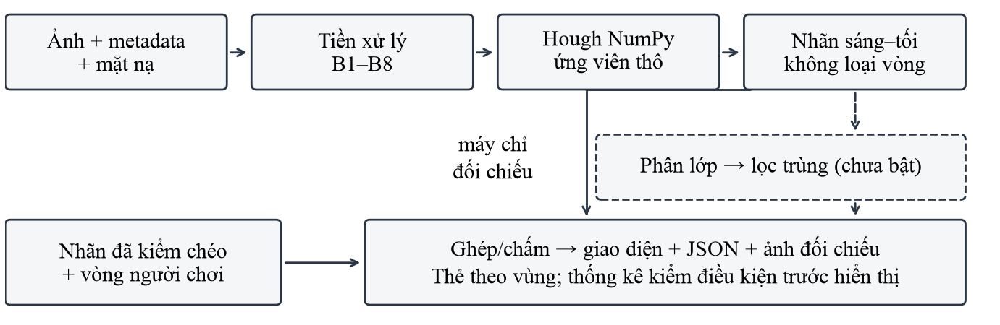

<!-- S3-12 r5: Đức chốt kiến trúc/game; Tiến chốt Hough/đối sánh; Hưng chốt tiền xử lý, hậu xử lý, thống kê. S3-07 (Hưng, 04/11/2026): đối chiếu 3.2, 3.4, 3.5, 3.6, 3.8 với mã cuối main 0e5b49f; chi tiết ở docs/S3-07_BAN_GIAO.md. -->

# Chương 3. Thiết kế và cài đặt

## 3.1. Kiến trúc và cấu trúc mã nguồn

Hình 3.1 mô tả luồng từ ảnh tới kết quả. `run_end_to_end` và trò chơi cùng gọi lõi `detect_machine`, nên dùng cùng cấu hình sẽ có cùng ứng viên. Hai nhánh phân lớp/lọc trùng đã cài nhưng **chưa bật mặc định**. Các mô-đun ở Bảng 3.1 trao đổi mảng NumPy và JSON (tệp dữ liệu văn bản có cấu trúc), phân biệt `source` của vòng máy, nhãn và người chơi.

{width=90%}

| Mã nguồn | Vai trò |
|---|---|
| `src/contracts.py`, `src/pipeline.py` | Kiểm hợp đồng, đổi tọa độ, điều phối và lưu lần chạy |
| `src/preprocessing.py`, `src/hough.py` | Tiền xử lý; Hough NumPy |
| `src/postprocessing.py` | Sáng–tối, phân lớp, lọc trùng |
| `src/matching.py`, `src/scoring.py`, `src/evaluation.py` | Ghép một–một; điểm người chơi; độ đo máy |
| `src/player_annotations.py`, `src/game_results.py` | Lưu vòng người chơi, ảnh đối chiếu, lượt chấm |
| `src/statistics.py`, `src/science_cards.py`, `src/integration.py` | Thống kê, thẻ và kiểm đầu ra trước hiển thị |
| `app.py`, `src/crater_canvas/` | Streamlit và bản đồ vẽ HTML/CSS/JavaScript |
| `scripts/`, `tests/`, `configs/`, `data/` | Lệnh tái tạo, kiểm thử, cấu hình, dữ liệu/nhãn |

: Bảng 3.1. Cấu trúc mã nguồn và trách nhiệm các mô-đun.

Ảnh chuẩn 512 × 512 đi kèm mặt nạ và metadata; tâm pixel nguyên, D = 2rs. Mỗi vòng có mã, tâm, r; `votes` chỉ dành cho máy, `confidence=null` vì phiếu chưa được hiệu chuẩn. Nhãn có `reference_source`; trường chưa có căn cứ để `null`. Mỗi lần chạy lưu metadata, tham số, phiên bản mã, thời gian từng bước và ảnh chồng vòng (overlay) trong thư mục mới; lỗi giữa chừng thì xóa thư mục chạy dở.

## 3.2. Tiền xử lý

Bảng 3.2 phân biệt phần tự viết với thư viện. B0 đọc/cắt ảnh dùng rasterio; B4 và B7 dùng OpenCV. Các phép còn lại chỉ dùng toán mảng NumPy; lý thuyết ở mục 2.1.

| Bước | Thao tác | Cài đặt và tham số |
|---|---|---|
| B1–B3 | Trung bình khối; ảnh xám BT.601; chuẩn hóa phân vị | Tự viết; k theo metadata, 0,5 %–99,5 % |
| B4 | CLAHE | OpenCV; ảnh 8 bit, clipLimit 2, lưới 8 × 8 |
| B5–B6 | Gauss; Sobel, độ lớn/hướng gradient | Tự viết; σ = 1,5, kernel 11; Sobel không chia 8 |
| B7 | Canny | OpenCV; ngưỡng tự tính P90 và tỷ lệ 0,4 |
| B8 | Co mặt nạ, bỏ biên mép/nodata | Tự viết; lề $\ell=\max(6,\lfloor h/2\rfloor+1)$ = 6 px với h = 11 |

: Bảng 3.2. Chuỗi tiền xử lý và phần tự cài đặt.

**Thuật toán 3.1 — `preprocess`.** Vào: ảnh I, mặt nạ V, k, σ, tham số. Ra: ảnh xám, ảnh trơn, biên E, θ và tham số thực dùng. B1–B3/B5–B6/B8 là phép tự viết; số bước tương ứng Bảng 3.2.

```text
01 Nếu không có pixel hợp lệ: báo lỗi; nếu k > 1: thu khối theo (2.1).
02 Đổi RGB sang Y theo BT.601; ảnh một kênh giữ nguyên.
03 Lấy phân vị trên V; nếu trùng thì thử min–max; ảnh phẳng trả 0.
04 Chuẩn hóa theo (2.2), đặt pixel lỗi bằng 0; lượng tử 8 bit cho CLAHE.
05 Tính h theo (2.4); lọc hàng rồi cột bằng correlate_1d.
06 Lọc Sobel tách hai trục theo (2.5); tính |G|, θ.
07 Lấy ngưỡng theo (2.6), có nhánh gradient dương khi nền phẳng.
08 Gọi Canny trên ảnh trơn uint8; lấy biên E_C.
09 Co V theo từng trục: AND các lát dịch −lề…lề, ngoài ảnh là False.
10 Trả E_C AND V_co, gray, smooth, θ và các ngưỡng/số biên.
```

**Thuật toán 3.2 — `correlate_1d`.** Vào: ảnh, hệ số kernel lẻ, trục. Ra: ảnh tương quan float64. Dùng chung cho Gauss và Sobel.

```text
01 Đệm phản chiếu (số hệ số−1)/2 pixel theo trục, không lặp mép.
02 Tạo out = 0 trong float64.
03 Với mỗi j có hệ_số[j] ≠ 0: out += hệ_số[j] × lát ảnh dịch j.
04 Trả out; chỉ đổi float32 ở đầu ra cuối của Gauss/Sobel.
```

Ảnh chuẩn hóa [0, 1]; Canny tính trên |G|·255; σ, h, lề, khoảng cách tâm và bán kính vòng tính bằng pixel ảnh 512. Tính trong float64 tránh tràn uint8 và giảm sai số cộng dồn. Ảnh NPY đã 512 × 512 bỏ qua B1; ảnh phẳng trả biên rỗng. P90 và Gauss giảm nhiễu nhưng không phân biệt mép bóng với vành hố; kết quả tiền xử lý ở mục 4.6.

## 3.3. Hough tròn bằng NumPy

`src/hough.py` không gọi Hough thư viện. Cấu hình cuối `configs/default.json` khớp `configs/s215_frozen.json`: toàn vòng, bước r = 1 px, bước góc 1°, tối thiểu 12 phiếu/tỷ lệ 0,35, NMS tâm 4 px/r 2 px, trần 100 vòng, lô 256. Dải r theo (2.14): 5–125 cho 11 ảnh 2 m/px; 5–100 cho 15 ảnh 20 m/px. `params.json` ghi dải thực quét.

Vector hóa (vectorization) tạo tâm cả lô bằng phép mở rộng mảng (broadcasting), không lặp Python theo từng phiếu.

**Thuật toán 3.3 — `detect_circles`.** Vào: E cỡ M × N, dải r, T góc, B, L và θ nếu dùng gradient. Ra: danh sách (x,y,r,phiếu,q).

```text
01 Lấy (ys,xs) = các điểm biên; rỗng thì trả []. đỉnh = [].
02 Với mỗi r trong dải: tạo A_r int32 cỡ M×N bằng 0.
03   Toàn vòng: tạo D_r theo (2.9), S_r = |D_r|.
04     Với mỗi lô B điểm: tạo tâm bằng mở rộng mảng, bỏ tâm ngoài ảnh.
05     Trải phẳng i=bN+a; cộng bincount trên đoạn [min i,max i].
06   Gradient: thiếu θ thì báo lỗi; bỏ phiếu hai tâm (2.11), S_r=⌈2πr⌉.
07   Lấy cực đại 3×3 với A_r ≥ max(v_min,⌈κS_r⌉); hòa trên/trái.
08   Thêm (A_r/S_r,A_r,y,x,r) của các đỉnh vào danh sách đỉnh.
09 Sắp đỉnh theo (−q,−phiếu,y,x,r).
10 Nếu radius_balanced: chia nhóm r gấp đôi, xen kẽ đầu mỗi nhóm từ nhỏ tới lớn.
11 giữ = []; duyệt đỉnh, bỏ vòng gần vòng đã giữ theo hai ngưỡng (2.13).
12 Thêm vòng còn lại; dừng khi |giữ|=L; trả giữ.
```

Mỗi r chỉ giữ một mặt phẳng 1 MiB; danh sách đỉnh vẫn tích lũy qua r. Đếm đoạn có phiếu giữ nguyên kết quả và từng tăng tốc 2,10–2,40 lần trên ba ảnh đo cùng máy; bảng lịch sử giữ ở Phụ lục E.

Cách `radius_balanced` chia $k_r=\lfloor\log_2(r/5)\rfloor$ thành [5,10), [10,20), [20,40), [40,80), [80,160), xen kẽ trước NMS. STT 13 đổi từ 100 vòng r ≤10 sang 29 vòng r >16, lớn nhất 31; nâng trần kiểu `score` lên 1.000 chỉ có 8 vòng r >16. Phân bổ suất ứng viên (quota) theo dải r nhằm giảm thiên lệch xếp hạng, không chứng minh Precision cao. Cấu hình cuối vẫn `score`, chọn trên 18 ảnh điều chỉnh (tuning) cho 10/174 nhãn (5,75 %; trung bình theo ảnh 8,12 ± 16,06 %), không dựa vào tập kiểm tra (holdout). Gradient từng chỉ cho 0–2 vòng/ảnh ở kiểm ghép 14/10; vì vậy không dùng mặc định.

## 3.4. Sáng–tối và phân lớp ứng viên

`resolve_sun` chỉ cho chấm khi có nguồn/xác nhận hướng nắng, biết hướng Bắc, góc tới ≥30° và đã kiểm bằng mắt. Ngày 18/10, tám phiếu hướng nắng ghi `consistent`; phiếu do một người kiểm nên còn giới hạn. `filter_candidates` gắn nhãn, **không loại vòng**. Ngưỡng τ ở Bảng 2.1.

**Thuật toán 3.4 — `score_one`.** Vào: ảnh I, V, vòng (c,r), vector nắng u, ngưỡng τ. Ra: hợp/ngược/không rõ/không chấm.

```text
01 P = pixel hợp lệ trong đĩa |p−c|≤r.
02 Nếu |P|<30 hoặc phủ <80 % đĩa: trả not_checked.
03 Q = pixel hợp lệ trên vành 1,3r<|p−c|≤2r.
04 Nếu |Q|<30 hoặc phủ <50 % vành: trả not_checked.
05 Tính t và S_raw từ I(P) theo (2.18).
06 Khớp ba hệ số mặt phẳng trên Q bằng bình phương tối thiểu (2.19).
07 Trừ mặt phẳng khỏi I(P); tính S. Không đủ phương sai: không chấm.
08 Trả nhãn theo đồng thuận S và S_raw ở Bảng 2.1.
```

**Thuật toán 3.5 — `review_candidates`, `apply_filter`.** Vào: các vòng, gray, |G|, θ, E, V và chính sách lọc. Ra: lớp ứng viên; vòng giữ/loại và lý do. Tìm vùng liền khối dùng OpenCV, luật sau đó tự viết và độc lập điểm sáng–tối. Ngưỡng bóng 0,06 là độ sáng chuẩn hóa sau B3; 1.500 px là 0,6 km² ở 20 m/px.

```text
01 Tìm vùng bóng gray<0,06, diện tích ≥1.500 px bằng OpenCV.
02 Giãn vùng bóng 2 px bằng co phần bù; E_bóng = E AND vùng đã giãn.
03 Với mỗi vòng: Z = biên trong dải |d−r|≤1,5 px.
04   Đo phủ = số cung 10° có biên xuyên tâm /36; lệch hướng ≤30°.
05   Đo nổi = mean |G| trên Z xuyên tâm / median |G| vành [1,3r;2r].
06   Đo bóng = tỷ lệ điểm Z thuộc E_bóng; thiếu dữ liệu trả unclear.
07   Bóng≥0,5: shadow_edge; khác thì phủ<0,5 hoặc nổi<1,5: texture;
08   còn lại rim. apply_filter kiểm tên lớp/nhãn, lọc và ghi lý do.
```

Chỉ 8/26 ảnh được chấm sáng–tối; 3 ảnh góc tới thấp và 15 ảnh ghép (mosaic) thiếu hướng nắng giữ `not_checked`. Trên ảnh đủ điều kiện có 17–31 vòng hợp, 18–27 ngược, 44–56 không rõ trong 100 vòng. Hough tăng cả hợp và ngược so với vòng ngẫu nhiên, nên điểm chưa tách được hố thật. Ở STT 13, chỉ M9 (+0,75) trong bốn vòng điểm cao là hố; bốn vòng thấp (−0,72 đến −0,79) là mép bóng/địa hình. Kết quả lọc ở mục 4.6; mặc định chưa bật vì mới có hai ảnh Apollo 16 gán nhãn ứng viên.

## 3.5. Lọc vòng tròn trùng

NMS còn bỏ lọt vòng nhỏ lồng trong vành thật hoặc hai vòng cùng cỡ cách tâm trên 4 px. `dedupe_circles` dùng khoảng cách tâm d, bán kính lớn R và nhỏ r; hai tỷ số không thứ nguyên:

$$ d/R\le\text{0,75}\quad\text{và}\quad r/R\ge\text{0,5}. \qquad (3.1) $$

Điều kiện bán kính giữ hố nhỏ thật nằm trong hố lớn. Ba cặp đã biết có d/R = 0,33; 0,45; 0,71; ngưỡng 0,5 sẽ bỏ sót M66/M67. Ngưỡng 0,75 có thể gộp hai hố thật chồng gần hết, nên chưa bật mặc định.

**Thuật toán 3.6 — `dedupe_circles`.** Vào: các vòng và ngưỡng (3.1). Ra: vòng giữ, vòng loại có `duplicate_of`.

```text
01 Với mỗi vòng: q = phiếu/S_r; đủ_tin = q≥0,35 và lớp≠texture.
02 Sắp các vòng theo (không đủ_tin, −r, −q, −phiếu, crater_id).
03 giữ = []; loại = [].
04 Duyệt thứ tự: nếu có vòng đã giữ thỏa (3.1), thêm vòng vào loại,
05   ghi duplicate_of = mã vòng đã giữ; nếu không, thêm vòng vào giữ.
06 Trả giữ theo thứ tự đầu vào và loại.
```

**Ví dụ M32/M8.** STT 13: M32 tâm (52,372), r = 9, 39 phiếu; M8 tâm (49,372), r = 6, 28 phiếu. d = 3 nên d/R = 0,33 ≤0,75 và r/R = 0,67 ≥0,5. $S_9=72$, $S_6=48$ cho q(M32) = 0,542, q(M8) = 0,583. Cả hai đủ tin, M32 lớn hơn được giữ; M8 ghi `duplicate_of=M32`. Chỉ chọn q sẽ giữ nhầm mép bóng nhỏ. Cặp M19/M15 là dạng tương tự; M66/M67 trên STT 17 có r = 7, tâm cách 5 px.

Tám bài `tests/test_dedupe.py` kiểm 10 ca, cả đổi thứ tự và ngưỡng biên: hố chạm mép, chồng mép, hố nhỏ trong hố lớn, cụm hố phải được giữ. STT 13 giảm 100→96, gộp 2/2 cặp trùng thật; STT 17 giảm 100→97, gộp 1/1 cặp; không mất hố thật trong hai bộ này. Bốn vòng loại khác thuộc `texture/unclear`. Đây chỉ là kiểm trên 3 cặp thật, không chứng minh an toàn trên mọi ảnh.

## 3.6. Đếm vùng và thống kê

`src/statistics.py` tự viết bằng Python/NumPy. Hai vùng phải cùng tỷ lệ và cùng dải D; khác nhau thì báo lỗi. Dùng D = 300–2.000 m, tương ứng r = 7,5–50 ở 20 m/px: cận dưới tránh hố nhỏ khó xác nhận, cận trên tránh hố quá hiếm trên vùng 100–200 km².

**Thuật toán 3.7 — `region_count`.** Vào: các ô, mặt nạ đếm/hợp lệ, tỷ lệ s, $D_{min},D_{max}$. Ra: danh sách hố gộp H, A, ρ, khoảng tin cậy.

```text
01 Kiểm các ô cùng s và cùng ảnh nguồn; U = hợp mặt nạ ở hệ ảnh nguồn.
02 H = []; với mỗi vòng (x,y,r) của mỗi ô: D = 2rs.
03 Bỏ D ngoài [D_min,D_max) hoặc tâm làm tròn nằm ngoài mặt nạ đếm.
04 Đổi tâm về ảnh nguồn, tìm hố đã có trong H lệch tâm ≤0,5R và r/R≥0,7.
05 Nếu tìm thấy hố: gộp; nếu không: thêm vòng vào H.
06 A = |U|s²/10⁶; ρ = |H|/A; A=0 thì mật độ không xác định.
07 Trả H, A, ρ và khoảng Poisson theo (2.25) chia A.
```

**Thuật toán 3.8 — `size_frequency`, `poisson_interval`, `compare_regions`.** Vào: hố của vùng, A, dải D; thêm vùng thứ hai khi so sánh. Ra: histogram, tần suất tích lũy, cận 95 %, tỷ số và p.

```text
01 Tạo biên bin D_min×(√2)^j, kết thúc tại D_max; đếm và cộng dồn.
02 Tính Poisson CDF (hàm phân phối tích lũy): term=exp(−μ); lặp term*=μ/i, cộng đến n.
03 Chia đôi 200 lần tìm hai nghiệm (2.25); n=0 có cận dưới 0.
04 Kiểm cùng s/dải D; tính xác suất Binomial của 0…N1+N2 theo (2.26).
05 Cộng xác suất không lớn hơn xác suất N1 quan sát để có p hai phía.
```

Khoảng n = 0 cho [0;3,689], n = 10 cho [4,795;18,39], khớp bảng tra; 12 bài kiểm thống kê còn kiểm gộp ô và từ chối khác thang/dải. Bản đếm S3-03 qua 13/13 phép kiểm độc lập của `scripts/s303_kiem_tra.py` (thang, dải r, diện tích từ mặt nạ với 1 px = $4\cdot10^{-4}$ km², chồng pixel, tổng các lớp); ngưỡng 424 m chỉ là thăm dò, báo kèm p hiệu chỉnh (mục 4.8).

`summarize` xuất số vòng, diện tích, mật độ, histogram, giới hạn cho game. Nếu số ứng viên **thô ≥ `max_circles`**, giao diện ẩn mật độ bằng “—” và cảnh báo không suy tuổi/so vùng; số vòng, diện tích, histogram còn hiện. Với ảnh Lunokhod 1/Mare Frigoris phù hợp metadata, app hiện riêng bảng **đếm tay**, độc lập lượt chơi; ảnh cùng nguồn ngoài ô đếm có lời giải thích. Kết quả và giới hạn ở mục 4.8.

## 3.7. Trò chơi, ghép hố và thẻ khoa học

Ứng dụng Streamlit có bản đồ tự viết bằng HTML/CSS/JavaScript [@streamlit], dùng được ngoại tuyến sau cài. Người chơi kéo tâm–vành để vẽ; kéo hoặc nhập số để sửa; có xóa, hoàn tác 50 thay đổi, tối đa 500 vòng/ảnh, phóng 1–8 lần, chuột/bàn phím/cảm ứng. Đổi ảnh giữ bản nháp. “Lưu trên máy” ghi ở máy chủ, “Tải JSON” đưa file về máy người chơi.

Con trỏ (u,v), gốc bản đồ $(u_0,v_0)$ và bề rộng W theo pixel hiển thị; mức phóng z không đơn vị, gốc vùng xem $(v_x,v_y)$ theo mép pixel ảnh:

$$ x=v_x+\frac{(u-u_0)512}{Wz}-\text{0,5},\qquad y=v_y+\frac{(v-v_0)512}{Wz}-\text{0,5}. \qquad (3.2) $$

Trừ 0,5 chuyển về tâm pixel; vẽ cộng lại 0,5. Test JavaScript kiểm nhiều mức phóng/cỡ hiển thị; ảnh đối chiếu phóng 3 lần. Câu trả lời chấm với máy và nhãn theo hai nguồn riêng.

**Thuật toán 3.9 — ghép và chấm.** Vào: vòng dự đoán, nhãn và mức đầy đủ. Ra: cặp ghép, sai lệch, điểm nếu nhãn đủ điều kiện.

```text
01 Tính δ_ij (2.20), bỏ hàng/cột không có cặp hợp lệ.
02 Tạo chi phí δ cho cặp hợp lệ; phạt (ν+1)(0,5+1) cho cặp sai.
03 Hungary: thêm từng hàng; tìm đường tăng theo chi phí giảm bởi thế vị.
04 Cập nhật thế vị bằng chi phí dư nhỏ nhất; truy vết, đảo đường tăng.
05 Bỏ cặp chịu phạt; trả khoảng cách tâm, lệch r theo (2.21).
06 So máy: chỉ báo vòng trùng/chỉ người/chỉ máy, không sinh điểm.
07 So nhãn: yêu cầu nguồn kiểm chéo; bỏ uncertain; tính (3.3).
```

$$ Điểm_{thưa}=100\,TP/N_{nhãn},\qquad Điểm_{đầy\,đủ}=100\,\frac{2TP}{N_{dự\,đoán}+N_{nhãn}}. \qquad (3.3) $$

Nhãn thưa không phạt vòng ngoài nhãn; chỉ dùng F1 khi đã xác nhận nhãn đầy đủ. Thiếu nguồn kiểm chéo thì “Chưa có điểm”; sửa sau khi chấm thì báo kết quả cũ. Phần máy nêu dải tìm và cảnh báo bước lưới >2 px/trần 100. Mỗi lượt lưu riêng tham số, metadata, vòng, kết quả, thời điểm và phiên bản.

Thẻ có tiêu đề, nội dung và nguồn về Apollo 15/16, Lunokhod 1/2; dữ liệu thiết bị đối chiếu NASA [@nssdc_artifacts], phủ 21/26 ảnh. Van de Graaff/Mare Frigoris không có thẻ; mọi thiết bị đã đối chiếu ngoài ô cắt nên `position=null`. Chưa đáp ứng hành vi “hiện khi tìm thấy”. Tích hợp trả `pending/ok/error`; sai hợp đồng không hiện số, thẻ thiếu nguồn/link `http(s)`/tọa độ hợp lệ bị ẩn kèm lý do. Hình kết quả ở mục 4.9.

## 3.8. Độ phức tạp, kiểm chứng và khó khăn

Bảng 3.3 dùng M × N là kích thước ảnh; $E_n,K,B,S_{max},T,R_n,L,J$ theo mục 2.2.4; n là số vòng, $r_{max}$ bán kính lớn nhất, $b_h$ số khoảng lớp; c là số ô vùng đếm, $P_U$ là số pixel của khung chữ nhật bao các ô, $n_p,n_q$ là số vòng/nhãn trước rút ma trận ghép.

| Khối tự cài | Thời gian | Bộ nhớ phụ |
|---|---|---|
| B1–B3 | $O(MN\log(MN))$ là chặn trên khi tìm phân vị bằng sắp xếp; trung bình khối/ảnh xám $O(MN)$ | $O(MN)$ |
| Gauss, Sobel, co mặt nạ | $O(MN(R_g+\ell))$; Sobel kernel cố định | $O(MN)$ |
| Hough toàn vòng / gradient | Công thức (2.15); gradient $O(R_n(E_n+MN)+K\log K+KL)$ | Công thức (2.16) |
| `score_one`; `review_candidates` | $O(\sum r_i^2)$; thêm $O(MN)$ tìm vùng bóng | $O(r_{max}^2)$; phân lớp thêm $O(MN)$ |
| `dedupe_circles` | $O(nT\log T+n\log n+n^2)$ | $O(n+T)$ |
| Ghép Hungary | $O(n_pn_q+n_1^2m_1)$, $n_1\le m_1$ | $O(n_pn_q)$ |
| Đếm vùng, histogram, khoảng Poisson | $O(P_U+cMN+n^2+nb_h+200n)$ | $O(P_U+n+b_h)$ |

: Bảng 3.3. Độ phức tạp; bộ nhớ toàn ứng dụng còn gồm dữ liệu và ảnh hiển thị.

Bảng 3.4 đo mới ngày 01/11/2026 trên cùng 26 ảnh float32 [0,1], cùng biên `REFLECT_101`, so NumPy tự viết với OpenCV. Với hai đầu ra $Z^{np},Z^{cv}$ có $P_e$ phần tử, $e_{max}=\max_i\left\lvert Z_i^{np}-Z_i^{cv}\right\rvert$. Sai số bình phương trung bình (mean squared error — MSE) là $MSE=P_e^{-1}\sum_i(Z_i^{np}-Z_i^{cv})^2$. MSE gộp có trọng số theo số phần tử, không phải sai số của phép phát hiện hố.

| Phép đối chiếu | $e_{max}$ | MSE |
|---|---:|---:|
| Trung bình khối k=2 ↔ `resize(INTER_AREA)` | $5,96\cdot10^{-8}$ | $2,64\cdot10^{-16}$ |
| Gauss σ=1,5, kernel 11 ↔ `GaussianBlur` | $1,79\cdot10^{-7}$ | $8,69\cdot10^{-16}$ |
| Sobel $g_x,g_y$ ↔ `Sobel(CV_32F)` | $3,58\cdot10^{-7}$ | $3,28\cdot10^{-15}$ |

: Bảng 3.4. Sai số lớn nhất và bình phương trung bình trên đủ 26 ảnh.

Sai khác do thứ tự cộng và làm tròn float32/float64, đều dưới ngưỡng kiểm $10^{-5}$; `scripts/verify_report_numerics.py` lưu kết quả từng ảnh, hash và môi trường (`docs/evidence/s3-12/report_numerics.json`). Hough và OpenCV khác biên/ngưỡng/NMS nên không so MSE giữa hai danh sách vòng; đối chiếu ở Chương 4. Giả lập dùng giá trị khởi tạo bộ sinh số giả ngẫu nhiên (seed) cố định. Số đo phụ CLAHE trong tài liệu bổ sung là lịch sử, chưa có script tái tạo. **Khó khăn và xử lý:** đệm mép trùng thư viện; tính số thực trước đạo hàm để tránh tràn uint8; trần 100 vòng của Hough thiên về vòng nhỏ. 380 test Python và 6 bộ JavaScript kiểm hành vi thiết kế, không thay đánh giá chất lượng (Phụ lục A).

<!-- S3-12: 380 test Python và 6 bộ test JavaScript, đo ngày 04/11/2026 trên nhánh dùng số S3-03 (nền main b091f96 và PR #46); so với 370 thêm 2 test đóng gói trên Windows (PR #48) và 8 test S3-03 (PR #46). Trước đó 370 = 342 + 5 test trung bình ± SD, 16 test xuất bảng Chương 4, 7 test liên kết công khai. -->
