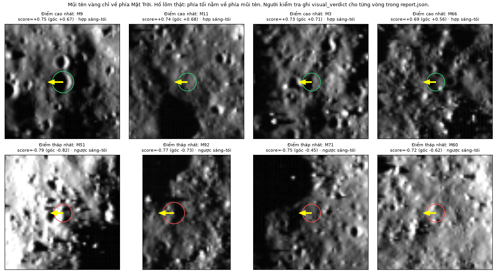
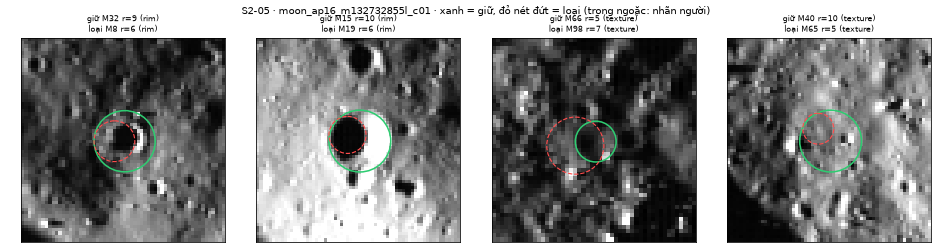

<!--
CHƯƠNG 3 — bản ghép đầu tiên (S3-12, 27/10/2026). Pandoc bỏ ghi chú này khi dựng báo cáo.

Người chốt nội dung:
- Hưng — S3-07: toàn chương (3.1, 3.2, 3.4, 3.5, 3.6, 3.7).
- Tiến — S3-06: mục 3.3 (cài đặt Hough tròn NumPy) và các ý về Hough trong 3.7.

Nguồn đã dùng:
- docs/S1-13_CHAY_TU_DAU_DEN_CUOI.md; docs/evidence/s1-13/ (e2e_26_anh.csv, summary/params/overlay ảnh STT 10).
- docs/S1-14_NHAP_CHUONG_2_3.md (phần "Chương 3", mục 3.2.x và 3.4.x); docs/TIEN_XU_LY.md; docs/evidence/s1-14/.
- docs/HOUGH.md; docs/S2-01_HOUGH_CAI_THIEN.md; docs/evidence/s2-01/ (README.md, timings.csv, report.json, regression.log).
- docs/S1-11_SANG_TOI.md; docs/evidence/s1-11/ (s111_tong_hop.csv, vi_du_stt13/).
- docs/S2-02_RA_SOAT_SANG_TOI.md; docs/evidence/s2-02/<ảnh>/report.json và candidates.csv.
- docs/S2-05_LOC_TRUNG.md; docs/evidence/s2-05/ (tong_hop.csv, <ảnh>.csv); data/examples/s205_dedupe_cases.json.
- docs/S2-13_TICH_HOP.md mục 1 (hợp đồng thống kê); docs/S2-07_THI_NGHIEM_VA_THU_GAME.md; docs/evidence/s2-07/results.json;
  data/reference_labels/moon_ap16_m109134835l_c01_craters_catalogue.json (bán kính 10 nhãn: 8–22 px).
- PR #26 (chưa merge, đọc qua git ref pr26): docs/S2-01_HOUGH_CAI_THIEN.md (mục "Sửa lỗi ứng viên hố lớn ngày 27/10/2026"),
  docs/S2-11_S3-06_HOUGH_HOAN_THIEN.md, docs/S2-06_S3-02_KIEM_CHUNG.md, configs/s201_large_craters.json, diff src/hough.py → mục 3.3.5.
- Mã: src/pipeline.py, src/preprocessing.py, src/hough.py, src/postprocessing.py, src/statistics.py, src/contracts.py,
  scripts/run_end_to_end.py, configs/default.json, configs/s201_hough.json.

Việc còn mở cho người chốt:
1. Số mục Chương 2 đang theo đề xuất S1-14: 2.1 tiền xử lý, 2.2 Hough, 2.3 sáng–tối. Ghép độ đo/ghép một–một và mật độ chỉ ghi "Chương 2". Sửa khi Chương 2 chốt.
2. Recall_known ở 3.3.5 và 3.7: S2-07 mục 1 yêu cầu chưa đưa Recall_known vào báo cáo chính thức tới khi Tiến xác nhận kiểm chéo.
   S2-03 mục 3.1 ghi đã kiểm chéo ngày 26/10 nhưng bảng trong S2-03 vẫn ghi `sparse_unreviewed`; file nhãn ghi "reviewed by Nguyen Manh Tien".
   S2-06_S3-02 (trong PR #26) ghi Tiến xác nhận kiểm bằng mắt đủ 26 overlay ngày 27/10. Khi PR #26 merge, sửa bảng S2-03 cho khớp.
3. Thời gian chạy lấy từ nhiều máy và nhiều lần: S1-13 (Hough 5,1–8,3 s, trước tối ưu), S2-01 (trung vị 9,1–26,1 s sau tối ưu, máy Windows khác), S2-02 (8–40 s), S2-07 (9,1 s). Nếu muốn báo thời gian chính thức, đo lại một lần trên cùng máy với mã cuối.
4. Số đối chiếu OpenCV trên STT 13 (mục 3.2.2) và phép đo ảnh hưởng lượng tử 8 bit là đo một lần, chưa có script trong repo (S1-14 mục 3.2.5–3.2.6).
5. Hình 3.1 lấy từ lần chạy 15/10/2026: chú giải ghi nhãn "chưa kiểm chéo" và lúc đó bước sáng–tối chưa có. Cân nhắc tạo lại bằng mã cuối.
6. Phiếu kiểm tra hướng nắng 8 ảnh do một người kiểm; S1-11 đề nghị người thứ hai kiểm chéo STT 11, 15, 16; STT 16 cần xem lại.
7. 3.4.3 trích opencv_components (người ghép thêm mục bib 27/10/2026).
8. Nhóm chưa quyết định bật lọc `texture` (S2-02) và lọc trùng (S2-05) trong pipeline. Nếu bật, sửa 3.1, 3.4.3, 3.5 và 3.7.
9. Mục 3.3.5 mô tả PR #26 (chọn ứng viên `radius_balanced`, chưa merge), đánh dấu [CHỜ PR #26 được merge: kiểm lại mô tả và số liệu].
   Khi merge: nếu `radius_balanced` thành mặc định thì sửa Bảng 3.2 (thêm `candidate_selection`), sơ đồ 3.1 và đoạn 3.7; kiểm lại mọi số trong 3.3.5.
   Dấu [CHỜ S2-01 ...] ban đầu ở 3.7 đã được thay bằng dấu PR #26 này. Cập nhật số liệu nếu S2-15 (chốt tham số) thay kết quả; điền 3.6 khi S2-09 xong.
10. Baseline phép đo tăng tốc: commit eb8278cc82901cc28dbbc6509b0ff0b6bfefa0cc; bản tối ưu đo trên working tree nhánh s2-01-hough-performance. Ghi ở Phụ lục nếu cần.
11. configs/default.json mục "preprocess" không được scripts/run_end_to_end.py đọc; pipeline dùng DEFAULT_PARAMS trong src/preprocessing.py (cùng giá trị; gauss_kernel_size null → tự tính 11).
12. Để giữ 9–10 trang, chương chỉ dùng 5 hình; đã bỏ ../images/s114/truoc_sau_stt17.png (số liệu STT 17 vẫn ở 3.2.2). Thêm lại nếu còn chỗ.
-->

# Chương 3. Phương pháp và cài đặt

Chương này mô tả cách nhóm cài đặt chuỗi phát hiện hố va chạm và kết quả chuỗi đó tạo ra trên bộ ảnh thật. Lý thuyết nằm ở Chương 2, đánh giá ở Chương 4, hợp đồng dữ liệu và trò chơi ở Chương 5. "STT" là số thứ tự ảnh nguồn trong bảng dữ liệu. Hai ảnh được nhắc nhiều nhất là STT 13 (`moon_ap16_m132732855l_c01`, nắng rất xiên, góc tới 87,7°) và STT 17 (`moon_ap16_m109134835l_c01`, nắng gần đứng, góc tới 7,64°), cùng là ảnh Apollo 16 ở 2 m/px.

## 3.1. Tổng quan chuỗi phát hiện

Hàm `run_end_to_end` trong `src/pipeline.py` chạy chuỗi trên một ảnh cắt 512 × 512 px. Phần lõi `detect_machine` cũng được màn hình chấm bài của trò chơi dùng lại, nên hai nơi cho cùng một danh sách ứng viên máy.

```text
ảnh .npy + metadata .json + mặt nạ hợp lệ
 ▼ preprocess()        B1…B8: edges, theta, gray
 ▼ detect_circles()    Hough NumPy, r ⊂ [5, 128] px
 ▼ filter_candidates() gắn nhãn sáng–tối
 ┊ review_candidates(), apply_filter()   (chưa bật)
 ┊ dedupe_circles()                      (chưa bật)
 ▼ save_run()          outputs/e2e_<image_id>_<UTC>_<id>/
```

Hai mô-đun phân lớp ứng viên (mục 3.4.3) và lọc vòng trùng (mục 3.5) đã cài đặt và thử trên ảnh có nhãn, nhưng chuỗi mặc định chưa gọi. Đầu ra mặc định vì vậy là danh sách ứng viên máy thô (`source = "machine"`) kèm nhãn sáng–tối. Trường `confidence` để `null` vì số phiếu Hough chưa được hiệu chuẩn thành xác suất.

Mỗi lần chạy tạo một thư mục mới, gồm danh sách vòng, metadata, tham số đã dùng, mã commit, thời gian từng bước và ảnh overlay. Nếu một bước lỗi, cả thư mục bị xóa.

Lần chạy cả bộ 26 ảnh ngày 15/10/2026 không gặp lỗi. Tiền xử lý mất 0,025–0,071 s mỗi ảnh, Hough mất 5,1–8,3 s trên máy phát triển. Cả 26 ảnh đều trả đúng 100 ứng viên, tức chạm giới hạn `max_circles`. Hình 3.1 là overlay của một lần chạy: vòng máy rải khắp ảnh, phần lớn là vòng nhỏ trên biên kết cấu (mục 3.7).

{width=75%}

## 3.2. Cài đặt tiền xử lý

### 3.2.1. Các bước và phần tự viết

Chuỗi B0–B8 nằm trong `src/preprocessing.py`; nguyên lý ở mục 2.1. Bảng 3.1 cho biết phần tự viết, phần dùng thư viện và tham số mặc định.

| Bước | Thao tác | Cài đặt | Tham số mặc định |
|---|---|---|---|
| B0 | Đọc file, cắt cửa sổ 512·k, mặt nạ nodata | Thư viện rasterio | — |
| B1 | Thu nhỏ trung bình khối k × k | Tự viết | k theo metadata |
| B2 | Ảnh xám BT.601 [@itu601] | Tự viết | — |
| B3 | Chuẩn hóa theo phân vị | Tự viết | 0,5 % và 99,5 % |
| B4 | CLAHE | OpenCV `createCLAHE` | `clipLimit` 2,0; lưới 8 × 8; 8 bit |
| B5 | Gauss tách hai chiều | Tự viết | σ = 1,5; kernel 11 |
| B6 | Sobel 3 × 3, \|G\|, θ | Tự viết | không chia 8 |
| B7 | Canny | OpenCV `Canny`; ngưỡng tự viết | $T_{high}$ = P90 của \|G\|·255; $T_{low}$ = 0,4 $T_{high}$ |
| B8 | Bỏ biên trong lề tính từ mép và vùng nodata | Tự viết | lề 6 px |

: Bảng 3.1. Các bước tiền xử lý, phần tự viết và phần dùng thư viện.

"Tự viết" nghĩa là chỉ dùng phép toán mảng của NumPy, không gọi hàm lọc ảnh dựng sẵn. B5 và B6 dùng chung hàm `correlate_1d`: đệm ảnh bằng `np.pad(mode="reflect")`, tương đương biên `BORDER_REFLECT_101` của OpenCV, rồi cộng dồn các lát cắt dịch chuyển nhân trọng số trong float64. CLAHE và Canny dùng thư viện vì dài và không phải trọng tâm đề tài [@zuiderveld1994; @opencv_clahe; @canny1986; @opencv_canny]. Hàm `preprocess` ghi vào `params` cả giá trị tính ra như $T_{low}$, $T_{high}$ và số pixel biên. Ảnh `.npy` đã có cỡ 512 × 512 nên B1 được bỏ qua. Ảnh phẳng trả biên rỗng, ảnh toàn nodata bị từ chối, và lề B8 tự tăng theo kernel Gauss.

### 3.2.2. Kết quả và kiểm chứng

Hình 3.2 cho thấy từng bước trên STT 13. Ngưỡng Canny tự co theo độ tương phản: STT 13 có $T_{low}$ = 63,6 và $T_{high}$ = 159,0, còn STT 17 có 46,3 và 115,8, thấp hơn khoảng 27 %. Số pixel biên sau B8 là 24.291 ở STT 13 và 26.642 ở STT 17, khoảng 9–10 % diện tích ảnh. Trên 26 ảnh, số này từ 20.949 đến 35.590. Phần lớn là biên kết cấu, không phải vành hố.

{width=75%}

Bộ kiểm thử `tests/test_preprocessing.py` (33 bài) so phần tự viết với `cv2.resize(INTER_AREA)`, `cv2.GaussianBlur` và `cv2.Sobel`, theo tiêu chí sai khác nhỏ hơn $10^{-5}$. Đo một lần trên STT 13, sai khác lớn nhất là $\text{6,0} \cdot 10^{-8}$ (thu nhỏ khối), $\text{1,8} \cdot 10^{-7}$ (Gauss) và $\text{3,6} \cdot 10^{-7}$ (Sobel).

Khác đặc tả ban đầu, CLAHE chạy trên ảnh 8 bit thay vì 16 bit. Với 16 bit, ô 64 × 64 px và các `clipLimit` thường dùng, ngưỡng cắt mỗi bin của OpenCV luôn bằng 1 nên `clipLimit` mất tác dụng (mục 2.1): trên vùng phẳng có nhiễu, độ lệch chuẩn 0,020 tăng lên 0,188 với mọi `clipLimit` 1, 2, 4, còn bản 8 bit cho 0,038; 0,056 và 0,090. Riêng phép lượng tử về 8 bit ảnh hưởng không đáng kể: hướng gradient lệch trung vị 0,05–0,08°, biên Canny trùng 93–96 %.

### 3.2.3. Hạn chế

- Ngưỡng P90 giả định khoảng 10 % pixel là biên mạnh. Trên vùng gồ ghề, Canny giữ nhiều biên kết cấu, nên Hough nhận nhiều phiếu rác.
- Ở ảnh nắng rất xiên, mép bóng có gradient mạnh hơn vành hố. Tiền xử lý không phân biệt được hai loại biên này; mục 3.4.3 xử lý ở mức ứng viên.
- 11,1 % pixel của STT 17 và 3,2 % của STT 13 đã bão hòa ở mức 255 trong ảnh nguồn 8 bit. Ảnh này chỉ dùng minh họa xử lý ảnh, không dùng đo quang học [@lroc_rdrsis].

## 3.3. Cài đặt Hough tròn bằng NumPy

Hough tròn tự cài đặt bằng NumPy nằm trong `src/hough.py`, không gọi `cv2.HoughCircles` hay hàm Hough của thư viện khác. Tâm pixel có tọa độ nguyên, x sang phải, y xuống dưới. Lý thuyết và chi phí tính toán ở mục 2.2 [@duda1972; @yuen1990].

### 3.3.1. Cấu trúc dữ liệu và vector hóa

Tọa độ điểm biên được lấy một lần bằng `np.nonzero`. Ở mỗi bán kính r, với 360 mẫu góc, bảng độ lệch $(\mathrm{rint}(r\cos\varphi), \mathrm{rint}(r\sin\varphi))$ được làm tròn bằng `np.rint` [@numpy_rint] rồi khử trùng bằng `np.unique`, để mỗi pixel lệch chỉ bỏ phiếu một lần. Số độ lệch khác nhau $S_r$ là số điểm hỗ trợ, ví dụ 48 với r = 6 và 80 với r = 10. Mỗi bán kính dùng một accumulator int32 cỡ 512 × 512 (1 MiB); mã không giữ khối ba chiều mà chỉ lưu các đỉnh. Điểm biên được bỏ phiếu theo lô 256 điểm: phép trừ có broadcast tạo ma trận tâm 256 × $S_r$, tâm ngoài ảnh bị loại, chỉ số phẳng được đếm bằng `np.bincount` [@numpy_bincount]. Đoạn mã rút gọn từ hàm `_accumulate` (đổi tên biến cho ngắn):

```python
cx = xs[s:s + B, None] - dx     # a = x - r*cos(phi)
cy = ys[s:s + B, None] - dy     # b = y - r*sin(phi)
ok = (cx >= 0) & (cx < W) & (cy >= 0) & (cy < H)
idx = cy[ok] * W + cx[ok]
lo, hi = int(idx.min()), int(idx.max()) + 1
acc[lo:hi] += np.bincount(idx - lo, minlength=hi - lo)
```

### 3.3.2. Cách bỏ phiếu và dải bán kính

Cách mặc định `full_circle` bỏ phiếu theo bảng độ lệch trên. Cách tùy chọn `gradient` cần `theta` từ B6: mỗi điểm biên chỉ bỏ phiếu cho hai tâm ở hai đầu pháp tuyến, với $S_r = \lceil 2\pi r \rceil$. Thiếu `theta` thì hàm báo lỗi. Khi kiểm tra ghép mô-đun ngày 14/10/2026, cách `gradient` chỉ giữ 0–2 ứng viên mỗi ảnh với tham số mặc định, nên nhóm giữ `full_circle` làm mặc định.

Dải quét là giao giữa dải của ảnh và giới hạn cấu hình: $r_{\min} = \max(r_{\min}^{\text{meta}}, 5)$, $r_{\max} = \min(r_{\max}^{\text{meta}}, 128)$. Với bộ 26 ảnh, dải này là 5–125 px cho 11 ảnh 2 m/px và 5–100 px cho 15 ảnh 20 m/px. `params.json` ghi bán kính thực quét; ví dụ dải [12, 29] bước 4 chỉ quét 12, 16, 20, 24, 28.

### 3.3.3. Chọn đỉnh và giới hạn số vòng

Ở mỗi bán kính, ngưỡng phiếu và tỷ lệ phiếu là

$$ \tau_r = \max\left(v_{\min},\ \lceil \kappa\, S_r \rceil\right), \qquad q = \frac{A(x, y, r)}{S_r} \qquad (3.1) $$

với $v_{\min}$ = `min_votes`, $\kappa$ = `min_vote_ratio` (ký hiệu như công thức (2.12)). Ví dụ r = 10 cho $\tau_r = \max(12, \lceil \text{0,35} \cdot 80 \rceil) = 28$ phiếu. Hàm `_local_peaks` giữ các ô đạt ngưỡng và là cực đại 3 × 3. Ứng viên được sắp theo (−q, −phiếu, y, x, r). NMS duyệt tham lam, bỏ ứng viên có tâm cách một vòng đã giữ không quá 4 px **và** bán kính lệch không quá 2 px, và dừng khi đủ `max_circles`. Tỷ lệ phiếu chỉ dùng xếp hạng, không phải xác suất. Bảng 3.2 liệt kê tham số.

| Tham số | Giá trị | Vai trò |
|---|---|---|
| `voting_method` | `full_circle` | Cách bỏ phiếu |
| `radius_step_px` | 1 | Bước bán kính (px) |
| `r_min_limit_px` ; `r_max_limit_px` | 5 ; 128 | Giới hạn bán kính (px) |
| `angle_step_deg` | 1,0 | Bước góc của bảng độ lệch |
| `min_votes` ; `min_vote_ratio` | 12 ; 0,35 | $v_{\min}$ và $\kappa$ trong công thức (3.1) |
| `nms_center_px` ; `nms_radius_px` | 4,0 ; 2 | Ngưỡng tâm và bán kính của NMS (px) |
| `max_circles` | 100 | Số vòng tối đa mỗi ảnh |
| `edge_batch_size` | 256 | Số điểm biên mỗi lô |

: Bảng 3.2. Tham số Hough trong `configs/s201_hough.json`.

### 3.3.4. Tăng tốc bỏ phiếu

Bản đầu gọi `np.bincount` dài 512 × 512 cho mỗi lô, dù lô điểm biên lấy theo hàng thường chỉ bỏ phiếu vào một dải hẹp. Bản tối ưu chỉ đếm trong đoạn chỉ số có phiếu (dòng cuối đoạn mã trên), không đổi phiếu, ngưỡng hay NMS. Phép đo ngày 24/10/2026 trên một máy Windows 11 (Python 3.12.10, NumPy 2.5.4) dùng cùng ảnh biên, cấu hình và dải bán kính, đo 5 lần mỗi bản sau một lần khởi động (Bảng 3.3). Ở mọi lần đo, hai bản cho danh sách vòng giống hệt nhau.

| Ảnh | Pixel biên | r quét (px) | Bản cũ (s) | Bản tối ưu (s) | Tăng tốc |
|---|---:|---|---:|---:|---:|
| STT 10 | 26.883 | 5–125 | 21,77 | 9,06 | 2,40× |
| STT 13 | 24.291 | 5–125 | 58,98 | 26,11 | 2,26× |
| STT 1, ảnh cắt c01 (20 m/px) | 27.996 | 5–100 | 51,52 | 24,51 | 2,10× |

: Bảng 3.3. Trung vị thời gian Hough trước và sau tối ưu (5 lần đo mỗi bản).

Hệ số 2,10–2,40 lần chỉ đúng cho ba ảnh và máy đo này; cùng ảnh STT 10, bản cũ chỉ mất 7,1 s trên máy phát triển ngày 15/10/2026. Năm bài kiểm thử so phiếu với một vòng lặp vô hướng độc lập, và lần kiểm tra hồi quy cho 209/209 bài kiểm thử Python đạt.

### 3.3.5. Bản sửa chọn ứng viên theo nhóm bán kính

Các mục trên mô tả bản cài đặt gốc, chọn ứng viên theo tỷ lệ phiếu (`candidate_selection = score`). Với cách này, 100 vòng giữ lại trên STT 13 đều có r ≤ 10 px; nâng trần lên 1.000 vòng cũng chỉ có 8 vòng r > 16 px. Bản sửa thêm cách chọn `radius_balanced` (cấu hình `configs/s201_large_craters.json`). Sau khi sắp xếp, ứng viên được chia nhóm theo octave bán kính $k = \lfloor \log_2(r/5) \rfloor$, tức [5, 10), [10, 20), [20, 40), [40, 80), [80, 160) px. Danh sách mới lấy luân phiên phần tử đầu của từng nhóm, từ nhỏ tới lớn, rồi mới qua NMS và giới hạn 100 vòng. Ngưỡng và phiếu không đổi. Trên STT 13, 100 vòng mới có 29 vòng r > 16 px, lớn nhất 31 px. Với cấu hình cố định trước khi đánh giá, Recall_known gộp theo số hố trên tập điều chỉnh (3 ảnh) là 0/28 (0,00 %) với `score` và 2/28 (7,14 %) với `radius_balanced`; trên tập kiểm tra (8 ảnh) là 4/66 (6,06 %) và 5/66 (7,58 %). Để tham khảo, `cv2.HoughCircles` [@opencv_hough_tutorial] đạt 96,43 % và 98,48 % trên hai tập, nhưng sinh 7.112–9.086 vòng mỗi ảnh; với nhãn thưa, Recall cao đó không chứng minh Precision cao. Bản sửa chỉ gỡ một nguyên nhân bỏ sót: Recall_known vẫn rất thấp, STT 17 vẫn 0/10, và `moon_marefrig_loc_c02` giảm từ 1/7 xuống 0/7. Bảng chi tiết ở Chương 4.

[CHỜ PR #26 được merge: kiểm lại mô tả và số liệu]

## 3.4. Cài đặt kiểm tra sáng–tối và phân lớp ứng viên

### 3.4.1. Gắn nhãn sáng–tối

Bước sáng–tối trong `src/postprocessing.py` được tự viết bằng NumPy; công thức ở mục 2.3. Hàm `resolve_sun` chỉ cho chấm ảnh có hướng nắng (từ trang nguồn hoặc đã xác nhận bằng mắt), góc tới từ 30° trở lên và đã kiểm tra hướng nắng bằng mắt; ảnh khác ghi `not_checked` kèm lý do. Với từng vòng, `score_one` tính điểm $S_{raw}$ trên ảnh gốc và điểm $S$ sau khi trừ mặt phẳng độ sáng khớp bằng `np.linalg.lstsq` trên vành [1,3r; 2r]. Vòng được gán `consistent` (hợp) hoặc `inverted` (ngược) chỉ khi hai điểm cùng vượt ngưỡng τ cùng dấu; còn lại là `unclear`. τ = 0,15 khi phương vị đo bằng số và 0,25 khi chỉ biết Đông/Tây. Vòng có dưới 80 % đĩa hoặc dưới 50 % vành ngoài hợp lệ cũng ghi `not_checked`. Bước này **chỉ gắn nhãn, không xóa vòng nào**.

Hướng nắng sai sẽ đảo ngược mọi kết luận, nên mỗi ảnh có hướng nắng và đủ góc tới được lập một phiếu kiểm tra bằng mắt: mũi tên chỉ về phía Mặt Trời và 6 ứng viên phóng to, chọn theo số phiếu Hough để tránh lập luận vòng tròn. Ngày 18/10/2026, cả 8 phiếu đều cho kết quả `consistent`.

### 3.4.2. Kết quả trên 26 ảnh

Chỉ 8/26 ảnh được chấm: năm ảnh nắng Tây (STT 8, 9, 13, 14, 18) và ba ảnh nắng Đông (STT 11, 15, 16). Ba ảnh có góc tới dưới 30° (STT 10 và hai ảnh cắt của STT 17) và 15 ảnh cắt từ mosaic không có hướng nắng ghi `not_checked`; ứng viên của chúng vẫn được giữ. Trên mỗi ảnh được chấm, 100 ứng viên chia thành 17–31 vòng hợp, 18–27 vòng ngược và 44–56 vòng không rõ.

So với 500 vòng đặt ngẫu nhiên mỗi ảnh trên STT 8, 13, 16 và 18, vòng Hough có nhiều nhãn hợp hơn (17–28 % so với 12–17 %) nhưng cũng nhiều nhãn ngược hơn (22–27 % so với 16–18 %). Điểm sáng–tối vì vậy chủ yếu cho biết vòng nằm trên vùng có dải sáng–tối rõ, chưa tách được hố thật với ứng viên sai. Hình 3.3 minh họa trên STT 13: trong 4 vòng điểm cao nhất chỉ M9 (+0,75) là hố thật, còn 4 vòng điểm thấp nhất (−0,72 đến −0,79) đều là mép bóng hoặc địa hình nhiễu. Đây mới là đối chiếu bằng mắt của một người trên 8 vòng.

{width=75%}

### 3.4.3. Phân lớp ứng viên và thử lọc

Hàm `review_candidates` xếp mỗi vòng vào lớp `rim` (vành hố), `shadow_edge` (ranh giới bóng), `texture` (kết cấu) hoặc `unclear`. Vùng bóng lớn là vùng liền khối có độ sáng B3 dưới 0,06 và diện tích từ 1.500 px, tìm bằng hàm `connectedComponentsWithStats` của OpenCV [@opencv_components]; điểm biên cách vùng này không quá 2 px là ranh giới bóng. Trên dải ±1,5 px quanh vòng, mã tính độ phủ xuyên tâm (phần trong 36 cung 10° có biên với gradient gần hướng xuyên tâm), độ nổi của vành (\|G\| trên vành so với vành ngoài) và tỷ lệ biên là ranh giới bóng. Luật: tỷ lệ biên bóng ≥ 0,5 là `shadow_edge`; độ phủ < 0,5 hoặc độ nổi < 1,5 là `texture`; còn lại là `rim`. Luật không dùng điểm sáng–tối. Hàm riêng `apply_filter` mới thực sự loại vòng và ghi lý do.

Để đo tác dụng, một thành viên gán nhãn mù (không thấy lớp do máy xếp) cho 100 ứng viên của STT 13, một thành viên khác kiểm chéo: 8 `rim`, 7 `shadow_edge`, 79 `texture`, 6 `unclear`. STT 13 thuộc tập điều chỉnh. Trên 94 vòng có nhãn rõ, lớp `texture` của máy chứa 47/48 vòng kết cấu và không hố thật nào, còn lớp `rim` lẫn 24/33 vòng kết cấu. STT 17 được gán nhãn theo cùng cách (17 `rim`, 66 `texture`, 17 `unclear`). Bảng 3.4 so các cách lọc.

| Cách lọc | STT 13: loại / mất hố thật | STT 13: tỷ lệ hố thật | STT 17: loại / mất hố thật | STT 17: tỷ lệ hố thật |
|---|---:|---:|---:|---:|
| Không lọc | 0 / 0 | 8,5 % | 0 / 0 | 20,5 % |
| **Bỏ `texture`** | **48 / 0** | **17,4 %** | **35 / 0** | **35,4 %** |
| Bỏ `shadow_edge` + `texture` | 61 / 1 | 21,2 % | 35 / 0 | 35,4 % |
| Bỏ sáng–tối `inverted` | 23 / 2 | 8,5 % | không chấm | 20,5 % |

: Bảng 3.4. Kết quả lọc trên ứng viên có nhãn: STT 13 (94 vòng, 8 hố thật) và STT 17 (83 vòng, 17 hố thật).

Bỏ lớp `texture` không mất hố thật nào và tăng gần gấp đôi tỷ lệ hố thật trên cả hai ảnh. Bỏ thêm `shadow_edge` mất hố M7, nằm sát vùng bóng lớn (Hình 3.4). Lọc theo nhãn `inverted` có hại: nó loại nhầm M8 và M19, hai vòng nhỏ lệch tâm nằm trong hố thật M32 và M15, chỉ bao lòng hố tối và vách sáng nên bị đảo dấu (mục 3.5). Chuỗi mặc định chưa bật bộ lọc vì mới có hai ảnh có nhãn, cùng là Apollo 16 ở 2 m/px; STT 13 đã dùng để thiết kế luật; và các ngưỡng là giá trị ban đầu.

{width=75%}

## 3.5. Lọc vòng tròn trùng

NMS của Hough chỉ gộp hai đỉnh khi tâm lệch ≤ 4 px **và** bán kính lệch ≤ 2 px. Hai dạng trùng lọt qua: vòng nhỏ lồng trong vành thật (STT 13: M8, r = 6, trong M32, r = 9; M19, r = 6, trong M15, r = 10) và hai vòng cùng cỡ lệch tâm (STT 17: M66 và M67, r = 7, tâm cách 5 px). Vòng trùng làm một hố bị đếm hai lần và gây nhãn sáng–tối "ngược" giả. Hàm tự viết `dedupe_circles` coi hai vòng là một hố khi thỏa công thức (3.2):

$$ \frac{d}{R} \le \text{0,75} \quad \text{và} \quad \frac{r}{R} \ge \text{0,5} \qquad (3.2) $$

với R, r là bán kính vòng lớn, vòng nhỏ và d là khoảng cách tâm. Ba cặp trùng thật có d/R = 0,33; 0,45; 0,71, nên ngưỡng 0,5 sẽ bỏ sót M66/M67. Vòng được duyệt tham lam theo thứ tự: vòng đủ tin (tỷ lệ phiếu ≥ 0,35, không thuộc lớp `texture`), vòng lớn hơn, tỷ lệ phiếu, số phiếu, `crater_id`. Vòng bị loại ghi `duplicate_of`. Không chọn theo tỷ lệ phiếu vì vòng nhỏ dễ đạt tỷ lệ cao: cặp M32/M8 có tỷ lệ 0,542 và 0,583, nên chọn theo tỷ lệ sẽ giữ nhầm M8. Bảng 3.5 liệt kê bộ ví dụ kiểm tra.

| # | Trường hợp | Mong đợi |
|---:|---|---|
| 1–2 | STT 13: M8 trong M32; M19 trong M15 | Giữ M32; giữ M15 |
| 3 | STT 17: M66/M67, cùng r = 7, tâm cách 5 px | Giữ 1 vòng |
| 4 | Ba vòng cùng một hố (r = 12, 9, 7) | Giữ r = 12 |
| 5–6 | Vòng ngoài thuộc lớp `texture`; vòng ngoài ít phiếu (tỷ lệ 0,25) | Giữ vòng trong |
| 7 | Hai hố chạm mép (d = R + r) | Giữ cả hai |
| 8 | Hai hố chồng mép (d = 14, R = 10, r = 8) | Giữ cả hai |
| 9 | Hố nhỏ trong hố lớn (r/R = 0,3) | Giữ cả hai |
| 10 | Cụm 4 hố gần nhau | Giữ cả bốn |

: Bảng 3.5. Bộ ví dụ kiểm tra lọc trùng; bốn ca cuối không được xóa vòng nào. Cả 10 ca đều đạt.

Ba ca đầu lấy từ ứng viên thật. Bộ kiểm thử `tests/test_dedupe.py` (8 bài) còn kiểm tra đảo thứ tự đầu vào và hai ngưỡng biên. Trên ảnh thật, STT 13 giảm từ 100 xuống 96 vòng, gộp đúng 2/2 cặp trùng thật; STT 17 giảm từ 100 xuống 97, gộp đúng 1/1 cặp; cả hai không mất hố thật nào (Hình 3.5). Bốn vòng bị loại còn lại thuộc các cặp có nhãn người `texture` hoặc `unclear`. Mosaic Mare Frigoris không có vòng nào bị loại.

{width=75%}

Ngưỡng 0,75 mới chọn theo 3 cặp trên hai ảnh 2 m/px, và hai hố thật chồng gần hết sẽ bị gộp. Lọc trùng không đưa thêm hố mới và chưa được bật trong chuỗi mặc định.

## 3.6. Thống kê hố và mật độ

Mô-đun thống kê chưa được cài đặt: hàm `summarize` trong `src/statistics.py` báo `NotImplementedError`, và giao diện hiển thị "chưa có" thay vì tự tạo số liệu. Nhóm đã thống nhất hợp đồng đầu ra của `summarize(crater_set, metadata, valid_pixel_count)` (Bảng 3.6). Với tỷ lệ $s$ (m/px), số pixel hợp lệ $N_{\text{hợp lệ}}$ và số hố $N$ (lý thuyết ở mục 2.5):

$$ A = \frac{N_{\text{hợp lệ}} \cdot s^2}{10^6}\ \text{km}^2, \qquad \rho = \frac{N}{A}, \qquad D = 2\, r\, s\ \text{m} \qquad (3.3) $$

| Khóa | Kiểu | Ý nghĩa |
|---|---|---|
| `count` | số nguyên ≥ 0, bắt buộc | Số hố được đếm |
| `valid_area_km2` | số ≥ 0 hoặc `null` | Diện tích hợp lệ $A$ theo công thức (3.3) |
| `density_per_km2` | số ≥ 0 hoặc `null` | Mật độ $\rho$; `null` khi diện tích bằng 0 |
| `histogram` | `bin_edges_m`, `counts` | Phân bố đường kính $D$ (m) |
| `limitations` | danh sách chuỗi | Hiện nguyên văn dưới biểu đồ |

: Bảng 3.6. Hợp đồng đầu ra của mô-đun thống kê.

Sai hợp đồng thì giao diện báo lỗi và không hiện số. Vì ứng viên máy luôn chạm trần 100 vòng, đếm trực tiếp danh sách thô chỉ cho lại giới hạn `max_circles`, không phải số hố.

[CHỜ S2-09: cài đặt thống kê, bảng đếm, histogram và so sánh mật độ hai vùng]

## 3.7. Hạn chế của chuỗi phát hiện

**Danh sách máy luôn chạm trần.** Cả 26 ảnh đều trả đúng 100 ứng viên. Trên 4 ảnh đo ở bước rà biên (mục 3.4.3), 80–94 vòng có r = 5–6 px và không vòng nào có r > 12 px, dù dải tìm lên tới 100–125 px. Không thể đọc số 100 thành số hố.

**Hố lớn bị bỏ sót dù nằm trong dải tìm.** STT 17 có 10 nhãn tham chiếu thưa, bán kính 8–22 px, đều nằm trong dải tìm 5–125 px. Hough dừng ở 100 vòng bán kính 5–10 px, nên Recall_known = 0/10. Đổi `min_vote_ratio` (0,30; 0,40) hay `radius_step_px` (2) vẫn cho 0/10, và đổi từng tham số tiền xử lý chỉ đưa bán kính lớn nhất lên 8–16 px. Nút thắt vì vậy nằm ở cách xếp hạng theo tỷ lệ phiếu và cắt ở 100 đỉnh. Bản sửa ở mục 3.3.5 đưa được vòng lớn hơn vào danh sách, nhưng Recall_known vẫn thấp.

**Bộ lọc chưa bật, sáng–tối phạm vi hẹp.** Đầu ra mặc định chưa qua phân lớp và lọc trùng. Chỉ 8/26 ảnh được chấm sáng–tối, phiếu hướng nắng do một người kiểm, và STT 16 là ảnh duy nhất có nhãn ngược (27) nhiều hơn hợp (17), chưa đủ căn cứ để kết luận hướng nắng sai.

**Tham số chưa chốt.** `configs/default.json` ghi trạng thái `initial_parameters_to_tune`. Trên STT 13, đổi σ của Gauss theo cả hai chiều đều làm mất hố thật (còn 4–6/8). Tham số cần được chọn trên tập điều chỉnh và khóa trước khi đánh giá trên tập kiểm tra.

[CHỜ S2-15: bộ tham số tiền xử lý và Hough chốt trên tập điều chỉnh]

**Thời gian.** Hough chiếm gần hết thời gian, từ vài giây tới vài chục giây mỗi ảnh tùy máy; tiền xử lý dưới 0,1 s.
