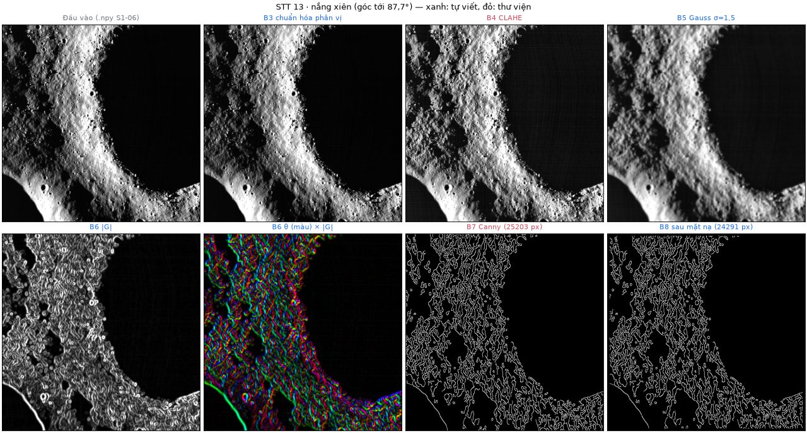
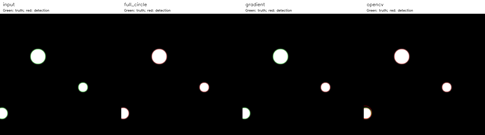
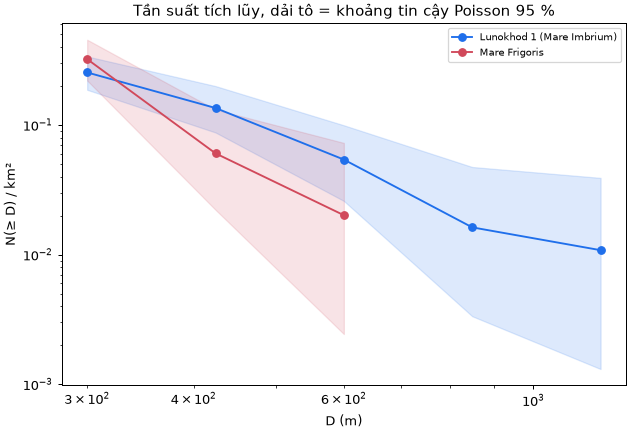

<!-- S3-12 r5: Quốc Anh chốt thực nghiệm; Hưng chốt dữ liệu/thống kê; Tiến chốt đánh giá Hough. S3-05 chờ PR #38. -->

# Chương 4. Thực nghiệm và đánh giá

## 4.1. Môi trường và khả năng tái tạo

**Phép đo Hough ngày 27/10/2026.** Hồ sơ `docs/evidence/s2-06-s3-02/summary.json` ghi Windows 11 (build 26200), Python 3.12.10, NumPy 2.5.4, OpenCV 5.0.0, một luồng OpenCV; mã CPU `Intel64 Family 6 Model 154 Stepping 4, GenuineIntel`. [CHỜ Tiến: tên CPU và dung lượng RAM của đúng máy đo ngày 27/10/2026]. Thời gian ở mục 4.7 là trung vị ba lượt sau một lượt làm nóng (warm-up), không gán cấu hình máy khác cho phép đo này.

**Lượt tái tạo độc lập ngày 31/10/2026.** Hồ sơ `docs/evidence/s3-10/kiem_doc_lap_linux/` ghi Intel i5-12450HX, Linux 7.0.0-38 x86_64/glibc 2.39, Python 3.12.3, nền mã `13394de`; RAM không được ghi. Lệnh đầy đủ dùng seed 0, ba lượt đo, hoàn thành tám bước trong 807,232 s. So dòng chung khớp 18/18 tập điều chỉnh (tuning) đóng băng, 9/9 đối chiếu tuning, 24/24 tập kiểm tra (holdout); E1/E2/E3 khớp 15/15, 14/14, 10/10; mỗi bảng mật độ 2/2, giả lập 8/8. Đây là xác nhận tái tạo, không phải phép so tốc độ Windows/Linux hay kết quả S3-05 mới.

**Kiểm số học ngày 01/11/2026 ở Bảng 3.4.** Intel i5-12450HX, RAM hệ điều hành ghi 24.304.916 KiB (khoảng 23,18 GiB), Linux 7.0.0-38/glibc 2.39, Python 3.12.3, NumPy 2.5.4, OpenCV 5.0.0; cấu hình này chỉ áp dụng lượt kiểm mới. Các phép số học xác định, không lấy mẫu ngẫu nhiên. Một lệnh tái tạo bảng thí nghiệm hiện có là `python -X utf8 -B scripts/reproduce_s310.py`; chỉ nhận `status=complete, mode=full`, không dùng chế độ nhanh làm bằng chứng tốc độ. Mã kiểm bảng sai số và ví dụ số ở Phụ lục B.

## 4.2. Dữ liệu và điều kiện sử dụng

Bộ `s106_lroc_browse_v2` gồm 26 ảnh 512 × 512 từ 16 sản phẩm camera góc hẹp (Narrow Angle Camera — NAC) của LROC, tải ngày 14/10/2026. Bảng 4.1 phân nhóm: 15 ô 20 m/px từ 6 mosaic `NAC_ROI`, 11 ô 2 m/px từ 10 ảnh Apollo 16 `NAC_PHO` [@lroc_pds; @robinson2012]. Ảnh TIFF browse 8 bit chỉ phục vụ hình học, không phải đo quang học đã hiệu chỉnh [@lroc_rdrsis].

| STT | Vùng | Tỷ lệ | Góc tới (°) | Ảnh nguồn | Ảnh cắt |
|:---------:|:----------------------------|:---------:|:------------:|:--------:|:--------:|
| 1 | Apollo 15, Mặt Trời cao | 20 m/px | 28–53 (\*) | 1 | 3 |
| 2 | Apollo 15, Mặt Trời thấp | 20 m/px | không ghi | 1 | 3 |
| 3 | Van de Graaff, Mặt Trời cao | 20 m/px | 27–45 (\*) | 1 | 2 |
| 4 | Lunokhod 1, Mặt Trời thấp | 20 m/px | 60–79 (\*) | 1 | 2 |
| 5 | Lunokhod 2, Mặt Trời thấp | 20 m/px | 56–83 (\*) | 1 | 2 |
| 6 | Mare Frigoris, Mặt Trời thấp | 20 m/px | 61–84 (\*) | 1 | 3 |
| 8–11, 13–18 | Apollo 16, chuỗi E090S0155 | 2 m/px | 7,64–87,78 | 10 | 11 |
| | **Tổng** | | | **16** | **26** |

: Bảng 4.1. Nhóm ảnh nguồn và số ảnh cắt. (\*) Dải góc tới của các ảnh thành phần trong mosaic, không phải số đo tại cửa sổ cắt.

**Giấy phép/nguồn.** Theo chính sách LROC, sản phẩm phát hành qua kho PDS thuộc phạm vi công cộng (public domain); ghi công NASA/GSFC/Arizona State University [@lroc_terms]. Không áp dụng kết luận này cho mọi hình biên tập trên website LROC. Bộ này lưu URL và SHA-256 của từng TIFF trong `data/s106_bundle/sources.json`; nguồn/cách cắt và ghi công giữ trong metadata. Các hình giao diện, biểu đồ và ảnh chồng vòng do nhóm tạo từ bộ dữ liệu đó.

`generate_s106_crops.py` cắt tại $(x_0,y_0)$, k = 1, tránh đường ghép; cả 26 ô có tỷ lệ pixel hợp lệ 1,0, pixel 0 vẫn hợp lệ. Chuẩn hóa phân vị 0,5–99,5 %. Metadata ghi tỷ lệ, tâm, chiếu sáng, phép chiếu và biến đổi tuyến tính kèm tịnh tiến (affine); không ảnh nào có phương vị nắng đo được. Sau kiểm bằng mắt, chỉ tám ảnh Apollo 16 đủ hướng/góc tới để chấm sáng–tối. Bundle ngoại tuyến 12.861.130 byte có kiểm SHA-256; tổng 16 TIFF nguồn 503.640.706 byte. Chi tiết dữ liệu giữ ở liên kết Phụ lục E.

Quy đổi tâm về ảnh nguồn dùng `src/contracts.py`, bù tâm pixel khi k ≠1 và cộng 0,5 trước affine của rasterio. `verify_s116_coords.py` khớp 26/26 tâm metadata, sai khác lớn nhất khoảng $6\cdot10^{-14}$ độ; công thức đầy đủ và ví dụ số ở tài liệu bổ sung. Dải r vẫn theo (2.14).

## 4.3. Nhãn tham chiếu

Người gán dùng `scripts/label_craters.py`, nhấp tâm và vành; công cụ kiểm hợp đồng, lưu vòng và overlay để kiểm chéo. Nhãn không chắc có hậu tố `_uncertain`. Tổng 241 nhãn, 4–13/ảnh; loại `C4_uncertain` ở `moon_ap16_m106777343r_c01` còn 240 nhãn dùng tính độ đo. Bảng 4.2 cho phân bố.

| Vùng mặt đất | Tập | Ảnh cắt | Nhãn | Chưa chắc | $r$ (px) | $D$ (m) |
|:------------------------|:-----------|:-------:|:------:|:-------:|:----------:|:-----------:|
| Apollo 16 (2 m/px) | điều chỉnh | 11 | 111 | 1 | 5,15–26 | 21–104 |
| Apollo 15, Mặt Trời cao | điều chỉnh | 3 | 24 | 0 | 7–30 | 280–1.200 |
| Van de Graaff | điều chỉnh | 2 | 21 | 0 | 7–20 | 280–800 |
| Lunokhod 1 | điều chỉnh | 2 | 19 | 0 | 7,5–55 | 300–2.200 |
| Apollo 15, Mặt Trời thấp | kiểm tra | 3 | 26 | 0 | 8–32 | 320–1.280 |
| Lunokhod 2 | kiểm tra | 2 | 18 | 0 | 8–50 | 320–2.000 |
| Mare Frigoris | kiểm tra | 3 | 22 | 0 | 7,5–24 | 300–960 |
| **Tổng** | | **26** | **241** | **1** | 5,15–55 | |

: Bảng 4.2. Nhãn tham chiếu theo vùng mặt đất. Các vùng ngoài Apollo 16 có tỷ lệ 20 m/px.

Cả 26 file có nguồn nhãn tay thưa và ghi người kiểm chéo Nguyễn Mạnh Tiến; xác nhận ngày 27/10 ghi đã xem đủ 26 overlay. Manifest/chỉ mục khớp 26/26 xác nhận định dạng, không tự chứng minh đúng vị trí hố. Danh mục Robbins đầy đủ khoảng 1–2 km [@robbins2019], không bao trọn hố nhỏ Apollo 16; nhóm **chưa chiếu danh mục** lên ảnh 20 m/px và hiện chỉ dùng nhãn tay.

Nhãn mù (blind labels) riêng cho ứng viên máy không hiện lớp máy khi gán. STT 13: 8 `rim`, 7 `shadow_edge`, 79 `texture`, 6 `unclear` (Hưng gán, Quốc Anh kiểm chéo 23/10); STT 17: 17 `rim`, 66 `texture`, 17 `unclear` (25/10). Nhãn này không chứa hố máy bỏ sót, nên chỉ dùng phân tích chất lượng ứng viên, không tính Recall_known.

## 4.4. Chia tập và giới hạn suy rộng

Manifest chia tập phiên bản 3 gom ảnh cùng mặt đất/chồng lấp vào một tập. Tập điều chỉnh (tuning) có 18 ảnh, 174 nhãn: toàn bộ 11 Apollo 16, Apollo 15 nắng cao, Van de Graaff, Lunokhod 1. Tập kiểm tra (holdout) có 8 ảnh 20 m/px, 66 nhãn: Apollo 15 nắng thấp, Lunokhod 2, Mare Frigoris. Trong 55 cặp Apollo 16 có 24 cặp chồng mặt đất; STT 9,11,17,18 dùng cùng cửa sổ. Không tách chúng để tránh rò rỉ dữ liệu (data leakage).

Tám ảnh đủ điều kiện sáng–tối đều thuộc tuning; STT 10 (28,38°) và hai ô STT 17 (7,64°) không đủ góc tới. Holdout toàn mosaic, không có hướng nắng, nên E1 không có phép đo ngoài mẫu và kết quả holdout không đại diện ảnh 2 m/px. Cần cụm Apollo 16 mới không chồng tuning để khắc phục. Ảnh `moon_marefrig_loc_c01` từng dùng làm đối chứng tiền xử lý trước khi chốt chia tập, dù không đổi tham số; đây vẫn là hạn chế.

Cấu hình cuối chốt trên 18 tuning, không dùng holdout để chọn. Holdout đã được xem trong lần đánh giá 27/10; mọi lượt sau là **đánh giá lặp**, không gọi tập hoàn toàn chưa thấy. `s207_experiments.py` đòi `--holdout --chosen-config` và không quét biến thể ở chế độ đó.

## 4.5. Chỉ số và cách tổng hợp

Ghép một–một theo (2.20)–(2.21); sai lệch tâm chuẩn hóa $\delta=d/r_{ref}$ phải ≤0,5, sai lệch bán kính $e_r=r_{dự\,đoán}-r_{ref}$ báo riêng. Dùng các công thức (2.22)–(2.23): $TP_{known}$ là số cặp, $FN_{known}=N_{known}-TP_{known}$, $R_i=TP_i/N_i$. Nhãn thưa không đo FP nên Precision/F1 là `null`, không phải 0. Mọi Recall đi kèm số nhãn, số vòng và trạng thái chạm trần.

Với m ảnh, Recall gộp, trung bình theo ảnh và độ lệch chuẩn mẫu (standard deviation — SD) là:

$$ R_{gộp}=\frac{\sum_i TP_i}{\sum_i N_i},\quad\overline{R}=\frac1m\sum_iR_i,\quad s_R=\sqrt{\frac{\sum_i(R_i-\overline{R})^2}{m-1}}. \qquad (4.1) $$

Báo $100\overline{R}\pm100s_R$ theo %, không nhầm với khoảng tin cậy. Mật độ, tần suất tích lũy, cận Poisson và giá trị p theo (2.24)–(2.26). Tỷ lệ hố thật trên nhãn mù là số `rim` còn giữ chia số vòng có nhãn rõ còn giữ; số loại và mất hố báo kèm. Điểm game theo (3.3), sai số số học theo mục 3.8. Thời gian trung vị ba lượt là giá trị giữa sau sắp xếp; tăng tốc là trung vị bản cũ chia bản mới. Không biến một lượt đo thành trung bình ± SD.

## 4.6. Ba thí nghiệm và kiểm tra kỹ thuật đã có

Bảng 4.3 nêu ba câu hỏi tương ứng (a) so phương pháp, (b) khảo sát tham số, (c) điều kiện khó. Kết quả S3-05 vẫn chờ chủ phần; các số dưới đây là kiểm kỹ thuật/chẩn đoán đã có.

| Thí nghiệm và câu hỏi | Ảnh | Biến thể |
|:--------------------|:--------------------|:----------------------|
| E1. Bước sáng–tối thay đổi gì so với Hough cơ bản? | Apollo 16, tập điều chỉnh, có hướng nắng dùng được | Hough cơ bản; thêm nhãn sáng–tối; thử bỏ vòng "ngược" |
| E2. Tham số Hough ảnh hưởng thế nào? | Ảnh đại diện của tập điều chỉnh | `min_vote_ratio` 0,30 / 0,35 / 0,40; `radius_step` 1 / 2 px; mỗi lượt đổi một tham số |
| E3. Ảnh khó được xử lý ra sao? | STT 13 (bóng mạnh), STT 17 (nắng gần đứng), Mare Frigoris | Phân lớp vành / bóng / kết cấu; bỏ lớp kết cấu; lọc vòng trùng |

: Bảng 4.3. Thiết kế ba thí nghiệm.

E1 so Hough cơ bản với nhánh chỉ gắn nhãn (hai nhánh giữ cùng vòng) và nhánh bỏ `inverted` để đo rủi ro mất hố. E2 đổi từng tham số; ưu tiên không giảm Recall_known rồi mới xét ít vòng/nhanh hơn. E3 báo phân lớp và lọc trùng riêng; Mare Frigoris thuộc holdout chỉ được mô tả. [CHỜ S3-05 — Quốc Anh: kết quả ba thí nghiệm (a/b/c), trung bình ± SD khi có, sau khi PR #38 được tích hợp].

**Tiền xử lý và trường hợp khó.** Hình 4.1 giữ cùng ảnh/thang cho các bước STT 13. Canny có 25.203 pixel biên, sau B8 còn 24.291; STT 17 còn 26.642; cả 26 ảnh nằm trong 20.949–35.590. Ngưỡng thấp/cao STT 13 là 63,6/159,0, STT 17 là 46,3/115,8 (thấp hơn khoảng 27 %). P90 tự co ngưỡng nhưng biên kết cấu vẫn nhiều; mép bóng nắng xiên mạnh hơn vành hố. Ảnh nguồn STT 17 và 13 có 11,1 % và 3,2 % pixel bão hòa, không khôi phục được bằng CLAHE.

{width=85%}

**Kiểm luồng E2 ngày 26/10.** Trên STT 17 (`moon_ap16_m109134835l_c01`, 10 nhãn r = 8–22), E1 ghi 100/100 `not_checked` vì góc tới 7,64°. Bảng 4.4 cho E2; E3 xếp 61 vành/39 kết cấu, gộp 3 vòng, Recall vẫn 0/10. Đây không phải kết quả S3-05 hay căn cứ chọn tham số.

| Biến thể | Ứng viên | Thời gian Hough (s) | Recall_known |
|:----------------------------------|:---:|:---:|:---:|
| Mặc định | 100 | 9,136 | 0/10 |
| `min_vote_ratio` = 0,30 | 100 | 8,437 | 0/10 |
| `min_vote_ratio` = 0,40 | 100 | 8,375 | 0/10 |
| `radius_step` = 2 px | 100 | 4,325 | 0/10 |

: Bảng 4.4. Chạy kiểm tra luồng E2 trên STT 17 (một lần đo, không phải kết quả cuối).

Bốn biến thể đều 0/10 dù thời gian khác nhau, phù hợp cơ chế trần 100 vòng ưu tiên r nhỏ (mục 3.3); máy có tìm vành khác nhưng không tìm lại nhãn đã biết. Nhãn mù cùng ảnh ghi 17/100 hố thật, nên 0/10 không đồng nghĩa ảnh không có vòng đúng.

**Thử lọc trên hai ảnh.** Bảng 4.5 chỉ dùng 94 vòng có nhãn rõ ở STT 13 và 83 ở STT 17; đây là độ tinh khiết ứng viên, không phải Precision toàn ảnh.

| Cách lọc | STT 13: loại / mất hố thật | STT 13: tỷ lệ hố thật | STT 17: loại / mất hố thật | STT 17: tỷ lệ hố thật |
|---|---:|---:|---:|---:|
| Không lọc | 0 / 0 | 8,5 % | 0 / 0 | 20,5 % |
| **Bỏ `texture`** | **48 / 0** | **17,4 %** | **35 / 0** | **35,4 %** |
| Bỏ `shadow_edge` + `texture` | 61 / 1 | 21,2 % | 35 / 0 | 35,4 % |
| Bỏ sáng–tối `inverted` | 23 / 2 | 8,5 % | không chấm | 20,5 % |

: Bảng 4.5. Kết quả lọc trên ứng viên có nhãn: STT 13 (94 vòng, 8 hố thật) và STT 17 (83 vòng, 17 hố thật).

Bỏ `texture` tăng tỷ lệ hố thật, không mất hố trong hai mẫu; lớp `texture` STT 13 gồm 47/48 vòng kết cấu, nhưng lớp `rim` lẫn 24/33 vòng kết cấu. Bỏ thêm `shadow_edge` mất M7 sát bóng. Bỏ `inverted` mất M8/M19, là mép bóng nằm trong M32/M15 (mục 3.5). Hình 4.2 phóng chi tiết để thấy vòng lồng; không chọn ảnh này làm bằng chứng tổng quát vì STT 13 đã dùng thiết kế luật.

{width=100%}

## 4.7. Đối chiếu Hough và kết quả phát hiện

**Ảnh giả lập.** Hình 4.3 đối chiếu ba phương pháp trên cùng đầu vào, r = 18–36. Toàn vòng tìm đủ ba đĩa; gradient chỉ giữ đĩa r = 20 vì hai tâm khác có 40/27 phiếu, dưới ngưỡng 71/53. OpenCV có bốn vòng: sau bù 0,5 px, ba tâm khớp thật, lệch r dưới 1 px; vòng thừa cách 5,39 px gần đĩa cắt mép. Do biên/ngưỡng khác nhau, đây là đối chiếu hành vi, không phải phép chứng minh hai thuật toán tương đương.

{width=100%}

**Ảnh Mặt Trăng, ngày 27/10.** `evaluate_hough.py` chạy ba ảnh tuning (STT 13, STT 17, `moon_ap15_hia_c01`) và đủ tám holdout, cấu hình `configs/s201_large_craters.json` được định trước. Hai nhánh NumPy chỉ khác `score/radius_balanced`; tham số như mục 3.3. OpenCV dùng `HOUGH_GRADIENT`, dp = 1, minDist = 4, param1 = 100, param2 = 12, cùng ảnh trơn/dải r nhưng tự trích biên và không có trần 100. Thời gian NumPy chỉ tính Hough, OpenCV gồm trích biên; không dùng để xếp hạng tốc độ. Bảng 4.6 báo gộp và theo ảnh.

| Tập | Phương pháp | TP | FN | Recall_known gộp (%) | Trung bình theo ảnh ± SD (%) |
|:------------|:----------------|:----------:|:----------:|:-----------:|:--------------:|
| Điều chỉnh | numpy_score | 0 | 28 | 0,00 | 0,00 ± 0,00 |
| Điều chỉnh | numpy_balanced | 2 | 26 | 7,14 | 7,41 ± 6,42 |
| Điều chỉnh | opencv | **27** | **1** | **96,43** | **96,67 ± 5,77** |
| Kiểm tra | numpy_score | 4 | 62 | 6,06 | 5,95 ± 8,77 |
| Kiểm tra | numpy_balanced | 5 | 61 | 7,58 | 7,64 ± 8,88 |
| Kiểm tra | opencv | **65** | **1** | **98,48** | **98,21 ± 5,05** |

: Bảng 4.6. Recall trên nhãn đã biết theo tập (điều chỉnh: 3 ảnh; kiểm tra: 8 ảnh) và phương pháp. TP và FN đếm trên nhãn đã biết (TP_known, FN_known); không tính Precision và F1. In đậm Recall cao nhất, không hàm ý Precision tốt nhất.

Bảng 4.7 giữ kết quả từng ảnh. Trên holdout, trung vị thời gian từng ảnh là 6,056–22,250 s (`score`), 6,332–25,497 s (`balanced`), 3,153–6,970 s (OpenCV). Ba ảnh tuning cho score 0/9,0/10,0/9 và balanced 1/9,0/10,1/9.

| Ảnh | Nhãn | score | balanced | opencv | Số vòng opencv |
|:--------------------------|:-------:|:--------:|:----------:|:--------:|:----------:|
| moon_ap15_loc_c01 | 8 | 0/8 | 0/8 | 8/0 | 8.195 |
| moon_ap15_loc_c02 | 9 | 0/9 | 0/9 | 9/0 | 8.323 |
| moon_ap15_loc_c03 | 9 | 0/9 | 0/9 | 9/0 | 8.438 |
| moon_lunokhod2_loc_c01 | 9 | 1/8 | 1/8 | 9/0 | 9.040 |
| moon_lunokhod2_loc_c02 | 9 | 0/9 | 1/8 | 9/0 | 9.086 |
| moon_marefrig_loc_c01 | 6 | 0/6 | 1/5 | 6/0 | 8.259 |
| moon_marefrig_loc_c02 | 7 | 1/6 | 0/7 | 6/1 | 8.521 |
| moon_marefrig_loc_c03 | 9 | 2/7 | 2/7 | 9/0 | 8.866 |
| **Tổng** | **66** | **4/62** | **5/61** | **65/1** |  |

: Bảng 4.7. Kết quả từng ảnh trên tập kiểm tra, ghi TP/FN cho từng phương pháp. Hai chế độ NumPy trả đúng 100 vòng trên mọi ảnh.

Cân bằng bán kính chỉ gỡ một nguyên nhân bỏ sót: holdout tăng 4/66 lên 5/66, nhưng riêng `moon_marefrig_loc_c02` giảm 1/7→0/7; cấu hình không được chỉnh lại theo holdout. Vành đứt/không tròn, ngoài dải r hoặc phiếu dưới ngưỡng vẫn mất. OpenCV có 8.195–9.086 vòng/ảnh holdout (7.112–8.984 trên tuning), nên Recall 98,48 % không chứng minh Precision cao. Lọc trùng đo riêng còn làm mất cặp đúng duy nhất của balanced trên STT 13; không bật trong game. Không so trực tiếp các tỷ lệ này với kết quả công bố của Yuen vì bộ ảnh/lỗi quan sát khác; Robbins là danh mục chứ không phải kết quả bộ phát hiện trên tập này.

## 4.8. So sánh mật độ hai vùng

Chọn Lunokhod 1 (Mare Imbrium) và Mare Frigoris: cùng biển bazan, 20 m/px, nắng thấp (góc tới ảnh thành phần 60–79° và 61–84°), D = 300–2.000 m. Van de Graaff nắng cao 27–45° khó thấy hố nhỏ nên không dùng. Mare Frigoris chỉ lấy mặt biển, bỏ hố 6–8 km, bóng và dải ghép; vùng không chồng trên ảnh nguồn. Hưng đếm đủ hố trên bốn ô, Quốc Anh kiểm chéo; không dùng nhãn thưa. Bảng 4.8 và Hình 4.4 cho kết quả.

| Vùng | Diện tích (km²) | N | ρ (hố/km²) | Khoảng tin cậy 95 % |
|---|---:|---:|---:|---|
| Lunokhod 1 | 184,7 | 47 | 0,254 | 0,187–0,338 |
| Mare Frigoris | 99,2 | 32 | 0,322 | 0,221–0,455 |

: Bảng 4.8. Mật độ đếm tay đầy đủ, cùng 20 m/px, D = 300–2.000 m.

Theo bin 300–424; 424–600; 600–849; 849–1.200; 1.200–2.000 m, Lunokhod 1 có 22;15;7;1;2 hố, Mare Frigoris có 26;4;2;0;0. Tỷ số tổng mật độ 0,79, p = 0,35: **chưa khác biệt có ý nghĩa**, không kết luận vùng nào già hơn. Từ 424 m trở lên, tỷ số 2,24 và p = 0,09 chỉ là gợi ý yếu; hai đường tích lũy cắt nhau.

{width=65%}

Bất định lớn do ít hố, vùng được chọn tránh hố lớn không phải mẫu ngẫu nhiên, thiếu phương vị nắng và có thể có cụm hố thứ cấp; sai số r đếm tay khoảng ±2 px. Máy (Hough mặc định, bỏ texture rồi lọc trùng) chỉ có 11/0 vòng trong cùng dải/vùng vì chỉ trả r ≤13 px. Mật độ ứng viên chưa dùng được; app hiện bảng đếm tay riêng và ẩn mật độ máy khi chạm trần.

## 4.9. Kết quả ứng dụng minh họa

Hình 4.5–4.7 dùng cùng lượt thao tác Playwright ngày 01/11/2026, khung nhìn 1.440 × 900 và tỷ lệ điểm ảnh 10/9. Bảy vòng lấy theo minh họa cũ, không phải câu trả lời của học sinh. Ảnh chèn PNG giữ nguyên pixel giải mã từ JPEG bằng chứng; không khôi phục được chi tiết đã mất do lần nén gốc.

{width=85%}

{width=85%}

Lượt này trùng máy 0, cho thấy điểm theo nhãn và mức trùng máy khác nhau. Hình 4.7 có nguồn thẻ Apollo 16; thẻ 21/26 ảnh theo vùng, không phải phần thưởng khi tìm thấy thiết bị.

{width=100%}

Ứng dụng có HTTPS/mật khẩu; lượt chấm đầu trên máy chủ từng mất 9,4 s, cache tối đa 8 ảnh giúp lượt sau. Số đo này tách khỏi môi trường Hough ở mục 4.1; không có cấu hình CPU/RAM máy chủ trong hồ sơ nên không suy benchmark.

## 4.10. Khảo sát và hạn chế thực nghiệm

Theo quyết định 31/10, thử người chơi và khảo sát **chưa thực hiện**; tiêu chí ít nhất 10 học sinh chưa đạt. Khung dự kiến có bốn câu hứng thú thang Likert 1–5, năm câu hiểu bài trước/sau và phản hồi mở; thử thao tác 1–2 người trước khi khảo sát. Kế hoạch cũ chọn 10–15 sinh viên khác đối tượng học sinh của đề, cần thống nhất lại với giảng viên; mẫu thuận tiện, hỏi lặp và không có đối chứng không cho kết luận nhân quả.

Giới hạn phát hiện gồm nhãn thưa không đo FP, ảnh browse bão hòa, chỉ tám ảnh có hướng nắng, holdout toàn 20 m/px và đã được xem trước. Bộ 26 ô từ bảy vùng không phải 26 mẫu mặt đất độc lập. Trần 100 ưu tiên hố nhỏ; bộ lọc có thể làm mất hố đúng. Vì vậy không suy chất lượng giáo dục, Precision toàn ảnh hay tuổi địa chất từ các minh họa này.
