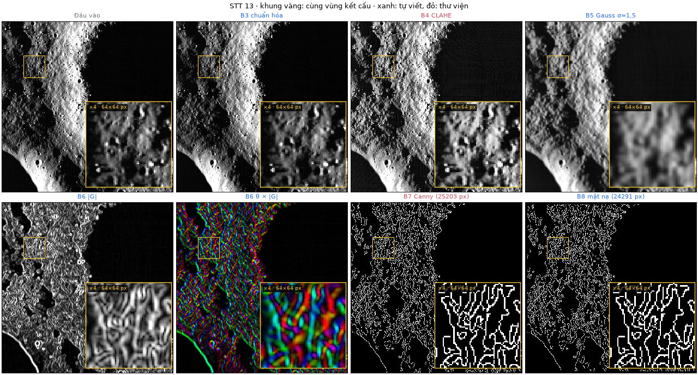
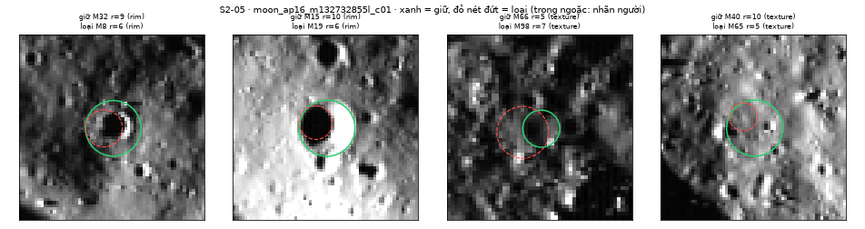
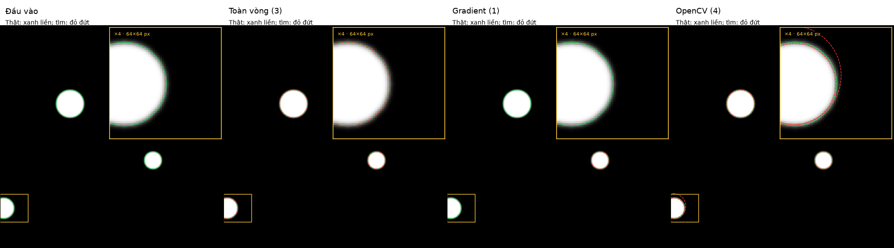
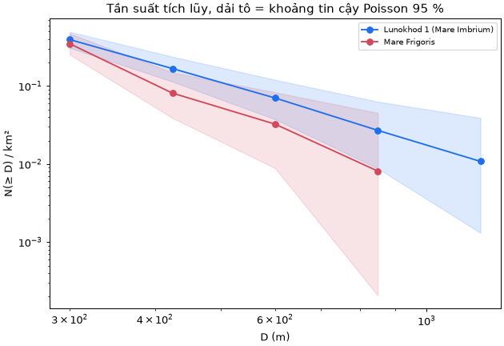
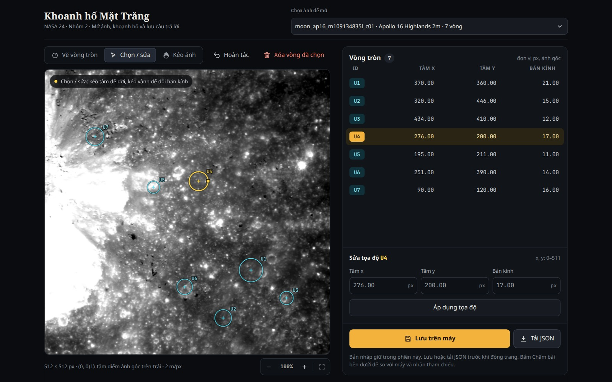
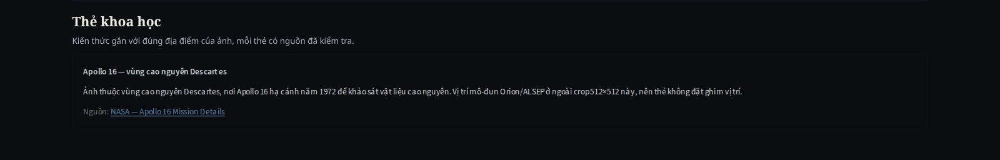

<!-- Quốc Anh duyệt bản ghép S3-05; Hưng chốt dữ liệu/thống kê; Tiến chốt đánh giá Hough. -->

# Chương 4. Thực nghiệm và đánh giá

## 4.1. Môi trường và khả năng tái tạo

**Phép đo Hough ngày 27/10/2026.** [Hồ sơ phép đo](../evidence/s2-06-s3-02/summary.json) ghi Windows 11 (build 26200), Python 3.12.10, NumPy 2.5.4, OpenCV 5.0.0, một luồng OpenCV; mã CPU `Intel64 Family 6 Model 154 Stepping 4, GenuineIntel`. [CHỜ Tiến: tên CPU/RAM đúng máy đo.] Mục 4.7 báo trung vị ba lượt sau một lượt làm nóng (warm-up).

**Tái tạo độc lập ngày 31/10/2026.** [Hồ sơ Linux](../evidence/s3-10/kiem_doc_lap_linux/README.md): Intel i5-12450HX, Linux 7.0.0-38 x86_64/glibc 2.39, Python 3.12.3, mã `13394de`; không ghi RAM. Giá trị khởi tạo (seed) 0, ba lượt đo, tám bước mất 807,232 s. Dòng chung khớp 18/18 tập điều chỉnh (tuning) đóng băng, 9/9 đối chiếu tuning, 24/24 tập kiểm tra (holdout); E1/E2/E3: 15/15, 14/14, 10/10; mỗi bảng mật độ 2/2, giả lập 8/8. Không dùng so tốc độ Windows/Linux hoặc làm kết quả S3-05.

**Kiểm số học ngày 01/11/2026 (Bảng 3.4).** Intel i5-12450HX, RAM 24.304.916 KiB (khoảng 23,18 GiB), Linux 7.0.0-38/glibc 2.39, Python 3.12.3, NumPy 2.5.4, OpenCV 5.0.0; không gán cấu hình này cho lượt cũ. Phép số học xác định, không lấy mẫu ngẫu nhiên. Tái tạo bảng thí nghiệm hiện có: `python -X utf8 -B scripts/reproduce_s310.py`; chỉ nhận `status=complete, mode=full`, không dùng chế độ nhanh đo tốc độ. Mã kiểm sai số/ví dụ số ở Phụ lục B.

## 4.2. Dữ liệu và điều kiện sử dụng

Bộ `s106_lroc_browse_v2` gồm 26 ảnh 512 × 512 từ 16 sản phẩm camera góc hẹp (Narrow Angle Camera — NAC) của LROC, tải ngày 14/10/2026. Bảng 4.1 phân nhóm: 15 ô 20 m/px từ 6 ảnh ghép (mosaic) `NAC_ROI`, 11 ô 2 m/px từ 10 ảnh Apollo 16 `NAC_PHO` [@lroc_pds; @robinson2012]. Ảnh TIFF xem nhanh (browse) 8 bit chỉ phục vụ hình học, không phải đo quang học đã hiệu chỉnh [@lroc_rdrsis].

| STT | Vùng | Tỷ lệ | Góc tới (°) | Ảnh nguồn | Ảnh cắt |
|:---------:|:----------------------------|:---------:|:------------:|:--------:|:--------:|
| 1 | Apollo 15, Mặt Trời cao | 20 m/px | 28–53 (\*) | 1 | 3 |
| 2 | Apollo 15, Mặt Trời thấp | 20 m/px | không ghi | 1 | 3 |
| 3 | Van de Graaff, Mặt Trời cao | 20 m/px | 27–45 (\*) | 1 | 2 |
| 4 | Lunokhod 1, Mặt Trời thấp | 20 m/px | 60–79 (\*) | 1 | 2 |
| 5 | Lunokhod 2, Mặt Trời thấp | 20 m/px | 56–83 (\*) | 1 | 2 |
| 6 | Mare Frigoris, Mặt Trời thấp | 20 m/px | 61–84 (\*) | 1 | 3 |
| 8–11, 13–18 | Apollo 16, chuỗi E090S0155 | 2 m/px | 7,64–87,78 | 10 | 11 |
| | **Tổng** | | | **16** | **26** |

: Bảng 4.1. Nhóm ảnh nguồn và số ảnh cắt. (\*) Dải góc tới của các ảnh thành phần trong mosaic, không phải số đo tại cửa sổ cắt.

**Giấy phép/nguồn.** Sản phẩm PDS (kho dữ liệu hành tinh của NASA) của LROC thuộc phạm vi công cộng (public domain), ghi công NASA/GSFC/Arizona State University [@lroc_terms]; không suy rộng sang mọi hình trên website. URL/SHA-256 từng TIFF ở `data/s106_bundle/sources.json`; siêu dữ liệu (metadata) giữ nguồn, cách cắt và ghi công. Hình giao diện, biểu đồ, ảnh chồng vòng do nhóm tạo từ bộ này.

`generate_s106_crops.py` cắt tại $(x_0,y_0)$, k = 1, tránh đường ghép; cả 26 ô có tỷ lệ pixel hợp lệ 1,0, pixel 0 vẫn hợp lệ. Chuẩn hóa phân vị 0,5–99,5 %. Metadata ghi tỷ lệ, tâm, chiếu sáng, phép chiếu và biến đổi tuyến tính kèm tịnh tiến (affine); không ảnh nào có phương vị nắng đo được. Sau kiểm bằng mắt, chỉ tám ảnh Apollo 16 đủ hướng/góc tới để chấm sáng–tối. Gói dữ liệu (bundle) ngoại tuyến 12.861.130 byte có kiểm SHA-256; tổng 16 TIFF nguồn 503.640.706 byte. Chi tiết dữ liệu giữ ở liên kết Phụ lục E.

Quy đổi tâm về ảnh nguồn dùng `src/contracts.py`, bù tâm pixel khi k ≠1 và cộng 0,5 trước affine của rasterio. `verify_s116_coords.py` khớp 26/26 tâm metadata, sai khác lớn nhất khoảng $6\cdot10^{-14}$ độ; công thức đầy đủ và ví dụ số ở tài liệu bổ sung. Dải r vẫn theo (2.14).

## 4.3. Nhãn tham chiếu

Người gán dùng `scripts/label_craters.py`, nhấp tâm và vành; công cụ kiểm hợp đồng, lưu vòng và ảnh chồng vòng (overlay) để kiểm chéo. Nhãn không chắc có hậu tố `_uncertain`. Tổng 241 nhãn, 4–13/ảnh; loại `C4_uncertain` ở `moon_ap16_m106777343r_c01` còn 240 nhãn dùng tính độ đo. Bảng 4.2 cho phân bố.

| Vùng mặt đất | Tập | Ảnh cắt | Nhãn | Chưa chắc | $r$ (px) | $D$ (m) |
|:------------------------|:-----------|:-------:|:------:|:-------:|:----------:|:-----------:|
| Apollo 16 (2 m/px) | điều chỉnh | 11 | 111 | 1 | 5,15–26 | 21–104 |
| Apollo 15, Mặt Trời cao | điều chỉnh | 3 | 24 | 0 | 7–30 | 280–1.200 |
| Van de Graaff | điều chỉnh | 2 | 21 | 0 | 7–20 | 280–800 |
| Lunokhod 1 | điều chỉnh | 2 | 19 | 0 | 7,5–55 | 300–2.200 |
| Apollo 15, Mặt Trời thấp | kiểm tra | 3 | 26 | 0 | 8–32 | 320–1.280 |
| Lunokhod 2 | kiểm tra | 2 | 18 | 0 | 8–50 | 320–2.000 |
| Mare Frigoris | kiểm tra | 3 | 22 | 0 | 7,5–24 | 300–960 |
| **Tổng** | | **26** | **241** | **1** | 5,15–55 | |

: Bảng 4.2. Nhãn tham chiếu theo vùng mặt đất. Các vùng ngoài Apollo 16 có tỷ lệ 20 m/px.

Cả 26 file có nhãn tay thưa (sparse labels) và ghi người kiểm chéo Nguyễn Mạnh Tiến; xác nhận ngày 27/10 đã xem đủ 26 overlay. Bản kê (manifest)/chỉ mục khớp 26/26 chỉ xác nhận định dạng, không chứng minh đúng vị trí hố. Danh mục Robbins đầy đủ khoảng 1–2 km [@robbins2019], không bao trọn hố nhỏ Apollo 16; nhóm **chưa chiếu danh mục** lên ảnh 20 m/px, hiện chỉ dùng nhãn tay.

Nhãn mù (blind labels) không hiện lớp máy khi gán. STT 13: 8 vành hố (`rim`), 7 mép bóng (`shadow_edge`), 79 kết cấu (`texture`), 6 chưa rõ (`unclear`) (Hưng gán, Quốc Anh kiểm chéo 23/10); STT 17: 17 `rim`, 66 `texture`, 17 `unclear` (25/10). Chúng không chứa hố máy bỏ sót, chỉ dùng phân tích ứng viên, không tính tỷ lệ tìm lại nhãn đã biết (Recall_known).

## 4.4. Chia tập và giới hạn suy rộng

Manifest chia tập phiên bản 3 gom ảnh cùng mặt đất/chồng lấp để tránh rò rỉ dữ liệu (data leakage). Tuning: 18 ảnh, 174 nhãn, gồm 11 Apollo 16, Apollo 15 nắng cao, Van de Graaff, Lunokhod 1. Holdout: 8 ảnh 20 m/px, 66 nhãn, gồm Apollo 15 nắng thấp, Lunokhod 2, Mare Frigoris. Trong 55 cặp Apollo 16 có 24 cặp chồng; STT 9,11,17,18 cùng cửa sổ.

Tám ảnh đủ điều kiện sáng–tối đều thuộc tuning; STT 10 (28,38°), hai ô STT 17 (7,64°) không đủ góc tới. Holdout toàn mosaic thiếu hướng nắng: E1 chưa có đo ngoài mẫu; holdout không đại diện ảnh 2 m/px. Cần cụm Apollo 16 mới, không chồng tuning. `moon_marefrig_loc_c01` từng làm đối chứng tiền xử lý trước khi chốt chia tập, dù không đổi tham số.

Cấu hình chốt trên 18 tuning. Holdout đã được xem ngày 27/10; lượt sau là **đánh giá lặp**. `s207_experiments.py` đòi `--holdout --chosen-config`, không quét biến thể để chọn trên holdout.

## 4.5. Chỉ số và cách tổng hợp

Ghép một–một theo (2.20)–(2.21); sai lệch tâm chuẩn hóa $\delta=d/r_{ref}$ phải ≤0,5, sai lệch bán kính $e_r=r_{dự\,đoán}-r_{ref}$ báo riêng. Theo (2.22)–(2.23), $TP_{known}$ là số cặp, $FN_{known}=N_{known}-TP_{known}$, $R_i=TP_i/N_i$. Không đếm được dương tính giả (false positive — FP), nên độ chính xác dự đoán (Precision)/F1 là `null`, không phải 0. Recall_known luôn kèm số nhãn, số vòng và trạng thái chạm trần.

Với m ảnh, Recall_known gộp, trung bình theo ảnh và độ lệch chuẩn mẫu (standard deviation — SD) là:

$$ R_{gộp}=\frac{\sum_i TP_i}{\sum_i N_i},\quad\overline{R}=\frac1m\sum_iR_i,\quad s_R=\sqrt{\frac{\sum_i(R_i-\overline{R})^2}{m-1}}. \qquad (4.1) $$

Báo $100\overline{R}\pm100s_R$ theo %, khác khoảng tin cậy. Mật độ/tần suất, cận Poisson, p theo (2.24)–(2.26); điểm trò chơi theo (3.3), sai số theo mục 3.8. Tỷ lệ hố thật trên nhãn mù = `rim` giữ / vòng nhãn rõ giữ; báo kèm số loại/mất hố. Trung vị ba lượt là giá trị giữa; tăng tốc = trung vị cũ / mới. Một lượt không thành trung bình ± SD.

## 4.6. Kết quả ba thí nghiệm S3-05

Bảng 4.3 nêu ba câu hỏi (a/b/c). S3-05 chạy ngày 01/11/2026, Python 3.14.7; mỗi cấu hình một lượt, không warm-up. Nền S2-15: ngưỡng 0,35, bước r = 1 px, trần 100 vòng. Kết quả thay [kiểm luồng E1–E3 cũ](../evidence/s2-07/results.json).

| Thí nghiệm và câu hỏi | Ảnh | Biến thể |
|:--------------------|:--------------------|:----------------------|
| E1. Bước sáng–tối thay đổi gì so với Hough cơ bản? | Apollo 16, tập điều chỉnh, có hướng nắng dùng được | Hough cơ bản; thêm nhãn sáng–tối; thử bỏ vòng "ngược" |
| E2. Tham số Hough ảnh hưởng thế nào? | Ảnh đại diện của tập điều chỉnh | `min_vote_ratio` 0,30 / 0,35 / 0,40; `radius_step` 1 / 2 px; mỗi lượt đổi một tham số |
| E3. Ảnh khó được xử lý ra sao? | STT 13 (bóng mạnh), STT 9, STT 17 (nắng gần đứng); Mare Frigoris chỉ mô tả | Phân lớp vành / bóng / kết cấu; bỏ lớp kết cấu; lọc vòng trùng |

: Bảng 4.3. Thiết kế ba thí nghiệm.

STT 13/9/17 có 9/11/10 nhãn; E1 chỉ so STT 13/9 đủ hướng nắng. Bảng 4.4 gộp TP/nhãn từ `docs/evidence/s3-05/` ([E1](../evidence/s3-05/E1.csv), [E2](../evidence/s3-05/E2.csv), [E3](../evidence/s3-05/E3.csv)), không báo trung bình ± SD. Tổng 30 nhãn khác bộ 28 nhãn mục 4.7. Hai bộ lọc E3 áp dụng riêng, không nối tiếp.

| Phép so, phạm vi | Nền: vòng; TP/nhãn | Nhánh thay đổi: vòng; TP/nhãn |
|:----------------|:----------------|:---------------------------------------|
| E1 · STT 13/9 | 200; **1/20** | Gắn sáng–tối: 200; **1/20**. Bỏ ngược: 151; 0/20 |
| E2 · STT 13/9/17 | 300; **1/30** | Ngưỡng 0,30 / 0,40 hoặc bước r = 2: mỗi nhánh 300; **1/30** |
| E3 · STT 13/9/17 | 300; **1/30** | Bỏ kết cấu: 155; **1/30**. Lọc trùng: 284; **1/30** |
| E3 · Mare (holdout) | 100; 0/6 | Không chạy bộ lọc |

: Bảng 4.4. S3-05: tổng vòng và TP/nhãn trên cùng nhóm ảnh. Đậm Recall_known cao nhất trong từng phép so, kể cả đồng hạng; giảm vòng chưa chứng minh giảm FP.

**(a) So phương pháp.** Gắn sáng–tối không đổi hình học, giữ 1/20; bỏ vòng ngược (`inverted`) làm mất M61–C9 trên STT 9: 1/11→0/11. Mô hình mục 2.3 chỉ hỗ trợ: mép bóng/địa hình có thể khác giả thiết, không đủ để loại hố. Vòng không khớp nhãn thưa chưa phải FP.

**(b) Tham số.** Bốn cấu hình đều 1/30; cả 12 lượt chạm trần 100, nhãn vẫn trong dải r. Theo mục 2.2, đổi ngưỡng/bước r chưa khắc phục chọn nhiều vòng nhỏ; cùng Recall_known chưa phải cùng vòng. Bước r = 2 quét ít bán kính hơn nhưng một lượt chưa đủ kết luận tốc độ hoặc đổi cấu hình đã chốt.

**(c) Điều kiện khó.** Hai bộ lọc chỉ bỏ ứng viên, không phục hồi hố Hough bỏ sót (mục 2.2/2.4): STT 13/17 vẫn 0/9, 0/10. Mare chỉ mô tả 0/6, không chọn bộ lọc trên holdout. Giảm vòng ở Bảng 4.4 chưa chứng minh giảm FP hoặc phát hiện hố chồng.

**Tiền xử lý.** Hình 4.1 giữ cùng ảnh/thang STT 13: Canny có 25.203 pixel biên, B8 còn 24.291; STT 17 còn 26.642; cả 26 ảnh: 20.949–35.590. Ngưỡng thấp/cao 63,6/159,0 (STT 13), 46,3/115,8 (STT 17), thấp hơn khoảng 27 %. P90 co ngưỡng nhưng vẫn nhiều kết cấu; mép bóng mạnh hơn vành. Pixel bão hòa STT 17/13: 11,1 %/3,2 %; cân bằng lược đồ thích nghi giới hạn tương phản (contrast limited adaptive histogram equalization — CLAHE) không phục hồi được.

{width=85%}

**Nhãn mù.** Bảng 4.5 dùng 94/83 vòng nhãn rõ ở STT 13/17; không đo Precision toàn ảnh.

| Cách lọc | STT 13: loại / mất hố thật | STT 13: tỷ lệ hố thật | STT 17: loại / mất hố thật | STT 17: tỷ lệ hố thật |
|---|---:|---:|---:|---:|
| Không lọc | 0 / 0 | 8,5 % | 0 / 0 | 20,5 % |
| Bỏ `texture` | 48 / 0 | 17,4 % | 35 / 0 | **35,4 %** |
| Bỏ `shadow_edge` + `texture` | 61 / 1 | **21,2 %** | 35 / 0 | **35,4 %** |
| Bỏ sáng–tối `inverted` | 23 / 2 | 8,5 % | không chấm | 20,5 % |

: Bảng 4.5. Lọc trên nhãn mù; đậm tỷ lệ hố thật cao nhất, chưa phải khuyến nghị lọc.

Bỏ `texture` tăng tỷ lệ hố thật, không mất hố trong hai mẫu; lớp `texture` STT 13 gồm 47/48 vòng kết cấu, nhưng lớp `rim` lẫn 24/33 vòng kết cấu. Bỏ thêm `shadow_edge` mất M7 sát bóng. Bỏ `inverted` mất M8/M19, là mép bóng nằm trong M32/M15 (mục 3.5). Hình 4.2 phóng chi tiết để thấy vòng lồng; không chọn ảnh này làm bằng chứng tổng quát vì STT 13 đã dùng thiết kế luật.

{width=100%}

## 4.7. Đối chiếu Hough và kết quả phát hiện

**Ảnh giả lập.** Hình 4.3 đối chiếu ba phương pháp trên cùng đầu vào, r = 18–36. Toàn vòng tìm đủ ba đĩa; dùng hướng biến thiên độ sáng (gradient) chỉ giữ đĩa r = 20 vì hai tâm khác có 40/27 phiếu, dưới ngưỡng 71/53. OpenCV có bốn vòng: sau bù 0,5 px, ba tâm khớp thật, lệch r dưới 1 px; vòng thừa cách 5,39 px gần đĩa cắt mép. Do biên/ngưỡng khác nhau, đây là đối chiếu hành vi, không phải phép chứng minh hai thuật toán tương đương.

{width=100%}

**Ảnh Mặt Trăng, ngày 27/10.** `evaluate_hough.py` chạy ba ảnh tuning (STT 13, STT 17, `moon_ap15_hia_c01`) và đủ tám holdout, cấu hình `configs/s201_large_craters.json` được định trước. Hai nhánh NumPy chỉ khác `score/radius_balanced`; tham số như mục 3.3. OpenCV dùng `HOUGH_GRADIENT`, dp = 1, minDist = 4, param1 = 100, param2 = 12, cùng ảnh trơn/dải r nhưng tự trích biên và không có trần 100. Thời gian NumPy chỉ tính Hough, OpenCV gồm trích biên; không dùng để xếp hạng tốc độ. Bảng 4.6 báo gộp và theo ảnh.

| Tập | Phương pháp | TP | FN | Recall_known gộp (%) | Trung bình theo ảnh ± SD (%) |
|:------------|:----------------|:----------:|:----------:|:-----------:|:--------------:|
| Điều chỉnh | numpy_score | 0 | 28 | 0,00 | 0,00 ± 0,00 |
| Điều chỉnh | numpy_balanced | 2 | 26 | 7,14 | 7,41 ± 6,42 |
| Điều chỉnh | opencv | **27** | **1** | **96,43** | **96,67 ± 5,77** |
| Kiểm tra | numpy_score | 4 | 62 | 6,06 | 5,95 ± 8,77 |
| Kiểm tra | numpy_balanced | 5 | 61 | 7,58 | 7,64 ± 8,88 |
| Kiểm tra | opencv | **65** | **1** | **98,48** | **98,21 ± 5,05** |

: Bảng 4.6. Recall_known theo tập (điều chỉnh: 3 ảnh; kiểm tra: 8 ảnh). TP/FN đếm trên nhãn đã biết (TP_known, FN_known). Đậm TP/FN và Recall_known tốt nhất theo tập; không tính Precision/F1.

Bảng 4.7 giữ kết quả từng ảnh. Trên holdout, trung vị thời gian từng ảnh là 6,056–22,250 s (`score`), 6,332–25,497 s (`balanced`), 3,153–6,970 s (OpenCV). Ba ảnh tuning cho score 0/9,0/10,0/9 và balanced 1/9,0/10,1/9.

| Ảnh | Nhãn | score | balanced | opencv | Số vòng opencv |
|:--------------------------|:-------:|:--------:|:----------:|:--------:|:----------:|
| moon_ap15_loc_c01 | 8 | 0/8 | 0/8 | **8/0** | 8.195 |
| moon_ap15_loc_c02 | 9 | 0/9 | 0/9 | **9/0** | 8.323 |
| moon_ap15_loc_c03 | 9 | 0/9 | 0/9 | **9/0** | 8.438 |
| moon_lunokhod2_loc_c01 | 9 | 1/8 | 1/8 | **9/0** | 9.040 |
| moon_lunokhod2_loc_c02 | 9 | 0/9 | 1/8 | **9/0** | 9.086 |
| moon_marefrig_loc_c01 | 6 | 0/6 | 1/5 | **6/0** | 8.259 |
| moon_marefrig_loc_c02 | 7 | 1/6 | 0/7 | **6/1** | 8.521 |
| moon_marefrig_loc_c03 | 9 | 2/7 | 2/7 | **9/0** | 8.866 |
| **Tổng** | **66** | 4/62 | 5/61 | **65/1** |  |

: Bảng 4.7. TP/FN từng ảnh kiểm tra; đậm TP cao nhất/FN thấp nhất theo hàng. Hai chế độ NumPy trả đúng 100 vòng trên mọi ảnh.

Cân bằng bán kính chỉ gỡ một nguyên nhân bỏ sót: holdout tăng 4/66 lên 5/66, nhưng riêng `moon_marefrig_loc_c02` giảm 1/7→0/7; cấu hình không được chỉnh lại theo holdout. Vành đứt/không tròn, ngoài dải r hoặc phiếu dưới ngưỡng vẫn mất. OpenCV có 8.195–9.086 vòng/ảnh holdout (7.112–8.984 trên tuning), nên Recall_known 98,48 % không chứng minh Precision cao. Lọc trùng đo riêng còn làm mất cặp đúng duy nhất của balanced trên STT 13; không bật trong trò chơi. Không so trực tiếp các tỷ lệ này với kết quả công bố của Yuen vì bộ ảnh/lỗi quan sát khác; Robbins là danh mục chứ không phải kết quả bộ phát hiện trên tập này.

## 4.8. So sánh mật độ hai vùng

Chọn Lunokhod 1 (Mare Imbrium) và Mare Frigoris: cùng biển bazan, 20 m/px, nắng thấp (góc tới ảnh thành phần 60–79° và 61–84°), D = 300–2.000 m. Van de Graaff nắng cao 27–45° khó thấy hố nhỏ nên không dùng. Hai vùng dùng **một quy tắc loại vùng chung**: chỉ bỏ phần trùng giữa hai ô, dải ghép, vùng bóng lớn, phần trong vành và sườn ngoài hố có D > 2 km; vùng không chồng trên ảnh nguồn. Số liệu lấy từ bản đếm lại [S3-03](../S3-03_KIEM_TRA_MAT_DO.md) trên bốn ô (bản đầu do Claude lập, Hưng duyệt, Quốc Anh kiểm chéo); bản S2-09 trước đó (47 và 32 hố) sót nhiều hố, nhất là ở Lunokhod 1, và loại vùng không đồng nhất nên không dùng. Không dùng nhãn thưa. Bảng 4.8 và Hình 4.4 cho kết quả.

| Vùng | Diện tích (km²) | N | ρ (hố/km²) | Khoảng tin cậy 95 % |
|---|---:|---:|---:|---|
| Lunokhod 1 | 184,7 | 73 | 0,395 | 0,310–0,497 |
| Mare Frigoris | 123,0 | 43 | 0,350 | 0,253–0,471 |

: Bảng 4.8. Mật độ đếm tay đầy đủ, cùng 20 m/px, D = 300–2.000 m.

Theo khoảng lớp kích thước (bin) 300–424; 424–600; 600–849; 849–1.200; 1.200–2.000 m, Lunokhod 1 có 42;18;8;3;2 hố, Mare Frigoris có 33;6;3;1;0. Tỷ số tổng mật độ 1,13, p = 0,57: **chưa khác biệt có ý nghĩa**, không kết luận vùng nào già hơn; các kịch bản độ nhạy của S3-03 ở dải chính đều cho p ≥ 0,05. Từ 424 m trở lên, tỷ số 2,06 và p = 0,054 chỉ là phân tích thăm dò (hiệu chỉnh cho 4 ngưỡng: p = 0,22). Đường tích lũy của Lunokhod 1 cao hơn ở mọi ngưỡng đã xét; riêng lớp nhỏ nhất, Mare Frigoris hơi cao hơn (0,268 so với 0,227 hố/km²) nhưng không có ý nghĩa.

{width=65%}

Bất định lớn do ít hố, vùng được chọn tránh hố lớn không phải mẫu ngẫu nhiên, thiếu phương vị nắng và có thể có cụm hố thứ cấp; sai số r đếm tay khoảng ±2 px. Máy (Hough mặc định, bỏ texture rồi lọc trùng) chỉ có 11/1 vòng trong cùng dải/vùng vì chỉ trả r ≤13 px. Mật độ ứng viên chưa dùng được; ứng dụng hiện bảng đếm tay riêng và ẩn mật độ máy khi chạm trần.

## 4.9. Kết quả ứng dụng minh họa

Hình 4.5–4.7 dùng cùng lượt thao tác Playwright ngày 01/11/2026, khung nhìn 1.440 × 900 và tỷ lệ điểm ảnh 10/9. Bảy vòng lấy theo minh họa cũ, không phải câu trả lời của học sinh. Ảnh chèn PNG giữ nguyên pixel giải mã từ JPEG bằng chứng; không khôi phục được chi tiết đã mất do lần nén gốc.

{width=85%}

{width=85%}

Lượt này trùng máy 0, cho thấy điểm theo nhãn và mức trùng máy khác nhau. Hình 4.7 có nguồn thẻ Apollo 16; thẻ 21/26 ảnh theo vùng, không phải phần thưởng khi tìm thấy thiết bị.

{width=100%}

Ứng dụng có HTTPS/mật khẩu; lượt chấm đầu trên máy chủ từng mất 9,4 s, bộ nhớ đệm (cache) tối đa 8 ảnh giúp lượt sau. Số này tách khỏi môi trường Hough mục 4.1; thiếu CPU/RAM máy chủ nên chưa phải phép đánh giá hiệu năng (benchmark).

## 4.10. Khảo sát và hạn chế thực nghiệm

Theo quyết định 31/10, thử người chơi và khảo sát **chưa thực hiện**; tiêu chí ít nhất 10 học sinh chưa đạt. Khung dự kiến có bốn câu hứng thú thang Likert 1–5, năm câu hiểu bài trước/sau và phản hồi mở; thử thao tác 1–2 người trước khi khảo sát. Kế hoạch cũ chọn 10–15 sinh viên khác đối tượng học sinh của đề, cần thống nhất lại với giảng viên; mẫu thuận tiện, hỏi lặp và không có đối chứng không cho kết luận nhân quả.

Bộ 26 ô từ bảy vùng không phải 26 mẫu mặt đất độc lập. Với các giới hạn nhãn, ánh sáng, chia tập và trần vòng đã nêu, không suy Precision toàn ảnh, chất lượng giáo dục hay tuổi địa chất từ minh họa.
