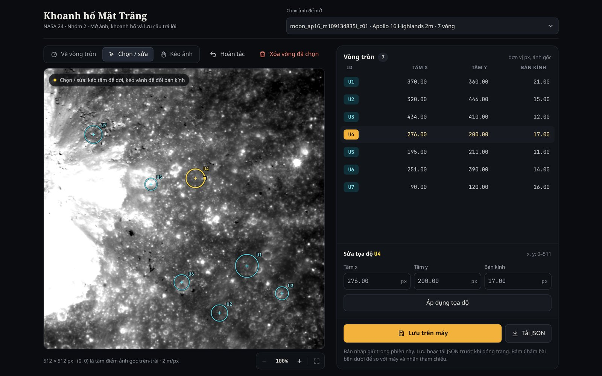
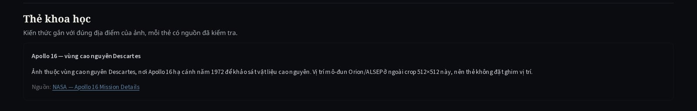

<!--
Người chốt: Bùi Hải Đức (S3-08). Nguồn: docs/DINH_DANG_DU_LIEU.md, docs/S1-09_GIAO_DIEN_KHOANH_HO.md,
docs/S2-04_CHAM_DIEM.md, docs/S2-08_MAN_HINH_KET_QUA.md, docs/S2-10_THE_KHOA_HOC.md, docs/S2-13_TICH_HOP.md,
src/contracts.py, src/matching.py, src/scoring.py, src/game_results.py, src/integration.py, app.py, src/crater_canvas/.
Ảnh: docs/evidence/s3-08/ chụp ngày 27/10/2026. Đã chụp lại trên main 3cff367 (có S3-04: tọa độ tâm pixel, màu link):
Hình 5.1 và 5.3 trùng từng byte, Hình 5.2 chỉ khác dòng thời điểm lưu lượt chấm, điểm vẫn 60/100.
Việc còn lại: cập nhật 5.6 (số test, thời gian chạy) và 5.7 khi có S3-01, S3-02, S3-05 (S2-09 điền ngày 28/10); cập nhật ảnh nếu giao diện đổi.
-->

# Chương 5. Hệ thống, trò chơi và kết luận

Chương này mô tả phần hệ thống nối các khối xử lý của Chương 3 thành sản phẩm cho học sinh: định dạng dữ liệu, giao diện khoanh hố, chấm điểm, màn hình kết quả, thẻ khoa học, kiểm thử và triển khai. Phần cuối tổng kết kết quả, hạn chế và hướng phát triển.

## 5.1. Kiến trúc và định dạng dữ liệu chung

Mã nguồn chia thành các mô-đun độc lập, trao đổi qua JSON và mảng NumPy theo một định dạng chung (Bảng 5.1). Nhờ vậy bốn thành viên làm song song: mỗi người sở hữu một mô-đun và chỉ cần giữ đúng đầu vào, đầu ra đã thống nhất.

| Mô-đun | Vai trò | Mục |
|---|---|---|
| `src/contracts.py` | Kiểm tra định dạng, quy đổi tọa độ, lưu lần chạy | 4.2, 5.1 |
| `src/preprocessing.py`, `src/hough.py`, `src/postprocessing.py`, `src/pipeline.py` | Chuỗi phát hiện: tiền xử lý, Hough NumPy, sáng–tối, phân lớp, lọc trùng | 3 |
| `src/matching.py`, `src/scoring.py`, `src/evaluation.py` | Ghép hố một–một, chấm người chơi, đánh giá phát hiện | 2.4, 4.7, 5.3 |
| `src/game_results.py`, `src/player_annotations.py` | Lượt chấm: ảnh đối chiếu, lưu lượt chơi và câu trả lời | 5.4 |
| `src/statistics.py`, `src/science_cards.py`, `src/integration.py` | Thống kê, thẻ khoa học và lớp ghép vào giao diện | 3.6, 5.5, 5.6 |
| `app.py`, `src/crater_canvas/` | Ứng dụng Streamlit và bản đồ vẽ chạy trong trình duyệt | 5.2–5.4 |

: Bảng 5.1. Các mô-đun chính của hệ thống.

Mỗi ảnh chuẩn gồm mảng 512 × 512, ảnh PNG để hiển thị, mặt nạ pixel hợp lệ và metadata: nguồn ảnh, góc cắt, tỷ lệ m/px, tọa độ địa lý của tâm, hướng nắng kèm mức tin cậy (`measured`, `side_only`, `none`) và dải bán kính tìm kiếm. Trường không có căn cứ để `null`, không điền giá trị đoán. Tọa độ theo quy ước ở mục 4.2: `x` là cột, `y` là hàng, gốc ở góc trên-trái, tâm pixel có tọa độ nguyên; đường kính $D = 2rs$.

Ứng viên máy, nhãn tham chiếu và câu trả lời người chơi dùng chung một cấu trúc nhưng lưu thành file riêng, phân biệt bằng trường `source`:

```json
{"schema_version": "1.0", "data_kind": "real", "image_id": "moon_ap16_m109134835l_c01",
 "source": "player", "reference_source": null,
 "circles": [{"crater_id": "U1", "x": 370.0, "y": 360.0, "r": 21.0, "confidence": null, "votes": null}]}
```

Nhãn tham chiếu bắt buộc ghi nguồn và người kiểm chéo trong `reference_source`. Số phiếu `votes` chỉ có ở ứng viên máy; `confidence` để `null` vì chưa được hiệu chuẩn thành xác suất. Mỗi lần chạy ghi vào một thư mục riêng, không ghi đè, kèm tham số và mã phiên bản (commit) để tái tạo được.

## 5.2. Giao diện khoanh hố

Giao diện là một ứng dụng Streamlit; phần bản đồ là thành phần tự viết bằng HTML, CSS và JavaScript chạy trong khung riêng của trang [@streamlit]. Ảnh và mã giao diện nằm trong kho mã, không tải thư viện từ mạng, nên dùng được ngoại tuyến sau lần cài đầu. Hình 5.1 là giao diện khi người chơi đã khoanh bảy vòng.

{width=85%}

Người chơi nhấn vào tâm hố và kéo ra tới vành để vẽ; kéo phần trong vòng để dời tâm, kéo vành để đổi bán kính, hoặc nhập chính xác tâm (0–511) và bán kính. Có xóa vòng, hoàn tác tối đa 50 thay đổi, tối đa 500 vòng mỗi ảnh. Bản đồ phóng 1–8 lần bằng nút, con lăn, phím hoặc hai ngón tay, và kéo ảnh bằng chế độ "Kéo ảnh", phím Space, nút giữa chuột hoặc hai ngón tay; thao tác xem không vào lịch sử hoàn tác hay dữ liệu lưu. "Lưu trên máy" ghi câu trả lời thành một lần chạy trên máy chủ, "Tải JSON" tải file về máy người chơi; bản nháp từng ảnh được giữ khi đổi qua lại giữa các ảnh.

**Quy đổi tọa độ.** Bản đồ hiển thị ở nhiều cỡ (khoảng 420–900 px trên máy tính, nhỏ hơn trên điện thoại) và nhiều mức phóng to, nên tọa độ được quy về hệ 512 × 512 ngay khi đọc con trỏ. Với $(u, v)$ là vị trí con trỏ, $(L, T)$ là góc trên-trái của bản đồ, $W$ là bề rộng hiển thị, $z$ là mức phóng to và $(v_x, v_y)$ là góc trên-trái vùng đang xem tính theo mép pixel:

$$
x = v_x + \frac{(u - L)\cdot 512}{W\,z} - \text{0,5}, \qquad y = v_y + \frac{(v - T)\cdot 512}{W\,z} - \text{0,5}. \qquad (5.1)
$$

Số hạng $-\text{0,5}$ đổi từ mép pixel sang tâm pixel: bấm vào giữa pixel 200 cho đúng $x = 200$, khớp quy ước của Hough và công cụ gán nhãn; khi vẽ thì cộng lại $\text{0,5}$. Test JavaScript khóa các trường hợp này ở nhiều cỡ hiển thị và mức phóng to; trên trình duyệt thật, vòng khoanh đúng tâm một ứng viên máy cho khoảng cách tâm 0,0 px.

## 5.3. Chấm điểm người chơi

Câu trả lời được so với **hai nguồn riêng**, không trộn kết quả. Cả hai dùng quy tắc ghép một–một của mục 2.4: tâm lệch không quá 0,5 bán kính hố đối chiếu, mỗi vòng và mỗi hố dùng tối đa một lần, chọn cách ghép nhiều cặp nhất rồi tổng khoảng cách nhỏ nhất bằng thuật toán Hungary [@kuhn1955].

**So với máy.** Ứng viên máy chưa được kiểm chứng (mục 3.7), nên phần này chỉ báo mức trùng: số vòng trùng, chỉ người chơi khoanh và chỉ máy có. Phần này không sinh điểm, để không dạy học sinh rằng máy là đáp án.

**So với nhãn tham chiếu.** Điểm chỉ được tính khi nguồn nhãn ghi rõ đã kiểm chéo ("reviewed by" kèm tên người kiểm); hố `uncertain` bị loại. Với ký hiệu của mục 2.4:

$$
\text{Điểm}_{\text{thưa}} = 100 \cdot \frac{\mathrm{TP}}{N_{\mathrm{nhãn}}}, \qquad \text{Điểm}_{\text{đầy đủ}} = 100 \cdot \frac{2\,\mathrm{TP}}{N_{\mathrm{dự\,đoán}} + N_{\mathrm{nhãn}}}. \qquad (5.2)
$$

Nhãn hiện có là nhãn thưa (mục 4.3), nên điểm là tỷ lệ hố đã gán nhãn được tìm thấy (Recall trên nhãn đã biết), và vòng ngoài nhãn **không** bị tính là khoanh sai. Công thức F1 chỉ dùng cho ảnh được xác nhận đã gán nhãn đầy đủ.

## 5.4. Màn hình kết quả và lưu lượt chơi

Người chơi bấm "Chấm bài" dưới bản đồ; máy chạy chuỗi phát hiện trên ảnh đang mở và hiện kết quả như Hình 5.2.

{width=85%}

Ảnh đối chiếu phóng to 3 lần để vòng nằm đúng tâm pixel, vẽ ba lớp vòng: người chơi, ứng viên máy và nhãn tham chiếu. Bên cạnh là điểm theo nhãn đã kiểm chéo, số hố tìm đúng và bỏ sót, kèm giải thích luật nhãn thưa; ảnh chưa có nhãn kiểm chéo thì hiện "Chưa có điểm" và lý do. Phần so với máy ghi rõ "chỉ để tham khảo, máy không phải đáp án". Màn hình nêu phạm vi tìm của máy (dải bán kính, đường kính theo mét, bước lưới, số bán kính đã thử), cảnh báo khi bước lưới lớn hơn 2 px hoặc máy dừng ở trần 100 ứng viên, và cảnh báo kết quả cũ khi người chơi sửa vòng sau lần chấm.

Trong Hình 5.2, người chơi tìm đúng 6/10 hố đã gán nhãn nên được 60 điểm, trong khi máy không trùng vòng nào của người chơi vì 100 ứng viên đều có bán kính nhỏ [CHỜ PR #26 được merge: chế độ chọn cân bằng đổi danh sách ứng viên, chụp lại Hình 5.2]. Đây là minh họa trực quan cho hạn chế ở mục 3.7 và là lý do không chấm người chơi theo máy.

Mỗi lần chấm được lưu thành một thư mục mới gồm metadata, tham số (cấu hình Hough, quy tắc chấm, phạm vi bán kính), vòng người chơi, ứng viên máy, nhãn tham chiếu nếu có, kết quả chấm, thời điểm và mã phiên bản. Dữ liệu lượt chơi của buổi khảo sát vì vậy phân tích lại được.

## 5.5. Thẻ khoa học

Thẻ khoa học gắn với vùng chụp của ảnh đang mở (Hình 5.3), gồm tiêu đề, nội dung ngắn và nguồn chính thức. Các vùng có thẻ là Apollo 15 Hadley–Apennine, Apollo 16 Descartes [@nasa_apollo15; @nasa_apollo16], Lunokhod 1 và Lunokhod 2 [@lroc_lunokhod1; @nssdc_artifacts], phủ 21 trong 26 ảnh. Năm ảnh Van de Graaff và Mare Frigoris không có thẻ, vì nhóm không gắn câu chuyện Apollo hay rover tùy ý vào ảnh không liên quan.

{width=100%}

Định dạng thẻ có trường vị trí (`position`) để đặt ghim tại thiết bị. Tuy nhiên, khi đối chiếu tọa độ tâm các ảnh cắt với vị trí bãi đáp và rover đã công bố, mọi thiết bị đều nằm ngoài khung ảnh: gần nhất là mô-đun Apollo 16, cách tâm ảnh cắt gần nhất khoảng 1,8 km, trong khi ảnh cắt 2 m/px chỉ rộng khoảng 1 km. Vì vậy mọi thẻ là thẻ theo vùng, giao diện không vẽ ghim giả, và yêu cầu "hiện khi học sinh tìm thấy" thiết bị mới đạt một phần (mục 5.8).

## 5.6. Tích hợp, kiểm thử và triển khai

**Tích hợp.** Giao diện không tự tính thống kê hay tự tạo thẻ. Lớp `src/integration.py` gọi hàm của mô-đun thống kê và mô-đun thẻ rồi trả một trong ba trạng thái: `pending` (module chưa cài, giao diện ghi "chưa có" kèm mã việc), `ok` (dữ liệu đúng định dạng) hoặc `error` (sai định dạng hay lỗi khi chạy, giao diện báo lỗi và không hiện số). Thẻ thiếu nguồn, link không phải `http(s)` hoặc vị trí ngoài ảnh bị ẩn kèm lý do. Nhờ vậy mỗi chức năng được ghép vào ngay khi mô-đun tương ứng xong, không phải sửa `app.py`.

**Kiểm thử.** Kho mã có [CHỜ: số test Python và JavaScript ở phiên bản cuối] test tự động, chạy trên GitHub Actions cho mọi pull request: test hợp đồng dữ liệu; test thuật toán (ví dụ Hough tính tay, ghép một–một so với lời giải vét cạn trên 150 cảnh ngẫu nhiên, luật chấm điểm); test giao diện (chạy ứng dụng Streamlit trong môi trường thử và 6 bộ test JavaScript cho tọa độ, thao tác chuột và cảm ứng, phóng to, lưu). Test đạt chỉ cho biết mã làm đúng thiết kế; độ chính xác phát hiện được đo riêng ở Chương 4.

**Triển khai.** Ứng dụng chạy trên máy chủ Linux của nhóm dưới dạng dịch vụ hệ thống, sau máy chủ web có HTTPS và mật khẩu truy cập; một script triển khai lấy bản mới nhất của nhánh chính, cài thư viện và bộ ảnh rồi khởi động lại dịch vụ. Lượt chấm đầu tiên của mỗi ảnh mất khoảng 9,4 s, chủ yếu cho tiền xử lý và Hough; ứng viên máy sau đó được giữ trong bộ nhớ đệm (tối đa 8 ảnh). Trước buổi khảo sát, người điều phối bấm "Chấm bài" một lần trên mỗi ảnh sẽ dùng để làm nóng bộ nhớ đệm.

## 5.7. Kết luận

Nhóm đã xây dựng một chuỗi chạy được từ đầu đến cuối, từ ảnh LROC thật đến trò chơi khoanh hố có chấm điểm, nhưng độ chính xác phát hiện còn thấp:

- **Phát hiện hố:** tiền xử lý tám bước và Hough tròn tự cài đặt bằng NumPy chạy trên cả 26 ảnh, có ví dụ tính tay khớp mã và đối chiếu OpenCV; kiểm tra sáng–tối, phân lớp ứng viên và lọc trùng đã có, kèm thử nghiệm đối chiếu nhãn.
- **Thống kê và so sánh mật độ:** nhóm đếm tay đủ hố 300–2.000 m trên hai vùng mặt biển cùng 20 m/px và cùng nắng xiên. Lunokhod 1 có 0,254 hố/km² trên 184,7 km², Mare Frigoris có 0,322 hố/km² trên 99,2 km². Khác biệt không có ý nghĩa thống kê (p = 0,35), nên chưa kết luận được vùng nào già hơn (mục 3.6). Mật độ tính từ ứng viên máy chưa dùng được, vì Hough luôn trả đủ 100 vòng nhỏ.
- **Trò chơi:** giao diện tiếng Việt khoanh, sửa, phóng to và lưu trên máy tính lẫn điện thoại; câu trả lời được chấm riêng so với máy và so với 240 nhãn tham chiếu chắc chắn trên 26 ảnh, bằng ghép một–một đúng quy tắc tâm lệch ≤ 0,5 r của đề.
- **Thẻ khoa học:** thẻ có nguồn cho bốn vùng Apollo và Lunokhod, không gắn sai địa điểm.
- **Đánh giá:** trên tập kiểm tra 8 ảnh, Hough tự cài đặt tìm lại 4/66 hố đã gán nhãn (6,06 %), và 5/66 (7,58 %) khi chọn ứng viên cân bằng theo bán kính. OpenCV tìm lại 65/66 nhưng sinh hơn 8.000 vòng mỗi ảnh, nên con số này không chứng minh độ chính xác (mục 4.7) [CHỜ PR #26 được merge].
- **Thí nghiệm và khảo sát:** [CHỜ S3-05, S3-01: kết quả ba thí nghiệm và khảo sát người chơi].

Nhóm giữ hai nguyên tắc xuyên suốt. Thứ nhất, chỉ báo độ đo khi có dữ liệu tham chiếu phù hợp: điểm chỉ tính trên nhãn đã kiểm chéo, nhãn thưa chỉ cho Recall, và ứng viên máy không bao giờ được coi là đáp án. Thứ hai, kết quả chính tái tạo được: mỗi lần chạy lưu tham số và mã phiên bản, và tham số được chọn trên tập điều chỉnh. Một số số đo phụ (đối chiếu OpenCV và lượng tử 8 bit trên STT 13) mới đo một lần và chưa có script, đã ghi rõ ở từng chương.

## 5.8. Hạn chế

- **Bỏ sót hố lớn.** Hough dừng ở trần 100 ứng viên trên mọi ảnh, phần lớn là vòng nhỏ trên vệt sáng và đá, nên bỏ sót hố lớn dù nằm trong dải tìm (mục 3.7); Recall trên nhãn đã biết của tập kiểm tra chỉ 6–8 % (mục 4.7). Chọn ứng viên cân bằng theo bán kính mới gỡ được một phần nguyên nhân. Số đếm của thống kê vì vậy phản ánh ứng viên thô.
- **Nhãn thưa.** Mỗi ảnh chỉ có 4–13 hố được gán nhãn, nên chưa đo được Precision và F1 trên toàn ảnh.
- **Bước lọc chưa bật.** Phân lớp ứng viên và lọc trùng mới được kiểm trên vài ảnh có nhãn.
- **Dữ liệu và tập kiểm tra.** Ảnh browse 8 bit chỉ phù hợp để minh họa; tập kiểm tra toàn ảnh 20 m/px không có hướng nắng, nên tác dụng của kiểm tra sáng–tối chỉ đo được trên tập điều chỉnh.
- **Thẻ khoa học chưa có ghim vị trí**, vì không ảnh cắt nào chứa bãi đáp hay rover.
- **Thời gian chấm** lượt đầu khoảng 9 s trên máy chủ thử nghiệm, phải làm nóng bộ nhớ đệm trước khi nhiều người chơi cùng lúc.
- **Khảo sát** quy mô nhỏ (khoảng 10 người), chỉ cho nhận xét mô tả về mức hứng thú và hiểu bài.

## 5.9. Hướng phát triển

- **Phát hiện hố lớn:** Hough nhiều tầng phân giải (ảnh thu nhỏ cho bán kính lớn), giới hạn số ứng viên theo từng khoảng bán kính, và chọn ngưỡng trên tập điều chỉnh có thêm nhãn hố lớn.
- **Nhãn đầy đủ:** gán nhãn đầy đủ cho một số ảnh để đo Precision/F1; với ảnh 20 m/px, chiếu danh mục Robbins [@robbins2019] để có nhãn cho hố từ 1–2 km.
- **Bật lọc có kiểm soát** khi đủ ảnh có nhãn để chứng minh không làm mất hố thật.
- **Thẻ có ghim:** cắt thêm ảnh chứa bãi đáp Apollo và vị trí rover, đổi tọa độ thiết bị sang pixel qua metadata, để thẻ chỉ hiện khi học sinh tìm thấy đúng vị trí.
- **Mở rộng:** thêm Sao Hỏa (CTX/HiRISE) và các hướng gợi ý của đề như chọn điểm hạ cánh an toàn; đóng gói bản ngoại tuyến hoàn toàn cho trường học không có mạng ổn định.
