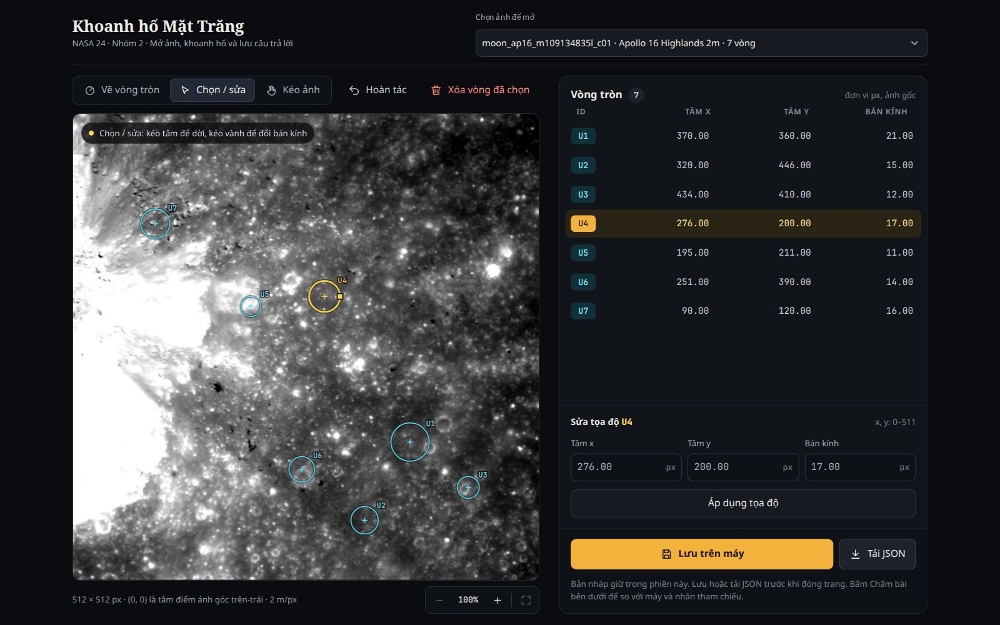
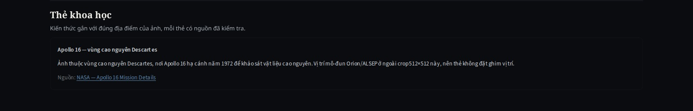

<!--
Người chốt: Bùi Hải Đức (S3-08). Nguồn: docs/DINH_DANG_DU_LIEU.md, docs/S1-09_GIAO_DIEN_KHOANH_HO.md,
docs/S2-04_CHAM_DIEM.md, docs/S2-08_MAN_HINH_KET_QUA.md, docs/S2-10_THE_KHOA_HOC.md, docs/S2-13_TICH_HOP.md,
src/contracts.py, src/matching.py, src/scoring.py, src/game_results.py, src/integration.py, app.py, src/crater_canvas/.
Ảnh: docs/evidence/s3-08/ chụp ngày 27/10/2026. Đã chụp lại trên main 3cff367 (có S3-04: tọa độ tâm pixel, màu link):
Hình 5.1 và 5.3 trùng từng byte, Hình 5.2 chỉ khác dòng thời điểm lưu lượt chấm, điểm vẫn 60/100.
Ngày 31/10/2026: bỏ chờ PR #26 theo S2-16 mục 6 và cấu hình score đã chốt ở S2-15; ghi khảo sát chưa thực hiện.
Việc còn lại: cập nhật 5.6 (số test cuối), 5.7 (S3-05); chụp lại Hình 5.x sau khi lỗi #10 và #11 được merge.
-->

# Chương 5. Hệ thống, trò chơi và kết luận

Chương này trình bày trò chơi, cách tích hợp các khối xử lý và giới hạn của sản phẩm.

## 5.1. Kiến trúc và định dạng dữ liệu chung

Các mô-đun trao đổi qua JSON và mảng NumPy theo định dạng chung (Bảng 5.1).

| Mô-đun | Vai trò | Mục |
|---|---|---|
| `src/contracts.py` | Kiểm tra định dạng, quy đổi tọa độ, lưu lần chạy | 4.2, 5.1 |
| `src/preprocessing.py`, `src/hough.py`, `src/postprocessing.py`, `src/pipeline.py` | Chuỗi phát hiện: tiền xử lý, Hough NumPy, sáng–tối, phân lớp, lọc trùng | 3 |
| `src/matching.py`, `src/scoring.py`, `src/evaluation.py` | Ghép hố một–một, chấm người chơi, đánh giá phát hiện | 2.4, 4.7, 5.3 |
| `src/game_results.py`, `src/player_annotations.py` | Lượt chấm: ảnh đối chiếu, lưu lượt chơi và câu trả lời | 5.4 |
| `src/statistics.py`, `src/science_cards.py`, `src/integration.py` | Thống kê, thẻ khoa học và lớp ghép vào giao diện | 3.6, 5.5, 5.6 |
| `app.py`, `src/crater_canvas/` | Ứng dụng Streamlit và bản đồ vẽ chạy trong trình duyệt | 5.2–5.4 |

: Bảng 5.1. Các mô-đun chính của hệ thống.

Mỗi ảnh có mảng 512 × 512, PNG, mặt nạ hợp lệ và metadata về nguồn, tỷ lệ, tọa độ, hướng nắng và dải bán kính (mục 4.1–4.2). Trường thiếu căn cứ để `null`. Tâm pixel có tọa độ nguyên; đường kính $D = 2rs$.

Ứng viên máy, nhãn và câu trả lời người chơi lưu riêng, phân biệt bằng `source`. Mỗi vòng ghi mã `crater_id`, tâm `x, y`, bán kính `r`, `confidence` và `votes`.

Nhãn ghi nguồn và người kiểm chéo trong `reference_source`; `votes` chỉ có ở vòng máy, `confidence` để `null` vì chưa hiệu chuẩn. Mỗi lần chạy lưu riêng tham số và mã phiên bản.

## 5.2. Giao diện khoanh hố

Ứng dụng dùng Streamlit và bản đồ tự viết bằng HTML, CSS, JavaScript [@streamlit]. Ảnh và mã nằm trong kho mã, dùng được ngoại tuyến sau khi cài. Hình 5.1 minh họa bảy vòng người chơi khoanh.

{width=85%}

Người chơi kéo từ tâm ra vành để vẽ, kéo vòng để dời, kéo vành hoặc nhập số để đổi bán kính. Có xóa vòng, hoàn tác tối đa 50 thay đổi và tối đa 500 vòng mỗi ảnh. Bản đồ hỗ trợ chuột, bàn phím, cảm ứng, phóng 1–8 lần và kéo ảnh. "Lưu trên máy" ghi lượt trên máy chủ; "Tải JSON" đưa file về máy người chơi. Đổi ảnh vẫn giữ bản nháp.

**Tọa độ.** Với con trỏ $(u, v)$, góc bản đồ $(L, T)$, bề rộng hiển thị $W$, mức phóng $z$ và góc vùng xem $(v_x, v_y)$ tính theo mép pixel, tọa độ ảnh là:

$$
x = v_x + \frac{(u - L)\cdot 512}{W\,z} - \text{0,5}, \qquad y = v_y + \frac{(v - T)\cdot 512}{W\,z} - \text{0,5}. \qquad (5.1)
$$

Số hạng $-\text{0,5}$ đổi mép pixel sang tâm pixel, khớp Hough và công cụ gán nhãn; khi vẽ thì cộng lại $\text{0,5}$. Test JavaScript kiểm quy ước ở nhiều cỡ và mức phóng; kiểm trên trình duyệt cho khoảng cách tâm 0,0 px khi khoanh đúng tâm ứng viên.

## 5.3. Chấm điểm người chơi

Câu trả lời được so với **hai nguồn riêng** theo quy tắc một–một ở mục 2.4: tâm lệch không quá 0,5 bán kính hố đối chiếu; tối đa số cặp rồi tối thiểu tổng khoảng cách chuẩn hóa bằng thuật toán Hungary [@kuhn1955].

**So với máy.** Chỉ báo số vòng trùng, chỉ người chơi có và chỉ máy có. Ứng viên chưa kiểm chứng không dùng làm đáp án hay sinh điểm.

**So với nhãn tham chiếu.** Điểm chỉ được tính khi nguồn nhãn ghi rõ đã kiểm chéo ("reviewed by" kèm tên người kiểm); hố `uncertain` bị loại. Với ký hiệu của mục 2.4:

$$
\text{Điểm}_{\text{thưa}} = 100 \cdot \frac{\mathrm{TP}}{N_{\mathrm{nhãn}}}, \qquad \text{Điểm}_{\text{đầy đủ}} = 100 \cdot \frac{2\,\mathrm{TP}}{N_{\mathrm{dự\,đoán}} + N_{\mathrm{nhãn}}}. \qquad (5.2)
$$

Nhãn hiện có là nhãn thưa (mục 4.3): điểm là Recall trên nhãn đã biết, vòng ngoài nhãn **không** bị tính sai. Công thức F1 chỉ dùng khi nhãn được xác nhận đầy đủ.

## 5.4. Màn hình kết quả và lưu lượt chơi

Người chơi bấm "Chấm bài" dưới bản đồ; máy chạy chuỗi phát hiện trên ảnh đang mở và hiện kết quả như Hình 5.2.

{width=85%}

Ảnh đối chiếu phóng 3 lần để vòng nằm đúng tâm pixel. Màn hình hiện điểm theo nhãn, số hố tìm đúng và bỏ sót, giải thích nhãn thưa; thiếu nhãn kiểm chéo thì ghi "Chưa có điểm". Phần máy ghi rõ chỉ để tham khảo, nêu dải tìm và cảnh báo khi bước lưới lớn hơn 2 px hoặc chạm trần 100 ứng viên. Sửa vòng sau khi chấm sẽ có cảnh báo kết quả cũ.

Hình 5.2 cho điểm 60 vì người chơi tìm đúng 6/10 nhãn; máy không trùng vòng nào của người chơi vì giữ 100 vòng nhỏ. Game vẫn dùng `score` theo cấu hình đã chốt, nên ví dụ này giữ nguyên. Hạn chế đó giải thích vì sao không chấm người chơi theo máy.

Mỗi lượt chấm lưu riêng metadata, tham số, các lớp vòng, kết quả, thời điểm và mã phiên bản để phân tích lại.

## 5.5. Thẻ khoa học

Thẻ theo vùng ảnh gồm tiêu đề, nội dung và nguồn chính thức (Hình 5.3): Apollo 15, Apollo 16 [@nasa_apollo15; @nasa_apollo16], Lunokhod 1 và 2 [@lroc_lunokhod1; @nssdc_artifacts], phủ 21/26 ảnh. Năm ảnh Van de Graaff và Mare Frigoris không có thẻ.

{width=100%}

Mọi bãi đáp và rover đã đối chiếu đều nằm ngoài ảnh cắt, nên `position=null` và giao diện không vẽ ghim. Yêu cầu thẻ "hiện khi học sinh tìm thấy" thiết bị mới đạt một phần.

## 5.6. Tích hợp, kiểm thử và triển khai

**Tích hợp.** `src/integration.py` gọi mô-đun thống kê và thẻ, trả `pending` khi chưa cài, `ok` khi đúng định dạng, `error` khi lỗi. Giao diện không tự tạo số liệu khi lỗi; thẻ thiếu nguồn, link không phải `http(s)` hoặc vị trí ngoài ảnh bị ẩn kèm lý do.

**Kiểm thử.** Kho mã có [CHỜ: số test Python và JavaScript ở phiên bản cuối] test tự động trên GitHub Actions: hợp đồng dữ liệu, Hough tính tay, ghép một–một so với vét cạn, luật chấm, luồng Streamlit và thao tác canvas. Test đạt xác nhận hành vi theo thiết kế; độ chính xác phát hiện được đo riêng ở Chương 4.

**Triển khai.** Ứng dụng chạy trên máy chủ Linux, có HTTPS và mật khẩu. Lượt đo trên máy chủ thử nghiệm mất 9,4 s cho lần chấm đầu; ứng viên được giữ trong bộ nhớ đệm tối đa 8 ảnh. Có thể chấm trước các ảnh dùng trình diễn để làm nóng bộ nhớ đệm.

## 5.7. Kết luận

Sản phẩm chạy từ ảnh LROC đến trò chơi có chấm điểm, nhưng độ chính xác phát hiện còn thấp:

- **Phát hiện:** tiền xử lý và Hough NumPy chạy trên 26 ảnh, có ví dụ tính tay, đối chiếu OpenCV và kiểm tra sáng–tối.
- **Mật độ:** đếm tay hố 300–2.000 m cho Lunokhod 1 là 0,254 và Mare Frigoris là 0,322 hố/km². Khác biệt chưa có ý nghĩa (p = 0,35), chưa kết luận được vùng nào già hơn. Ứng viên máy chạm trần không dùng để suy mật độ hố.
- **Trò chơi và thẻ:** giao diện tiếng Việt hỗ trợ khoanh, sửa, lưu; chấm theo 240 nhãn chắc chắn trên 26 ảnh bằng ghép một–một. So với máy chỉ báo mức trùng. Thẻ có nguồn cho bốn vùng Apollo và Lunokhod.
- **Đánh giá:** trên 8 ảnh kiểm tra, NumPy tìm lại 4/66 nhãn với `score`, 5/66 với cách cân bằng; OpenCV tìm lại 65/66 nhưng sinh hơn 8.000 vòng mỗi ảnh. Nhãn thưa chưa cho phép kết luận về Precision (mục 4.7).
- **Thí nghiệm:** [CHỜ S3-05: kết quả ba thí nghiệm].
- **Khảo sát:** chưa thực hiện theo quyết định của trưởng nhóm ngày 31/10/2026. Tiêu chí khảo sát ít nhất 10 học sinh của đề chưa đạt; chưa có bằng chứng về mức hứng thú hay hiểu bài.

Tham số game đã chốt theo tập điều chỉnh; lệnh tái tạo và giới hạn từng phép đo ở Phụ lục C. Điểm dùng nhãn đã kiểm chéo; ứng viên máy không thay đáp án.

## 5.8. Hạn chế

- **Bỏ sót hố lớn.** Hough giữ 100 vòng, phần lớn nhỏ; cách cân bằng chỉ khắc phục một phần (mục 3.7). Thống kê vòng máy phản ánh ứng viên thô.
- **Nhãn thưa.** Mỗi ảnh chỉ có 4–13 hố được gán nhãn, nên chưa đo được Precision và F1 trên toàn ảnh.
- **Bước lọc chưa bật.** Phân lớp ứng viên và lọc trùng mới được kiểm trên vài ảnh có nhãn.
- **Dữ liệu và tập kiểm tra.** Ảnh browse 8 bit chỉ phù hợp để minh họa; tập kiểm tra toàn ảnh 20 m/px không có hướng nắng, nên tác dụng của kiểm tra sáng–tối chỉ đo được trên tập điều chỉnh.
- **Thẻ khoa học chưa có ghim vị trí**, vì không ảnh cắt nào chứa bãi đáp hay rover.
- **Thời gian chấm** lượt đầu còn chậm; bộ nhớ đệm chỉ giúp các lượt sau.
- **Chưa đánh giá với người chơi thật.** Nhóm bỏ thử người chơi và khảo sát để ưu tiên hoàn thành dự án. Yêu cầu khảo sát ít nhất 10 học sinh chưa đạt. Khung phiếu đã có chỉ là thiết kế dự kiến; cần triển khai và thu dữ liệu thật ở bước tiếp theo.

## 5.9. Hướng phát triển

- **Phát hiện hố lớn:** Hough nhiều tầng phân giải (ảnh thu nhỏ cho bán kính lớn), giới hạn số ứng viên theo từng khoảng bán kính, và chọn ngưỡng trên tập điều chỉnh có thêm nhãn hố lớn.
- **Nhãn đầy đủ:** gán nhãn đầy đủ cho một số ảnh để đo Precision/F1; với ảnh 20 m/px, chiếu danh mục Robbins [@robbins2019] để có nhãn cho hố từ 1–2 km.
- **Bật lọc có kiểm soát** khi đủ ảnh có nhãn để chứng minh không làm mất hố thật.
- **Thẻ có ghim:** cắt thêm ảnh chứa bãi đáp Apollo và vị trí rover, đổi tọa độ thiết bị sang pixel qua metadata, để thẻ chỉ hiện khi học sinh tìm thấy đúng vị trí.
- **Đánh giá người chơi:** thử phiếu trước khi khảo sát ít nhất 10 học sinh; dùng chung hướng dẫn, bốn câu hứng thú thang 1–5 và năm câu hiểu bài trước/sau theo khung đã có. Báo riêng hai mặt và phản hồi mở; thiết kế không có nhóm đối chứng nên không chứng minh quan hệ nhân quả. Nếu dùng sinh viên thay học sinh, cần giảng viên chấp thuận và nêu giới hạn mẫu.
- **Mở rộng:** thêm Sao Hỏa (CTX/HiRISE) và các hướng gợi ý của đề như chọn điểm hạ cánh an toàn; đóng gói bản ngoại tuyến hoàn toàn cho trường học không có mạng ổn định.
