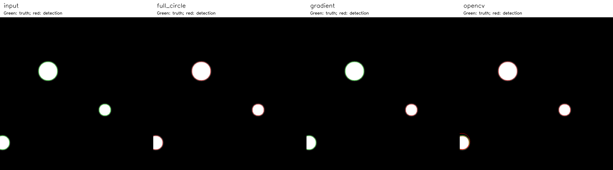
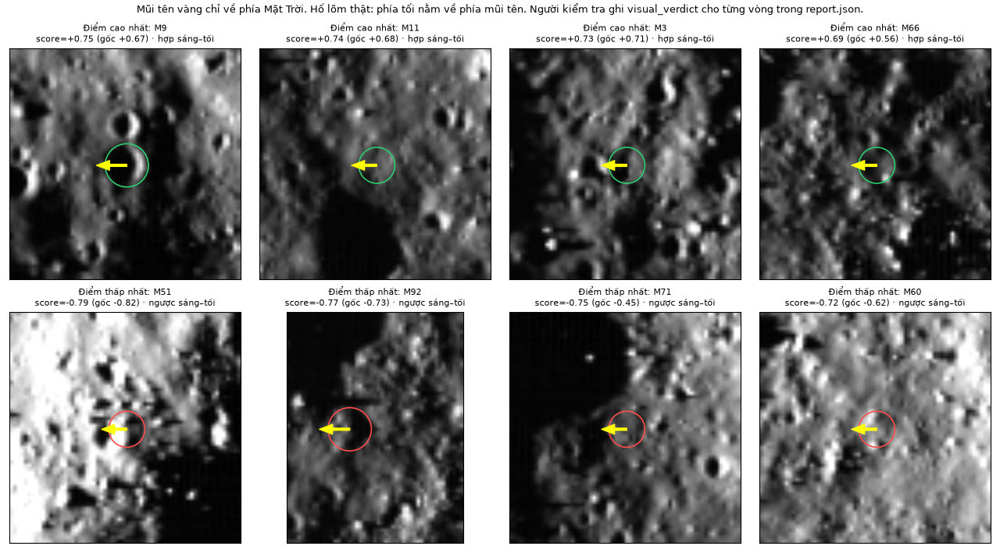
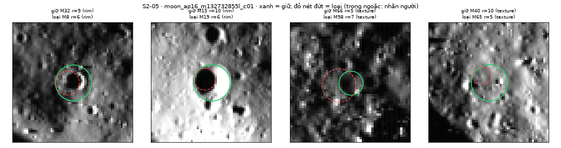
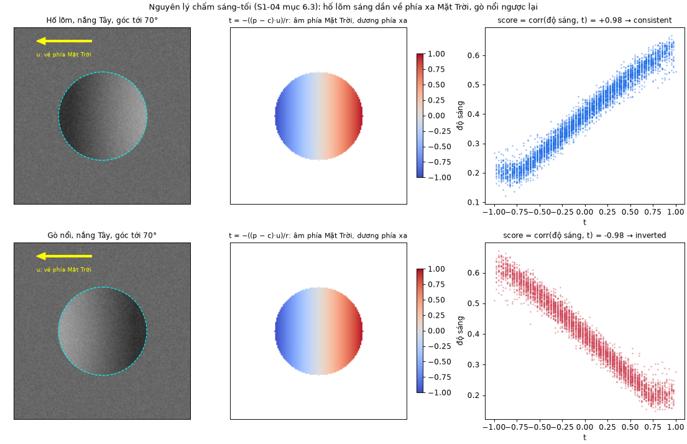

<!--
Người chốt: cả nhóm. Mỗi thành viên kiểm tra dòng của mình ở Phụ lục A và D.
Phụ lục D, dòng của Đức: Đức xác nhận lại mô tả trước khi nộp.
Phụ lục C: Tiến (S3-10) đối chiếu với README cuối và lệnh tái tạo bảng kết quả.
-->

# Phụ lục

## A. Phân công và đóng góp

Bảng A.1 ghi đầu việc và sản phẩm trong kho mã. S1–S3 là ba sprint; PR là pull request trên GitHub.

| Thành viên | Đầu việc chính | Sản phẩm trong kho mã |
|---|---|---|
| Bùi Hải Đức | S1-01, S1-05, S1-09, S1-13, S2-04, S2-08, S2-13, S2-16, S3-04, S3-08, S3-12 | Phạm vi và tiêu chí nghiệm thu; khung kho mã và định dạng dữ liệu; giao diện khoanh hố (PR #6); chạy từ đầu đến cuối và nháp Chương 1 (PR #7, #9); giải thích lệch 0,5 px của OpenCV (PR #8); chấm điểm (PR #15); màn hình kết quả (PR #16, #17); tích hợp (PR #18); sửa tọa độ tâm pixel (PR #27); ghép báo cáo (PR #28); biên bản nghiệm thu tuần 2 (PR #29) |
| Nguyễn Mạnh Tiến | S1-03, S1-07, S1-12, S1-15, S2-01, S2-06, S2-11, S2-15, S3-02, S3-06, S3-10 | Ghi chú Hough và danh mục tài liệu; Hough tròn NumPy (PR #2); ví dụ tính tay, đối chiếu OpenCV và lý thuyết Hough (PR #5); tăng tốc Hough và cấu hình (PR #21); kiểm chéo nhãn tham chiếu |
| Đinh Quang Hưng | S1-04, S1-08, S1-11, S1-14, S2-02, S2-05, S2-09, S2-12, S3-03, S3-07, S3-11 | Đặc tả tiền xử lý; chuỗi tiền xử lý B0–B8 (PR #3); kiểm tra sáng–tối (PR #12); nháp Chương 2/3 (PR #13); phân lớp ứng viên (PR #19); lọc trùng (PR #22) |
| Hoàng Quốc Anh | S1-02, S1-06, S1-10, S1-16, S2-03, S2-07, S2-10, S2-14, S3-01, S3-05, S3-09, S3-13 | Nguồn ảnh; bộ 26 ảnh cắt và metadata (PR #1); công cụ gán nhãn (PR #4); hồ sơ dữ liệu, khung Chương 4 và khung khảo sát (PR #10); chia tập và nhãn 26 ảnh (PR #20); ba thí nghiệm (PR #24); thẻ khoa học (PR #25) |

: Bảng A.1. Đầu việc và sản phẩm của từng thành viên.

Đã có thêm sản phẩm trong repo: PR #26 (Hough, đánh giá và lý thuyết của Tiến); PR #31 (S2-15, S3-10); PR #33 (Hưng bổ sung Chương 3 và mục 4.1); PR #34 (Đức sửa app, kiểm trình duyệt); PR #35 (báo cáo của Đức); PR #36 (kiểm tái tạo và hồ sơ bàn giao). Danh mục này ghi sản phẩm đã merge, không xác nhận mức đóng góp hay nghiệm thu thay thành viên.

[CHỜ cả nhóm: đối chiếu sản phẩm sprint 3 còn lại với Bảng A.1 và xác nhận phần của mình.]

| Thành viên | Tỷ lệ đóng góp | Tự đánh giá | Đánh giá của các thành viên khác | Xác nhận |
|---|---|---|---|---|
| Bùi Hải Đức | [CHỜ] | [CHỜ] | [CHỜ] | [CHỜ] |
| Nguyễn Mạnh Tiến | [CHỜ] | [CHỜ] | [CHỜ] | [CHỜ] |
| Đinh Quang Hưng | [CHỜ] | [CHỜ] | [CHỜ] | [CHỜ] |
| Hoàng Quốc Anh | [CHỜ] | [CHỜ] | [CHỜ] | [CHỜ] |

: Bảng A.2. Tỷ lệ đóng góp và đánh giá chéo.

## B. Quy trình làm việc

Mỗi đầu việc có người phụ trách, người phối hợp, đầu ra và tiêu chí hoàn thành. Thay đổi vào nhánh chính qua PR sau khi người phối hợp hoặc trưởng nhóm duyệt và GitHub Actions kiểm hợp đồng, test Python, JavaScript đạt. Bằng chứng lưu ở `docs/evidence/`, kèm tham số và mã phiên bản; nhật ký ở `docs/NHAT_KY_NHOM.csv`.

## C. Cách chạy lại

Các lệnh sau chạy từ thư mục gốc của kho mã, với Python 3.12. Trên Windows, kích hoạt môi trường bằng `.venv\Scripts\activate`.

```bash
python -m venv .venv && source .venv/bin/activate
python -m pip install -r requirements-test.txt
python -B scripts/install_s106_dataset.py       # bộ ảnh và SHA-256
python -B -m streamlit run app.py               # trò chơi
python -B scripts/run_end_to_end.py --all       # toàn bộ ảnh
python -B -m unittest discover -s tests         # test Python
for f in tests/test_canvas_*.js; do node "$f" || exit 1; done
python -B scripts/check_contracts.py
python -m pip install -r requirements-report.txt
python -B scripts/build_report.py              # DOCX/PDF; cần LibreOffice
```

Một lệnh tái tạo các bảng thuật toán/thống kê đã có mã và dữ liệu:

```bash
python -X utf8 -B scripts/reproduce_s310.py
```

Thư mục mới `outputs/s310_<UTC>/` chứa `frozen_tuning.csv`, hai bảng `evaluation_*/results.csv`, `E1.csv`–`E3.csv` và `density/`. `manifest.json` ghi môi trường, seed 0, hash và trạng thái từng bước; chỉ nhận bộ bảng có `status=complete, mode=full`. Cấu hình game và đối chiếu lưu riêng. Nhãn thưa chỉ cho Recall_known; chạy holdout là đánh giá lặp. `--quick --repeats 1` chỉ kiểm luồng. Hướng dẫn Windows/Linux ở README; chưa có dữ liệu khảo sát thật.

## D. Khai báo sử dụng công cụ AI

| Thành viên | Công cụ | Dùng cho việc gì | Cách kiểm soát |
|---|---|---|---|
| Bùi Hải Đức | Claude Code (Anthropic); Codex (OpenAI), từ 31/10/2026 | Claude Code: viết và sửa mã giao diện, chấm điểm, tích hợp và test; rà soát pull request; soạn tài liệu và ghép báo cáo. Codex: sửa lỗi app, kiểm độc lập, chỉnh báo cáo và chạy tái tạo | Đọc thay đổi, chạy test và kiểm tra trên trình duyệt trước khi merge; số liệu trong báo cáo lấy từ kết quả chạy và tài liệu trong kho mã. Với Codex: người kiểm độc lập, chạy test, đối chiếu bằng chứng và trưởng nhóm duyệt trước khi tích hợp |
| Nguyễn Mạnh Tiến | [CHỜ] | [CHỜ] | [CHỜ] |
| Đinh Quang Hưng | [CHỜ] | [CHỜ] | [CHỜ] |
| Hoàng Quốc Anh | [CHỜ] | [CHỜ] | [CHỜ] |

: Bảng D.1. Khai báo sử dụng công cụ AI.

## E. Chi tiết thuật toán và bằng chứng bổ sung

Các phần dưới chuyển từ Chương 2–4 khi rút gọn; số liệu thuộc các lần chạy đã ghi, không phải phép đo mới.

### E.1. Chi tiết Hough

Hình E.1 so sánh ba cách trên cùng ảnh giả lập, dải bán kính 18–36 px. Bỏ phiếu toàn vòng tìm đúng ba đĩa. Bỏ phiếu theo gradient chỉ giữ đĩa r = 20, vì tại tâm hai đĩa kia số phiếu (40 và 27) thấp hơn ngưỡng (71 và 53). OpenCV trả bốn vòng: sau khi trừ 0,5 px, ba vòng trùng tâm thật, bán kính lệch dưới 1 px; vòng thứ tư lệch 5,39 px gần đĩa bị cắt mép. Đây chỉ là minh họa thuật toán, không chứng minh cách nào tốt hơn trên ảnh Mặt Trăng.

{width=100%}

Giả mã dưới đây bám theo cài đặt; B là số điểm biên mỗi lô.

```text
(ys, xs) ← các điểm biên; nếu không có: trả []
U ← []
với r = r_min, r_min + Δr, ... ≤ r_max:
    A ← mảng H×W toàn 0
    nếu toàn vòng: D ← (2.9); S ← |D|
        với mỗi lô B điểm biên: cộng phiếu (2.10) bằng
            bincount trên đoạn [min i, max i], i = b·W + a
    ngược lại: S ← ⌈2πr⌉; cộng phiếu hai tâm (2.11)
    τ ← max(v_min, ⌈κ·S⌉)
    thêm (A/S, A, b, a, r) của mọi cực đại 3×3 có A ≥ τ vào U
sắp U: điểm giảm, phiếu giảm, rồi y, x, r tăng
chế độ cân bằng: xen kẽ U giữa các nhóm bán kính
G ← []
với mỗi u trong U: nếu không g ∈ G nào thỏa (2.13) thì thêm u
    vào G; dừng khi |G| = L
trả G
```

Ví dụ dùng đúng các hàm nội bộ của bước Hough, trên ảnh biên 5 × 5, r = 1; bán kính và ngưỡng nhỏ chỉ để minh họa. Bốn điểm biên $P_1 = (2, 1)$, $P_2 = (1, 2)$, $P_3 = (3, 2)$, $P_4 = (2, 3)$ đều cách (2, 2) đúng 1 px. Với bước 1°, 360 góc chỉ cho 8 độ lệch (±1, ±1), (±1, 0), (0, ±1), nên $S_1 = 8$. Mỗi điểm bỏ 8 phiếu tại $(x - d_x,\ y - d_y)$, tổng 32 phiếu, đều trong ảnh. Bốn phiếu rơi vào (2, 2), chỉ số phẳng 2·5 + 2 = 12: $P_1$ với (0, −1), $P_2$ với (−1, 0), $P_3$ với (1, 0), $P_4$ với (0, 1). Mảng tích lũy sau $P_1$ và sau cả bốn điểm:

```text
sau P1:        sau P1..P4:
0 1 1 1 0      0 1 1 1 0
0 1 0 1 0      1 2 2 2 1
0 1 1 1 0      1 2 4 2 1
0 0 0 0 0      1 2 2 2 1
0 0 0 0 0      0 1 1 1 0
```

Với $v_{\min} = 3$ và κ = 0,35, (2.12) cho $\tau_1 = \max(3, \lceil \text{2,8} \rceil) = 3$. Chỉ ô (2, 2) vượt ngưỡng và lớn hơn tám ô kề, nên kết quả là tâm (2, 2), r = 1, q = 4/8 = 0,5; với $v_{\min}$ mặc định bằng 12 thì không có đỉnh. Nếu gradient lý tưởng hướng ra ngoài, (2.11) cho 4 phiếu tại tâm và 1 phiếu ở mỗi ô (2, 0), (0, 2), (4, 2), (2, 4); $S_1 = \lceil 2\pi \rceil = 7$ nên q = 4/7 ≈ 0,571. Cả hai kết quả được kiểm chứng tự động bằng mã.

### E.2. Chạy chuỗi và kiểm chứng tiền xử lý

Lần chạy cả bộ 26 ảnh ngày 15/10/2026 không gặp lỗi. Tiền xử lý mất 0,025–0,071 s mỗi ảnh, Hough mất 5,1–8,3 s trên máy phát triển. Cả 26 ảnh đều trả đúng 100 ứng viên, tức chạm giới hạn `max_circles`. Hình E.2 là overlay của một lần chạy: vòng máy rải khắp ảnh, phần lớn là vòng nhỏ trên biên kết cấu (mục 3.7).

{width=75%}

Bộ kiểm thử `tests/test_preprocessing.py` (33 bài) so phần tự viết với `cv2.resize(INTER_AREA)`, `cv2.GaussianBlur` và `cv2.Sobel`, theo tiêu chí sai khác nhỏ hơn $10^{-5}$. Đo một lần trên STT 13, sai khác lớn nhất là $\text{6,0} \cdot 10^{-8}$ (thu nhỏ khối), $\text{1,8} \cdot 10^{-7}$ (Gauss) và $\text{3,6} \cdot 10^{-7}$ (Sobel).

Khác đặc tả ban đầu, CLAHE chạy trên ảnh 8 bit thay vì 16 bit. Với 16 bit, ô 64 × 64 px và các `clipLimit` thường dùng, ngưỡng cắt mỗi bin của OpenCV luôn bằng 1 nên `clipLimit` mất tác dụng (mục 2.1): trên vùng phẳng có nhiễu, độ lệch chuẩn 0,020 tăng lên 0,188 với mọi `clipLimit` 1, 2, 4, còn bản 8 bit cho 0,038; 0,056 và 0,090. Riêng phép lượng tử về 8 bit ảnh hưởng không đáng kể: hướng gradient lệch trung vị 0,05–0,08°, biên Canny trùng 93–96 %.

**Danh sách máy luôn chạm trần.** Cả 26 ảnh đều trả đúng 100 ứng viên. Trên 4 ảnh đo ở bước rà biên (mục 3.4.3), 80–94 vòng có r = 5–6 px và không vòng nào có r > 12 px, dù dải tìm lên tới 100–125 px. Không thể đọc số 100 thành số hố.

**Hố lớn bị bỏ sót dù nằm trong dải tìm.** STT 17 có 10 nhãn tham chiếu thưa, bán kính 8–22 px, đều nằm trong dải tìm 5–125 px. Hough dừng ở 100 vòng bán kính 5–10 px, nên Recall_known = 0/10. Đổi `min_vote_ratio` (0,30; 0,40) hay `radius_step_px` (2) vẫn cho 0/10, và đổi từng tham số tiền xử lý chỉ đưa bán kính lớn nhất lên 8–16 px. Nút thắt vì vậy nằm ở cách xếp hạng theo tỷ lệ phiếu và cắt ở 100 đỉnh. Bản sửa ở mục 3.3.5 đưa được vòng lớn hơn vào danh sách, nhưng Recall_known vẫn thấp.

Các số đo phụ đối chiếu OpenCV và lượng tử 8 bit ở trên lấy từ `docs/S1-14_NHAP_CHUONG_2_3.md` mục 3.2.5–3.2.6; chưa có script tái tạo trong repo.

### E.3. Chi tiết cài đặt và tăng tốc Hough

Tọa độ điểm biên được lấy một lần bằng `np.nonzero`. Ở mỗi bán kính r, với 360 mẫu góc, bảng độ lệch $(\mathrm{rint}(r\cos\varphi), \mathrm{rint}(r\sin\varphi))$ được làm tròn bằng `np.rint` [@numpy_rint] rồi khử trùng bằng `np.unique`, để mỗi pixel lệch chỉ bỏ phiếu một lần. Số độ lệch khác nhau $S_r$ là số điểm hỗ trợ, ví dụ 48 với r = 6 và 80 với r = 10. Mỗi bán kính dùng một accumulator int32 cỡ 512 × 512 (1 MiB); mã không giữ khối ba chiều mà chỉ lưu các đỉnh. Điểm biên được bỏ phiếu theo lô 256 điểm: phép trừ có broadcast tạo ma trận tâm 256 × $S_r$, tâm ngoài ảnh bị loại, chỉ số phẳng được đếm bằng `np.bincount` [@numpy_bincount]. Đoạn mã rút gọn từ hàm `_accumulate` (đổi tên biến cho ngắn):

```python
cx = xs[s:s + B, None] - dx     # a = x - r*cos(phi)
cy = ys[s:s + B, None] - dy     # b = y - r*sin(phi)
ok = (cx >= 0) & (cx < W) & (cy >= 0) & (cy < H)
idx = cy[ok] * W + cx[ok]
lo, hi = int(idx.min()), int(idx.max()) + 1
acc[lo:hi] += np.bincount(idx - lo, minlength=hi - lo)
```

Bản đầu gọi `np.bincount` dài 512 × 512 cho mỗi lô, dù lô điểm biên lấy theo hàng thường chỉ bỏ phiếu vào một dải hẹp. Bản tối ưu chỉ đếm trong đoạn chỉ số có phiếu (dòng cuối đoạn mã trên), không đổi phiếu, ngưỡng hay NMS. Phép đo ngày 24/10/2026 trên một máy Windows 11 (Python 3.12.10, NumPy 2.5.4) dùng cùng ảnh biên, cấu hình và dải bán kính, đo 5 lần mỗi bản sau một lần khởi động (Bảng E.1). Ở mọi lần đo, hai bản cho danh sách vòng giống hệt nhau.

| Ảnh | Pixel biên | r quét (px) | Bản cũ (s) | Bản tối ưu (s) | Tăng tốc |
|---|---:|---|---:|---:|---:|
| STT 10 | 26.883 | 5–125 | 21,77 | 9,06 | 2,40× |
| STT 13 | 24.291 | 5–125 | 58,98 | 26,11 | 2,26× |
| STT 1, ảnh cắt c01 (20 m/px) | 27.996 | 5–100 | 51,52 | 24,51 | 2,10× |

: Bảng E.1. Trung vị thời gian Hough trước và sau tối ưu (5 lần đo mỗi bản).

Hệ số 2,10–2,40 lần chỉ đúng cho ba ảnh và máy đo này; cùng ảnh STT 10, bản cũ chỉ mất 7,1 s trên máy phát triển ngày 15/10/2026. Năm bài kiểm thử so phiếu với một vòng lặp vô hướng độc lập, và lần kiểm tra hồi quy cho 209/209 bài kiểm thử Python đạt.

| Tham số | Giá trị | Vai trò |
|---|---|---|
| `voting_method` | `full_circle` | Cách bỏ phiếu |
| `radius_step_px` | 1 | Bước bán kính (px) |
| `r_min_limit_px` ; `r_max_limit_px` | 5 ; 128 | Giới hạn bán kính (px) |
| `angle_step_deg` | 1,0 | Bước góc của bảng độ lệch |
| `min_votes` ; `min_vote_ratio` | 12 ; 0,35 | $v_{\min}$ và $\kappa$ trong công thức (2.12) |
| `nms_center_px` ; `nms_radius_px` | 4,0 ; 2 | Ngưỡng tâm và bán kính của NMS (px) |
| `max_circles` | 100 | Số vòng tối đa mỗi ảnh |
| `edge_batch_size` | 256 | Số điểm biên mỗi lô |

: Bảng E.2. Tham số Hough trong `configs/s201_hough.json`.

### E.4. Giả mã sáng–tối và phân lớp ứng viên

```text
score_one(I, V, (x_c, y_c, r), u):
    P ← pixel hợp lệ trong đĩa |p − c| ≤ r
    nếu |P| < 30 hoặc |P| < 0,8 · (số pixel của đĩa): trả not_checked
    t_k ← −((p_k − c) · u) / r                với mọi p_k ∈ P
    S_raw ← tương quan Pearson giữa I(P) và t
    Q ← pixel hợp lệ trong vành 1,3r < |p − c| ≤ 2r
    nếu |Q| < 30 hoặc |Q| < 0,5 · (số pixel của vành): trả not_checked
    (a, b, e) ← bình phương tối thiểu trên Q:
                I ≈ a + b (x − x_c)/r + e (y − y_c)/r
    S ← tương quan Pearson giữa I(P) − mặt phẳng(P) và t
    nếu nhãn(S_raw) ≠ nhãn(S): trả unclear
    trả nhãn(S)                               hợp / ngược / không rõ
```

Gọi n là số vòng và $r_{\max}$ là bán kính lớn nhất. Mỗi vòng duyệt $O(r^2)$ pixel trong đĩa và vành; bài toán bình phương tối thiểu chỉ có 3 ẩn nên cũng $O(r^2)$. Cả bước tốn $O\big(\sum_i r_i^2\big) \le O(n\, r_{\max}^2)$ thời gian và $O(r_{\max}^2)$ bộ nhớ phụ.

{width=75%}

```text
review_candidates(các vòng, gray, |G|, θ, E, V):
    B ← vùng liền khối {gray < 0,06} có diện tích ≥ 1.500 px     (OpenCV)
    E_bóng ← E ∧ giãn(B, 2 px)            (giãn = co phần bù, tự viết)
    với mỗi vòng (c, r):
        Z ← điểm biên trong dải |d − r| ≤ 1,5 px
        phủ ← (số cung 10° có điểm biên xuyên tâm) / 36
              điểm xuyên tâm: |cos(θ − góc từ tâm)| ≥ cos 30°
        nổi ← trung bình |G| trên Z xuyên tâm
              / trung vị |G| trên vành [1,3r; 2r]
        bóng ← tỷ lệ điểm của Z thuộc E_bóng
        nếu bóng ≥ 0,5:                          lớp ← shadow_edge
        ngược lại nếu phủ < 0,5 hoặc nổi < 1,5:  lớp ← texture
        ngược lại:                               lớp ← rim
```

Với ảnh N = H·W pixel, tìm vùng liền khối và giãn 2 px tốn O(N); mỗi vòng duyệt $O(r)$ pixel trên dải và $O(r^2)$ pixel trên vành ngoài, nên cả bước tốn $O\big(N + \sum_i r_i^2\big)$. Luật không dùng điểm sáng–tối, để hai bằng chứng độc lập nhau. Hàm riêng `apply_filter` mới thực sự loại vòng và ghi lý do; hàm báo lỗi khi tên lớp hoặc tên nhãn sáng–tối sai, thay vì im lặng không loại gì.

{width=75%}

### E.5. Kiểm chứng lọc trùng

| # | Trường hợp | Mong đợi |
|---:|---|---|
| 1–2 | STT 13: M8 trong M32; M19 trong M15 | Giữ M32; giữ M15 |
| 3 | STT 17: M66/M67, cùng r = 7, tâm cách 5 px | Giữ 1 vòng |
| 4 | Ba vòng cùng một hố (r = 12, 9, 7) | Giữ r = 12 |
| 5–6 | Vòng ngoài thuộc lớp `texture`; vòng ngoài ít phiếu (tỷ lệ 0,25) | Giữ vòng trong |
| 7 | Hai hố chạm mép (d = R + r) | Giữ cả hai |
| 8 | Hai hố chồng mép (d = 14, R = 10, r = 8) | Giữ cả hai |
| 9 | Hố nhỏ trong hố lớn (r/R = 0,3) | Giữ cả hai |
| 10 | Cụm 4 hố gần nhau | Giữ cả bốn |

: Bảng E.3. Bộ ví dụ kiểm tra lọc trùng; bốn ca cuối không được xóa vòng nào. Cả 10 ca đều đạt.

Với n vòng và k vòng giữ lại, tính tỷ lệ phiếu tốn $O(n\,T\log T)$ với T = 360 mẫu góc (khử trùng độ lệch bằng sắp xếp), sắp xếp tốn $O(n \log n)$, vòng lặp so mỗi vòng với các vòng đã giữ tốn $O(n\,k) \le O(n^2)$.

{width=75%}

### E.6. Chi tiết thống kê

```text
region_count(các ô, D_min, D_max):
    kiểm tra mọi ô cùng tỷ lệ s và cùng ảnh nguồn
    U ← hợp các mặt nạ (vùng đếm ∧ hợp lệ) trên tọa độ ảnh nguồn
    H ← []
    với mỗi ô, mỗi vòng (x, y, r):
        D ← 2rs
        nếu D ∉ [D_min, D_max) hoặc tâm ∉ vùng đếm: bỏ qua
        nếu ∃ h ∈ H cùng hố (tâm lệch ≤ 0,5R, r/R ≥ 0,7): gộp vào h
        ngược lại: thêm vòng vào H
    A ← |U| · s² / 10⁶;  ρ ← |H| / A;  khoảng tin cậy theo (3.2)
```

Với M pixel trong các ô và n vòng, dựng mặt nạ hợp tốn O(M), gộp hố trùng giữa các ô tốn $O(n^2)$ trong trường hợp xấu nhất, histogram với b bin tốn $O(n\,b)$. Mỗi khoảng tin cậy tốn O(200·n) vì mỗi bước chia đôi tính hàm phân phối Poisson trong O(n); kiểm định nhị thức tính $N_1 + N_2 + 1$ xác suất. Bộ kiểm thử `tests/test_statistics.py` (12 bài) kiểm tra mật độ trên diện tích, dải D theo mét, chỉ đếm tâm trong vùng, ô chồng nhau chỉ đếm một lần, từ chối khác tỷ lệ hoặc khác dải D, và khoảng tin cậy khớp bảng tra.

Hàm `summarize(crater_set, metadata, valid_pixel_count)` trả đầu ra theo Bảng E.4. Giao diện kiểm hợp đồng trước khi hiện số; cách trình bày theo mục 3.6.4. Vì ứng viên máy chưa kiểm chứng, trường `limitations` ghi rõ đây là số ứng viên, không phải mật độ hố. Hàm tốn $O(n\,b)$ với n vòng và b bin.

| Khóa | Kiểu | Ý nghĩa |
|---|---|---|
| `count` | số nguyên ≥ 0 | Số vòng trong danh sách |
| `valid_area_km2` | số ≥ 0 hoặc `null` | Diện tích hợp lệ A theo công thức (2.24) |
| `density_per_km2` | số ≥ 0 hoặc `null` | Mật độ ρ; `null` khi diện tích bằng 0 |
| `histogram` | `bin_edges_m`, `counts` | Bin √2 bắt đầu tại $D_{\min}$ của ảnh |
| `limitations` | danh sách chuỗi | Lớp giao diện lọc đúng câu cảnh báo chạm trần cũ; các câu còn lại giữ nguyên |
| `density_ci95_per_km2` | hai số | Khoảng tin cậy 95 %; giao diện bỏ qua |

: Bảng E.4. Đầu ra của hàm `summarize`.

### E.7. Quy đổi tọa độ và kiểm chứng

Tâm và bán kính hố được lưu theo pixel ảnh cắt: $x$ là cột, $y$ là hàng, gốc ở góc trên-trái, tâm pixel có tọa độ nguyên. Gọi $s$ là tỷ lệ m/px của ảnh cắt. Công thức (E.1), cài trong hàm `source_coordinates` của `src/contracts.py`, đổi một vòng tròn sang ảnh nguồn:

$$ x_{\mathrm{src}} = x_0 + k\,x + \frac{k-1}{2}, \qquad y_{\mathrm{src}} = y_0 + k\,y + \frac{k-1}{2}, \qquad r_{\mathrm{src}} = k\,r \qquad (E.1) $$

Số hạng $(k-1)/2$ là độ lệch tâm khi thu nhỏ bằng trung bình khối; với $k = 1$ nó bằng 0. Ma trận affine $(a, b, c, d, e, f)$ của rasterio tính theo góc pixel, nên phải cộng 0,5 trước khi đổi sang tọa độ phẳng $(X, Y)$ tính bằng mét:

$$ \mathrm{col} = x_{\mathrm{src}} + \text{0,5}, \quad \mathrm{row} = y_{\mathrm{src}} + \text{0,5}, \quad X = a\,\mathrm{col} + b\,\mathrm{row} + c, \quad Y = d\,\mathrm{col} + e\,\mathrm{row} + f \qquad (E.2) $$

Với dữ liệu này $b = d = 0$, $a = s$, $e = -s$. Vĩ độ và kinh độ theo phép chiếu Equirectangular là

$$ \varphi = \frac{Y}{R}, \qquad \lambda = \lambda_0 + \frac{X}{R\cos\varphi_1} \qquad (E.3) $$

với bán kính Mặt Trăng $R$ = 1.737.400 m, góc tính bằng radian, $\lambda_0$ và $\varphi_1$ đọc từ CRS của ảnh nguồn. Đường kính $D = 2rs$ và dải bán kính theo (2.14).

Dải 20–500 m ở 2 m/px cho $r \in [5, 125]$ px; dải 200–4.000 m ở 20 m/px cho $r \in [5, 100]$ px. Ví dụ, tâm (255,5; 255,5) của ảnh `moon_ap16_m106777343r_c01` ($x_0 = 170$, $y_0 = 6600$, $s = 2$ m/px) đổi thành (425,5; 6855,5) trong ảnh nguồn và (−9,0717548°; 15,4355671°), khớp tọa độ tâm trong metadata. Script `scripts/verify_s116_coords.py` lặp lại phép tính cho cả 26 ảnh: 26/26 ảnh khớp, chênh lệch lớn nhất cỡ $6 \cdot 10^{-14}$ độ.

### E.8. Minh họa sáng–tối

{width=65%}
