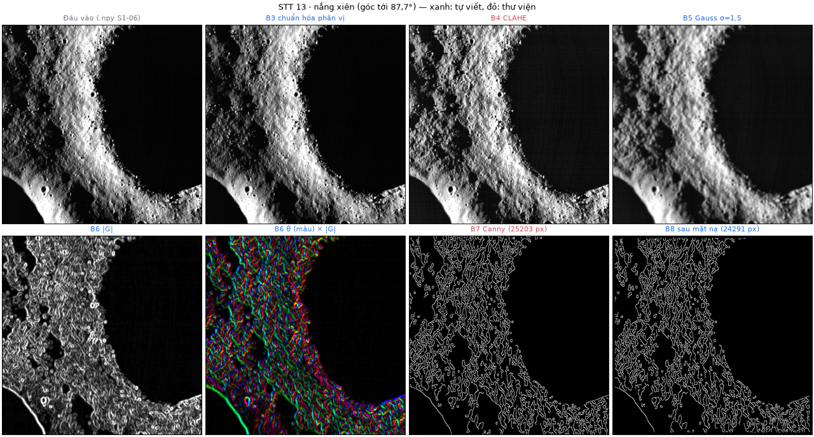

# Báo cáo bài tập lớn — nguồn Markdown (S3-12)

Báo cáo cuối được ghép từ các file `NN_*.md` trong thư mục này, theo thứ tự tên file, bằng `scripts/build_report.py`. File này (README) không được ghép.

## 1. Ai viết, ai chốt

| File | Nội dung | Bản ghép đầu tiên | Người chốt nội dung (mã việc) |
|---|---|---|---|
| `00_mo_dau.md` | Bìa, mục lục, danh mục ký hiệu và chữ viết tắt | Đức | Đức (S3-12). Cả nhóm điền tên trường, mã lớp, MSSV, giảng viên |
| `01_chuong_1_gioi_thieu.md` | Chương 1. Giới thiệu | Đức, từ `CHUONG_1_NHAP.md` | Đức (S3-08) |
| `02_chuong_2_co_so_ly_thuyet.md` | Chương 2. Cơ sở lý thuyết | Ghép từ S1-14, S1-15, S1-12 | Tiến (S3-06) phần Hough; Hưng (S3-07) phần tiền xử lý và sáng–tối |
| `03_chuong_3_phuong_phap_cai_dat.md` | Chương 3. Phương pháp và cài đặt | Ghép từ S1-14, S1-11, S1-13, S2-01, S2-02, S2-05 | Hưng (S3-07); Tiến (S3-06) phần cài đặt Hough; thống kê chờ S2-09 |
| `04_chuong_4_du_lieu_danh_gia.md` | Chương 4. Dữ liệu, đánh giá và khảo sát | Ghép từ S1-16, S1-10, S2-03, S2-07 | Quốc Anh (S3-09); Tiến (S3-02) phần Precision/Recall |
| `05_chuong_5_he_thong_ket_luan.md` | Chương 5. Hệ thống, trò chơi và kết luận | Đức | Đức (S3-08) |
| `06_tai_lieu_tham_khao.md` | Tài liệu tham khảo (pandoc tự sinh từ `tai_lieu.bib`) | Đức | — |
| `07_phu_luc.md` | Phụ lục: phân công, đóng góp, cách chạy lại, khai báo dùng AI | Đức | Cả nhóm xác nhận phần của mình |

Bản ghép đầu tiên chỉ chuyển nội dung đã có trong repo sang dạng chương, không thêm kết quả mới. Người chốt đọc lại, sửa số liệu theo phiên bản chạy cuối và xóa các ghi chú `<!-- ... -->` khi xong.

## 2. Quy ước viết

**Cấu trúc.** Mỗi file có đúng một tiêu đề `# Chương N. Tên`. Mục con đánh số tay: `## N.M. Tên`, `### N.M.K. Tên`, không sâu hơn ba cấp. Mục lục lấy hai cấp đầu.

**Văn phong.** Tiếng Việt có dấu đầy đủ, câu ngắn, ngôi "nhóm". Báo cáo mô tả sản phẩm và kết quả, không kể tiến độ nội bộ: không ghi "PR #20", "Tiến cần…", "chờ duyệt" trong thân bài. Thông tin quy trình (PR, nhật ký) để ở Phụ lục.

**Chỉ ghi điều có bằng chứng.** Mọi con số phải có trong repo (`docs/`, `docs/evidence/`, `outputs/` được dẫn lại, test). Phần chưa có kết quả ghi đúng một dấu chờ, ví dụ `[CHỜ S3-02: bảng Precision/Recall trên tập kiểm tra]`. Script dựng báo cáo đếm và in các dấu này. Không thay kết quả thật bằng số ước lượng.

**Số và đơn vị.** Dấu thập phân là dấu phẩy trong văn bản (0,5 r; 2 m/px). Trong công thức viết `\text{0,5}` (cách viết `0{,}5` bị LibreOffice tách thành "0 , 5"). Đơn vị cách số một khoảng trắng.

**Công thức.** Công thức trong dòng dùng `$...$`. Công thức riêng dòng dùng `$$ ... \qquad (2.1) $$`, đánh số theo chương và nhắc trong văn bản là "công thức (2.1)".

**Hình.** Mỗi hình là một đoạn riêng, có số và chú thích:

```markdown
{width=85%}
```

Đường dẫn tính từ thư mục `docs/bao_cao/`. Chỉ dùng ảnh đã có trong repo (`docs/images/`, `docs/evidence/`). Hình phải được nhắc trong văn bản trước khi xuất hiện, ví dụ "Hình 3.2 cho thấy…".

**Bảng.** Dùng bảng `|...|`. Chú thích đặt ngay dưới bảng, bắt đầu bằng dấu hai chấm. Khi xuất, chú thích hiện phía trên bảng:

```markdown
| Bước | Thư viện |
|---|---|
| CLAHE | OpenCV |

: Bảng 3.1. Phần tự viết và phần dùng thư viện.
```

**Trích dẫn.** Viết `[@duda1972]` hoặc `[@duda1972; @yuen1990]`. Khóa phải có trong `tai_lieu.bib`. Pandoc tự đánh số [1], [2]… theo thứ tự xuất hiện, và tự tạo danh mục ở `06_tai_lieu_tham_khao.md` theo chuẩn IEEE (`ieee.csl`). Thêm nguồn mới thì thêm mục vào `tai_lieu.bib` kèm DOI hoặc URL và ngày truy cập. Không trích file nội bộ của repo như một tài liệu tham khảo; chỉ ghi tên file trong văn bản khi mô tả cài đặt.

**Thuật ngữ thống nhất.** Dùng: ứng viên máy (vòng Hough trả về, chưa kiểm chứng); nhãn tham chiếu (vòng do người gán và kiểm chéo); Recall trên nhãn đã biết (Recall_known); tập điều chỉnh / tập kiểm tra; tâm pixel có tọa độ nguyên; Hough tròn tự cài đặt bằng NumPy.

## 3. Dựng báo cáo

```bash
pip install -r requirements-report.txt        # pypandoc_binary (kèm pandoc), python-docx
python scripts/build_report.py                # outputs/report/BaoCao_Nhom2_NASA24.docx và .pdf
python scripts/build_report.py --no-pdf       # chỉ DOCX
python scripts/build_report.py --only 03 --no-pdf --out /tmp/ch3   # thử riêng một chương
```

Script in số chữ và số dấu `[CHỜ]` của từng file. Bản PDF cần LibreOffice và Python có module `uno` (trên Ubuntu: gói `python3-uno`; nơi khác đặt biến `REPORT_UNO_PYTHON` trỏ tới python của LibreOffice). Script tự gọi `scripts/report_to_pdf.py` để cập nhật mục lục và số trang. Nếu không có LibreOffice, mở DOCX bằng Word, nhấn Ctrl+A rồi F9 để cập nhật mục lục, sau đó lưu PDF.

Khi ghép, script đổi `\qquad (2.1)` ở cuối công thức thành 8 khoảng trắng không ngắt, vì LibreOffice bỏ khoảng trắng TeX và làm số công thức dính vào công thức. Trang bìa hiện vẫn mang số trang 1.

Định dạng do script đặt: A4, Times New Roman 13, giãn dòng 1,3; lề trái 3 cm, các lề còn lại 2 cm; số trang ở giữa chân trang; mỗi chương bắt đầu trang mới.

## 4. Kiểm tra trước khi nộp (theo yêu cầu học phần)

- [ ] Đủ 5 chương; 25–40 trang nội dung chính; tổng 30–60 trang.
- [ ] Ít nhất 10 tài liệu tham khảo, trong đó ít nhất 3 bài có DOI; trích dẫn theo IEEE.
- [ ] Không còn dấu `[CHỜ ...]` và ghi chú `<!-- ... -->`.
- [ ] Số liệu khớp phiên bản mã cuối; hình và bảng đánh số liên tục theo chương.
- [ ] Bìa đủ tên trường, mã lớp, MSSV, giảng viên.
- [ ] Phụ lục có bảng đóng góp đã được cả bốn người xác nhận và phần khai báo dùng AI.

## 5. Trạng thái bản ghép (cập nhật 27/10/2026, PR #29)

Bản dựng sau PR #29 dài 55 trang: bìa và mục lục 4 trang, nội dung chính 45 trang (trang 5–49), tài liệu tham khảo và phụ lục 6 trang. Báo cáo có 28 tài liệu, trong đó 7 bài có DOI. **Nội dung chính đang vượt mức 40 trang**, trong khi các kết quả còn chờ sẽ thêm khoảng 3–4 trang. Bảng dưới đề xuất số trang tối đa cho từng chương.

| Chương | Hiện tại | Tối đa đề xuất | Gợi ý rút gọn (người chốt quyết định) |
|---|---:|---:|---|
| 1 | 4 | 4 | Đã gộp 1.2 và 1.3, thay Bảng 1.2 bằng một đoạn (PR #29) |
| 2 | 11 | 8 | Bỏ Hình 2.2 hoặc rút 2.2.5; rút ví dụ CLAHE và 2.3.3 |
| 3 | 12 | 9 | Bảng 3.3 thành một câu; rút 3.4.2 (so với vòng ngẫu nhiên); cân nhắc bỏ Hình 3.1 |
| 4 | 11 | 10 | Đã gồm chỗ cho kết quả thí nghiệm và khảo sát; rút ví dụ quy đổi ở 4.2 và chi tiết thử nhỏ ở 4.8.3 |
| 5 | 7 | 7 | — |

Các dấu `[CHỜ]` còn lại:

- PR #26 (Tiến) chưa được merge. Các mục dùng số liệu của PR này là 1.5 (Bảng 1.1), 2.2.3, 3.3.5, 4.3.1, 4.7 và 5.7. Nếu PR này đổi cấu hình chọn ứng viên của game (review đề nghị giữ `score` cho tới khi chốt S2-15), phải kiểm lại các câu tả danh sách máy ở 1.5, 3.7, 5.4 và chụp lại Hình 5.2. Sau đó người chốt xóa dấu.
- PR #27 đã merge và đã chạy trên VPS; dấu chờ ở mục 5.2 đã xóa. Hình 5.1–5.3 chụp lại trên main `3cff367` cho kết quả như cũ (`docs/S2-13_TICH_HOP.md` mục 2.1).
- S2-09 (Hưng): mục 3.6, Bảng 1.1 và mục 5.7.
- S2-15 (Tiến): mục 3.7.
- S3-05 (Quốc Anh): mục 4.6.
- S2-07 thử nhỏ và S3-01 khảo sát (Quốc Anh, Đức): mục 4.8.
- Số test cuối: mục 5.6.
- Phụ lục A, D: cả nhóm điền.
- Bìa: còn tên khoa, mã lớp và họ tên giảng viên. Tên trường và MSSV đã điền.

Còn để người chốt quyết định: Hình 3.4, 3.5 có mã việc nội bộ trong tiêu đề ảnh; sơ đồ dạng chữ ở mục 3.1 chưa có số hình; một số nội dung lặp giữa Chương 2 và 3 (công thức (4.4) = (2.14), (3.3) = (2.24), ví dụ bước bán kính, NMS) có thể bỏ để giảm trang.

Mỗi chương có ghi chú đầu file (`<!-- ... -->`), liệt kê việc người chốt cần kiểm tra và các chỗ tài liệu nguồn lệch với mã hoặc dữ liệu. Ví dụ: bảng trong `S2-03_TAP_DIEU_CHINH.md` vẫn ghi `sparse_unreviewed`; `manifest_split.json` ghi `sun_quality` là `measured` cho 11 ảnh Apollo 16, trong khi metadata ghi `side_only` hoặc `none`.
