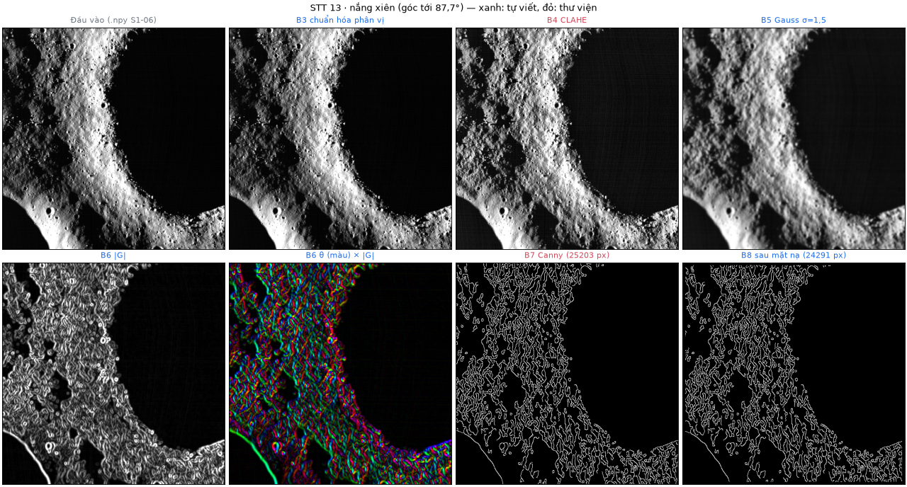

# Báo cáo bài tập lớn — nguồn Markdown (S3-12)

Báo cáo cuối được ghép từ các file `NN_*.md` trong thư mục này, theo thứ tự tên file, bằng `scripts/build_report.py`. File này (README) không được ghép.

## 1. Ai viết, ai chốt

| File | Nội dung | Bản ghép đầu tiên | Người chốt nội dung (mã việc) |
|---|---|---|---|
| `00_mo_dau.md` | Bìa, cam đoan/phân công, mục lục, danh mục hình/bảng/ký hiệu | Đức | Đức (S3-12). Cả nhóm điền tên trường, mã lớp, MSSV, giảng viên |
| `01_chuong_1_gioi_thieu.md` | Chương 1. Tổng quan bài toán | Đức, từ `CHUONG_1_NHAP.md` | Đức (S3-08) |
| `02_chuong_2_co_so_ly_thuyet.md` | Chương 2. Cơ sở lý thuyết | Ghép từ S1-14, S1-15, S1-12 | Tiến (S3-06) phần Hough; Hưng (S3-07) phần tiền xử lý và sáng–tối |
| `03_chuong_3_phuong_phap_cai_dat.md` | Chương 3. Thiết kế và cài đặt | Ghép từ S1-14, S1-11, S1-13, S2-01, S2-02, S2-05 | Hưng (S3-07); Tiến (S3-06) phần cài đặt Hough; Hưng phần thống kê; Đức kiến trúc/game |
| `04_chuong_4_du_lieu_danh_gia.md` | Chương 4. Thực nghiệm và đánh giá | Ghép từ S1-16, S1-10, S2-03, S2-07 | Quốc Anh (S3-09); Tiến (S3-02) phần Precision/Recall |
| `05_chuong_5_he_thong_ket_luan.md` | Chương 5. Kết luận và hướng phát triển | Đức | Đức (S3-08) |
| `06_tai_lieu_tham_khao.md` | Tài liệu tham khảo (pandoc tự sinh từ `tai_lieu.bib`) | Đức | — |
| `07_phu_luc.md` | Phụ lục A–E: cách chạy, mã kiểm, nhật ký, AI, liên kết bổ sung | Đức | Cả nhóm xác nhận phần của mình |

Bản ghép đầu tiên chỉ chuyển nội dung đã có trong repo sang dạng chương, không thêm kết quả mới. Người chốt đọc lại, sửa số liệu theo phiên bản chạy cuối và xóa các ghi chú `<!-- ... -->` khi xong.

## 2. Quy ước viết

**Cấu trúc.** Mỗi file có đúng một tiêu đề `# Chương N. Tên`. Mục con đánh số tay: `## N.M. Tên`, `### N.M.K. Tên`, không sâu hơn ba cấp. Mục lục lấy hai cấp đầu.

**Văn phong.** Tiếng Việt có dấu đầy đủ, câu ngắn, ngôi "nhóm". Báo cáo mô tả sản phẩm và kết quả, không kể tiến độ nội bộ: không ghi "PR #20", "Tiến cần…", "chờ duyệt" trong thân bài. Thông tin quy trình (PR, nhật ký) để ở Phụ lục.

**Chỉ ghi điều có bằng chứng.** Mọi con số phải có trong repo (`docs/`, `docs/evidence/`, `outputs/` được dẫn lại, test). Phần chưa có kết quả ghi đúng một dấu chờ, ví dụ `[CHỜ S3-02: bảng Precision/Recall trên tập kiểm tra]`. Script dựng báo cáo đếm và in các dấu này. Không thay kết quả thật bằng số ước lượng.

**Số và đơn vị.** Dấu thập phân là dấu phẩy trong văn bản (0,5 r; 2 m/px). Trong công thức viết `\text{0,5}` (cách viết `0{,}5` bị LibreOffice tách thành "0 , 5"). Đơn vị cách số một khoảng trắng.

**Công thức.** Công thức trong dòng dùng `$...$`. Công thức riêng dòng dùng `$$ ... \qquad (2.1) $$`, đánh số theo chương và nhắc trong văn bản là "công thức (2.1)".

**Hình.** Mỗi hình là một đoạn riêng, có số và chú thích:

```markdown
{width=85%}
```

Đường dẫn tính từ thư mục `docs/bao_cao/`. Dùng PNG, giữ nguồn gốc trong evidence. Chỉ dùng ảnh đã có trong repo (`docs/images/`, `docs/evidence/`). Hình phải được nhắc trong văn bản trước khi xuất hiện, ví dụ "Hình 3.2 cho thấy…".

**Bảng.** Dùng bảng `|...|`. Chú thích đặt ngay dưới bảng, bắt đầu bằng dấu hai chấm. Khi xuất, chú thích hiện phía trên bảng:

```markdown
| Bước | Thư viện |
|---|---|
| CLAHE | OpenCV |

: Bảng 3.1. Phần tự viết và phần dùng thư viện.
```

**Trích dẫn.** Viết `[@duda1972]` hoặc `[@duda1972; @yuen1990]`. Khóa phải có trong `tai_lieu.bib`. Pandoc tự đánh số [1], [2]… theo thứ tự xuất hiện, và tự tạo danh mục ở `06_tai_lieu_tham_khao.md` theo chuẩn IEEE (`ieee.csl`). Thêm nguồn mới thì thêm mục vào `tai_lieu.bib` kèm DOI hoặc URL và ngày truy cập. Hai nguồn học phần chỉ ghi tên “Quy định BTL Xử lý ảnh” và “Danh sách đề tài NASA, Đề 24”; diễn giải ngắn bằng lời của nhóm, không chép dài nội dung đề. Không trích file nội bộ của repo như một tài liệu tham khảo; chỉ ghi tên file trong văn bản khi mô tả cài đặt.

**Thuật ngữ thống nhất.** Dùng: ứng viên máy (vòng Hough trả về, chưa kiểm chứng); nhãn tham chiếu (vòng do người gán và kiểm chéo); Recall trên nhãn đã biết (Recall_known); tập điều chỉnh / tập kiểm tra; tâm pixel có tọa độ nguyên; Hough tròn tự cài đặt bằng NumPy.

## 3. Dựng báo cáo

```bash
pip install -r requirements-report.txt        # pypandoc_binary (kèm pandoc), python-docx
python scripts/build_report.py                # outputs/report/BaoCao_Nhom2_NASA24.docx và .pdf
python scripts/build_report.py --no-pdf       # chỉ DOCX
python scripts/build_report.py --only 03 --no-pdf --out /tmp/ch3   # thử riêng một chương
```

Script in số chữ và số dấu `[CHỜ]` của từng file. Bản PDF cần LibreOffice và Python có module `uno` (trên Ubuntu: gói `python3-uno`; nơi khác đặt biến `REPORT_UNO_PYTHON` trỏ tới python của LibreOffice). Script tự gọi `scripts/report_to_pdf.py` để cập nhật mục lục và số trang, lưu DOCX qua bộ lọc `Office Open XML Text`, mở lại để ổn định dàn trang, cập nhật/lưu trường lần nữa rồi xuất PDF. `--no-pdf` chỉ tạo bản nháp, chưa cập nhật mục lục; không dùng bản đó để nộp. Nếu không có LibreOffice, mở DOCX bằng Word, nhấn Ctrl+A rồi F9 để cập nhật mục lục, sau đó lưu PDF.

Khi ghép, script đổi `\qquad (2.1)` ở cuối công thức thành 8 khoảng trắng không ngắt, vì LibreOffice bỏ khoảng trắng TeX và làm số công thức dính vào công thức. Trang bìa hiện vẫn mang số trang 1. Danh mục hình/bảng sinh từ chú thích, số trang dùng trường PAGEREF được cập nhật cùng mục lục. PDF xuất ảnh bằng nén không mất dữ liệu, không giảm độ phân giải; DOCX giữ ảnh PNG. Thân bài dùng Times New Roman; công thức có thể dùng font toán thay thế.

Định dạng do script đặt: A4, Times New Roman 13, giãn dòng 1,3; lề trái 3 cm, phải 2 cm, trên/dưới 2,5 cm; số trang ở giữa chân trang; mỗi chương bắt đầu trang mới.

## 4. Kiểm tra trước khi nộp (theo yêu cầu học phần)

- [ ] Đủ 5 chương; 25–40 trang nội dung chính; tổng 30–60 trang.
- [ ] Ít nhất 10 tài liệu tham khảo, trong đó ít nhất 3 bài có DOI; trích dẫn theo IEEE.
- [ ] Không còn dấu `[CHỜ ...]` và ghi chú `<!-- ... -->`.
- [ ] Số liệu khớp phiên bản mã cuối; hình và bảng đánh số liên tục theo chương.
- [ ] Bìa đủ tên trường, mã lớp, MSSV, giảng viên.
- [ ] Phụ lục có bảng đóng góp đã được cả bốn người xác nhận và phần khai báo dùng AI.

## 5. Đối chiếu quy định học phần (01/11/2026, S3-12 r5)

Nền `94c17ff`, nhánh `s3-12-doi-chieu-de-goc`, đã gồm PR #40. Ngân sách dưới đây theo **Quy định BTL Xử lý ảnh** (tài liệu học phần), thay bảng ngân sách cũ. Bản nền dựng lại có 56 trang, 37 trang chính; bản đối chiếu có **44 trang, phần chính 33 trang (7–39)**. Chương 3+4 có 21/33 trang (63,6 %). Số trang đo từ PDF bằng pypdf, có thể đổi khi điền kết quả còn thiếu hoặc đổi môi trường dựng.

| Phần | Nền 94c17ff | Bản r5 | Ngân sách | Người chốt |
|---|---:|---:|---:|---|
| Mở đầu | 4 | 6 | 4–6 | Đức; cả nhóm ký và chốt tỷ lệ |
| Chương 1 | 3 | 3 | 3–4 | Đức |
| Chương 2 | 9 | 7 | 5–8 | Tiến; Hưng tiền xử lý/sáng–tối |
| Chương 3 | 10 | 9 | 6–10 | Tiến Hough; Hưng hậu xử lý/thống kê; Đức kiến trúc/game |
| Chương 4 | 9 | 12 | 7–12 | Quốc Anh; Hưng dữ liệu/thống kê; Tiến Hough |
| Chương 5 | 6 | 2 | 1–2 | Đức |
| Tài liệu tham khảo | 3 | 2 | 1–2 | Cả nhóm |
| Phụ lục | 12 | 3 | Không giới hạn, ưu tiên liên kết GitHub | Cả nhóm |

Ví dụ 5×5 đã trở lại Chương 2; Chương 3 có chín khối giả mã đánh số dòng, đầu vào/đầu ra, độ phức tạp, bảng sai số số học mới trên 26 ảnh. Giữ `dedupe_circles` và ví dụ M32/M8. Thiết kế ứng dụng chuyển từ Chương 5 về Chương 3; hình và kết quả sang Chương 4. Hình 5.1–5.3 cũ nay là Hình 4.5–4.7, PNG cùng pixel giải mã từ bằng chứng JPEG S3-08; không coi chuyển định dạng là khôi phục chi tiết đã mất hay một lượt chụp mới.

Phụ lục A hướng dẫn chạy; B dẫn mã kiểm ví dụ; C tóm tắt tuần và dẫn nhật ký; D khai báo AI; E chỉ dẫn liên kết. Chi tiết cũ được giữ trong [chi_tiet_bo_sung.md](chi_tiet_bo_sung.md), đóng góp/đánh giá chéo trong [dong_gop_va_danh_gia.md](dong_gop_va_danh_gia.md), hai file không ghép vào PDF. Liên kết `main` tới file mới chỉ có hiệu lực sau khi tích hợp.

Còn **14 dấu chờ trong bản ghép**, cùng **17 dấu chờ** ở file đóng góp/đánh giá chéo được dẫn từ phụ lục; việc chuyển file không có nghĩa đã hoàn thành:

| Nơi | Số dấu | Ai cần bổ sung |
|---|---:|---|
| Mở đầu | 1 | Cả nhóm thống nhất tỷ lệ tổng 100 %, ký cam đoan/phân công; không điền thay |
| Chương 4 | 2 | Tiến: tên CPU/RAM đúng máy Windows 27/10; Quốc Anh: kết quả S3-05 sau PR #38 |
| Chương 5 | 1 | Quốc Anh: kết luận S3-05 theo kết quả đã tích hợp |
| Phụ lục C | 1 | Cả nhóm: ngày họp thật, nội dung/phân công/trạng thái; ngày công việc CSV chưa phải biên bản họp |
| Phụ lục D | 9 | Tiến, Hưng, Quốc Anh tự khai AI, phần sử dụng và cách kiểm soát |
| File đóng góp/đánh giá chéo | 17 | Cả nhóm xác nhận đóng góp, tỷ lệ, tự/đánh giá chéo; giữ nguyên các ô cá nhân |

Môi trường lượt Linux 31/10 dùng đúng hồ sơ S3-10, hồ sơ đó chưa có RAM; không thay bằng cấu hình máy đo khác. Lượt kiểm số học 01/11 có môi trường riêng trong `docs/evidence/s3-12/`. Số test ở mục 3.8: 338 test Python và 6 bộ JavaScript, đo ngày 01/11/2026 trên main `59cf4e3` ghép nhánh `s3-16-doi-chieu-de-goc` (thêm 5 test đóng gói) và nhánh này; đúng khi PR S3-16 được merge. r6 không chạy lại toàn bộ kiểm thử ứng dụng.

Đối chiếu Đề 24 vẫn có phần chưa đạt: chưa có Sao Hỏa; chưa ghép danh mục/đo Precision; chưa khảo sát ≥10 học sinh; thẻ theo vùng thay vì kích hoạt khi tìm thấy; nhóm 4 người thay vì 5 theo quy định. Nêu ở Chương 1/5, không xem chỉnh văn bản là hoàn thành chức năng. S3-05 và các xác nhận con người vẫn chờ. Đây là **bản làm việc**, chưa đủ điều kiện nộp cuối; chủ phần cần xác nhận bản diễn đạt lại và hoàn tất các ô của mình.

## 6. Hiệu chỉnh bảng chuyển/cắt sau kiểm r5 (r6)

R5-03 phát hiện hai ví dụ số đã bị bỏ khỏi bản r5 dù câu dẫn nói có ở tài liệu bổ sung. r6 khôi phục nguyên văn từ mốc `94c17ff`, không coi chúng đã được giữ trong r5.

| Mục nguồn tại 94c17ff | Đích sau r6 | Nội dung khôi phục và lý do | Chủ phần |
|---|---|---|---|
| 2.2.5, dòng 111 | Tài liệu bổ sung E.9; dẫn từ 2.2.4 | Điều kiện góc 180/π ≈ 57,3; 360 độ lệch lần đầu ở r=62, dao động 352–360 tới r=66, ổn định từ r=67 trong dải xét. Khôi phục ví dụ minh họa lượng tử hóa | Tiến |
| 2.2.6, dòng 125 | Tài liệu bổ sung E.9; dẫn từ 2.2.4 | Tổng 35.365/36.445 độ lệch; 24.291 điểm biên cho 859.051.215 ≈ 8,6×10^8 phiếu trước cắt biên. Khôi phục minh họa chi phí, giữ ký hiệu lịch sử và nguồn | Tiến |
