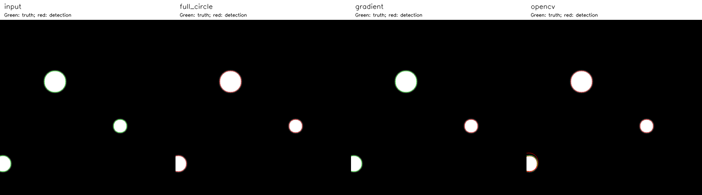
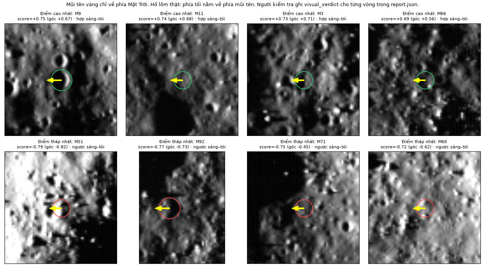
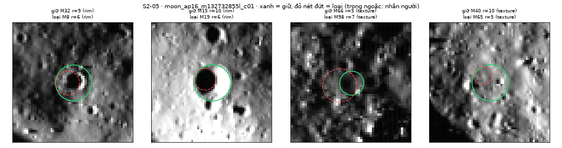
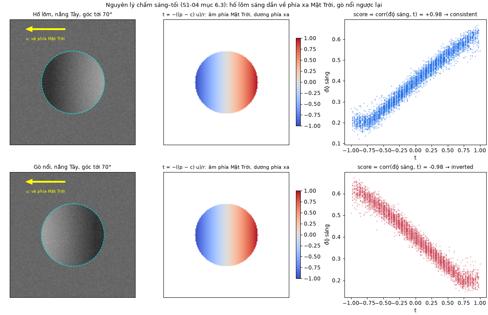

# Chi tiết thuật toán và bằng chứng bổ sung

Tài liệu bổ sung ngoài bản PDF. Giữ số liệu và minh họa từ Phụ lục E ở mốc 94c17ff; số mục/chương trong các đoạn lịch sử là số của bản đó. Bản báo cáo hiện hành đưa ví dụ 5×5 về Chương 2 và giả mã về Chương 3. Các ký hiệu trích dẫn tra trong [tai_lieu.bib](tai_lieu.bib).

### E.1. Chi tiết Hough

Hình E.1 so sánh ba cách trên cùng ảnh giả lập, dải bán kính 18–36 px. Bỏ phiếu toàn vòng tìm đúng ba đĩa. Bỏ phiếu theo gradient chỉ giữ đĩa r = 20, vì tại tâm hai đĩa kia số phiếu (40 và 27) thấp hơn ngưỡng (71 và 53). OpenCV trả bốn vòng: sau khi trừ 0,5 px, ba vòng trùng tâm thật, bán kính lệch dưới 1 px; vòng thứ tư lệch 5,39 px gần đĩa bị cắt mép. Đây chỉ là minh họa thuật toán, không chứng minh cách nào tốt hơn trên ảnh Mặt Trăng.

{width=100%}

Giả mã dưới đây bám theo cài đặt; B là số điểm biên mỗi lô.

```text
(ys, xs) ← các điểm biên; nếu không có: trả []
U ← []
với r = r_min, r_min + Δr, ... ≤ r_max:
    A ← mảng H×W toàn 0
    nếu toàn vòng: D ← (2.9); S ← |D|
        với mỗi lô B điểm biên: cộng phiếu (2.10) bằng
            bincount trên đoạn [min i, max i], i = b·W + a
    ngược lại: S ← ⌈2πr⌉; cộng phiếu hai tâm (2.11)
    τ ← max(v_min, ⌈κ·S⌉)
    thêm (A/S, A, b, a, r) của mọi cực đại 3×3 có A ≥ τ vào U
sắp U: điểm giảm, phiếu giảm, rồi y, x, r tăng
chế độ cân bằng: xen kẽ U giữa các nhóm bán kính
G ← []
với mỗi u trong U: nếu không g ∈ G nào thỏa (2.13) thì thêm u
    vào G; dừng khi |G| = L
trả G
```

Ví dụ dùng đúng các hàm nội bộ của bước Hough, trên ảnh biên 5 × 5, r = 1; bán kính và ngưỡng nhỏ chỉ để minh họa. Bốn điểm biên $P_1 = (2, 1)$, $P_2 = (1, 2)$, $P_3 = (3, 2)$, $P_4 = (2, 3)$ đều cách (2, 2) đúng 1 px. Với bước 1°, 360 góc chỉ cho 8 độ lệch (±1, ±1), (±1, 0), (0, ±1), nên $S_1 = 8$. Mỗi điểm bỏ 8 phiếu tại $(x - d_x,\ y - d_y)$, tổng 32 phiếu, đều trong ảnh. Bốn phiếu rơi vào (2, 2), chỉ số phẳng 2·5 + 2 = 12: $P_1$ với (0, −1), $P_2$ với (−1, 0), $P_3$ với (1, 0), $P_4$ với (0, 1). Mảng tích lũy sau $P_1$ và sau cả bốn điểm:

```text
sau P1:        sau P1..P4:
0 1 1 1 0      0 1 1 1 0
0 1 0 1 0      1 2 2 2 1
0 1 1 1 0      1 2 4 2 1
0 0 0 0 0      1 2 2 2 1
0 0 0 0 0      0 1 1 1 0
```

Với $v_{\min} = 3$ và κ = 0,35, (2.12) cho $\tau_1 = \max(3, \lceil \text{2,8} \rceil) = 3$. Chỉ ô (2, 2) vượt ngưỡng và lớn hơn tám ô kề, nên kết quả là tâm (2, 2), r = 1, q = 4/8 = 0,5; với $v_{\min}$ mặc định bằng 12 thì không có đỉnh. Nếu gradient lý tưởng hướng ra ngoài, (2.11) cho 4 phiếu tại tâm và 1 phiếu ở mỗi ô (2, 0), (0, 2), (4, 2), (2, 4); $S_1 = \lceil 2\pi \rceil = 7$ nên q = 4/7 ≈ 0,571. Cả hai kết quả được kiểm chứng tự động bằng mã.

### E.2. Chạy chuỗi và kiểm chứng tiền xử lý

Lần chạy cả bộ 26 ảnh ngày 15/10/2026 không gặp lỗi. Tiền xử lý mất 0,025–0,071 s mỗi ảnh, Hough mất 5,1–8,3 s trên máy phát triển. Cả 26 ảnh đều trả đúng 100 ứng viên, tức chạm giới hạn `max_circles`. Hình E.2 là overlay của một lần chạy: vòng máy rải khắp ảnh, phần lớn là vòng nhỏ trên biên kết cấu (mục 3.7).

{width=75%}

Bộ kiểm thử `tests/test_preprocessing.py` (33 bài) so phần tự viết với `cv2.resize(INTER_AREA)`, `cv2.GaussianBlur` và `cv2.Sobel`, theo tiêu chí sai khác nhỏ hơn $10^{-5}$. Đo một lần trên STT 13, sai khác lớn nhất là $\text{6,0} \cdot 10^{-8}$ (thu nhỏ khối), $\text{1,8} \cdot 10^{-7}$ (Gauss) và $\text{3,6} \cdot 10^{-7}$ (Sobel).

Khác đặc tả ban đầu, CLAHE chạy trên ảnh 8 bit thay vì 16 bit. Với 16 bit, ô 64 × 64 px và các `clipLimit` thường dùng, ngưỡng cắt mỗi bin của OpenCV luôn bằng 1 nên `clipLimit` mất tác dụng (mục 2.1): trên vùng phẳng có nhiễu, độ lệch chuẩn 0,020 tăng lên 0,188 với mọi `clipLimit` 1, 2, 4, còn bản 8 bit cho 0,038; 0,056 và 0,090. Riêng phép lượng tử về 8 bit ảnh hưởng không đáng kể: hướng gradient lệch trung vị 0,05–0,08°, biên Canny trùng 93–96 %.

**Danh sách máy luôn chạm trần.** Cả 26 ảnh đều trả đúng 100 ứng viên. Trên 4 ảnh đo ở bước rà biên (mục 3.4.3), 80–94 vòng có r = 5–6 px và không vòng nào có r > 12 px, dù dải tìm lên tới 100–125 px. Không thể đọc số 100 thành số hố.

**Hố lớn bị bỏ sót dù nằm trong dải tìm.** STT 17 có 10 nhãn tham chiếu thưa, bán kính 8–22 px, đều nằm trong dải tìm 5–125 px. Hough dừng ở 100 vòng bán kính 5–10 px, nên Recall_known = 0/10. Đổi `min_vote_ratio` (0,30; 0,40) hay `radius_step_px` (2) vẫn cho 0/10, và đổi từng tham số tiền xử lý chỉ đưa bán kính lớn nhất lên 8–16 px. Nút thắt vì vậy nằm ở cách xếp hạng theo tỷ lệ phiếu và cắt ở 100 đỉnh. Bản sửa ở mục 3.3.5 đưa được vòng lớn hơn vào danh sách, nhưng Recall_known vẫn thấp.

Các số đo phụ đối chiếu OpenCV và lượng tử 8 bit ở trên lấy từ `docs/S1-14_NHAP_CHUONG_2_3.md` mục 3.2.5–3.2.6; chưa có script tái tạo trong repo.

### E.3. Chi tiết cài đặt và tăng tốc Hough

Tọa độ điểm biên được lấy một lần bằng `np.nonzero`. Ở mỗi bán kính r, với 360 mẫu góc, bảng độ lệch $(\mathrm{rint}(r\cos\varphi), \mathrm{rint}(r\sin\varphi))$ được làm tròn bằng `np.rint` [@numpy_rint] rồi khử trùng bằng `np.unique`, để mỗi pixel lệch chỉ bỏ phiếu một lần. Số độ lệch khác nhau $S_r$ là số điểm hỗ trợ, ví dụ 48 với r = 6 và 80 với r = 10. Mỗi bán kính dùng một accumulator int32 cỡ 512 × 512 (1 MiB); mã không giữ khối ba chiều mà chỉ lưu các đỉnh. Điểm biên được bỏ phiếu theo lô 256 điểm: phép trừ có broadcast tạo ma trận tâm 256 × $S_r$, tâm ngoài ảnh bị loại, chỉ số phẳng được đếm bằng `np.bincount` [@numpy_bincount]. Đoạn mã rút gọn từ hàm `_accumulate` (đổi tên biến cho ngắn):

```python
cx = xs[s:s + B, None] - dx     # a = x - r*cos(phi)
cy = ys[s:s + B, None] - dy     # b = y - r*sin(phi)
ok = (cx >= 0) & (cx < W) & (cy >= 0) & (cy < H)
idx = cy[ok] * W + cx[ok]
lo, hi = int(idx.min()), int(idx.max()) + 1
acc[lo:hi] += np.bincount(idx - lo, minlength=hi - lo)
```

Bản đầu gọi `np.bincount` dài 512 × 512 cho mỗi lô, dù lô điểm biên lấy theo hàng thường chỉ bỏ phiếu vào một dải hẹp. Bản tối ưu chỉ đếm trong đoạn chỉ số có phiếu (dòng cuối đoạn mã trên), không đổi phiếu, ngưỡng hay NMS. Phép đo ngày 24/10/2026 trên một máy Windows 11 (Python 3.12.10, NumPy 2.5.4) dùng cùng ảnh biên, cấu hình và dải bán kính, đo 5 lần mỗi bản sau một lần khởi động (Bảng E.1). Ở mọi lần đo, hai bản cho danh sách vòng giống hệt nhau.

| Ảnh | Pixel biên | r quét (px) | Bản cũ (s) | Bản tối ưu (s) | Tăng tốc |
|---|---:|---|---:|---:|---:|
| STT 10 | 26.883 | 5–125 | 21,77 | 9,06 | 2,40× |
| STT 13 | 24.291 | 5–125 | 58,98 | 26,11 | 2,26× |
| STT 1, ảnh cắt c01 (20 m/px) | 27.996 | 5–100 | 51,52 | 24,51 | 2,10× |

: Bảng E.1. Trung vị thời gian Hough trước và sau tối ưu (5 lần đo mỗi bản).

Hệ số 2,10–2,40 lần chỉ đúng cho ba ảnh và máy đo này; cùng ảnh STT 10, bản cũ chỉ mất 7,1 s trên máy phát triển ngày 15/10/2026. Năm bài kiểm thử so phiếu với một vòng lặp vô hướng độc lập, và lần kiểm tra hồi quy cho 209/209 bài kiểm thử Python đạt.

| Tham số | Giá trị | Vai trò |
|---|---|---|
| `voting_method` | `full_circle` | Cách bỏ phiếu |
| `radius_step_px` | 1 | Bước bán kính (px) |
| `r_min_limit_px` ; `r_max_limit_px` | 5 ; 128 | Giới hạn bán kính (px) |
| `angle_step_deg` | 1,0 | Bước góc của bảng độ lệch |
| `min_votes` ; `min_vote_ratio` | 12 ; 0,35 | $v_{\min}$ và $\kappa$ trong công thức (2.12) |
| `nms_center_px` ; `nms_radius_px` | 4,0 ; 2 | Ngưỡng tâm và bán kính của NMS (px) |
| `max_circles` | 100 | Số vòng tối đa mỗi ảnh |
| `edge_batch_size` | 256 | Số điểm biên mỗi lô |

: Bảng E.2. Tham số Hough trong `configs/s201_hough.json`.

### E.4. Giả mã sáng–tối và phân lớp ứng viên

```text
score_one(I, V, (x_c, y_c, r), u):
    P ← pixel hợp lệ trong đĩa |p − c| ≤ r
    nếu |P| < 30 hoặc |P| < 0,8 · (số pixel của đĩa): trả not_checked
    t_k ← −((p_k − c) · u) / r                với mọi p_k ∈ P
    S_raw ← tương quan Pearson giữa I(P) và t
    Q ← pixel hợp lệ trong vành 1,3r < |p − c| ≤ 2r
    nếu |Q| < 30 hoặc |Q| < 0,5 · (số pixel của vành): trả not_checked
    (a, b, e) ← bình phương tối thiểu trên Q:
                I ≈ a + b (x − x_c)/r + e (y − y_c)/r
    S ← tương quan Pearson giữa I(P) − mặt phẳng(P) và t
    nếu nhãn(S_raw) ≠ nhãn(S): trả unclear
    trả nhãn(S)                               hợp / ngược / không rõ
```

Gọi n là số vòng và $r_{\max}$ là bán kính lớn nhất. Mỗi vòng duyệt $O(r^2)$ pixel trong đĩa và vành; bài toán bình phương tối thiểu chỉ có 3 ẩn nên cũng $O(r^2)$. Cả bước tốn $O\big(\sum_i r_i^2\big) \le O(n\, r_{\max}^2)$ thời gian và $O(r_{\max}^2)$ bộ nhớ phụ.

{width=75%}

```text
review_candidates(các vòng, gray, |G|, θ, E, V):
    B ← vùng liền khối {gray < 0,06} có diện tích ≥ 1.500 px     (OpenCV)
    E_bóng ← E ∧ giãn(B, 2 px)            (giãn = co phần bù, tự viết)
    với mỗi vòng (c, r):
        Z ← điểm biên trong dải |d − r| ≤ 1,5 px
        phủ ← (số cung 10° có điểm biên xuyên tâm) / 36
              điểm xuyên tâm: |cos(θ − góc từ tâm)| ≥ cos 30°
        nổi ← trung bình |G| trên Z xuyên tâm
              / trung vị |G| trên vành [1,3r; 2r]
        bóng ← tỷ lệ điểm của Z thuộc E_bóng
        nếu bóng ≥ 0,5:                          lớp ← shadow_edge
        ngược lại nếu phủ < 0,5 hoặc nổi < 1,5:  lớp ← texture
        ngược lại:                               lớp ← rim
```

Với ảnh N = H·W pixel, tìm vùng liền khối và giãn 2 px tốn O(N); mỗi vòng duyệt $O(r)$ pixel trên dải và $O(r^2)$ pixel trên vành ngoài, nên cả bước tốn $O\big(N + \sum_i r_i^2\big)$. Luật không dùng điểm sáng–tối, để hai bằng chứng độc lập nhau. Hàm riêng `apply_filter` mới thực sự loại vòng và ghi lý do; hàm báo lỗi khi tên lớp hoặc tên nhãn sáng–tối sai, thay vì im lặng không loại gì.

{width=75%}

### E.5. Kiểm chứng lọc trùng

| # | Trường hợp | Mong đợi |
|---:|---|---|
| 1–2 | STT 13: M8 trong M32; M19 trong M15 | Giữ M32; giữ M15 |
| 3 | STT 17: M66/M67, cùng r = 7, tâm cách 5 px | Giữ 1 vòng |
| 4 | Ba vòng cùng một hố (r = 12, 9, 7) | Giữ r = 12 |
| 5–6 | Vòng ngoài thuộc lớp `texture`; vòng ngoài ít phiếu (tỷ lệ 0,25) | Giữ vòng trong |
| 7 | Hai hố chạm mép (d = R + r) | Giữ cả hai |
| 8 | Hai hố chồng mép (d = 14, R = 10, r = 8) | Giữ cả hai |
| 9 | Hố nhỏ trong hố lớn (r/R = 0,3) | Giữ cả hai |
| 10 | Cụm 4 hố gần nhau | Giữ cả bốn |

: Bảng E.3. Bộ ví dụ kiểm tra lọc trùng; bốn ca cuối không được xóa vòng nào. Cả 10 ca đều đạt.

Với n vòng và k vòng giữ lại, tính tỷ lệ phiếu tốn $O(n\,T\log T)$ với T = 360 mẫu góc (khử trùng độ lệch bằng sắp xếp), sắp xếp tốn $O(n \log n)$, vòng lặp so mỗi vòng với các vòng đã giữ tốn $O(n\,k) \le O(n^2)$.

{width=75%}

### E.6. Chi tiết thống kê

```text
region_count(các ô, D_min, D_max):
    kiểm tra mọi ô cùng tỷ lệ s và cùng ảnh nguồn
    U ← hợp các mặt nạ (vùng đếm ∧ hợp lệ) trên tọa độ ảnh nguồn
    H ← []
    với mỗi ô, mỗi vòng (x, y, r):
        D ← 2rs
        nếu D ∉ [D_min, D_max) hoặc tâm ∉ vùng đếm: bỏ qua
        nếu ∃ h ∈ H cùng hố (tâm lệch ≤ 0,5R, r/R ≥ 0,7): gộp vào h
        ngược lại: thêm vòng vào H
    A ← |U| · s² / 10⁶;  ρ ← |H| / A;  khoảng tin cậy theo (3.2)
```

Với M pixel trong các ô và n vòng, dựng mặt nạ hợp tốn O(M), gộp hố trùng giữa các ô tốn $O(n^2)$ trong trường hợp xấu nhất, histogram với b bin tốn $O(n\,b)$. Mỗi khoảng tin cậy tốn O(200·n) vì mỗi bước chia đôi tính hàm phân phối Poisson trong O(n); kiểm định nhị thức tính $N_1 + N_2 + 1$ xác suất. Bộ kiểm thử `tests/test_statistics.py` (12 bài) kiểm tra mật độ trên diện tích, dải D theo mét, chỉ đếm tâm trong vùng, ô chồng nhau chỉ đếm một lần, từ chối khác tỷ lệ hoặc khác dải D, và khoảng tin cậy khớp bảng tra.

Hàm `summarize(crater_set, metadata, valid_pixel_count)` trả đầu ra theo Bảng E.4. Giao diện kiểm hợp đồng trước khi hiện số; cách trình bày theo mục 3.6.4. Vì ứng viên máy chưa kiểm chứng, trường `limitations` ghi rõ đây là số ứng viên, không phải mật độ hố. Hàm tốn $O(n\,b)$ với n vòng và b bin.

| Khóa | Kiểu | Ý nghĩa |
|---|---|---|
| `count` | số nguyên ≥ 0 | Số vòng trong danh sách |
| `valid_area_km2` | số ≥ 0 hoặc `null` | Diện tích hợp lệ A theo công thức (2.24) |
| `density_per_km2` | số ≥ 0 hoặc `null` | Mật độ ρ; `null` khi diện tích bằng 0 |
| `histogram` | `bin_edges_m`, `counts` | Bin √2 bắt đầu tại $D_{\min}$ của ảnh |
| `limitations` | danh sách chuỗi | Lớp giao diện lọc đúng câu cảnh báo chạm trần cũ; các câu còn lại giữ nguyên |
| `density_ci95_per_km2` | hai số | Khoảng tin cậy 95 %; giao diện bỏ qua |

: Bảng E.4. Đầu ra của hàm `summarize`.

### E.7. Quy đổi tọa độ và kiểm chứng

Tâm và bán kính hố được lưu theo pixel ảnh cắt: $x$ là cột, $y$ là hàng, gốc ở góc trên-trái, tâm pixel có tọa độ nguyên. Gọi $s$ là tỷ lệ m/px của ảnh cắt. Công thức (E.1), cài trong hàm `source_coordinates` của `src/contracts.py`, đổi một vòng tròn sang ảnh nguồn:

$$ x_{\mathrm{src}} = x_0 + k\,x + \frac{k-1}{2}, \qquad y_{\mathrm{src}} = y_0 + k\,y + \frac{k-1}{2}, \qquad r_{\mathrm{src}} = k\,r \qquad (E.1) $$

Số hạng $(k-1)/2$ là độ lệch tâm khi thu nhỏ bằng trung bình khối; với $k = 1$ nó bằng 0. Ma trận affine $(a, b, c, d, e, f)$ của rasterio tính theo góc pixel, nên phải cộng 0,5 trước khi đổi sang tọa độ phẳng $(X, Y)$ tính bằng mét:

$$ \mathrm{col} = x_{\mathrm{src}} + \text{0,5}, \quad \mathrm{row} = y_{\mathrm{src}} + \text{0,5}, \quad X = a\,\mathrm{col} + b\,\mathrm{row} + c, \quad Y = d\,\mathrm{col} + e\,\mathrm{row} + f \qquad (E.2) $$

Với dữ liệu này $b = d = 0$, $a = s$, $e = -s$. Vĩ độ và kinh độ theo phép chiếu Equirectangular là

$$ \varphi = \frac{Y}{R}, \qquad \lambda = \lambda_0 + \frac{X}{R\cos\varphi_1} \qquad (E.3) $$

với bán kính Mặt Trăng $R$ = 1.737.400 m, góc tính bằng radian, $\lambda_0$ và $\varphi_1$ đọc từ CRS của ảnh nguồn. Đường kính $D = 2rs$ và dải bán kính theo (2.14).

Dải 20–500 m ở 2 m/px cho $r \in [5, 125]$ px; dải 200–4.000 m ở 20 m/px cho $r \in [5, 100]$ px. Ví dụ, tâm (255,5; 255,5) của ảnh `moon_ap16_m106777343r_c01` ($x_0 = 170$, $y_0 = 6600$, $s = 2$ m/px) đổi thành (425,5; 6855,5) trong ảnh nguồn và (−9,0717548°; 15,4355671°), khớp tọa độ tâm trong metadata. Script `scripts/verify_s116_coords.py` lặp lại phép tính cho cả 26 ảnh: 26/26 ảnh khớp, chênh lệch lớn nhất cỡ $6 \cdot 10^{-14}$ độ.

### E.8. Minh họa sáng–tối

{width=65%}


### E.9. Ví dụ lượng tử hóa và số phiếu Hough

Hai đoạn dưới giữ nguyên văn Chương 2 tại mốc `94c17ff`: [mục 2.2.5, dòng 111](https://github.com/Duckcy-Bui/nasa24-crater-stem/blob/94c17ff/docs/bao_cao/02_chuong_2_co_so_ly_thuyet.md#L111) và [mục 2.2.6, dòng 125](https://github.com/Duckcy-Bui/nasa24-crater-stem/blob/94c17ff/docs/bao_cao/02_chuong_2_co_so_ly_thuyet.md#L125). Ký hiệu theo bản lịch sử: E là số điểm biên, R/R_n là số bán kính, Θ là số góc, N = H × W là số pixel, K là tổng số đỉnh và L là trần vòng giữ. Đây là ví dụ tính toán, không phải phép đo thời gian mới.

Với bước Δr, ví dụ dải [12, 29] bước 4 chỉ quét 12, 16, 20, 24, 28, và sai số bán kính tới Δr/2. Ở bán kính r khác bán kính thật $r_0$, phiếu rải trên vòng nhỏ bán kính khoảng $\left|r - r_0\right|$ quanh tâm nên đỉnh yếu đi. Về góc, hai mẫu liền nhau cách nhau cung $r\,\Delta\varphi$, vượt 1 px khi r > 57,3 px với Δφ = 1°; $S_r$ đạt 360 lần đầu ở r = 62 px, dao động 352–360 tới r = 66 px và giữ 360 từ r = 67 px.

Hạng chính có dạng quen thuộc $O(E \cdot R \cdot \Theta)$, với Θ là số góc: với 24.291 điểm biên của STT 13 quét r = 5…125 bước 1°, tổng số độ lệch là 35.365, tức khoảng 8,6·10⁸ phiếu (r = 5…128 cho 36.445 độ lệch). Bỏ phiếu theo gradient tốn $O(R_n(E + N) + K\log K + K\,L)$; bước xen kẽ nhóm bán kính thêm O(K). Khối tích lũy ba chiều cần $R_n \cdot H \cdot W$ ô, tức 1 MiB mỗi mặt phẳng 512 × 512 số nguyên 4 byte và 124 MiB cho r = 5…128. Cài đặt chỉ giữ một mặt phẳng, nhưng danh sách K đỉnh vẫn gom qua mọi bán kính:

Ở bước góc 1°, điều kiện cung dài hơn 1 px là $r>180/\pi\approx57,3$ px. Số độ lệch đạt 360 từ r = 67 chỉ nói trong dải đã xét đến r = 128. Từ hai số ở đoạn trích, $24.291\times35.365=859.051.215\approx8,6\times10^8$ là số phiếu dự kiến **trước khi bỏ tâm ngoài ảnh**; dải r = 5…128 có tổng 36.445 độ lệch. Nguồn 24.291 điểm biên là STT 13 sau B8 ở mục 3.2.2 của cùng bản lịch sử.

## F. Chi tiết hồ sơ dữ liệu trước khi sắp lại chương

Số mục dưới đây giữ theo bản 94c17ff để truy nguyên các khoảng cách, kích thước gói và thông số metadata; xem Chương 4 hiện hành để đọc cấu trúc mới.

## 4.1. Nguồn ảnh và bộ dữ liệu

Nhóm dùng ảnh Mặt Trăng của camera góc hẹp (NAC) trên tàu Lunar Reconnaissance Orbiter, lấy từ kho PDS của LROC [@lroc_pds] ngày 14/10/2026, ghi công NASA/GSFC/Arizona State University. Có hai loại sản phẩm: mosaic `NAC_ROI` ở 20 m/px [@robinson2012] và ảnh NAC đơn `NAC_PHO` ở 2 m/px thuộc chuỗi E090S0155 quanh bãi đáp Apollo 16 [@martin2018]. Cả hai đều là TIFF browse 8 bit, loại ảnh dùng để xem chứ không dùng cho đo đạc định lượng [@lroc_rdrsis]. Vì vậy dữ liệu chỉ phục vụ bài toán hình học ảnh: tìm vòng tròn, đếm và so sánh.

Bộ dữ liệu `s106_lroc_browse_v2` gồm 26 ảnh cắt 512 × 512 px lấy từ 16 ảnh nguồn: 15 ảnh cắt 20 m/px từ 6 mosaic và 11 ảnh cắt 2 m/px từ 10 ảnh Apollo 16 (Bảng 4.1). STT là mã ảnh nguồn trong danh sách của nhóm.

| STT | Vùng | Tỷ lệ | Góc tới (°) | Ảnh nguồn | Ảnh cắt |
|:---------:|:----------------------------|:---------:|:------------:|:--------:|:--------:|
| 1 | Apollo 15, Mặt Trời cao | 20 m/px | 28–53 (\*) | 1 | 3 |
| 2 | Apollo 15, Mặt Trời thấp | 20 m/px | không ghi | 1 | 3 |
| 3 | Van de Graaff, Mặt Trời cao | 20 m/px | 27–45 (\*) | 1 | 2 |
| 4 | Lunokhod 1, Mặt Trời thấp | 20 m/px | 60–79 (\*) | 1 | 2 |
| 5 | Lunokhod 2, Mặt Trời thấp | 20 m/px | 56–83 (\*) | 1 | 2 |
| 6 | Mare Frigoris, Mặt Trời thấp | 20 m/px | 61–84 (\*) | 1 | 3 |
| 8–11, 13–18 | Apollo 16, chuỗi E090S0155 | 2 m/px | 7,64–87,78 | 10 | 11 |
| | **Tổng** | | | **16** | **26** |

: Bảng 4.1. Nhóm ảnh nguồn và số ảnh cắt. (\*) Dải góc tới của các ảnh thành phần trong mosaic, không phải số đo tại cửa sổ cắt.

Script `scripts/generate_s106_crops.py` cắt mỗi cửa sổ theo góc trên-trái $(x_0, y_0)$, nằm trọn trong ảnh nguồn và tránh đường ghép mosaic; ảnh không bị thu nhỏ ($k = 1$). Mặt nạ hợp lệ là giao của mặt nạ raster và điều kiện giá trị hữu hạn; pixel bằng 0 vẫn hợp lệ, và cả 26 ảnh có tỷ lệ pixel hợp lệ bằng 1,0. Giá trị pixel được chuẩn hóa về [0, 1] theo phân vị 0,5 % và 99,5 %. Metadata của mỗi ảnh ghi mã nguồn, vị trí cắt, tỷ lệ, tọa độ tâm, hướng Bắc, chiếu sáng, dải bán kính, CRS và affine của ảnh nguồn, cùng mã băm SHA-256 của script và cấu hình. Chiếu sáng có mức tin cậy `measured`, `side_only` hoặc `none`, và không ảnh nào có phương vị đo được. Tám ảnh Apollo 16 ghi `side_only` (nắng phía Tây, phương vị 270° chỉ là quy ước); STT 11, 15, 16 và 15 ảnh mosaic ghi `none`.

Toàn bộ ảnh được đóng thành một gói ngoại tuyến 12.861.130 byte, có kiểm tra SHA-256 khi cài. File `sources.json` lưu URL, kích thước và SHA-256 của 16 TIFF nguồn (503.640.706 byte), nên có thể tải lại và tái tạo ảnh cắt.

Dữ liệu phục vụ ba kiểu so sánh. Vùng 1 gồm Apollo 15 khi Mặt Trời cao (1A) và thấp (1B), ở hai tọa độ khác nhau, nên chỉ là hai nhóm điều kiện chụp. Cặp so mật độ gồm Lunokhod 1 và Mare Frigoris, cùng là biển bazan, cùng 20 m/px, cùng Mặt Trời thấp và cùng dải đường kính 300–2.000 m (mục 3.6). Cặp dự kiến ban đầu Van de Graaff – Mare Frigoris không dùng vì hai ảnh chụp ở góc nắng rất khác nhau; mật độ hố chỉ gợi ý tuổi tương đối [@neukum2001]. Cặp STT 9 (góc tới 81,08°) và STT 17 (7,64°) có cùng cửa sổ (1190, 2750), dùng để minh họa ảnh hưởng của chiếu sáng. Các ảnh cắt cùng mosaic có thể chồng lấp, nên không phải mẫu độc lập.

## 4.2. Quy đổi tọa độ ảnh cắt và ảnh nguồn

Tâm pixel ảnh cắt có tọa độ nguyên, x là cột, y là hàng, gốc ở góc trên-trái. `source_coordinates` trong `src/contracts.py` đổi sang ảnh nguồn bằng vị trí cửa sổ và hệ số thu nhỏ, có bù tâm pixel khi k khác 1. Khi áp dụng affine của rasterio phải cộng 0,5 vì affine dùng góc pixel. Công thức và ví dụ tọa độ địa lý ở Phụ lục E.7.

Đường kính $D = 2rs$ và dải bán kính theo (2.14): D = 20–500 m ở 2 m/px cho r = 5–125 px; D = 200–4.000 m ở 20 m/px cho r = 5–100 px. `scripts/verify_s116_coords.py` kiểm cả 26 ảnh: 26/26 khớp metadata, sai khác lớn nhất khoảng $6 \cdot 10^{-14}$ độ.

## 4.3. Nhãn tham chiếu

### 4.3.1. Gán nhãn và kiểm chéo

Nhãn tham chiếu được gán bằng `scripts/label_craters.py`: người gán nhấp vào tâm hố rồi vào một điểm trên vành, công cụ tính bán kính, kiểm tra cấu trúc dữ liệu và ghi kèm một ảnh overlay để kiểm chéo. Hố chưa chắc chắn, chẳng hạn vành xói mòn không khép kín hay nằm trong bóng sâu, có hậu tố `_uncertain` trong mã. Nhãn của nhóm là nhãn thưa: mỗi ảnh chỉ có một số hố được gán, và thiếu nhãn không có nghĩa là không có hố.

Cả 26 ảnh cắt có file nhãn, tổng cộng 241 nhãn, mỗi ảnh từ 4 đến 13 nhãn. Chỉ có 1 nhãn chưa chắc chắn (`C4_uncertain` trên `moon_ap16_m106777343r_c01`), nên 240 nhãn được dùng khi tính độ đo. Mọi nhãn nằm trong dải bán kính tìm kiếm (Bảng 4.2).

| Vùng mặt đất | Tập | Ảnh cắt | Nhãn | Chưa chắc | $r$ (px) | $D$ (m) |
|:------------------------|:-----------|:-------:|:------:|:-------:|:----------:|:-----------:|
| Apollo 16 (2 m/px) | điều chỉnh | 11 | 111 | 1 | 5,15–26 | 21–104 |
| Apollo 15, Mặt Trời cao | điều chỉnh | 3 | 24 | 0 | 7–30 | 280–1.200 |
| Van de Graaff | điều chỉnh | 2 | 21 | 0 | 7–20 | 280–800 |
| Lunokhod 1 | điều chỉnh | 2 | 19 | 0 | 7,5–55 | 300–2.200 |
| Apollo 15, Mặt Trời thấp | kiểm tra | 3 | 26 | 0 | 8–32 | 320–1.280 |
| Lunokhod 2 | kiểm tra | 2 | 18 | 0 | 8–50 | 320–2.000 |
| Mare Frigoris | kiểm tra | 3 | 22 | 0 | 7,5–24 | 300–960 |
| **Tổng** | | **26** | **241** | **1** | 5,15–55 | |

: Bảng 4.2. Nhãn tham chiếu theo vùng mặt đất. Các vùng ngoài Apollo 16 có tỷ lệ 20 m/px.

Cả 26 file ghi nguồn `manual_label_s110; sparse manual labels, reviewed by Nguyen Manh Tien`. Theo xác nhận của người kiểm ngày 27/10/2026, Nguyễn Mạnh Tiến đã đối chiếu bằng mắt từng vòng trên đủ 26 ảnh overlay. Kiểm tra tự động cho thấy 26/26 file khớp với manifest, chỉ mục nhãn và ảnh overlay, nhưng kiểm tra này chỉ xác nhận định dạng, không xác nhận vị trí hố.

### 4.3.2. Danh mục Robbins và nhãn mù

Danh mục hố của Robbins chỉ đầy đủ cho hố từ khoảng 1–2 km trở lên [@robbins2019]. Dải 20–500 m của ảnh 2 m/px nằm hoàn toàn dưới ngưỡng này; với ảnh 20 m/px, chỉ phần trên của dải 200–4.000 m nằm trong phạm vi đầy đủ. Nhóm chưa chiếu danh mục lên ảnh 20 m/px, vì việc đó cần quy đổi ngược theo mục 4.2, đối chiếu bằng mắt từng hố và chỉ cho một tập con hố lớn. Mọi nhãn tham chiếu hiện có đều là nhãn tay.

Bước rà biên ở Chương 3 dùng thêm nhãn mù gán trực tiếp cho ứng viên máy. Trên STT 13 (`moon_ap16_m132732855l_c01`, góc tới 87,7°), 100 ứng viên của cấu hình mặc định được đưa lên một phiếu không hiện lớp do máy xếp. Kết quả: 8 vành hố thật, 7 ranh giới bóng, 79 biên kết cấu, 6 không chắc (Đinh Quang Hưng gán, Hoàng Quốc Anh kiểm chéo, 23/10/2026). Trên STT 17, kết quả là 17 vành hố thật, 66 biên kết cấu và 17 không chắc (25/10/2026). Nhãn mù không chứa các hố máy bỏ sót, nên không dùng để tính Recall_known.

## 4.4. Tập điều chỉnh và tập kiểm tra

Tập điều chỉnh dùng để chọn tham số; tập kiểm tra chỉ dùng để báo cáo kết quả cuối. Cách chia hiện hành (phiên bản 3, `data/s203_split/manifest_split.json`) theo quy tắc: các ảnh cắt chồng lấp nhau, hoặc cùng mặt đất chụp dưới điều kiện nắng khác nhau, phải nằm cùng một tập. Vì vậy cả 11 ảnh Apollo 16 thuộc tập điều chỉnh. Các ảnh này thuộc cùng chuỗi ảnh quanh bãi đáp Apollo 16, tâm cách nhau từ 0 đến 8,06 km, trong khi mỗi ảnh cắt rộng 1.024 m: 24 trong 55 cặp chồng lấp mặt đất, với khoảng cách tâm 340–680 m tương ứng mức chồng lấp 33–67 %. Bốn ảnh STT 9, 11, 17 và 18 còn dùng chung cửa sổ (1190, 2750), và STT 13 đã được dùng để chọn cách lọc ở bước rà biên. Tập kiểm tra gồm ba vùng độc lập: Apollo 15 khi Mặt Trời thấp (cách tập điều chỉnh 50,1–62,8 km), Lunokhod 2 (721,4–726,9 km) và Mare Frigoris (1.095–1.106 km).

Tập điều chỉnh gồm 18 ảnh cắt từ bốn vùng: 11 ảnh Apollo 16 ở 2 m/px, cùng Apollo 15 khi Mặt Trời cao, Van de Graaff và Lunokhod 1 ở 20 m/px; có 174 nhãn được tính. Tập kiểm tra gồm 8 ảnh cắt 20 m/px từ ba vùng, với 66 nhãn được tính (Bảng 4.2). Chỉ 8 ảnh Apollo 16 của tập điều chỉnh thỏa điều kiện của bước sáng–tối (Chương 3): có phía nắng đã biết và góc tới từ 30° trở lên. STT 10 (28,38°) và hai ảnh cắt của STT 17 (7,64°) bị loại vì nắng gần đứng.

Cách chia có hai giới hạn. Thứ nhất, cả 8 ảnh kiểm tra đều là mosaic 20 m/px với `sun.quality = none`, nên bước sáng–tối luôn ghi `not_checked` và thí nghiệm E1 không có phép đo ngoài mẫu. Thứ hai, tập kiểm tra không có ảnh 2 m/px, nên kết quả trên Apollo 16 chỉ là kết quả chẩn đoán và được báo riêng. Khắc phục cần một cụm ảnh Apollo 16 mới, không chồng lấp với tập điều chỉnh; bộ dữ liệu hiện chưa có. Ngoài ra, hai vùng so sánh 2A và 2B nằm ở hai tập khác nhau, nên khi so mật độ cần nêu sai số phát hiện của từng vùng. Ảnh `moon_marefrig_loc_c01` của tập kiểm tra đã được dùng làm ảnh đối chứng trong thử nghiệm tiền xử lý trước khi chốt cách chia; thử nghiệm đó giữ nguyên tham số mặc định, nhưng đây vẫn là điểm cần lưu ý.
